# Company OS / Lightweight ERP

> **อัปเดตล่าสุด (2026-11-07) — Phase UI Local Complete, POS Setup Wizard (`/setup`), Phase 28 Local Closure และ Security Hardening**
> - **UI & Layout Redesign (Light / Dark / System Theme & Print Isolation):** ปรับโฉม ERP Shell (พื้นสีงาช้าง Ivory, แถบข้างสีเขียวเข้ม Deep Forest Green, สถานะสี Mint, ปุ่มหลักสี Coral) รองรับสลับโหมด `Light / Dark / System` โดยจำค่าบนอุปกรณ์ (`erp-theme.js` และ POS Theme Sync), ฟอร์มสร้างใบสั่งซื้อแบบ 2 คอลัมน์พร้อม `Preview totals` ฝั่ง Server, แสดงล็อตและวันหมดอายุในตะกร้า Pharmacy POS, และแยกหน้าพิมพ์เอกสาร/PDF พื้นขาวบริสุทธิ์ (`#FFFFFF`) ออกจากธีมหน้าจอ [ทะเบียนตรวจรับ UI](document/design/ui-acceptance-register.md) · [สถานะ Checklist](checklist.md#checklist-ปรับ-layout-ทั้งระบบ--local-complete)
> - **Full Local Project Closure & Security Hardening (2026-11-05 — 2026-11-07):** ผ่านการตรวจรับ Local Scope ครบทุกโมดูล (ERP **566+ tests / 10,933+ assertions**, Isolated MySQL Concurrency/Queue **2 tests / 20 assertions**, Standalone POS **116 tests / 2,171 assertions**, Frontend **39 tests**, Apache Loopback Security **35/35**, Dependency Audit **0 advisories**) [รายงานตรวจรับรวม](document/acceptance/local-closure-20261105/README.md) · [บทวิเคราะห์สถาปัตยกรรม](document/acceptance/local-closure-20261105/ANTIGRAVITY_REVIEW.md) · [รายงานความปลอดภัย](document/SECURITY_REVIEW_20261105.md)
> - **Standalone POS & Phase 28.8.1–28.8.5 (Local Scope Complete):** ครอบคลุม [POS Setup Wizard `/setup` & ติดตั้ง](document/README_POS.md) · [Manager `/config`](document/POS_CONFIGURATION.md) · [28.8.1 Delivery & COD](document/PHASE_28_8_1_DELIVERY.md) · [28.8.2 สมาชิกและโปรโมชัน](document/PHASE_28_8_2_MEMBERSHIP.md) · [28.8.3 Browser / PWA Offline](document/PHASE_28_8_3_OFFLINE.md) · [28.8.4 ประวัติผู้ป่วยสังเคราะห์ Pharmacy](document/PHASE_28_8_4_PATIENT_HISTORY.md) · [28.8.5 คิวครัว คิวที่นั่ง จองโต๊ะ และ QR สั่งอาหาร](document/PHASE_28_8_5_RESTAURANT.md) (**ยังไม่ได้ทดสอบกับระบบและอุปกรณ์จริง**)
> - **ฐานข้อมูลปัจจุบัน (Configured Databases):** ERP MySQL **88/88 migrations** (`173` ตาราง) และ POS SQLite **25/25 migrations** (`56` ตาราง), `pending = 0` [รายงานฐาน ERP/POS](document/DATABASE_UPDATE_20261104.md) · [รายงานฐาน POS ล่าสุด](document/DATABASE_UPDATE_20261105_PHASE28_8_5.md)

ระบบบริหารองค์กรสำหรับ SME บริษัทบริการ ทีมโครงการ และธุรกิจจัดซื้อ/คลังสินค้า เชื่อมข้อมูลลูกค้า การขาย การเงิน โครงการ สินค้าคงคลัง และบุคลากรในระบบเดียว รองรับหลายองค์กรด้วยการแยกข้อมูลและสิทธิ์ผู้ใช้งาน

## สารบัญด่วน (Table of Contents)

- [ความสามารถหลัก](#ความสามารถหลัก) · [ตัวอย่างหน้าจอจริง (UI Showcase — Light / Dark Mode)](#ตัวอย่างหน้าจอจริง-ui-showcase--light--dark-mode)
- [ฟีเจอร์แยกตามโมดูล](#ฟีเจอร์แยกตามโมดูล) · [ตารางบทบาทและสิทธิ์การใช้งาน (RBAC Roles & Access Matrix)](#ตารางบทบาทและสิทธิ์การใช้งาน-rbac-roles--access-matrix)
- [สถาปัตยกรรมระบบ (System Architecture)](#สถาปัตยกรรมระบบ-system-architecture) · [Diagrams ทั้งหมด (27 หมวด)](#diagrams-และเอกสารสถาปัตยกรรม)
- [Technology Stack & Overview Diagram](#technology-stack--overview-diagram)
- [โครงสร้างฐานข้อมูลและ ER Diagram (ครบ 225 ตาราง)](#โครงสร้างฐานข้อมูลและ-er-diagram-database-schema--table-reference)
  - [ERP Table Dictionary (170 Application Tables)](#3-คำอธิบายตารางฐานข้อมูล-erp-ทั้งหมด-complete-erp-table-dictionary--170-application-tables)
  - [Standalone POS Table Dictionary (55 Application Tables)](#4-คำอธิบายตารางฐานข้อมูล-standalone-pos-ทั้งหมด-complete-pos-table-dictionary--55-application-tables)
- [การติดตั้ง (Web Setup Wizard, Local Dev, Ports & `.env` Reference)](#การติดตั้ง)
- [External Read-only API (`/api/v1` — 62 GET Endpoints & Webhooks)](#external-read-only-api)
- [Security & Data Integrity](#security--data-integrity) · [การทดสอบและพัฒนา (ERP, POS & Frontend Tests)](#การทดสอบและพัฒนา)
- [ติดตั้ง ตั้งค่า และใช้งาน Standalone POS (Retail / Restaurant / Pharmacy)](#ติดตั้ง-ตั้งค่า-และใช้งาน-pos)

## ความสามารถหลัก

| กลุ่มงาน | ความสามารถ |
| --- | --- |
| CRM & Sales | ลูกค้า ผู้ติดต่อ Deals Pipeline ใบเสนอราคา และกิจกรรมติดตาม |
| Billing & Finance | ใบแจ้งหนี้ รับชำระบางส่วน/เต็มจำนวน Payment Reversal ค่าใช้จ่าย เอกสารรับ–จ่าย และรายงานอายุหนี้ |
| Accounting & Treasury | ผังบัญชี บัญชีคู่ งวดบัญชี งบทดลอง ธนาคาร กระทบยอด เงินสดย่อย เช็ค สินทรัพย์ และหลายสกุลเงิน |
| Procurement & Inventory | คู่ค้า PO/GRN Stock Ledger หลายคลัง Bin Locations Lot/Expiry Barcode/QR และต้นทุนเฉลี่ย |
| Projects & Tasks | โครงการจาก Won Deals สมาชิกโครงการ งานย่อย Checklists Comments และ Dashboard ตามบทบาท |
| HR & Payroll | ทะเบียนพนักงานและตำแหน่ง นำเข้า Excel/CSV ตารางกะ เวลาทำงานข้ามวัน การลา OT เงินเดือน และสลิป |
| Manufacturing | BOM หลายระดับ Work Orders และข้อมูลต้นทุนการผลิต |
| Documents & Approvals | เอกสารส่วนตัว Versioning Scan Gate ระดับความลับ Retention/Legal Hold สายอนุมัติ และ Delegation |
| Tax & Automation | เอกสารภาษี e-Tax XML/ลายเซ็นดิจิทัล คิวงาน AI OCR พร้อมผู้ตรวจยืนยัน และการพยากรณ์กระแสเงินสด |
| Portals & Notifications | Customer/Supplier Portal ผ่าน Magic Link การแจ้งเตือนในระบบ อีเมล และ External Channel Outbox |
| External Read API | Summary, Reference, Products, Inventory, HR/Employee, Sales, Procurement, Projects, Approvals, Manufacturing และ Documents |
| Administration | โครงสร้างองค์กร Users/Roles/Permissions Audit Logs 2FA และการจัดการ Integration Keys |

## ตัวอย่างหน้าจอจริง (UI Showcase — Light / Dark Mode)

ภาพบันทึกจากแอปพลิเคชันจริงที่ความกว้าง `1440px` บนฐานข้อมูลสังเคราะห์ แสดงระบบธีมคู่ (`Light / Dark / System`) ที่ใช้โครงสร้างข้อมูลและลำดับการมองเห็นเดียวกันทั้งสองโหมด (ดูหลักฐานการตรวจรับเพิ่มเติมใน [`document/design/ui-acceptance-register.md`](document/design/ui-acceptance-register.md)):

| หน้าจออ้างอิง | Light Mode (`#F5F2EA` Ivory Canvas) | Dark Mode (`#101A18` Forest Slate) |
| :--- | :---: | :---: |
| **ERP Business Overview Dashboard**<br>KPI ตามสิทธิ์, แยกกราฟยอดขายและเงินรับจริง, และรายการงานเร่งด่วน | 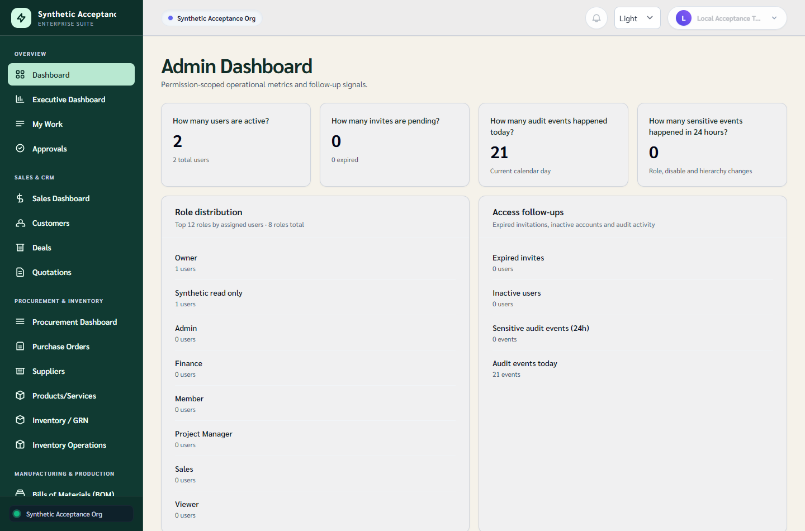 | 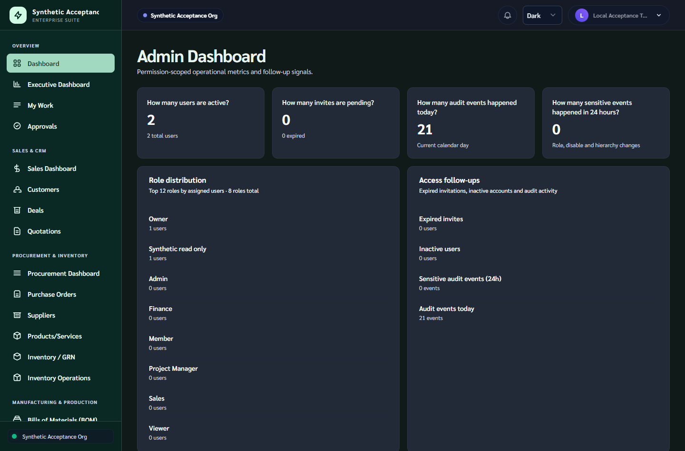 |
| **Create Purchase Order (2-Column Master Dialog)**<br>ข้อมูลหลักและรายการย่อยด้านซ้าย สรุปยอด `Preview totals` จาก Server ด้านขวา | 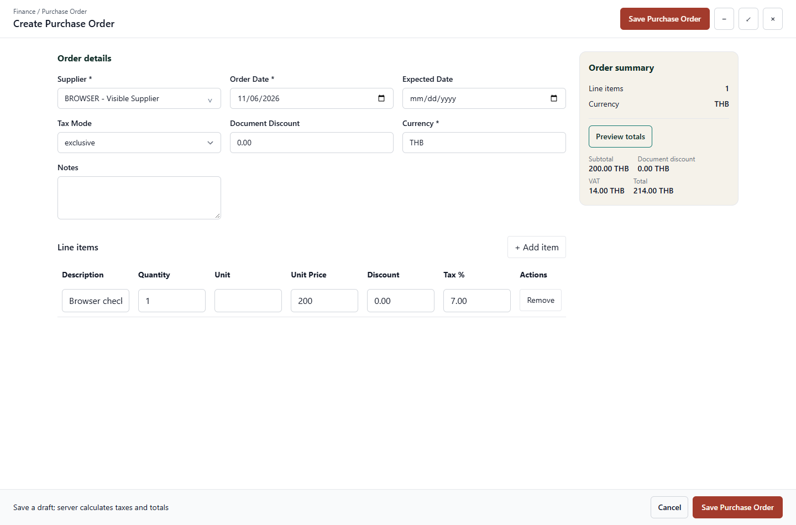 | 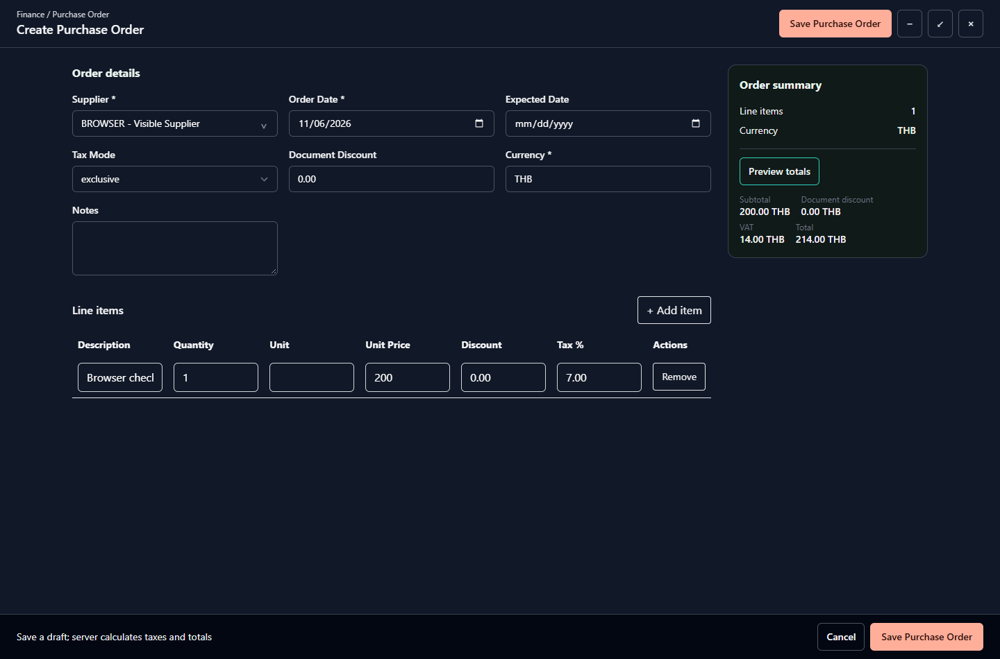 |
| **Retail POS Register**<br>ค้นหา/สแกนบาร์โค้ด ตะกร้าสินค้า ยอดก่อนส่วนลด และปุ่มรับชำระเงินในหน้าเดียว | 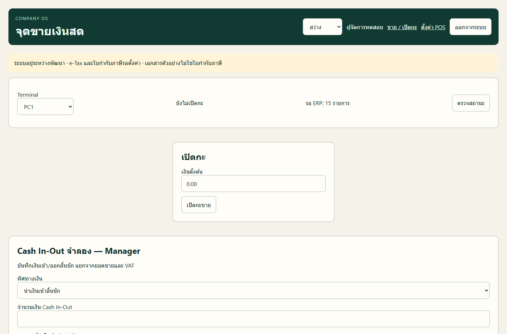 | 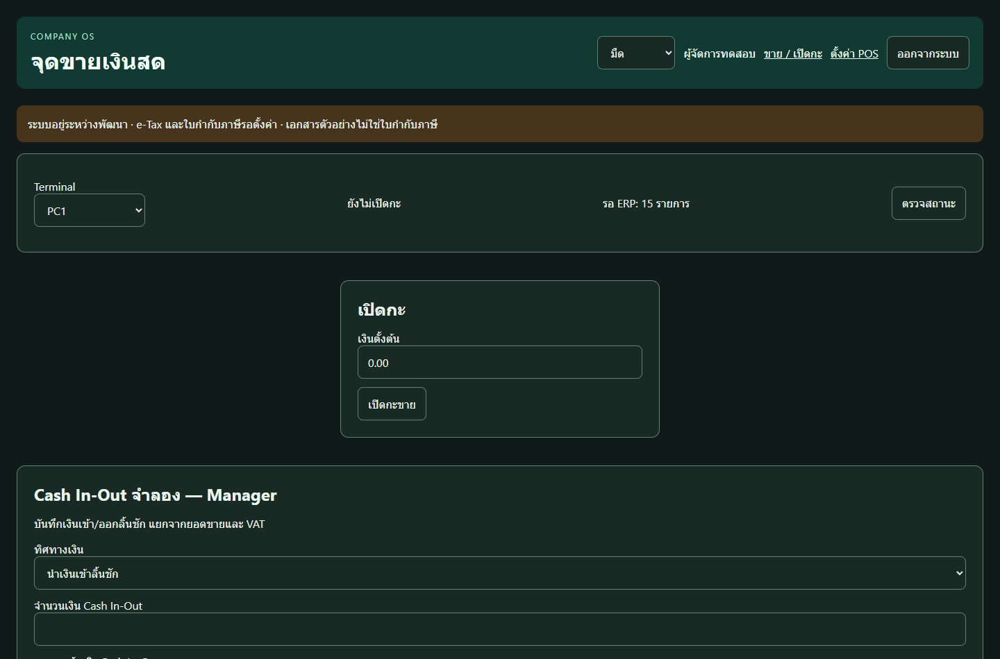 |
| **Restaurant POS & Floor Map**<br>ผังโต๊ะอาหาร คิวที่นั่ง Walk-in/จองโต๊ะ คิวครัว FIFO และจัดการ QR ประจำโต๊ะ | 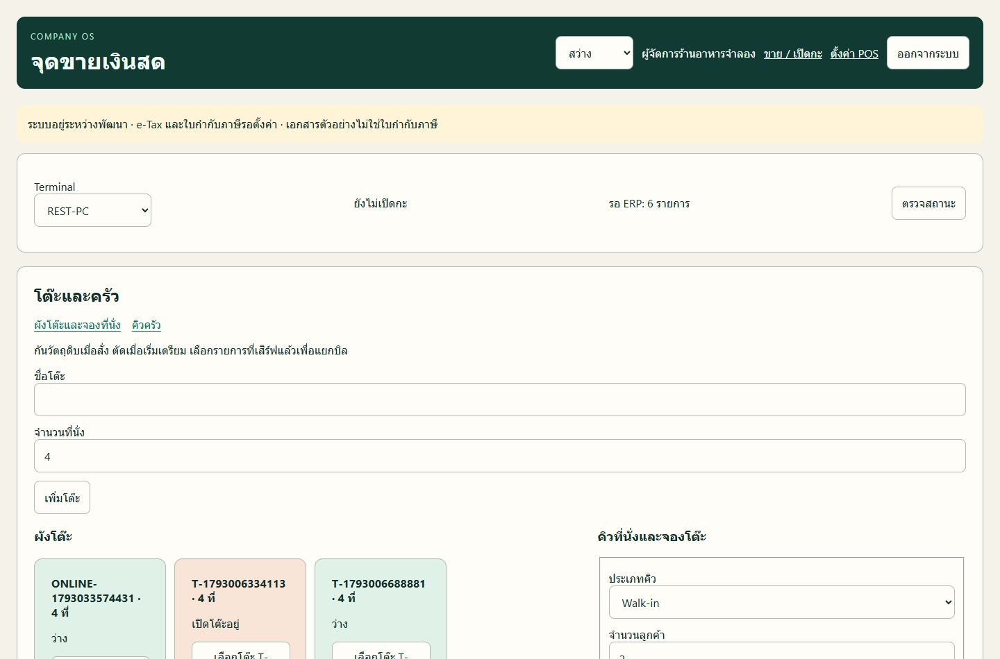 | 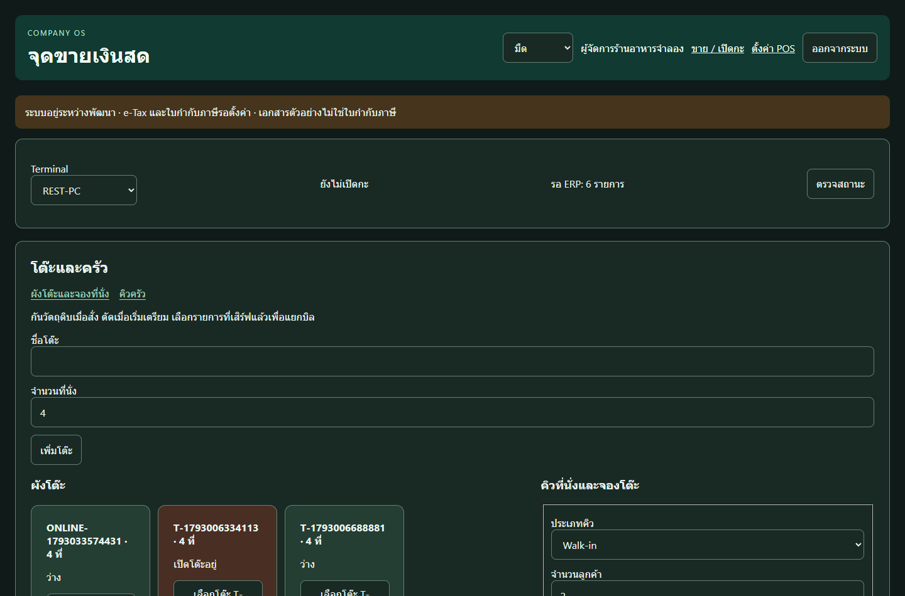 |
| **Pharmacy POS Register**<br>แสดงหน่วยขาย ล็อต วันหมดอายุในตะกร้า เงื่อนไขเภสัชกร และการผูกผู้ป่วยแบบ Mask | 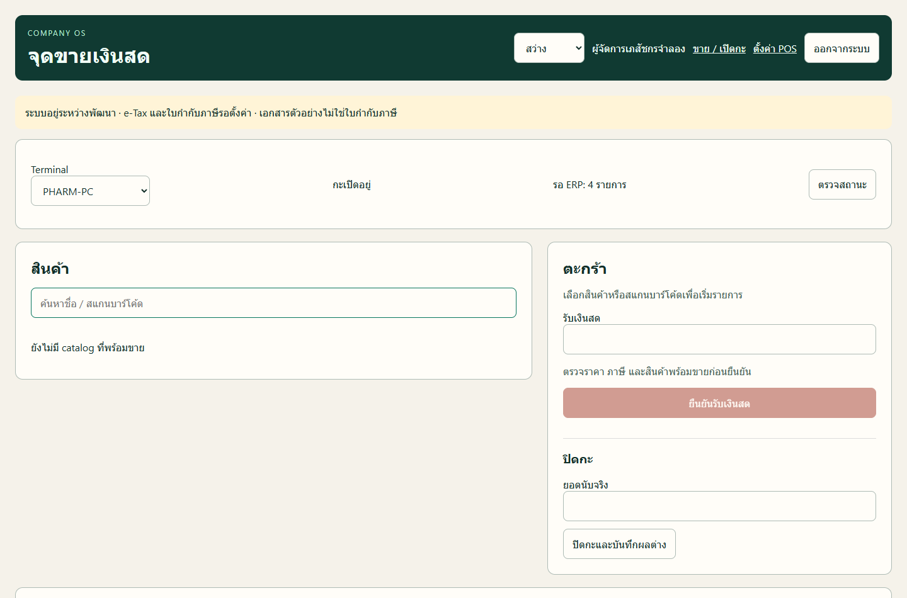 | 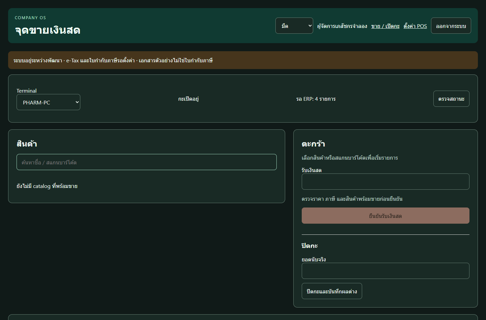 |

## ฟีเจอร์แยกตามโมดูล

รายการนี้ครอบคลุมหน้าที่ของระบบปัจจุบัน การเข้าถึงขึ้นกับ role/permission ของผู้ใช้ การเชื่อมบริการภายนอกต้องตั้งค่า credentials, queue และ scheduler ตามบริการนั้น ส่วนข้อมูล HR/Payroll ภายในระบบแยกจากข้อมูลที่อนุญาตให้อ่านผ่าน External API

### องค์กร ผู้ใช้งาน และสิทธิ์

- แยกข้อมูลหลายองค์กรด้วย `org_id`; จัดการข้อมูลบริษัท ชื่อนิติบุคคล และโครงสร้างสาขา/ฝ่าย/แผนก พร้อมกำหนดสำนักงานใหญ่
- เชิญผู้ใช้ด้วย token จัดการบัญชี เปิด–ปิดผู้ใช้ และกำหนดตำแหน่งในโครงสร้างองค์กร
- Roles และ Permission Matrix พร้อมบทบาทเริ่มต้น Owner, Admin, Sales, Project Manager, Finance, Member และ Viewer
- สมัคร/เข้าสู่ระบบ ยืนยันอีเมล รีเซ็ตรหัสผ่าน แก้ไขโปรไฟล์ และยืนยันรหัสผ่านซ้ำสำหรับงานสำคัญ
- TOTP 2FA, Recovery Codes, Trusted Devices และนโยบายบังคับตามบทบาท พร้อมการ reset โดย Owner
- Audit Logs สำหรับการเปลี่ยนข้อมูลสำคัญ และการตั้งรูปแบบ/ลำดับเลขเอกสารแยกตามประเภท

### CRM และ Sales Pipeline

- ทะเบียนลูกค้า ข้อมูลบริษัท/ภาษี ผู้ติดต่อหลายคน และ Primary Contact
- จัดการ Deals ตาม stage, มูลค่า, โอกาสปิดการขาย และสถานะ Won/Lost
- บันทึกกิจกรรม นัดหมายติดตาม และปิดกิจกรรมที่ทำแล้ว
- แปลง Won Deal เป็นโครงการ และติดตามข้อมูลขายผ่าน Sales Dashboard ตามสิทธิ์

### สินค้า บริการ และเอกสารขาย

- Product Catalog สำหรับสินค้า/บริการ พร้อม SKU หน่วย ราคา ต้นทุน และสถานะใช้งาน
- กำหนดภาษีแบบ Exclusive, Inclusive หรือ No Tax และคำนวณยอด/ส่วนลด/VAT ฝั่ง server
- ใบเสนอราคา: สร้าง แก้ไข อนุมัติ/ปฏิเสธ และแปลงเป็นใบแจ้งหนี้
- ใบแจ้งหนี้จาก Deal หรือสร้างโดยตรง พร้อมรายการสินค้า/บริการ สถานะ และการ void
- ใบลดหนี้/เพิ่มหนี้ (CN/DN), ใบวางบิล, ใบส่งของ (DO) และใบสำคัญรับ/จ่าย (RV/PV)
- พิมพ์และสร้าง PDF สำหรับเอกสารที่รองรับ พร้อมรูปแบบเอกสารทางการและข้อมูลภาษี

### รับชำระ ค่าใช้จ่าย และจ่ายคู่ค้า

- รับชำระบางส่วนหรือเต็มจำนวน ป้องกันยอดชำระเกินด้วย transaction/locking และกลับรายการรับชำระโดยเก็บประวัติ
- ค่าใช้จ่ายพร้อมเอกสารแนบ ผูกโครงการ/PO และกระบวนการ Draft → Approved/Paid หรือ Rejected
- บันทึก Vendor Payments และกลับรายการจ่ายคู่ค้า โดยแยกสิทธิ์ดู อนุมัติ และจ่าย
- ใบรับเงิน หนังสือรับรองหัก ณ ที่จ่าย และเอกสารหลักฐานการรับ–จ่ายตามรายการต้นทาง

### จัดซื้อและคู่ค้า

- ทะเบียน Suppliers พร้อมข้อมูลบริษัท ภาษี และช่องทางติดต่อสำหรับผู้มีสิทธิ์
- ใบขอซื้อ (PR) พร้อมอนุมัติและแปลงเป็น Purchase Order
- PO แบบหลายรายการ อนุมัติ/ยกเลิก เชื่อมค่าใช้จ่ายและใบรับสินค้า พร้อมพิมพ์/PDF
- GRN รับสินค้าตาม PO และติดตาม ordered/received/outstanding quantities

### คลังสินค้าและสต็อก

- Stock Movement Ledger และต้นทุนเฉลี่ยเคลื่อนที่ (Moving Average Cost)
- หลายคลังสินค้าและ Bin Locations พร้อมโอนย้ายระหว่างคลัง
- Lot/Batch และวันหมดอายุสินค้า
- ตรวจนับสินค้า ปรับปรุงยอด และบันทึกการเคลื่อนไหวตามสิทธิ์
- Barcode/QR Scan สำหรับค้นหาและทำงานกับสินค้า
- Reorder/Low-stock information ตามจุดสั่งซื้อของสินค้า และ Procurement/Inventory Dashboard

### ธนาคาร เงินสดย่อย และเช็ค

- ทะเบียนบัญชีธนาคารพร้อมข้อมูลสำคัญเข้ารหัส และการโอนเงินระหว่างบัญชี
- นำเข้า CSV Bank Statement จับคู่/ยกเลิกการจับคู่รายการ และ Bank Reconciliation
- กองเงินสดย่อย คำขอเบิก อนุมัติ/ปฏิเสธ จ่าย และเติมคืนกองเงิน
- ทะเบียนเช็ค/PDC พร้อมวงจรสถานะ และ Treasury Reports

### บัญชีแยกประเภทและหลายสกุลเงิน

- ผังบัญชี งวดบัญชี และการปิดงวด
- บัญชีคู่ (Double-entry Journals) จากรายการต้นทางและรายการบันทึกโดยตรง พร้อมตรวจยอดสมดุล
- Reverse Journal โดยรักษาประวัติเดิม รายงาน Trial Balance และ General Ledger
- Currency/Exchange Rate Master พร้อมอัตราย้อนหลังและ snapshot ของเอกสารที่รองรับ
- Realized/Unrealized FX, AR Revaluation/Reverse และการเชื่อม AP/Inventory FX
- บัญชีเงินฝากเงินตราต่างประเทศ (FCD) และการเชื่อมบัญชีธนาคารกับ GL

### สินทรัพย์ถาวร

- หมวดหมู่และทะเบียนสินทรัพย์ พร้อมข้อมูลการได้มา อายุใช้งาน และเอกสารแนบ
- คำนวณค่าเสื่อมราคาเส้นตรงรายเดือนและบันทึก GL
- จำหน่าย/ตัดบัญชีสินทรัพย์พร้อมผลทางบัญชีและประวัติรายการ

### ภาษีและ e-Tax

- รายงานภาษีขาย/ซื้อ ภ.พ.30, ภ.ง.ด.3/53, หนังสือรับรอง50ทวิ และ AR/AP Aging
- Export รายงานตามรูปแบบที่แต่ละรายงานรองรับ รวม CSV/Excel และ RD Prep
- สร้าง e-Tax XML, เก็บไฟล์แบบ private และตรวจ hash
- Digital Signature แบบ Enveloped XML-DSig, RSA-SHA256 และการอ้างอิง certificate
- คิว submit, การ inquire status และ callback ที่ตรวจ HMAC; เลือกโหมด/adapter ตามการตั้งค่าผู้ให้บริการ
- การนำส่งจริงต้องใช้ credentials/certificate และผ่านข้อกำหนดของผู้ให้บริการและหน่วยงานปลายทาง

### Payment Gateway และ PromptPay

- สร้าง Thai PromptPay QR สำหรับใบแจ้งหนี้ รองรับข้อมูลรับเงินตามการตั้งค่าองค์กร
- Opn checkout/event verification และหน้าจัดการ Payment Gateway
- Signed settlement bridge พร้อม HMAC, timestamp window และการป้องกันรายการซ้ำ
- ตรวจหลักฐานการชำระก่อนสร้างรายการรับเงิน/GL; การตั้ง gateway ไม่ถือว่ารายการได้รับเงินจริงแล้ว

### โครงการและงาน

- สร้างโครงการโดยตรงหรือจาก Won Deal พร้อมสมาชิกโครงการและผู้รับผิดชอบ
- จัดการ Tasks, สถานะ, กำหนดส่ง, ความคืบหน้า และงานที่เกินกำหนด
- Checklists และ Comments ของงาน
- เชื่อมค่าใช้จ่ายกับโครงการเพื่อดูต้นทุน พร้อม Delivery Dashboard และ My Work ตามสิทธิ์

### บุคลากร ตำแหน่ง และเวลาทำงาน

- Employee Master แยกจาก User รองรับพนักงานที่มีและไม่มีบัญชีเข้าสู่ระบบ
- รหัสพนักงาน สถานะ/ประเภทการจ้าง โครงสร้างองค์กร ผู้บังคับบัญชา วันเริ่มงาน ทดลองงาน และพ้นสภาพ
- Position Master พร้อมค้นหา/เลือกตำแหน่งและสร้างตำแหน่งจากฟอร์มที่รองรับ
- Bulk Import พนักงานจาก Excel/CSV/TSV พร้อมตรวจข้อมูลและจัดการตำแหน่งตามการนำเข้า
- Shift Master, วันหยุด, Work Profile และ Roster Matrix สำหรับจัดกะ
- ลงเวลาเข้า–ออกและนำเข้าข้อมูลเครื่องสแกน พร้อม reconciliation, กะข้ามวัน และนาทีสาย/กลับก่อน/ทำงาน/OT
- การตั้ง privacy ของ attendance รวมการเก็บ IP แบบ hash และ GPS ตามนโยบาย/ความยินยอม
- ประเภทลา โควตาวันลา คำขอ/ส่งอนุมัติ/ยกเลิก และคืนสิทธิ์ตามกฎการลา
- สรุปเวลาทำงานพร้อม lock/reverse เพื่อส่งต่อข้อมูลที่ตรวจแล้วไปกระบวนการเงินเดือน

### เงินเดือนและสลิป

- Payroll Profile และนโยบายภาษี/ประกันสังคมแบบ effective-dated/versioned
- Payroll Run: สร้าง คำนวณ อนุมัติ และจ่ายตามสิทธิ์
- คำนวณรายรับ/รายการหักและ OT ตามข้อมูล/อัตราที่กำหนด พร้อม calculation snapshot
- รองรับพนักงานที่ไม่มี User และเชื่อมข้อมูลสรุปเวลาทำงานที่ตรวจแล้ว
- สลิปเงินเดือนสำหรับพิมพ์/PDF และส่งอีเมลตามสิทธิ์
- รายงาน/ไฟล์ประกอบ ภ.ง.ด.1/1ก และประกันสังคม รวมการบันทึก GL จากกระบวนการจ่าย
- ข้อมูลเงินเดือนและบัญชีธนาคารอยู่ภายใต้สิทธิ์ภายใน ไม่มีการเปิดผ่าน External Read API

### การผลิตและต้นทุน

- BOM พร้อม version, รายการวัตถุดิบ, sub-BOM และการ duplicate
- BOM Explosion หลายระดับ พร้อมตรวจ circular dependency และคำนวณความต้องการวัตถุดิบ
- Work Orders: สร้าง แก้ไข วางแผน release ตรวจคุณภาพ complete และ cancel ตามสถานะ
- บันทึก planned/actual/scrap quantities และข้อมูลคลังต้นทาง/ปลายทาง
- บันทึกต้นทุนวัตถุดิบ ค่าแรง และโสหุ้ย พร้อมเส้นทางเชื่อม stock/GL ตามรายการผลิต

### คลังเอกสารองค์กร

- Central DMS พร้อมหมวดหมู่และ immutable versions
- Private storage, สิทธิ์ตามเอกสาร/parent entity และระดับความลับ
- Scan Gate/Quarantine และดาวน์โหลดเฉพาะไฟล์ที่ผ่านเงื่อนไข
- เชื่อมเอกสารกับข้อมูลธุรกิจ พร้อม expiry/renewal และการแจ้งเตือน
- Retention Policy, Legal Hold, Archive และ explicit purge ผ่านคำสั่งสำหรับผู้ดูแล

### สายอนุมัติและการแจ้งเตือน

- Workflow Definitions แบบ versioned และ snapshot ต่อคำขอ
- Routing ตามวงเงิน บุคคล หัวหน้างาน หรือบทบาท พร้อมลำดับขั้นและรูปแบบ first-to-approve ที่รองรับ
- SoD ป้องกันอนุมัติคำขอตัวเอง, temporary delegation และ Approval Inbox
- In-app Notifications, อีเมลผ่าน queue และ preferences ของผู้ใช้
- LINE OA / Slack / Telegram ผ่าน outbox พร้อม encrypted credentials, retry/backoff และ dead-letter
- Quiet Hours และ Daily Digest ตามสิทธิ์ผู้รับ

### Customer และ Supplier Portal

- เข้าถึงผ่าน Magic Link ใช้ครั้งเดียว/หมดอายุ และแยก portal session จาก staff
- Customer ดูข้อมูลการค้าที่ได้รับอนุญาต ยืนยันใบเสนอราคา และเข้าถึงใบแจ้งหนี้/QR ตามสิทธิ์
- Supplier ส่ง vendor bill พร้อมกักกันไฟล์รอตรวจ ไม่สร้างรายการบัญชีที่อนุมัติแล้วโดยอัตโนมัติ
- ดาวน์โหลดเอกสารที่ portal grant อนุญาต และถอน session/access ได้ตามนโยบาย

### Dashboard และการพยากรณ์

- Admin, Executive, Sales, Finance, Delivery, My Work, Procurement/Inventory และ HR/Payroll Dashboards รวมมุมมอง portal
- ตัวกรองช่วงวันและมิติข้อมูลที่แต่ละหน้าอนุญาต เก็บ filter state ใน URL พร้อม filtered drill-down
- Charts และ widgets แสดงตาม permission และแยก current snapshot จากข้อมูลตามช่วงเวลา
- Cash Flow Forecast30–180วัน แบบ Base/Best/Worst พร้อมปรับ scenario และบันทึก daily snapshots
- ตัวชี้วัด Current Ratio, Quick Ratio, DSO, DPO และ Working Capital Runway ตาม source ที่มี
- แยก forecast จากยอดทางบัญชีจริง และระบุข้อมูลที่ source ยังไม่รองรับแทนการสมมติค่า

### AI OCR และการตรวจเอกสาร

- ตั้งค่า OpenAI-compatible Vision endpoint/model/credentials และทดสอบการเชื่อมต่อ
- รองรับ local endpoint เช่น Ollama/LM Studio หรือ cloud endpoint ที่เข้ากันได้
- Upload ภาพ/Scanned PDF สกัดข้อมูลเอกสาร และตรวจเลขภาษี/ยอดคำนวณ
- Split-screen Reviewer เทียบเอกสารต้นฉบับกับข้อมูลสกัด พร้อมยืนยันหรือ reject
- แปลงข้อมูลที่ผู้ตรวจยืนยันเป็น Assisted Draft Expense/Vendor Bill โดยไม่ auto-post GL

### External API และการเชื่อมแอป

- Summary10โดเมน และ read list/detail ของ Reference, Products, Inventory, Employees, Parties, เอกสารขาย/จัดซื้อ, Projects/Tasks, Approvals, Manufacturing และ Documents
- Bearer integration keys, scopes, expiry/revoke, one-time reveal และ Admin API Access
- Organization/party visibility, HR branch restrictions, document allowlist และ scope แยกราคา/ต้นทุน/สูตร/download
- Cursor pagination, watermark/delta ใน resource ที่รองรับ และ full reconciliation สำหรับข้อมูลลบ/สิทธิ์/derived changes
- Outbound signed webhooks พร้อม ownership verification, retry/dead-letter และ Admin delivery tracking
- ไม่มี business Write API และไม่ส่ง national_id/payroll/bank/private contacts ผ่านชุดข้อมูลภายนอก

### การติดตั้งและประสบการณ์ใช้งาน

- Web Setup Wizard ฝั่ง ERP (`/setup` + `/setup/system-requirements.php`) และฝั่ง POS (`/setup` สำหรับสร้างสาขาแรก/Terminal/Manager) พร้อม token activation, preflight และ installer lock
- รองรับ CLI setup, background queue และ scheduled tasks
- ระบบธีม `Light / Dark / System` ที่จำค่าบนอุปกรณ์โดยไม่กะพริบตอนโหลด (`erp-theme.js` และ POS Theme Sync) บนโทนสีพื้นงาช้าง (`Ivory`), เมนูเขียวเข้ม (`Deep Forest Green`), สถานะปกติสี `Mint`, และปุ่มหลักสี `Coral` พร้อมแยกหน้าพิมพ์เอกสาร/PDF ให้ใช้พื้นขาวบริสุทธิ์ (`#FFFFFF`) เสมอ
- `CreateEditDialog` และหน้าต่างเฉพาะ BOM/Work Order พร้อม dirty detection, discard guard และ focus สำหรับคีย์บอร์ด ใช้ Single Active Editor Coordinator ในหน้าที่มีหลาย editor และคำนวณยอดจาก server (`Preview totals` บนฟอร์มใบสั่งซื้อแบบ 2 คอลัมน์) ดู [มาตรฐาน UI](document/design/ui-standards.md) และ [ทะเบียนหน้าจอ](document/design/ui-screen-inventory.md)
- File preview/download ตาม parent permission และการตั้งค่าองค์กร/เลขเอกสาร/notification channels จากหน้าผู้ดูแล

## ตารางบทบาทและสิทธิ์การใช้งาน (RBAC Roles & Access Matrix)

ระบบบังคับใช้สิทธิ์ผ่าน `User::hasPermissionCode()` (Effective Permissions) ร่วมกับกฎการแบ่งแยกหน้าที่ (**Strict SoD**: ห้ามผู้อนุมัติกดอนุมัติคำขอของตนเองทุกกรณี) โดยแบ่งบทบาทมาตรฐานออกเป็น 3 กลุ่มระบบดังนี้:

| ระบบ | บทบาท (Role) | ขอบเขตหน้าที่และ Dashboard ที่เข้าถึงได้ | ข้อจำกัดด้านความปลอดภัยสำคัญ (Security Guardrails) |
| :--- | :--- | :--- | :--- |
| **ERP (`backend/`)** | **`owner`** (เจ้าขององค์กร) | เข้าถึงครบทุกโดเมน, Executive Dashboard, ตั้งค่าองค์กร/2FA/API Keys/POS Connector, และรีเซ็ต 2FA ให้พนักงาน | อยู่ภายใต้กฎ Strict SoD (ห้ามอนุมัติคำขอที่ตนเองเป็นผู้ยื่น) และบังคับ Enroll 2FA เมื่อเปิดนโยบายองค์กร |
| **ERP (`backend/`)** | **`admin`** (ผู้ดูแลระบบ) | จัดการผู้ใช้ (`users`), บทบาท (`roles`), โครงสร้างสาขา/ฝ่าย/แผนก, คลังเอกสาร DMS, และตรวจสอบ Audit Logs | ไม่สามารถรีเซ็ต 2FA ของ Owner และถูกบังคับ Enroll 2FA เมื่อเปิด `required_for_privileged_roles` |
| **ERP (`backend/`)** | **`finance`** (การเงินและบัญชี) | Finance Dashboard, ใบแจ้งหนี้, รับชำระ, รายจ่าย, จ่ายคู่ค้า, ธนาคาร/กระทบยอด, บัญชีแยกประเภท (GL), สินทรัพย์ถาวร, e-Tax, AI OCR, และ Payroll | บังคับยืนยันรหัสผ่าน (`password.confirm`) ก่อนทำรายการสำคัญ และห้ามแก้ไของค์ประกอบงวดบัญชีที่ปิดแล้ว (`closed`) |
| **ERP (`backend/`)** | **`sales`** (ฝ่ายขาย) | Sales Dashboard, ลูกค้า (`customers`), ผู้ติดต่อ, Deals Pipeline, กิจกรรมติดตาม, และใบเสนอราคา (`quotations`) | ไม่เห็นข้อมูลสรุปการเงินองค์กร, ไม่เห็นเงินเดือนพนักงานอื่น, และไม่มีสิทธิ์ผ่านรายการบัญชี GL |
| **ERP (`backend/`)** | **`pm`** (ผู้จัดการโครงการ) | Delivery Dashboard, จัดการโครงการ (`projects`), สมาชิกโครงการ, งานย่อย (`tasks`), และติดตามต้นทุนโครงการเทียบงบประมาณ | แก้ไขได้เฉพาะโครงการที่รับผิดชอบ; ต้นทุนจริงคำนวณเฉพาะรายจ่ายที่อนุมัติแล้ว |
| **ERP (`backend/`)** | **`member`** (พนักงานทั่วไป) | My Work Dashboard (`/my-work`), อัปเดตสถานะงาน (`status`) ที่ได้รับมอบหมาย, ลงเวลา/ขอลางาน (`hr.self.view`), และดาวน์โหลดสลิปเงินเดือนของตนเอง | แก้ไขได้เฉพาะ `status` ของ Task ที่ตนเป็น Assignee และดูสลิปเงินเดือนของผู้อื่นไม่ได้ 100% |
| **ERP (`backend/`)** | **`viewer`** (ผู้ตรวจสอบ/อ่านอย่างเดียว) | เปิดดูหน้ารายการและรายงานตามสิทธิ์ `.view` ที่ได้รับมอบหมายโดยไม่มีปุ่มสร้าง/แก้ไข/ลบ | ระบบซ่อน Action แก้ไขบน UI และปฏิเสธคำขอ `POST`/`PATCH`/`DELETE` ที่ระดับ Middleware (`403`) |
| **POS (`pos/`)** | **`manager`** (ผู้จัดการสาขา) | เปิด/ปิดกะ, ขาย/คืนเงิน, อนุมัติส่วนลดเกินสิทธิ์, รับเงิน COD เข้ากะ (`remit`), พัก/ข้ามคิวครัวพร้อมเหตุผล, ตรวจรับบิล Offline, และตั้งค่าสาขาผ่าน `/config` | อ่านเวชระเบียนผู้ป่วยหรือตรวจรับยาคืนได้เฉพาะผู้จัดการที่มี `pharmacist_qualified = true` เท่านั้น |
| **POS (`pos/`)** | **`pharmacist`** (เภสัชกรประจำสาขา) | ขายยาควบคุม (`requires_pharmacist`), บันทึกใบสั่งยา, อ่าน/แก้ไขเวชระเบียนและประวัติแพ้ยา (`pos_patients*`), และตรวจรับยาคืน (`quarantine`/`destroy`) | จำกัดเฉพาะสาขาตนเอง (`branch_id`) และเฉพาะร้านประเภท `pharmacy` เท่านั้น |
| **POS (`pos/`)** | **`cashier`** (แคชเชียร์หน้าร้าน) | เปิดกะขายสินค้าทั่วไป, สแกนบาร์โค้ด, รับชำระเงินสด, จัดโต๊ะ/คิวครัวร้านอาหาร, และค้นหารหัสสมาชิก/ผู้ป่วยเพื่อผูกบิล | เห็นเฉพาะชื่อ/เบอร์โทรสมาชิกแบบ Mask (`name_masked`, `phone_masked`) และชื่อผู้ป่วยแบบ Mask (ไม่เห็นประวัติแพ้ยา/เวชระเบียน) |
| **Portal (`/portal`)** | **`customer` / `supplier`** | เข้าสู่ระบบแบบไร้รหัสผ่านด้วย Magic Link (30 นาที) เพื่อดู/กดยืนยันใบเสนอราคา ดูใบแจ้งหนี้ หรือส่งใบวางบิลคู่ค้า | แยก `portal_users` และ `portal_sessions` ออกจากพนักงาน 100%; ใบวางบิลถูกกักกันที่ `pending_scan` จนกว่าจะตรวจผ่าน |

## สถาปัตยกรรมระบบ (System Architecture)

### 1. ภาพรวมโครงสร้างสถาปัตยกรรมทั้งระบบ (End-to-End System Topology)

[เปิดแผนภาพ High-Level แบบ HTML](document/design/architecture-high-level.html)

ERP ส่วนกลางและ Standalone POS เป็นแอป Laravel คนละตัว แต่ละแอปจัดการฐานข้อมูลและไฟล์ส่วนตัวของตัวเอง ส่วน ERP–POS Connector เชื่อมสองแอปผ่าน HTTPS/mTLS

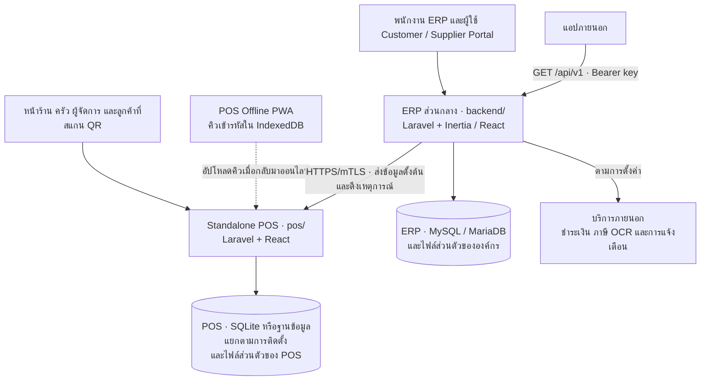

- **ERP–POS Connector** ฝั่ง ERP เป็นผู้เรียกไปยัง POS เพื่อส่ง Catalog, Quota และโปรโมชัน และดึงเหตุการณ์ที่ลงนามจาก POS Outbox กลับมาประมวลผล ลูกศรแสดงทิศทางการเรียก HTTPS [คู่มือการเชื่อมต่อ POS](document/POS_CONFIGURATION.md)
- **Offline PWA** เก็บคิวบนเบราว์เซอร์และส่งเข้า Standalone POS เมื่อออนไลน์อีกครั้ง จากนั้นเหตุการณ์ที่พร้อมซิงค์เข้า ERP จะเดินผ่าน Connector [ขั้นตอน Browser / PWA Offline](document/PHASE_28_8_3_OFFLINE.md)

---

### 2. โครงสร้างกลุ่มโดเมนและการไหลของข้อมูลใน ERP (7 Domain Groups & Data Lineage)

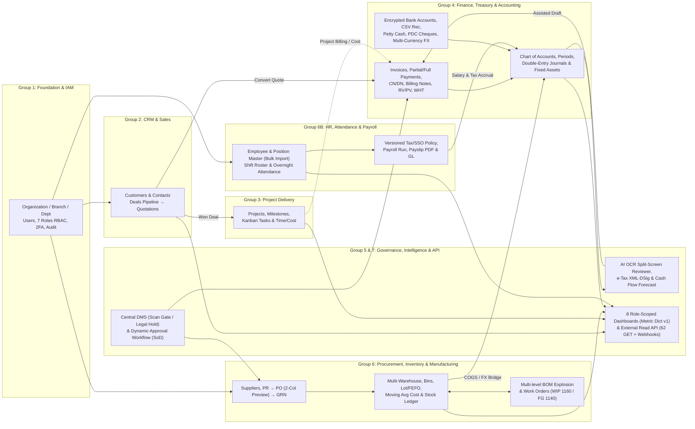

---

### 3. สถาปัตยกรรมระบบหน้าร้าน Standalone POS และส่วนขยาย Phase 28.8.1–28.8.5

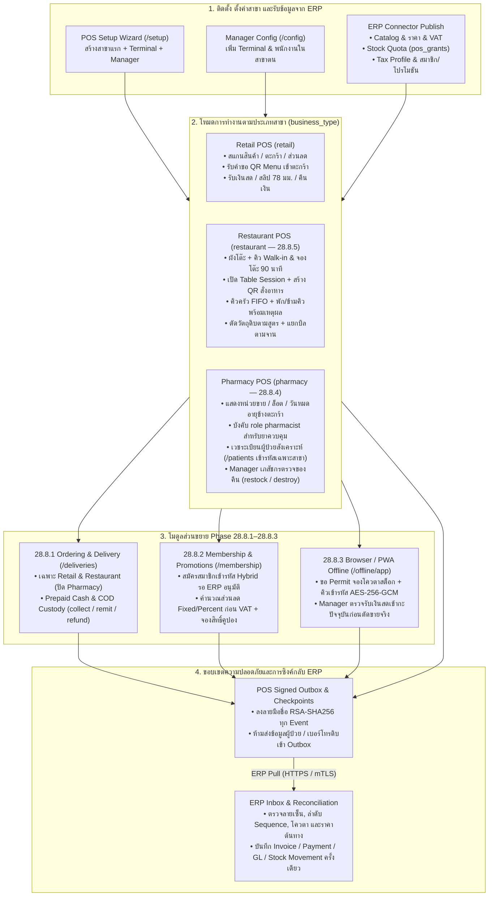

---

### 4. โครงสร้างไดเรกทอรีของโปรเจกต์ (Repository Structure)

```text
ERP/
├── backend/                  # ระบบ ERP หลัก (Laravel 13 + React 18 + Inertia + TypeScript)
│   ├── app/                  # Controllers, Models, Services (GL, Inventory, POS, OCR, e-Tax, API), Policies
│   ├── database/migrations/  # 88 Migration files (173 ERP tables)
│   ├── public/               # Web root ฝั่ง ERP, erp-theme.js และ /setup bridge
│   ├── resources/            # React Pages, shared UI components, Blade Print/PDF
│   ├── routes/               # web.php, api.php (/api/v1 — 62 GET endpoints), console.php
│   ├── setup/                # ERP Setup Wizard activation template (enable.php.example)
│   └── tests/                # Feature (566 tests), MySQL Concurrency/Queue, Browser & Frontend tests
├── pos/                      # ระบบ Standalone POS แยกส่วน (Laravel 13 + React 18 + Offline PWA)
│   ├── app/                  # Controllers (Setup, Config), Services (Checkout, Restaurant, Pharmacy, Offline, Delivery)
│   ├── database/migrations/  # 25 Migration files (56 POS tables)
│   ├── public/               # Web root ฝั่ง POS และ Service Worker (offline-sw.js)
│   ├── resources/            # POS React apps (pos.tsx, RestaurantPanel.tsx) และ Blade views (10 ไฟล์)
│   ├── routes/               # web.php, connector.php, configuration.php, delivery.php, membership.php, offline.php, patients.php
│   └── tests/                # POS Isolated PHPUnit (115 tests) & Playwright Headless Browser fixtures
├── setup/                    # Entry point สำรองสำหรับ Web Setup Wizard และ system-requirements.php
├── docs/                     # เอกสารข้อกำหนดสถาปัตยกรรม, OpenAPI v1 spec (external-read-v1.json) และ Runbooks
├── document/                 # ศูนย์รวม Interactive HTML Diagrams (01–24), Mermaid, ERD, คู่มือ POS และหลักฐานตรวจรับ
│   ├── design/               # ภาพอ้างอิง UI Redesign และทะเบียนตรวจรับ UI (ui-acceptance-register.md)
│   └── specs/                # Archify JSON Specifications สำหรับสร้าง Interactive HTML Diagrams
└── examples/external-api/    # ตัวอย่าง Node.js Summary API Client และ Signed Webhook Verifier
```

### Diagrams และเอกสารสถาปัตยกรรม

ไฟล์ Mermaid อ่านได้บน GitHub ส่วน Interactive HTML ให้เปิดด้วย browser หลัง clone repository

| เอกสาร | รายละเอียด |
| --- | --- |
| [Diagram Index](document/README.md) | สารบัญสถาปัตยกรรมและ workflow ทั้งหมด (01–27) |
| [Interactive Diagram Portal](document/index.html) | ศูนย์รวม Interactive HTML diagrams พร้อมเครื่องมือสำรวจ |
| [Domain Workflows](document/GROUPS_WORKFLOW.md) | การทำงานระหว่างโมดูลและวงจรสถานะ (7 กลุ่มโดเมน) |
| [Database ER Diagram](document/DATABASE_ERD.md) | ความสัมพันธ์ของข้อมูล ERP (88 migrations) และส่วนขยาย POS (25 migrations) |
| [HR / Attendance / Payroll](document/17_hr_employee_attendance_payroll.md) | Employee Master ตารางกะ เวลาทำงาน และการคำนวณเงินเดือน |
| [e-Tax Pipeline](document/18_etax_gateway_pipeline.md) | XML Signature คิวส่ง และการรับสถานะ |
| [Cash Flow Forecasting](document/19_cash_flow_forecasting_engine.md) | สถานการณ์จำลองและตัวชี้วัดการเงิน |
| [AI OCR Ingestion](document/20_ai_ocr_document_ingestion.md) | การรับเอกสาร สกัดข้อมูล และตรวจยืนยันแบบ Split-screen |
| [Web Setup Wizard](document/21_setup_wizard_installer_lifecycle.md) | Preflight การติดตั้ง และ Installer Lock (ERP & POS `/setup`) |
| [External API Architecture](document/22_external_api_architecture.md) | Read API 62 GET paths, key lifecycle, visibility, sync และ outbound webhooks |
| [POS Server, Setup & Config](document/23_pos_server_configuration.html) | สถาปัตยกรรม POS Server, `/setup`, `/config` และการเชื่อมต่อ ERP ([คู่มือ](document/POS_CONFIGURATION.md)) |
| [POS Workflows (Retail / Restaurant / Pharmacy)](document/24_pos_workflows.html) | ขั้นตอนใช้งาน POS ทั้ง 3 ประเภท และส่วนขยาย Phase 28.8.1–28.8.5 ([คู่มือ](document/README_POS.md)) |
| [UI & Layout Redesign Register](document/design/ui-acceptance-register.md) | ทะเบียนตรวจรับ UI, โหมด Light/Dark/System, การแยกสีหน้าพิมพ์ และภาพอ้างอิง |

## Technology Stack & Overview Diagram

### ภาพรวมเทคโนโลยีที่ใช้ในระบบ (Technology Stack Overview Diagram)

```mermaid
flowchart TB
    subgraph FrontendLayer["1. Frontend, UI & Offline PWA Layer"]
        ReactTS["React 18 + TypeScript 5\n• Component-Driven UI & Strict Typing"]
        InertiaJS["Inertia.js Protocol\n• Monolith SPA Routing (ERP & Portal)\n• Zero Client-Side State Drift"]
        Styling["Tailwind CSS + Semantic CSS Tokens\n• Light / Dark / System Theme (erp-theme.js)\n• Ivory / Deep Forest Green / Mint / Coral\n•Accessible SVG Charts & Responsive 320–1440px"]
        OfflinePWA["POS Offline PWA & Web APIs\n• Service Worker (offline-sw.js Precache)\n• IndexedDB Atomic Transactions + Revision CAS\n• WebCrypto API (PBKDF2-SHA256 600k + AES-256-GCM)\n• StorageManager.persist & Monotonic Clock Guard"]
    end

    subgraph BackendLayer["2. Application & Domain Runtime Layer (ERP & Standalone POS)"]
        PHP83["PHP 8.3+ Runtime\n• BCMath (Exact Decimal & Satang Arithmetic)\n• OpenSSL, DOM / SimpleXML (LIBXML_NONET), ZipArchive, cURL"]
        Laravel13["Laravel 13 Framework\n• Separate Workspaces: backend/ (ERP) & pos/ (POS)\n• Eloquent ORM, Transactions & Pessimistic Locking\n• Queue Worker, Task Scheduler & Transactional Outbox"]
    end

    subgraph SecurityLayer["3. Security, Identity & Cryptography Layer"]
        AuthRBAC["Authentication & Access Control\n• Laravel Breeze + Session Regeneration\n• RFC 6238 TOTP 2FA + Hashed Recovery Codes\n• 7-Role RBAC + Tenant Isolation (org_id)\n• Single-Use SHA-256 Magic Links (Portals)"]
        CryptoEngine["Encryption & Digital Signatures\n• Laravel Crypt (AES-256-CBC / GCM Casts)\n• Hybrid Envelope (AES-256-GCM + RSA-OAEP for POS Members)\n• RSA-SHA256 Signed POS Events, Checkpoints & e-Tax XML-DSig\n• HMAC-SHA256 Webhooks, Settlement Bridge & Branch Lookups\n• mTLS Client Certificate Verification (ERP ↔ POS Connector)"]
    end

    subgraph DataLayer["4. Database, Storage & Document Engine Layer"]
        ERPSQL[("ERP MySQL / MariaDB\n• 88 Migrations (173 Tables)\n• Ordered UUIDv7 Primary Keys\n• DECIMAL(18,2) / DECIMAL(18,4)")]
        POSSQL[("POS SQLite / Isolated DB\n• 25 Migrations (56 Tables)\n• WAL / Foreign Key / Integrity Guard\n• Independent Recovery Fence")]
        DocEngine["Document, Print & Archive Engine\n• DomPDF + Embedded Sarabun Font\n• Print Paper Isolation (#FFFFFF paper-colors)\n• Private Tenant DMS + Antivirus Scan Gate\n• Gzip + Authenticated Encrypted 90-Day POS Archive"]
    end

    subgraph IntegrationLayer["5. External APIs, Gateways & AI Integration Layer"]
        OpenAPI["External Read-only API (/api/v1)\n• OpenAPI 3.1 Contract (62 GET Paths)\n• Bearer Secret (SHA-256) + Cursor Watermark Sync"]
        FinGateways["Financial & Tax Gateways\n• EMVCo Thai PromptPay QR (Tag 29/30 Exact Satang)\n• Opn Checkout & Signed Settlement Bridge\n• ETDA e-Tax Invoice XML-DSig (RD API / INET / Sandbox)"]
        AIVision["AI OCR & Notification Channels\n• OpenAI-Compatible Vision API (Ollama / LM Studio / Cloud)\n• Thai Tax ID Modulo 11 & Math Reconciler\n• LINE OA / Slack / Telegram Encrypted Outbox"]
    end

    subgraph ToolingLayer["6. Build, Testing & Quality Assurance Layer"]
        BuildTools["Build & Package Management\n• Vite Bundler + pnpm (Frozen Lockfiles)\n• Composer Locked Dependencies (0 Advisories)"]
        TestTools["Automated Verification Suites\n• PHPUnit 11 (ERP 566 + POS 115 + MySQL Concurrency Tests)\n• Node Test Runner (Frontend 38 + API/Webhook Client Tests)\n• Playwright / Chrome Headless Browser Acceptance\n• Laravel Pint, ESLint, Prettier & Archify Showcase Diagrams"]
    end

    FrontendLayer --> BackendLayer
    BackendLayer --> SecurityLayer
    SecurityLayer --> DataLayer
    BackendLayer --> IntegrationLayer
    ToolingLayer -.->|"Build, Lint & Verify"| FrontendLayer
    ToolingLayer -.->|"Test & Audit"| BackendLayer
```

### ตารางสรุปเทคโนโลยีแยกตามส่วนงาน

| ส่วนงาน | เทคโนโลยีและมาตรฐานที่ใช้ |
| --- | --- |
| **Backend & Math** | PHP 8.3+, Laravel 13 (แยกแอป `backend/` และ `pos/`), `BCMath` (คำนวณเงิน/ภาษี/สต็อกระดับสตางค์และทศนิยม 4 ตำแหน่ง), `OpenSSL`, `DOM`/`SimpleXML` (`LIBXML_NONET`), `ZipArchive`, `Symfony Process` |
| **Frontend & UI** | React 18, TypeScript, Inertia.js, Tailwind CSS, Semantic Theme Tokens (`Light / Dark / System` ผ่าน `erp-theme.js` และ POS Theme Sync), Accessible SVG Charts |
| **POS Offline & PWA** | Service Worker (`offline-sw.js`), IndexedDB Atomic Transactions + Revision CAS, WebCrypto API (`PBKDF2-SHA256` 600,000 รอบ + `AES-256-GCM`), `StorageManager.persist` |
| **Database** | **ERP:** MySQL / MariaDB (`88` migrations, `173` ตาราง, Ordered UUIDv7, `DECIMAL(18,2)`/`(18,4)`) · **POS:** SQLite / MariaDB แยกอิสระ (`25` migrations, `56` ตาราง) |
| **Authentication & Security** | Laravel Breeze, 7-Role RBAC + Effective Permissions, Password Confirmation, RFC 6238 TOTP 2FA + Single-Use Recovery Codes, SHA-256 Magic Links, Central Audit Redaction |
| **Cryptography & Sync** | Eloquent Encrypted Casts, Hybrid `AES-256-GCM` + `RSA-OAEP` (POS Member Enrollment), `RSA-SHA256` (POS Signed Events/Checkpoints & ETDA XML-DSig), `HMAC-SHA256` (Webhooks & Branch Lookups), `mTLS` Connector |
| **Background Processing** | Laravel Queue Worker, Task Scheduler (`cashflow:snapshot`, `etax:inquire-status`, `pos:sync`), Transactional Outbox พร้อม Exponential Backoff & Dead-Letter Log |
| **Documents & Print** | DomPDF พร้อมฟอนต์ไทย `Sarabun` ฝังในระบบ, Print Isolation (`paper-colors.blade.php` บังคับพื้นขาว `#FFFFFF` ทั้งโหมดสว่าง/มืด), Private Tenant Storage (`tenants/{org_id}/...`), Scan Gate & Legal Hold |
| **AI & External Contracts** | OpenAPI 3.1 (`docs/openapi/external-read-v1.json` — 62 GET paths), Universal OpenAI-Compatible Vision (Local Ollama / LM Studio / Cloud GPT / Gemini), Thai PromptPay QR (Tag 29/30) |
| **Build & Quality Tools** | Vite, pnpm, Composer, PHPUnit (`566+` ERP + `116` POS tests), Playwright Headless Browser Suites, Node Test Runner (`39` Frontend tests), Laravel Pint, ESLint, Prettier, Archify Diagram Engine |

---

## โครงสร้างฐานข้อมูลและ ER Diagram (Database Schema & Table Reference)

ระบบแบ่งฐานข้อมูลออกเป็น **2 ฐานข้อมูลที่แยกจากกันอย่างเด็ดขาด (Strict Physical & Logical Isolation)** เพื่อให้ Standalone POS สามารถทำงานแบบ Offline-first ที่หน้าร้านได้อย่างอิสระและซิงค์ข้อมูลกลับเข้าสู่ ERP ผ่าน Signed Outbox / Inbox:

1. **ฐานข้อมูลหลัก ERP (`backend/`)** — **88 Migrations / 170 Application Tables** (รวมตารางระบบ `migrations` และ RBAC pivots เป็น **173 ตารางจริงใน MySQL**) ทุกตารางธุรกิจมี `org_id` สำหรับ Multi-tenant Isolation
2. **ฐานข้อมูล Standalone POS (`pos/`)** — **25 Migrations / 55 Application Tables** (รวมตาราง `migrations` เป็น **56 ตารางจริงใน SQLite / MySQL**) แยกตามสาขา (`branch_id`) และเครื่องจุดขาย (`terminal_id`)

> ดูรายละเอียด ER Diagram แยกตามโดเมนย่อยเพิ่มเติมได้ที่ [`document/DATABASE_ERD.md`](file:///c:/LocalDevine/www/ERP/document/DATABASE_ERD.md) และ [`document/PHASE_28_DATABASE.md`](file:///c:/LocalDevine/www/ERP/document/PHASE_28_DATABASE.md)

### 1. ERP Core & Enterprise Domain ER Diagram (`backend/`)

```mermaid
erDiagram
    ORGANIZATIONS ||--o{ BRANCHES : "has"
    ORGANIZATIONS ||--o{ DIVISIONS : "has"
    DIVISIONS ||--o{ DEPARTMENTS : "contains"
    ORGANIZATIONS ||--o{ USERS : "employs"
    USERS }o--o{ ROLES : "user_roles"
    ROLES }o--o{ PERMISSIONS : "role_permissions"
    ORGANIZATIONS ||--o{ EMPLOYEES : "hr_master"
    POSITIONS ||--o{ EMPLOYEES : "assigns"
    USERS |o--o| EMPLOYEES : "optional_link"

    CUSTOMERS ||--o{ CONTACTS : "has"
    CUSTOMERS ||--o{ DEALS : "pipeline"
    CUSTOMERS ||--o{ QUOTATIONS : "receives"
    QUOTATIONS ||--o{ QUOTATION_ITEMS : "lines"
    CUSTOMERS ||--o{ INVOICES : "billed"
    INVOICES ||--o{ INVOICE_ITEMS : "lines"
    INVOICES ||--o{ PAYMENTS : "settled_by"
    INVOICES ||--o{ CREDIT_DEBIT_NOTES : "adjusted_by"
    INVOICES ||--o{ BILLING_NOTE_LINES : "grouped_in"
    INVOICES ||--o{ DELIVERY_ORDERS : "shipped_by"
    INVOICES ||--o{ E_TAX_DOCUMENTS : "signed_xml"
    INVOICES ||--o{ GATEWAY_TRANSACTIONS : "promptpay_opn"

    SUPPLIERS ||--o{ PURCHASE_ORDERS : "receives"
    PURCHASE_REQUESTS ||--o{ PURCHASE_ORDERS : "converted_to"
    PURCHASE_ORDERS ||--o{ PURCHASE_ORDER_ITEMS : "lines"
    PURCHASE_ORDERS ||--o{ GOODS_RECEIPTS : "received_via"
    GOODS_RECEIPTS ||--o{ GOODS_RECEIPT_ITEMS : "lines"
    SUPPLIERS ||--o{ EXPENSES : "bills"
    SUPPLIERS ||--o{ VENDOR_PAYMENTS : "ap_settled"

    WAREHOUSES ||--o{ WAREHOUSE_BINS : "locations"
    PRODUCTS ||--o{ INVENTORY_LOTS : "batches_expiry"
    PRODUCTS ||--o{ STOCK_MOVEMENTS : "ledger"
    PRODUCTS ||--o{ BILL_OF_MATERIALS : "fg_recipe"
    BILL_OF_MATERIALS ||--o{ BOM_ITEMS : "components"
    BILL_OF_MATERIALS ||--o{ WORK_ORDERS : "produces"
    WORK_ORDERS ||--o{ WORK_ORDER_ITEMS : "consumes"
    WORK_ORDERS ||--o{ PRODUCTION_COSTS : "wip_fg_cost"

    BANK_ACCOUNTS ||--o{ BANK_STATEMENTS : "imports"
    BANK_STATEMENTS ||--o{ BANK_STATEMENT_LINES : "lines"
    BANK_STATEMENT_LINES ||--o{ RECONCILIATIONS : "matches"
    CHART_OF_ACCOUNTS ||--o{ JOURNAL_LINES : "posts_to"
    ACCOUNTING_PERIODS ||--o{ JOURNAL_ENTRIES : "governs"
    JOURNAL_ENTRIES ||--o{ JOURNAL_LINES : "double_entry"
    ASSET_CATEGORIES ||--o{ FIXED_ASSETS : "classifies"
    FIXED_ASSETS ||--o{ ASSET_DEPRECIATIONS : "depreciates"

    EMPLOYEES ||--o{ EMPLOYEE_SHIFT_SCHEDULES : "roster"
    EMPLOYEES ||--o{ ATTENDANCES : "timecards"
    EMPLOYEES ||--o{ LEAVE_REQUESTS : "leaves"
    EMPLOYEES ||--o{ EMPLOYEE_PAYROLL_PROFILES : "comp_tax"
    PAYROLL_RUNS ||--o{ PAYROLL_ITEMS : "payslips"

    DOCUMENT_CATEGORIES ||--o{ DOCUMENTS : "organizes"
    DOCUMENTS ||--o{ DOCUMENT_VERSIONS : "immutable_ver"
    WORKFLOW_DEFINITIONS ||--o{ WORKFLOW_INSTANCES : "executes"
    WORKFLOW_INSTANCES ||--o{ WORKFLOW_APPROVALS : "sod_steps"
    NOTIFICATION_EVENTS ||--o{ NOTIFICATION_OUTBOX : "queues"
    AI_CONFIGURATIONS ||--o{ OCR_EXTRACTIONS : "vision_ocr"
    INTEGRATION_API_KEYS ||--o{ INTEGRATION_WEBHOOKS : "api_v1"
    ORGANIZATIONS ||--o{ POS_INSTANCES : "pos_connector"
    POS_INSTANCES ||--o{ POS_SYNC_INBOX : "ingests_signed"
```

---

### 2. Standalone POS & ERP Connector ER Diagram (`pos/` ↔ `backend/`)

```mermaid
erDiagram
    POS_BRANCHES ||--o{ POS_TERMINALS : "registers"
    POS_BRANCHES ||--o{ POS_STAFF : "assigns"
    POS_BRANCHES ||--o{ POS_CATALOGS : "caches_sku"
    POS_TERMINALS ||--o{ POS_SHIFTS : "opens_closes"
    POS_SHIFTS ||--o{ POS_CASH_MOVEMENTS : "cash_in_out"
    POS_SHIFTS ||--o{ POS_ORDERS : "records"
    POS_ORDERS ||--o{ POS_ORDER_ITEMS : "lines"
    POS_ORDERS ||--o{ POS_PAYMENTS : "tenders"
    POS_ORDERS ||--o{ POS_REFUNDS : "returns"
    POS_REFUNDS ||--o{ POS_REFUND_LINES : "return_lines"
    POS_ORDERS ||--o{ POS_TAX_DOCUMENTS : "abb_full_tax"
    POS_TAX_DOCUMENTS ||--o{ POS_ETAX_QUEUE : "queues_etax"

    POS_BRANCHES ||--o{ POS_RESTAURANT_TABLES : "floor_plan"
    POS_RESTAURANT_TABLES ||--o{ POS_TABLE_SESSIONS : "dine_in"
    POS_TABLE_SESSIONS ||--o{ POS_MENU_TOKENS : "qr_token"
    POS_MENU_TOKENS ||--o{ POS_CUSTOMER_REQUESTS : "qr_orders"
    POS_ORDERS ||--o{ POS_KITCHEN_ORDERS : "fifo_queue"
    POS_KITCHEN_ORDERS ||--o{ POS_KITCHEN_LINES : "prep_items"
    POS_BRANCHES ||--o{ POS_SEATING_ENTRIES : "walkin_reserve"

    POS_ORDERS ||--o{ POS_PRESCRIPTIONS : "rx_dispense"
    POS_REFUNDS ||--o{ POS_RETURN_INSPECTIONS : "quarantine"
    POS_BRANCHES ||--o{ POS_PATIENTS : "encrypted_emr"
    POS_PATIENTS ||--o{ POS_PATIENT_VISITS : "append_only"
    POS_PATIENT_VISITS ||--o{ POS_PATIENT_DISPENSING : "rx_link"

    POS_ORDERS ||--o{ POS_DELIVERIES : "fulfillment"
    POS_DELIVERIES ||--o{ POS_DELIVERY_ACTIONS : "audit_trail"
    POS_DELIVERIES ||--o{ POS_DELIVERY_RESERVATIONS : "holds_quota"
    POS_DELIVERIES ||--o{ POS_DELIVERY_CASH : "cod_custody"

    POS_MEMBERSHIP_PUBLICATIONS ||--o{ POS_PROMOTION_RIGHTS : "coupon_quota"
    POS_ORDERS ||--o{ POS_PROMOTION_CLAIMS : "redeems"
    POS_BRANCHES ||--o{ POS_MEMBER_DRAFTS : "hybrid_aes_rsa"

    POS_OFFLINE_DEVICES ||--o{ POS_OFFLINE_PERMITS : "allocates_quota"
    POS_OFFLINE_PERMITS ||--o{ POS_OFFLINE_RESERVATIONS : "reserves_stock"
    POS_OFFLINE_PERMITS ||--o{ POS_OFFLINE_SLOTS : "receipt_slots"
    POS_OFFLINE_DEVICES ||--o{ POS_OFFLINE_INBOX : "reconciles_pwa"

    POS_ORDERS ||--o{ POS_OUTBOX : "rsa_sha256_events"
    POS_OUTBOX ||--o{ POS_OUTBOX_ARCHIVE : "aes256_90d"
```

---

### 3. คำอธิบายตารางฐานข้อมูล ERP ทั้งหมด (Complete ERP Table Dictionary — 170 Application Tables)

#### 3.1 Foundation, Organization, IAM & System Infrastructure (22 ตาราง)

| ลำดับ | ชื่อตาราง (Table Name) | คำอธิบายหน้าที่และข้อมูลที่จัดเก็บ |
| :---: | :--- | :--- |
| 1 | `organizations` | ข้อมูลหลักขององค์กร (Tenant) เช่น ชื่อบริษัท, เลขประจำตัวผู้เสียภาษี, ที่อยู่, สกุลเงินหลัก (`base_currency`), และสถานะการใช้งาน |
| 2 | `branches` | ข้อมูลสาขาขององค์กร (`code`, `name`, `tax_branch_code` เช่น `00000` สำนักงานใหญ่, ที่อยู่สาขา) |
| 3 | `divisions` | ฝ่ายงาน (Division) ภายในองค์กร สำหรับจัดโครงสร้างสายบังคับบัญชาและงบประมาณ |
| 4 | `departments` | แผนก (Department) ภายใต้ฝ่ายงาน ผูกกับพนักงานและศูนย์ต้นทุน |
| 5 | `users` | บัญชีผู้ใช้งานระบบ ERP (Staff Identity), รหัสผ่านแฮช, สถานะ `is_active`, ข้อมูล 2FA ที่เข้ารหัส (`two_factor_secret`, `two_factor_recovery_codes`) |
| 6 | `password_reset_tokens` | โทเคนสำหรับรีเซ็ตรหัสผ่านของผู้ใช้งานระบบ |
| 7 | `sessions` | เซสชันการเข้าสู่ระบบของผู้ใช้งาน รองรับการสั่ง Invalidate ทันทีเมื่อเปลี่ยนสิทธิ์หรือปิดบัญชี |
| 8 | `two_factor_trusted_devices` | รายการอุปกรณ์ที่ผู้ใช้กดยืนยันความเชื่อถือ (Trusted Devices 30 วัน) เก็บเฉพาะ SHA-256 token hash ผูกกับ User-Agent |
| 9 | `roles` | บทบาทผู้ใช้งานในแต่ละองค์กร (เช่น `owner`, `admin`, `finance`, `sales`, `hr`, `warehouse`, `staff`) |
| 10 | `permissions` | ทะเบียนสิทธิ์การใช้งานระดับ Granular ทั้งระบบ (เช่น `invoices.approve`, `payroll.view`, `dms.manage`) |
| 11 | `role_permissions` | ตารางเชื่อมความสัมพันธ์ระหว่างบทบาท (`roles`) และสิทธิ์ (`permissions`) |
| 12 | `user_roles` | ตารางเชื่อมความสัมพันธ์ระหว่างผู้ใช้ (`users`) และบทบาท (`roles`) ภายในองค์กร |
| 13 | `settings` | ค่าตั้งค่าระบบระดับองค์กรแบบ Key-Value (เช่น นโยบาย VAT, รูปแบบเอกสาร, `hr.attendance_privacy`) |
| 14 | `number_sequences` | ตัวจัดการเลขที่เอกสารอัตโนมัติแยกตามองค์กร ประเภทเอกสาร และปี/เดือน (ป้องกันเลขซ้ำด้วย Row Lock) |
| 15 | `audit_logs` | บันทึกประวัติการกระทำสำคัญทั้งหมดในระบบ พร้อม Central Redaction Guard เซนเซอร์ข้อมูลลับและเลขบัตรประชาชนอัตโนมัติ |
| 16 | `form_submissions` | ตารางป้องกันการส่งฟอร์มซ้ำ (Idempotency Key / Submission Token) สำหรับธุรกรรมการเงินและเอกสารสำคัญ |
| 17 | `files` | ทะเบียนไฟล์แนบส่วนกลางของโมดูลต่างๆ จัดเก็บภายใต้พาธแยกตามองค์กร `tenants/{org_id}/...` พร้อมตรวจ MIME Type |
| 18 | `cache` | ตารางจัดเก็บ Application Cache ของ Laravel |
| 19 | `cache_locks` | ตารางจัดเก็บ Distributed Atomic Locks สำหรับงานประมวลผลพร้อมกัน (Concurrency Control) |
| 20 | `jobs` | คิวงานเบื้องหลัง (Background Jobs Queue) ของระบบ |
| 21 | `job_batches` | ข้อมูลกลุ่มงานประมวลผลแบบ Batch |
| 22 | `failed_jobs` | บันทึกงานเบื้องหลังที่ล้มเหลวเพื่อการตรวจสอบและสั่งรันซ้ำ (Retry) |

*(หมายเหตุ: ในฐานข้อมูลจริงมีตาราง `migrations` ของ Laravel และตารางสำรอง `model_has_roles`, `model_has_permissions` รวมเป็น 173 ตาราง)*

#### 3.2 CRM & Sales Pipeline (6 ตาราง)

| ลำดับ | ชื่อตาราง (Table Name) | คำอธิบายหน้าที่และข้อมูลที่จัดเก็บ |
| :---: | :--- | :--- |
| 23 | `customers` | ทะเบียนลูกค้า (Customer Master), เลขผู้เสียภาษี, เงื่อนไขเครดิต (`credit_term_days`), วงเงินเครดิต, และระดับราคา |
| 24 | `contacts` | รายชื่อผู้ติดต่อของลูกค้าแต่ละราย (ชื่อ, ตำแหน่ง, อีเมล, เบอร์โทรศัพท์, ผู้ติดต่อหลัก) |
| 25 | `deals` | โอกาสทางการขาย (Sales Pipeline / Deals), มูลค่าที่คาดหวัง, ขั้นตอนการขาย (`stage`), โอกาสปิดการขาย (`probability`), และผู้รับผิดชอบ |
| 26 | `activities` | บันทึกกิจกรรมติดตามลูกค้าและการขาย (โทรศัพท์, ประชุม, อีเมล, งานที่ต้องทำ) ผูกกับลูกค้าหรือ Deal |
| 27 | `quotations` | เอกสารใบเสนอราคา (Quotation Header), สถานะอนุมัติ, วันหมดอายุ, สกุลเงิน, ยอดก่อนภาษี/VAT/ยอดสุทธิ |
| 28 | `quotation_items` | รายการสินค้า/บริการในใบเสนอราคา จำนวน ราคาต่อหน่วย ส่วนลด และภาษีรายบรรทัด |

#### 3.3 Products, Billing, Commercial Documents & Accounts Receivable (11 ตาราง)

| ลำดับ | ชื่อตาราง (Table Name) | คำอธิบายหน้าที่และข้อมูลที่จัดเก็บ |
| :---: | :--- | :--- |
| 29 | `products` | ทะเบียนสินค้าและบริการ (Product/SKU Master), รหัสสินค้า, บาร์โค้ด, ประเภท (`goods`/`service`), ราคาขาย, ต้นทุนมาตรฐาน, หน่วยนับ, และการคุม Lot/Expiry |
| 30 | `invoices` | ใบแจ้งหนี้/ใบกำกับภาษี (AR Invoice Header), สถานะ (`draft`, `sent`, `partially_paid`, `paid`, `overdue`, `void`), อัตราแลกเปลี่ยน ณ วันออกเอกสาร |
| 31 | `invoice_items` | รายการสินค้า/บริการในใบแจ้งหนี้ จำนวน ราคา ส่วนลด และยอดภาษี |
| 32 | `payments` | บันทึกการรับชำระเงินจากลูกค้า (AR Receipt/Payment), ช่องทางชำระเงิน, ยอดภาษีหัก ณ ที่จ่าย (WHT), และหลักฐานการโอน |
| 33 | `credit_debit_notes` | ใบลดหนี้ (Credit Note) และใบเพิ่มหนี้ (Debit Note) ที่อ้างอิงกับใบแจ้งหนี้เดิมตามหลักสรรพากร |
| 34 | `credit_debit_note_items` | รายการบรรทัดสินค้า/บริการที่ปรับปรุงมูลค่าในใบลดหนี้/ใบเพิ่มหนี้ |
| 35 | `billing_notes` | ใบวางบิล (Billing Note Header) สำหรับรวบรวมหลายใบแจ้งหนี้เพื่อแจ้งเรียกเก็บเงินลูกค้าตามรอบเครดิต |
| 36 | `billing_note_lines` | รายการใบแจ้งหนี้แต่ละใบที่ถูกจัดชุดรวมอยู่ในใบวางบิล |
| 37 | `delivery_orders` | ใบส่งของ (Delivery Order Header) อ้างอิงใบแจ้งหนี้หรือใบสั่งขาย พร้อมสถานะการจัดส่งและผู้รับสินค้า |
| 38 | `delivery_order_items` | รายการสินค้าและจำนวนที่จัดส่งในใบส่งของ |
| 39 | `vouchers` | เอกสารใบสำคัญรับ/ใบสำคัญจ่าย (Receipt / Payment Voucher) สำหรับงานบัญชีและการเงิน |

#### 3.4 Procurement, Expenses & Accounts Payable (9 ตาราง)

| ลำดับ | ชื่อตาราง (Table Name) | คำอธิบายหน้าที่และข้อมูลที่จัดเก็บ |
| :---: | :--- | :--- |
| 40 | `suppliers` | ทะเบียนผู้ขาย/คู่ค้า (Supplier/Vendor Master), เลขผู้เสียภาษี, เงื่อนไขการชำระเงิน, และข้อมูลติดต่อ |
| 41 | `purchase_requests` | ใบขอซื้อ (Purchase Requisition - PR), ผู้ขอซื้อ, แผนก, เหตุผลความจำเป็น, และสถานะการอนุมัติ |
| 42 | `purchase_request_items` | รายการสินค้า/บริการที่ขอซื้อในใบ PR พร้อมจำนวนและราคาประเมิน |
| 43 | `purchase_orders` | ใบสั่งซื้อ (Purchase Order - PO), อ้างอิงผู้ขายและ PR, สกุลเงิน, อัตราแลกเปลี่ยน, และสถานะการรับของ |
| 44 | `purchase_order_items` | รายการสินค้าในใบสั่งซื้อ จำนวนที่สั่ง จำนวนที่รับแล้ว (`received_qty`) และราคาต่อหน่วย |
| 45 | `goods_receipts` | ใบรับสินค้าเข้าคลัง (Goods Receipt Note - GRN) อ้างอิง PO และคลังสินค้าที่รับเข้า |
| 46 | `goods_receipt_items` | รายการสินค้าที่ตรวจรับจริงในใบ GRN พร้อมผูกคลัง ที่เก็บ (Bin) และหมายเลข Lot/วันหมดอายุ |
| 47 | `expenses` | บันทึกรายจ่าย/ใบเบิกค่าใช้จ่าย/เจ้าหนี้ค่าใช้จ่าย (AP Expense), หมวดหมู่, ยอด VAT, ภาษีหัก ณ ที่จ่าย (WHT), และสถานะการจ่ายชำระ |
| 48 | `vendor_payments` | บันทึกการจ่ายชำระเงินให้ผู้ขาย (AP Subledger Settlement), รองรับการจ่ายหลายสกุลเงินและการคำนวณกำไร/ขาดทุนจากอัตราแลกเปลี่ยนที่เกิดขึ้นจริง (Realized FX) |

#### 3.5 Warehouses & Advanced Inventory — Phase 15 (7 ตาราง)

| ลำดับ | ชื่อตาราง (Table Name) | คำอธิบายหน้าที่และข้อมูลที่จัดเก็บ |
| :---: | :--- | :--- |
| 49 | `warehouses` | ทะเบียนคลังสินค้า (Warehouse Master) ผูกกับสาขาและสถานะคลังหลัก |
| 50 | `warehouse_bins` | ตำแหน่งจัดเก็บย่อยภายในคลังสินค้า (Bin / Zone / Shelf / Rack Location) |
| 51 | `inventory_lots` | ทะเบียนคุม Lot / Batch Number ของสินค้า วันผลิต วันหมดอายุ (`expiry_date`) และยอดคงเหลือแยกตามคลัง/Bin |
| 52 | `stock_movements` | สมุดรายวันความเคลื่อนไหวสต็อก (Immutable Stock Ledger: `in`, `out`, `transfer`, `adjust`, `pos_sale`, `production`) พร้อมต้นทุนต่อหน่วย |
| 53 | `stock_transfers` | เอกสารโอนย้ายสินค้าระหว่างคลังหรือระหว่างตำแหน่งจัดเก็บ (Inter-warehouse / Bin Transfer) |
| 54 | `stock_counts` | เอกสารตรวจนับสต็อกจริง (Physical Stock Count / Cycle Count Header) และสถานะการปรับปรุงยอด |
| 55 | `stock_count_items` | รายการสินค้าที่ตรวจนับเทียบยอดในระบบ (`system_qty`) กับยอดนับจริง (`counted_qty`) และผลต่าง (`variance_qty`) |

#### 3.6 Manufacturing & Bill of Materials (BOM) — Phase 27 (5 ตาราง)

| ลำดับ | ชื่อตาราง (Table Name) | คำอธิบายหน้าที่และข้อมูลที่จัดเก็บ |
| :---: | :--- | :--- |
| 56 | `bill_of_materials` | สูตรการผลิตสินค้าสำเร็จรูปหรือกึ่งสำเร็จรูป (BOM Header), รหัสสูตร, เวอร์ชัน, ปริมาณผลผลิตมาตรฐาน, และสถานะ Active |
| 57 | `bom_items` | รายการวัตถุดิบ/ส่วนประกอบในสูตร BOM (รองรับ Multi-level BOM Explosion และตรวจจับ Circular Dependency) พร้อมเปอร์เซ็นต์สูญเสีย (`scrap_rate`) |
| 58 | `work_orders` | ใบสั่งผลิต (Work Order Header), สินค้าที่ต้องการผลิต, จำนวนที่สั่งผลิต, จำนวนที่ผลิตเสร็จจริง, คลังวัตถุดิบ/คลังสินค้าสำเร็จรูป, และสถานะ (`draft`, `released`, `in_progress`, `completed`, `closed`) |
| 59 | `work_order_items` | รายการเบิกใช้วัตถุดิบจริงในใบสั่งผลิต เทียบจำนวนตามสูตรกับจำนวนเบิกใช้จริง |
| 60 | `production_costs` | บันทึกต้นทุนการผลิต (ต้นทุนวัตถุดิบ DM, ค่าแรงทางตรง DL, ค่าใช้จ่ายการผลิต OH) เพื่อโอนเข้างานระหว่างทำ (WIP `1160`) และสินค้าสำเร็จรูป (FG `1140`) |

#### 3.7 Project Delivery & Task Management (5 ตาราง)

| ลำดับ | ชื่อตาราง (Table Name) | คำอธิบายหน้าที่และข้อมูลที่จัดเก็บ |
| :---: | :--- | :--- |
| 61 | `projects` | ข้อมูลโครงการ (Project Header), ลูกค้าที่ผูก, งบประมาณโครงการ, วันเริ่ม-สิ้นสุด, และสถานะความคืบหน้า |
| 62 | `project_members` | สมาชิกทีมงานในโครงการและบทบาทหน้าที่ในโครงการนั้น |
| 63 | `tasks` | งานย่อยภายใต้โครงการ (Task / Kanban Card), ผู้รับผิดชอบ, ความสำคัญ, สถานะ (`todo`, `in_progress`, `review`, `done`), และกำหนดส่ง |
| 64 | `task_checklists` | รายการตรวจเช็คย่อย (Checklist Items) ภายในแต่ละ Task |
| 65 | `task_comments` | ความคิดเห็นและการสนทนาติดตามงานภายใน Task |

#### 3.8 Treasury, Banking, Petty Cash, Cheques & Multi-Currency FX — Phase 9, 10, 14 (12 ตาราง)

| ลำดับ | ชื่อตาราง (Table Name) | คำอธิบายหน้าที่และข้อมูลที่จัดเก็บ |
| :---: | :--- | :--- |
| 66 | `bank_accounts` | บัญชีธนาคารขององค์กร (รองรับบัญชีเงินฝากสกุลเงินต่างประเทศ FCD), เลขบัญชีเข้ารหัส (`encrypted` cast) พร้อม `account_number_hash` (SHA-256) |
| 67 | `bank_statements` | เอกสารรายการเดินบัญชีธนาคารที่นำเข้า (Imported Bank Statement Header) พร้อมช่วงวันที่และยอดยกมา/ยกไป |
| 68 | `bank_statement_lines` | รายการเดินบัญชีแต่ละบรรทัดจากธนาคาร สำหรับใช้จับคู่กระทบยอด (Bank Reconciliation) |
| 69 | `reconciliations` | บันทึกผลการจับคู่กระทบยอดระหว่าง `bank_statement_lines` กับธุรกรรมในระบบ (Payments, Expenses, Transfers) |
| 70 | `bank_transfers` | รายการโอนเงินระหว่างบัญชีธนาคารภายในองค์กร (Inter-account / Cross-currency Transfer) |
| 71 | `petty_cash_funds` | วงเงินสดย่อย (Petty Cash Fund), ผู้ถือวงเงิน (Custodian), วงเงินสูงสุด, และยอดคงเหลือ |
| 72 | `petty_cash_requests` | รายการเบิกจ่ายเงินสดย่อยพร้อมหลักฐานใบเสร็จและการอนุมัติ |
| 73 | `petty_cash_reimbursements` | รายการตั้งเบิกชดเชยวงเงินสดย่อย (Replenishment / Reimbursement) เพื่อเติมเงินกลับเข้าวงเงิน |
| 74 | `cheques` | ทะเบียนคุมเช็คจ่ายและเช็ครับล่วงหน้า (PDC - Post-Dated Cheques), เลขที่เช็ค, ธนาคาร, วันครบกำหนด, และสถานะการขึ้นเงิน/เช็คเด้ง |
| 75 | `organization_currencies` | สกุลเงินที่เปิดใช้งานในองค์กร (เช่น `THB`, `USD`, `EUR`, `JPY`, `CNY`) |
| 76 | `exchange_rates` | ตารางอัตราแลกเปลี่ยนประจำวัน (Buying / Selling / Mid Rate) สำหรับใช้อ้างอิงและทำ Rate Snapshot ลงเอกสาร |
| 77 | `fx_revaluations` | ประวัติการประเมินมูลค่าสินทรัพย์/หนี้สินสกุลเงินต่างประเทศใหม่ ณ สิ้นงวด (Unrealized FX Gain/Loss Revaluation) พร้อมผูกใบสำคัญการกลับรายการต้นงวดถัดไป |

#### 3.9 General Ledger, Double-Entry Accounting & Fixed Assets — Phase 11, 13 (7 ตาราง)

| ลำดับ | ชื่อตาราง (Table Name) | คำอธิบายหน้าที่และข้อมูลที่จัดเก็บ |
| :---: | :--- | :--- |
| 78 | `chart_of_accounts` | ผังบัญชีแยกประเภท (Chart of Accounts - COA) แบ่งตามหมวด `asset`, `liability`, `equity`, `revenue`, `expense` |
| 79 | `accounting_periods` | งวดบัญชีรายเดือน/รายปี และสถานะการปิดงวด (`open`, `closed`, `locked`) เพื่อบล็อกการลงบัญชีย้อนหลัง |
| 80 | `journal_entries` | สมุดรายวันทั่วไป/ใบสำคัญคู่ (Journal Entry Header), เลขที่ใบสำคัญ, วันที่ลงบัญชี, แหล่งที่มา (`source_type`/`source_id`), และสถานะการผ่านรายการ |
| 81 | `journal_lines` | รายการบรรทัดเดบิต/เครดิต (Double-Entry Lines) ที่บังคับสมดุล `SUM(debit) == SUM(credit)` ทุกครั้ง |
| 82 | `asset_categories` | หมวดหมู่สินทรัพย์ถาวร อายุการใช้งานมาตรฐาน อัตราค่าเสื่อมราคา และผังบัญชีที่เกี่ยวข้อง |
| 83 | `fixed_assets` | ทะเบียนสินทรัพย์ถาวร (Fixed Asset Register), รหัสทรัพย์สิน, ราคาทุน, มูลค่าซาก (`salvage_value`), วันที่เริ่มคิดค่าเสื่อม, และสถานะ |
| 84 | `asset_depreciations` | ตารางบันทึกค่าเสื่อมราคารายงวด (Straight-Line Depreciation Schedule & Posted Logs) พร้อมลิงก์ไปยัง `journal_entries` |

#### 3.10 e-Tax Invoice & Cash Flow Forecasting — Phase 12, 24, 25 (6 ตาราง)

| ลำดับ | ชื่อตาราง (Table Name) | คำอธิบายหน้าที่และข้อมูลที่จัดเก็บ |
| :---: | :--- | :--- |
| 85 | `e_tax_configs` | การตั้งค่าเชื่อมต่อระบบใบกำกับภาษีอิเล็กทรอนิกส์ (ETDA / กรมสรรพากร), ผู้ให้บริการ (`rd_api`, `inet`, `sandbox`), และอ้างอิง Certificate Vault (ไม่เก็บ Private Key ดิบ) |
| 86 | `e_tax_documents` | ทะเบียนเอกสารภาษีอิเล็กทรอนิกส์ (XML/PDF), ค่าแฮชของ XML ที่ลงนามดิจิทัล (`RSA-SHA256`), และสถานะการนำส่งกรมสรรพากร |
| 87 | `e_tax_submission_attempts` | ประวัติการส่งข้อมูลและผลตอบกลับ (Response / Error Code / Transaction ID) จาก Gateway ของกรมสรรพากรหรือ Service Provider |
| 88 | `forecast_scenarios` | สมมติฐานการพยากรณ์กระแสเงินสด (Base / Best / Worst Case Scenarios) และตัวแปรปรับลด/เพิ่ม |
| 89 | `cash_flow_forecast_snapshots` | ข้อมูลภาพถ่ายผลการพยากรณ์กระแสเงินสดล่วงหน้า 30–180 วัน (Inflows, Outflows, Net Cash Flow, Runway) |
| 90 | `financial_metric_logs` | บันทึกค่าดัชนีสุขภาพทางการเงินย้อนหลัง (Current Ratio, Quick Ratio, DSO, DPO, Working Capital Runway) |

#### 3.11 HR Core, Shift Roster, Attendance & Payroll — Phase 16B, 19, 23.3 (17 ตาราง)

| ลำดับ | ชื่อตาราง (Table Name) | คำอธิบายหน้าที่และข้อมูลที่จัดเก็บ |
| :---: | :--- | :--- |
| 91 | `positions` | ทะเบียนตำแหน่งงาน (Position Master), รหัสตำแหน่ง, ระดับงาน (`level`), และผูกกับฝ่าย/แผนก |
| 92 | `employees` | ทะเบียนประวัติพนักงาน (Employee Master แยกจาก `users` เพื่อให้พนักงานที่ไม่มีบัญชีล็อกอินรับเงินเดือนได้), ข้อมูลส่วนบุคคล (`citizen_id`, `tax_id`, `bank_account_number`) เข้ารหัสแบบ `encrypted` cast |
| 93 | `employee_shifts` | แม่แบบกะการทำงาน (Shift Templates เช่น กะเช้า, กะบ่าย, กะดึกข้ามวัน `is_overnight`), เวลาเข้า-ออก, และเวลาพัก |
| 94 | `employee_work_profiles` | โปรไฟล์รูปแบบการทำงานของพนักงานแต่ละคน กะเริ่มต้น และนโยบายการคิดเวลาทำงาน/OT |
| 95 | `employee_shift_schedules` | ตารางจัดกะการทำงานรายวันของพนักงาน (Shift Roster Matrix) |
| 96 | `holidays` | ปฏิทินวันหยุดประจำปีขององค์กร (วันหยุดราชการ/วันหยุดตามประเพณี) สำหรับใช้คำนวณวันลาและอัตรา OT วันหยุด (2x / 3x) |
| 97 | `attendance_raw_logs` | บันทึกเวลาเข้า-ออกงานดิบจากการสแกนนิ้ว/นำเข้าไฟล์/ลงเวลาเว็บ (จัดเก็บ IP เฉพาะ SHA-256 Hash ตาม Consent Guard) |
| 98 | `attendances` | ข้อมูลเวลาทำงานรายวันที่ผ่านการประมวลผลจับคู่กะแล้ว (สถานะมาปกติ/สาย/ขาดงาน, ชั่วโมงทำงานปกติ, ชั่วโมง OT 1.5x/2x/3x) |
| 99 | `attendance_summaries` | สรุปสถิติเวลาทำงาน วันลา มาสาย และชั่วโมงล่วงเวลาประจำงวด เพื่อส่งต่อให้ระบบคำนวณเงินเดือน |
| 100 | `leave_types` | ประเภทการลา (ลาป่วย, ลากิจ, ลาพักร้อน, ลาคลอด ฯลฯ), สิทธิ์จำนวนวันต่อปี, และเงื่อนไขการได้รับค่าจ้าง |
| 101 | `leave_balances` | ยอดคงเหลือสิทธิ์การลาของพนักงานแต่ละคนในแต่ละปี (สิทธิ์ได้รับ, ใช้ไป, ยอดคงเหลือ) |
| 102 | `leave_requests` | ใบลาของพนักงาน ช่วงวันที่ลา จำนวนวัน เหตุผล ไฟล์แนบใบรับรองแพทย์ และสถานะการอนุมัติ |
| 103 | `employee_payroll_profiles` | ข้อมูลโครงสร้างเงินเดือนและค่าลดหย่อนภาษีของพนักงาน (เงินเดือนฐาน, ค่าตำแหน่ง, ค่าลดหย่อนส่วนตัว/คู่สมรส/บุตร/กองทุน) |
| 104 | `payroll_tax_policies` | ตารางขั้นบันไดอัตราภาษีเงินได้บุคคลธรรมดา (Progressive Tax Brackets) และเพดานค่าลดหย่อนตามปีภาษี |
| 105 | `social_security_policies` | นโยบายอัตราเงินสมทบประกันสังคม (พนักงาน/นายจ้าง) และเพดานค่าจ้างสูงสุดต่อเดือน |
| 106 | `payroll_runs` | งวดการประมวลผลเงินเดือนประจำเดือน (Payroll Run Header), สถานะ (`draft`, `approved`, `paid`), ยอดรวมเงินได้/ภาษี/ประกันสังคม/เงินสุทธิ |
| 107 | `payroll_items` | รายการสลิปเงินเดือนรายบุคคล (Payslip Line) รองรับทั้งพนักงานที่ผูก `user_id` และพนักงาน `employee_id` ล้วน พร้อมข้อมูลเตรียมยื่น ภ.ง.ด. 1 |

#### 3.12 Enterprise DMS, Dynamic Approval Workflow & Operational Notifications — Phase 17, 18.1, 20, 21 (17 ตาราง)

| ลำดับ | ชื่อตาราง (Table Name) | คำอธิบายหน้าที่และข้อมูลที่จัดเก็บ |
| :---: | :--- | :--- |
| 108 | `retention_policies` | นโยบายอายุการจัดเก็บเอกสาร (Document Retention Period) และการจัดการเมื่อครบกำหนดอายุ |
| 109 | `document_categories` | หมวดหมู่การจัดเก็บเอกสารในระบบ DMS และระดับความลับเริ่มต้น |
| 110 | `documents` | ทะเบียนเอกสารส่วนกลาง (DMS Master), ระดับชั้นความลับ 5 ระดับ (`public` ถึง `strictly_confidential`), สถานะ `legal_hold`, และนโยบาย Retention |
| 111 | `document_versions` | ประวัติเวอร์ชันของไฟล์เอกสารแบบแก้ไขทับไม่ได้ (Immutable Versioning), เช็คซัม SHA-256, และสถานะสแกนไวรัส (`scan_status === 'clean'`) |
| 112 | `document_links` | ตารางเชื่อมโยงเอกสารใน DMS เข้ากับเอกสารทางธุรกิจอื่นๆ (Polymorphic Links เช่น ผูกกับ Invoice, PO, Contract, Employee) |
| 113 | `workflow_definitions` | แม่แบบสายอนุมัติแบบไดนามิก (Approval Workflow Rules) กำหนดตามประเภทเอกสารและเงื่อนไขวงเงิน |
| 114 | `workflow_steps` | ลำดับขั้นตอนการอนุมัติในแต่ละสายงาน (Step Order, บทบาท/ผู้อนุมัติ, เงื่อนไขจำนวนผู้อนุมัติ) |
| 115 | `workflow_instances` | อินสแตนซ์การขออนุมัติที่กำลังทำงานอยู่ พร้อมเก็บ **Immutable Snapshot** ของขั้นตอนและรายชื่อผู้อนุมัติ ณ วันยื่นคำขอ (กรอง Requester ออกตามกฎ Strict SoD) |
| 116 | `workflow_approvals` | บันทึกผลการกดอนุมัติ/ไม่อนุมัติในแต่ละขั้นตอน พร้อมความคิดเห็นและเวลาที่ดำเนินการ |
| 117 | `workflow_delegations` | การมอบหมายสิทธิ์อนุมัติแทนชั่วคราว (Approval Delegation) ในช่วงเวลาที่กำหนด พร้อมป้องกันการมอบอำนาจย้อนให้ผู้ขออนุมัติเอง |
| 118 | `in_app_notifications` | รายการแจ้งเตือนภายในแอปพลิเคชัน (In-App Bell Notifications) และสถานะการอ่านของแต่ละผู้ใช้ |
| 119 | `notification_events` | เหตุการณ์แจ้งเตือนระดับโดเมนที่เกิดขึ้นในระบบ (Domain Events สำหรับกระจายสู่ช่องทางต่างๆ) |
| 120 | `notification_preferences` | ค่าตั้งค่าการรับแจ้งเตือนระดับองค์กรตามประเภทเหตุการณ์ |
| 121 | `notification_channels` | ช่องทางแจ้งเตือนภายนอกขององค์กร (LINE OA, Slack, Telegram, Email) โดยเก็บ `config` แบบเข้ารหัส `encrypted:array` |
| 122 | `user_channel_preferences` | ค่าตั้งค่าการรับแจ้งเตือนรายบุคคลในแต่ละช่องทาง |
| 123 | `notification_outbox` | คิวข้อความแจ้งเตือนขาออก (Transactional Outbox) รองรับการส่งซ้ำแบบ Exponential Backoff และ Dead-Letter Log |
| 124 | `notification_dispatches` | บันทึกประวัติผลการส่งแจ้งเตือนจริงไปยังแต่ละช่องทางภายนอก (HTTP Status, Latency, Error) |

#### 3.13 Customer/Supplier Portals & Payment Gateway — Phase 22, 23 (8 ตาราง)

| ลำดับ | ชื่อตาราง (Table Name) | คำอธิบายหน้าที่และข้อมูลที่จัดเก็บ |
| :---: | :--- | :--- |
| 125 | `portal_users` | บัญชีผู้ใช้ภายนอกสำหรับ Customer & Supplier Self-Service Portal (แยก Identity ออกจากตาราง `users` ของพนักงาน 100%) |
| 126 | `portal_access_tokens` | โทเคนเข้าสู่ระบบแบบ Magic Link (Single-use, อายุ 30 นาที) จัดเก็บเฉพาะค่าแฮช SHA-256 |
| 127 | `portal_sessions` | เซสชันการใช้งานของพอร์ทัลภายนอกที่แยกขาดจากเซสชันพนักงานภายใน |
| 128 | `quotation_acceptances` | บันทึกหลักฐานการกดยอมรับใบเสนอราคาโดยลูกค้าผ่าน Customer Portal (ชื่อผู้ยืนยัน, เวลา, IP Hash, ลายเซ็น/หมายเหตุ) |
| 129 | `vendor_bill_submissions` | รายการใบวางบิลที่ผู้ขายส่งเข้ามาผ่าน Supplier Portal ซึ่งถูกกักกันที่สถานะ `pending_scan` จนกว่าไฟล์จะปลอดภัยและฝ่ายบัญชีตรวจสอบยืนยัน |
| 130 | `payment_gateway_configs` | การตั้งค่า PromptPay Thai QR และ Payment Gateway (Opn / Settlement Bridge) โดยเข้ารหัส `recipient_id`, `webhook_secret`, `provider_secret` |
| 131 | `gateway_transactions` | รายการธุรกรรมรับชำระเงินผ่าน QR / Payment Gateway (เก็บยอดเป็นหน่วยสตางค์ `amount_satang`, สถานะ `pending`, `provider_confirmed`, `settled`) |
| 132 | `webhook_events` | บันทึก Webhook ขาเข้าจากผู้ให้บริการชำระเงินและ Settlement Bridge พร้อมตรวจสอบลายเซ็น HMAC-SHA256 และป้องกัน Replay Attack |

#### 3.14 AI OCR Document Ingestion & External Read API — Phase 26 & External API (8 ตาราง)

| ลำดับ | ชื่อตาราง (Table Name) | คำอธิบายหน้าที่และข้อมูลที่จัดเก็บ |
| :---: | :--- | :--- |
| 133 | `ai_configurations` | การตั้งค่าเชื่อมต่อโมเดล AI Vision / LLM (Local Ollama, LM Studio, OpenAI, OpenRouter, Gemini) พร้อมเข้ารหัส API Key |
| 134 | `ocr_extractions` | งานสกัดข้อมูลเอกสารด้วย AI OCR (Assisted Draft Header), สถานะการตรวจสอบโดยมนุษย์ (`pending_review`, `approved`, `rejected`), และผลตรวจสมการภาษี/Modulo 11 |
| 135 | `ocr_field_results` | ค่าข้อมูลรายฟิลด์ที่สกัดได้จาก OCR พร้อมคะแนนความมั่นใจ (`confidence_score`) และค่าที่ผู้ตรวจสอบแก้ไข |
| 136 | `ocr_templates` | แม่แบบโครงสร้างเอกสารของผู้ขายแต่ละราย เพื่อช่วยเพิ่มความแม่นยำในการสกัดข้อมูลครั้งถัดไป |
| 137 | `integration_api_keys` | คีย์สำหรับเรียกใช้ External Read-only API (`/api/v1` ทั้ง 62 Endpoints) เก็บเฉพาะ SHA-256 Hash, Scopes, และวันหมดอายุ |
| 138 | `integration_webhooks` | ทะเบียนปลายทาง Webhook ของระบบภายนอกที่ต้องการรับแจ้งเตือนเหตุการณ์จาก ERP พร้อม Shared Secret ที่เข้ารหัส |
| 139 | `integration_webhook_events` | เหตุการณ์ที่เตรียมส่งออกไปยังระบบภายนอกผ่าน Integration Webhook |
| 140 | `integration_webhook_deliveries` | ประวัติการส่งข้อมูล Webhook ออกไปยังระบบภายนอก รหัสตอบกลับ HTTP และจำนวนครั้งที่ลองส่งซ้ำ |

#### 3.15 ERP POS Connector, Subledgers, Member Master & Offline Claims — Phase 28 & 28.8.1–28.8.3 (30 ตาราง)

| ลำดับ | ชื่อตาราง (Table Name) | คำอธิบายหน้าที่และข้อมูลที่จัดเก็บ |
| :---: | :--- | :--- |
| 141 | `pos_instances` | ทะเบียนเครื่อง/สาขา Standalone POS ที่เชื่อมต่อกับ ERP, Public Key สำหรับตรวจลายเซ็น RSA-SHA256, และสถานะ Fence/Anchor |
| 142 | `pos_stock_entitlements` | โควตาสต็อกสินค้าที่ ERP จัดสรร (Grant) ให้แต่ละสาขา/เครื่อง POS นำไปขายได้โดยไม่ต้องตัดสต็อกออนไลน์แบบเรียลไทม์ |
| 143 | `pos_catalog_publications` | ประวัติการเผยแพร่ข้อมูลสินค้าและราคา (Signed Catalog Snapshot) จาก ERP ไปยังเครื่อง POS |
| 144 | `pos_product_policies` | นโยบายควบคุมการขายสินค้ารายตัวบน POS (เช่น สินค้าควบคุมร้านยา `requires_pharmacist`, ห้ามจัดส่งเดลิเวอรี, จำกัดจำนวนต่อบิล) |
| 145 | `pos_staff_authorities` | สิทธิ์และวงเงินอนุมัติของพนักงานหน้าร้านที่ซิงค์จาก ERP (เช่น วงเงินส่วนลด, สิทธิ์ผู้จัดการกะ, คุณสมบัติเภสัชกร `pharmacist_qualified`) |
| 146 | `pos_tax_settings` | การตั้งค่าภาษีและเลขประจำตัวผู้เสียภาษี/รหัสเครื่องจุดขายสำหรับออกใบกำกับภาษีบน POS |
| 147 | `pos_tax_profile_publications` | Snapshot ข้อมูลผู้เสียภาษีลูกค้าที่เผยแพร่ให้ POS ใช้ค้นหาในการออกใบกำกับภาษีเต็มรูป |
| 148 | `pos_restaurant_variants` | สูตรการตัดวัตถุดิบครัวและตัวเลือกเสริม (Modifiers / Variants) ของเมนูร้านอาหารที่เผยแพร่จาก ERP ไปยัง POS |
| 149 | `pos_sync_inbox` | กล่องรับข้อมูลเหตุการณ์ขาเข้าจาก POS ที่ผ่านการตรวจลายเซ็นดิจิทัล RSA-SHA256 และป้องกันการประมวลผลซ้ำ (Idempotency Inbox) |
| 150 | `pos_sync_dependencies` | ตารางติดตามลำดับการพึ่งพากันของเหตุการณ์ซิงค์ (เช่น บิลขายต้องเข้าก่อนรายการรับคืนหรือส่งของ) |
| 151 | `pos_sync_conflicts` | ทะเบียนข้อขัดแย้งจากการซิงค์ข้อมูล POS (เช่น สต็อกติดลบ, ข้อมูลอ้างอิงไม่ตรง, ลายเซ็นหรือลำดับผิดปกติ) เพื่อรอผู้ดูแลตรวจสอบ |
| 152 | `pos_source_checkpoints` | จุดบันทึกความคืบหน้าการซิงค์ล่าสุด (`last_sequence`, `last_event_hash`) ของแต่ละเครื่อง POS บนฝั่ง ERP |
| 153 | `pos_import_sales` | ข้อมูลบิลขายจาก POS ที่นำเข้าสู่ ERP Subledger สำเร็จแล้ว พร้อมผูกการตัดสต็อกและลงบัญชี GL |
| 154 | `pos_import_refunds` | ข้อมูลการรับคืนสินค้าและคืนเงิน (POS Refunds) ที่ซิงค์เข้าสู่ ERP |
| 155 | `pos_import_cash_movements` | ข้อมูลการนำเงินสดเข้า/ออกลิ้นชักและสรุปยอดเงินสดปิดกะจาก POS |
| 156 | `pos_import_kitchen_sales` | ข้อมูลยอดขายเมนูอาหารจากโมดูล Restaurant POS ที่ซิงค์เข้าสู่ ERP |
| 157 | `pos_import_kitchen_consumptions` | ข้อมูลการตัดใช้วัตถุดิบจริงในครัวตามสูตรเมนูอาหารที่ขายไปบน POS |
| 158 | `pos_import_kitchen_waste` | ข้อมูลการบันทึกของเสีย/วัตถุดิบสูญเสียในครัวจาก Restaurant POS |
| 159 | `pos_import_return_inspections` | ผลการตรวจสอบคุณภาพสินค้าที่รับคืนจากลูกค้าบน POS (แยกสถานะคืนเข้าสต็อกขายต่อ `restock` หรือทำลาย/กักกัน `quarantine`/`destroy`) |
| 160 | `pos_lot_recalls` | คำสั่งเรียกคืนสินค้าตามหมายเลข Lot (Lot Recall Notice) เช่น ยาหรืออาหารที่มีปัญหา เพื่อสั่งระงับการขายบน POS ทันที |
| 161 | `pos_recall_deliveries` | สถานะการส่งคำสั่งเรียกคืน Lot สินค้าไปยังแต่ละเครื่อง POS และการยืนยันรับทราบจากสาขา |
| 162 | `pos_import_tax_documents` | ข้อมูลใบกำกับภาษีอย่างย่อ (ABB) และใบกำกับภาษีเต็มรูปที่ออกจากเครื่อง POS และซิงค์กลับมาขึ้นทะเบียนภาษีขายใน ERP |
| 163 | `pos_import_delivery_revisions` | ประวัติการอัปเดตสถานะใบงานจัดส่ง/รับที่ร้าน (`delivery.updated`) และการรับ/นำส่งเงินสดปลายทาง (COD Remittance) จาก POS (Phase 28.8.1) |
| 164 | `pos_members` | ทะเบียนสมาชิกหลักบน ERP (Member Master — Phase 28.8.2) เก็บข้อมูลส่วนบุคคลที่เข้ารหัส ระดับสมาชิก และแต้มสะสม |
| 165 | `pos_promotion_rules` | กฎโปรโมชันและคูปองส่วนลด (`fixed_amount` / `percent_bps` แบบ Exclusive ก่อน VAT) ที่กำหนดจาก ERP |
| 166 | `pos_membership_publications` | Snapshot ข้อมูลสมาชิกแบบปกปิดข้อมูลส่วนบุคคล (`name_masked`, `phone_masked` อายุไม่เกิน 15 นาที) ที่เผยแพร่ให้ POS |
| 167 | `pos_promotion_allocations` | โควตาจำนวนสิทธิ์การใช้คูปองโปรโมชันจำกัดจำนวนที่ ERP จัดสรรล่วงหน้าให้แต่ละเครื่อง/สาขา POS |
| 168 | `pos_import_promotion_claims` | บันทึกการใช้สิทธิ์และคืนสิทธิ์คูปองโปรโมชันที่ซิงค์กลับมาจาก POS เพื่อตัดโควตาจริงบน ERP |
| 169 | `pos_import_member_requests` | คำขอสมัครสมาชิกใหม่จาก POS ที่ส่งมาในรูปแบบซองเข้ารหัส Hybrid (`AES-256-GCM` + `RSA-OAEP`) รอเจ้าหน้าที่ ERP ตรวจสอบอนุมัติหรือจับคู่สมาชิกเดิม |
| 170 | `pos_offline_receipt_claims` | ทะเบียนรับรองใบเสร็จที่ออกในโหมด Browser/PWA Offline (Phase 28.8.3) ที่ผ่านการตรวจรับเงินสดโดยผู้จัดการกะและซิงค์เข้าสู่ ERP แล้ว |

---

### 4. คำอธิบายตารางฐานข้อมูล Standalone POS ทั้งหมด (Complete POS Table Dictionary — 55 Application Tables)

#### 4.1 POS Core, Shifts, Orders, Payments, Outbox & Recovery (17 ตาราง)

| ลำดับ | ชื่อตาราง (Table Name) | คำอธิบายหน้าที่และข้อมูลที่จัดเก็บ |
| :---: | :--- | :--- |
| 1 | `pos_branches` | ข้อมูลสาขาที่ติดตั้งระบบ POS, รหัสสาขา, โหมดการทำงาน (`retail`, `restaurant`, `pharmacy`), และสถานะการเชื่อมต่อ |
| 2 | `pos_terminals` | ข้อมูลเครื่องจุดขาย (POS Terminal / Register), รหัสเครื่องสรรพากร, และกุญแจเข้ารหัสประจำเครื่อง |
| 3 | `pos_staff` | ข้อมูลพนักงานหน้าร้าน, รหัส PIN แฮช, บทบาท (`cashier`, `manager`, `pharmacist`), วงเงินอนุมัติส่วนลด, และสถานะ `pharmacist_qualified` |
| 4 | `pos_catalogs` | แคตตาล็อกสินค้าและบริการที่ซิงค์มาจาก ERP พร้อมราคาขาย อัตราภาษี และนโยบายควบคุมการขาย |
| 5 | `pos_grants` | โควตาสต็อกสินค้าและสิทธิ์การขายที่ได้รับจัดสรรจาก ERP สำหรับตรวจตัดยอดขายที่หน้าร้าน |
| 6 | `pos_shifts` | กะการทำงานของแคชเชียร์/ผู้จัดการ (Shift Open/Close), เงินทอนตั้งต้น, ยอดเงินสดตามระบบเทียบยอดนับจริงเมื่อปิดกะ |
| 7 | `pos_orders` | ใบสั่งขาย/บิลขายหน้าร้าน (POS Order Header), ประเภทช่องทาง (`walk_in`, `dine_in`, `takeaway`, `delivery`, `pickup`), ยอดรวม, ส่วนลด, VAT, และสถานะ |
| 8 | `pos_order_items` | รายการสินค้าแต่ละบรรทัดในบิลขาย จำนวน ราคาต่อหน่วย ส่วนลด และภาษี |
| 9 | `pos_payments` | รายการรับชำระเงินของบิลขาย (เงินสด, โอน/QR, บัตรเครดิต, เงินสดปลายทาง COD) |
| 10 | `pos_receipt_sequences` | ตัวรันเลขที่ใบเสร็จรับเงินของแต่ละเครื่องจุดขายแบบต่อเนื่องและไม่ซ้ำ |
| 11 | `pos_cash_movements` | รายการนำเงินสดเข้า/ออกลิ้นชักเก็บเงินระหว่างกะ (Cash Float, Cash Drop, Petty Payout, COD Remittance) |
| 12 | `pos_discount_approvals` | บันทึกการอนุมัติส่วนลดพิเศษที่เกินสิทธิ์แคชเชียร์โดยผู้จัดการกะ |
| 13 | `pos_outbox` | คิวเหตุการณ์ขาออก (Signed Transactional Outbox) ที่ลงนามด้วย RSA-SHA256 และเชื่อม Hash Chain เพื่อรอส่งเข้า ERP |
| 14 | `pos_audit` | บันทึก Audit Trail ของการกระทำสำคัญทั้งหมดบนเครื่อง POS (ไม่เก็บข้อมูลสุขภาพผู้ป่วยตามกฎ `PatientDataBoundary`) |
| 15 | `pos_source_checkpoints` | จุดบันทึกสถานะการซิงค์ล่าสุดระหว่างเครื่อง POS กับ ERP |
| 16 | `pos_outbox_archive` | คลังเก็บข้อมูล Outbox ที่ซิงค์สำเร็จแล้วแบบเข้ารหัส `AES-256` ย้อนหลัง 90 วันเพื่อการกู้คืนและตรวจสอบ |
| 17 | `pos_runtime_fence` | ตารางควบคุม Runtime Fence & Recovery Anchor สำหรับล็อกเครื่อง POS ทันทีหากตรวจพบฐานข้อมูลย้อนเวลา (Rollback) หรือไม่ตรงกับ Anchor บน ERP |

*(หมายเหตุ: ในฐานข้อมูลจริงของ POS มีตาราง `migrations` ของ Laravel รวมเป็น 56 ตาราง)*

#### 4.2 Public QR Menu, Refunds, Tax Documents & e-Tax Queue (8 ตาราง)

| ลำดับ | ชื่อตาราง (Table Name) | คำอธิบายหน้าที่และข้อมูลที่จัดเก็บ |
| :---: | :--- | :--- |
| 18 | `pos_menu_tokens` | โทเคน QR Code สำหรับลูกค้าสแกนสั่งอาหารที่โต๊ะ ผูกกับ `table_session_id` ที่เปิดอยู่และมีอายุจำกัด |
| 19 | `pos_customer_requests` | คำสั่งอาหารหรือคำขอเรียกพนักงานที่ลูกค้ากดส่งมาจากหน้าเว็บ QR Menu ก่อนตรวจรับเข้าครัว |
| 20 | `pos_refunds` | เอกสารรับคืนสินค้าและคืนเงิน (POS Refund Header) อ้างอิงบิลขายเดิมและผู้อนุมัติ |
| 21 | `pos_refund_lines` | รายการสินค้าและจำนวนที่รับคืนในแต่ละบรรทัด พร้อมเหตุผลการคืน |
| 22 | `pos_tax_profiles` | ข้อมูลชื่อ ที่อยู่ และเลขผู้เสียภาษีของลูกค้าสำหรับใช้ออกใบกำกับภาษีเต็มรูปที่จุดขาย |
| 23 | `pos_tax_sequences` | ตัวรันเลขที่ใบกำกับภาษีอย่างย่อ (ABB) และใบกำกับภาษีเต็มรูปแยกตามเครื่องและประเภทเอกสาร |
| 24 | `pos_tax_documents` | ทะเบียนใบกำกับภาษีอย่างย่อ (ABB), ใบกำกับภาษีเต็มรูป, และใบลดหนี้ที่ออกโดยเครื่อง POS |
| 25 | `pos_etax_queue` | คิวส่งข้อมูลใบกำกับภาษีจาก POS เพื่อเตรียมจัดทำ e-Tax XML บนระบบ ERP |

#### 4.3 Restaurant POS, Kitchen FIFO Queue & Seating/Reservations — Phase 28 & 28.8.5 (7 ตาราง)

| ลำดับ | ชื่อตาราง (Table Name) | คำอธิบายหน้าที่และข้อมูลที่จัดเก็บ |
| :---: | :--- | :--- |
| 26 | `pos_restaurant_tables` | ผังโต๊ะอาหารในร้าน (หมายเลขโต๊ะ, โซน, จำนวนที่นั่ง `capacity`, และสถานะปัจจุบัน) |
| 27 | `pos_table_sessions` | รอบการเปิดโต๊ะรับลูกค้า (Table Session), จำนวนลูกค้าจริง (`pax`), เวลาเปิด-ปิดโต๊ะ, และบิลที่ผูกอยู่ |
| 28 | `pos_kitchen_orders` | ใบสั่งครัว (Kitchen Order Ticket - KOT) เรียงลำดับตาม `queue_number` ต่อสาขาแบบ FIFO (สั่งเพิ่มได้เลขคิวใหม่) พร้อมสถานะพักคิว/ข้ามคิว |
| 29 | `pos_kitchen_lines` | รายการอาหารแต่ละจานในใบสั่งครัว ตัวเลือกพิเศษ (Modifiers) และสถานะการปรุง (`queued`, `preparing`, `ready`, `served`, `cancelled`) |
| 30 | `pos_kitchen_reservations` | การจองตัดโควตาวัตถุดิบในครัวล่วงหน้าเมื่อรับออเดอร์ เพื่อป้องกันการรับออเดอร์เกินวัตถุดิบที่มี |
| 31 | `pos_kitchen_waste` | บันทึกการตัดของเสีย/วัตถุดิบสูญเสียในครัว พร้อมเหตุผลและผู้อนุมัติ |
| 32 | `pos_seating_entries` | ทะเบียนคิวที่นั่ง Walk-in และการจองโต๊ะล่วงหน้าช่วงละ 90 นาที (ระยะผ่อนผัน 15 นาทีก่อน `no_show`) โดยเข้ารหัสข้อมูลติดต่อด้วย `Crypt` และไม่ส่งไป ERP |

#### 4.4 Pharmacy POS, Return Inspections, Lot Recalls & Patient History — Phase 28 & 28.8.4 (7 ตาราง)

| ลำดับ | ชื่อตาราง (Table Name) | คำอธิบายหน้าที่และข้อมูลที่จัดเก็บ |
| :---: | :--- | :--- |
| 33 | `pos_prescriptions` | บันทึกใบสั่งยาและการจ่ายยาควบคุมโดยเภสัชกร (ชื่อเภสัชกรผู้จ่ายยา, เลขใบประกอบโรคศิลปะ, คำแนะนำการใช้ยา) |
| 34 | `pos_return_inspections` | บันทึกการตรวจสอบคุณภาพสินค้าที่รับคืน (บังคับกักกัน `quarantine`/`destroy` สำหรับยาร้านขายยา 100% ห้ามนำกลับเข้าสต็อกขายต่อ) |
| 35 | `pos_lot_recalls` | ทะเบียน Lot สินค้า/ยาที่ถูกสั่งระงับการขายและเรียกคืนที่สาขา |
| 36 | `pos_patients` | ทะเบียนผู้ป่วยร้านขายยา (`branch_id`, รหัสผู้ป่วย, ชื่อ Mask สำหรับแคชเชียร์, ข้อมูลสุขภาพ/ประวัติแพ้ยาเข้ารหัสด้วย `Crypt`, และ HMAC สำหรับค้นหาภายในสาขา) |
| 37 | `pos_patient_revisions` | ประวัติการแก้ไขข้อมูลทะเบียนผู้ป่วยและประวัติแพ้ยาแบบเก็บทุกเวอร์ชันโดยเภสัชกร |
| 38 | `pos_patient_visits` | บันทึกการมารับบริการ/ซักประวัติอาการของผู้ป่วยแบบ Append-only (หากแก้ไขจะสร้างแถวใหม่พร้อมชี้ `supersedes_id` ไปยังแถวเดิม) |
| 39 | `pos_patient_dispensing` | ตารางเชื่อมโยงประวัติการจ่ายยาของผู้ป่วยเข้ากับรายการบิลขาย (`pos_orders`) โดยเข้ารหัสข้อมูลอ้างอิงบิลและไม่ส่งออกนอกสาขา |

#### 4.5 Ordering / Delivery & COD Custody — Phase 28.8.1 (5 ตาราง)

| ลำดับ | ชื่อตาราง (Table Name) | คำอธิบายหน้าที่และข้อมูลที่จัดเก็บ |
| :---: | :--- | :--- |
| 40 | `pos_deliveries` | ใบงานจัดส่งเดลิเวอรีและนัดรับที่ร้าน (สำหรับ Retail และ Restaurant เท่านั้น บล็อก Pharmacy 100%), รูปแบบชำระเงิน (`prepaid_cash` / `cod_cash`), และสถานะจัดส่ง |
| 41 | `pos_delivery_actions` | ประวัติการเปลี่ยนสถานะใบงานจัดส่งทุกขั้นตอน (รับงาน, เตรียมของ, ออกส่ง, ส่งสำเร็จ, ส่งไม่สำเร็จ/ตีกลับ) |
| 42 | `pos_delivery_reservations` | การล็อกโควตาสต็อกสินค้าสำหรับรายการรอจัดส่ง เพื่อไม่ให้ถูกขายซ้ำที่หน้าเคาน์เตอร์ |
| 43 | `pos_delivery_kitchen_lines` | รายการอาหารที่ผูกกับใบงานเดลิเวอรีเพื่อประสานคิวปรุงอาหารให้เสร็จพร้อมเวลาไรเดอร์มารับ |
| 44 | `pos_delivery_cash` | ทะเบียนคุมเงินสดเก็บปลายทาง (COD Custody Lifecycle: พนักงานส่งของรับเงิน `collect` → นำส่งเข้ากะผู้จัดการที่เปิดอยู่ `remit` → หรือคืนเงิน `refund`) |

#### 4.6 POS Membership & Promotions Runtime — Phase 28.8.2 (4 ตาราง)

| ลำดับ | ชื่อตาราง (Table Name) | คำอธิบายหน้าที่และข้อมูลที่จัดเก็บ |
| :---: | :--- | :--- |
| 45 | `pos_membership_publications` | แคชข้อมูลสมาชิกที่ซิงค์มาจาก ERP เก็บเฉพาะข้อมูลที่ทำ Mask แล้ว (`name_masked`, `phone_masked`) และมีอายุแคชไม่เกิน 15 นาที |
| 46 | `pos_promotion_rights` | โควตาสิทธิ์การใช้คูปองโปรโมชันจำกัดจำนวนที่เครื่อง POS ได้รับจัดสรรมาจาก ERP |
| 47 | `pos_promotion_claims` | บันทึกการใช้สิทธิ์คูปองส่วนลดในบิลขาย และการคืนสิทธิ์กลับเข้าโควตาเมื่อเกิด Full Refund หรือยกเลิกใบจัดส่ง |
| 48 | `pos_member_drafts` | คำขอสมัครสมาชิกใหม่ที่รับจากลูกค้าหน้าจุดขาย โดยเข้ารหัสข้อมูลส่วนบุคคลแบบ Hybrid (`AES-256-GCM` + `RSA-OAEP` ใน `MemberEnvelope`) ทันทีและไม่เก็บ Plaintext ลงดิสก์ |

#### 4.7 POS Browser / PWA Offline Ingress & Permits — Phase 28.8.3 (7 ตาราง)

| ลำดับ | ชื่อตาราง (Table Name) | คำอธิบายหน้าที่และข้อมูลที่จัดเก็บ |
| :---: | :--- | :--- |
| 49 | `pos_offline_devices` | ทะเบียนอุปกรณ์แท็บเล็ต/เบราว์เซอร์ที่ได้รับอนุญาตให้ใช้งานโหมด PWA Offline พร้อมกุญแจและสถานะอุปกรณ์ |
| 50 | `pos_offline_policies` | นโยบายควบคุมการขายขณะออฟไลน์ (เช่น วงเงินสูงสุดต่อบิล, จำนวนบิลสูงสุดต่อ Permit, อายุของ Permit) |
| 51 | `pos_offline_permits` | ใบอนุญาตขายออฟไลน์ (Offline Authority Permit) ที่ออกให้แต่ละอุปกรณ์พร้อมกำหนดวันหมดอายุและ Snapshot ราคาสินค้า ณ เวลาออก Permit |
| 52 | `pos_offline_reservations` | รายการสต็อกสินค้าที่ถูกกันโควตาไว้ให้ Permit ออฟไลน์ (ห้ามปล่อยโควตาที่ไม่ได้ใช้คืนจนกว่า Permit จะหมดอายุและผู้จัดการยืนยัน Manifest ครบถ้วน) |
| 53 | `pos_offline_slots` | ช่องเลขที่ใบเสร็จออฟไลน์ที่จัดสรรไว้ล่วงหน้าในแต่ละ Permit เพื่อป้องกันเลขใบเสร็จซ้ำหรือสูญหาย |
| 54 | `pos_offline_inbox` | กล่องรับคิวบิลขายจากอุปกรณ์ PWA Offline ที่ส่งกลับเข้ามาเมื่อต่อเครือข่ายได้ เพื่อรอผู้จัดการกะปัจจุบันกดตรวจรับเงินสด (`OfflineReconciliationService`) |
| 55 | `pos_offline_conflicts` | ทะเบียนปัญหาหรือข้อขัดแย้งของรายการขายออฟไลน์ (เช่น เวลาเครื่องคลาดเคลื่อนเกิน `TrustedClock` Guard, โควตาไม่พอ, หรือ Hash Chain ไม่ตรง) เพื่อรอผู้จัดการตรวจสอบ (`review`) |

---

## การติดตั้ง

### Web Setup Wizard

ใช้ release bundle ที่มี `backend/vendor/` และ `backend/public/build/` แล้ว

1. เตรียม PHP 8.3+ พร้อม `pdo_mysql`, `openssl`, `mbstring`, `fileinfo`, `dom`, `simplexml`, `curl` และฐานข้อมูล MySQL/MariaDB ว่าง
2. ตั้ง Web Document Root เป็น `backend/public` และให้ web-server user เขียน `backend/storage`, `backend/bootstrap/cache` และสร้าง `backend/.env` ได้
3. เปิด `/setup/system-requirements.php` เพื่อตรวจ runtime และสิทธิ์ไฟล์
4. คัดลอก `backend/setup/enable.php.example` เป็น `enable.php` แล้วตั้ง random token อย่างน้อย32ตัวอักษร หรือกำหนด `SETUP_TOKEN` ผ่าน server environment
5. เปิด `/setup` ผ่าน HTTPS กรอก token ตั้งค่า Application URL/ฐานข้อมูล/องค์กร และ Owner password อย่างน้อย12ตัวอักษร
6. ตรวจรายละเอียด พิมพ์ `INSTALL` และยืนยัน ระบบจะสร้าง environment รัน migrations สร้าง Owner และล็อก installer

รายละเอียด: [Setup Wizard Guide](docs/SETUP_WIZARD.md)

### Local Development

ต้องมี PHP/Composer, Node.js/pnpm และ MySQL/MariaDB

```sh
cd backend
composer install
pnpm install --frozen-lockfile
```

คัดลอก `.env.example` เป็น `.env` แล้วตั้ง `APP_URL` และ `DB_*` ให้ตรงฐานข้อมูลสำหรับพัฒนา

```sh
php artisan key:generate
php artisan migrate
php artisan storage:link
```

หากต้องการข้อมูลตัวอย่าง ให้รัน `php artisan db:seed` เฉพาะฐานพัฒนา บัญชีตัวอย่าง เช่น `owner@example.com`, `admin@example.com`, `sales@example.com`, `pm@example.com`, `finance@example.com`, `member@example.com`, `viewer@example.com` ใช้รหัสผ่าน `password`; ไม่ใช้ข้อมูล seed เหล่านี้บน production

เปิดแยกสอง terminal จาก `backend/`:

```sh
php artisan serve
```

```sh
pnpm run dev
```

เข้าใช้งานที่ `http://127.0.0.1:8000`

### Background Jobs และ Production

สร้าง frontend bundle ด้วย `pnpm run build`, ตั้ง `APP_ENV=production`, `APP_DEBUG=false`, HTTPS และค่า mail/queue/storage ตาม deployment ของระบบ เก็บ `.env` และ private storage นอกเส้นทางไฟล์สาธารณะ สำรองฐานข้อมูลก่อนรัน migrations และรักษา `APP_KEY` สำหรับข้อมูลเข้ารหัส

รัน queue worker ด้วย process supervisor และตั้ง scheduler ทุกนาที:

```sh
php artisan queue:work
php artisan schedule:run
```

`queue:work` เป็น process ต่อเนื่อง ส่วน `schedule:run` ให้เรียกผ่าน cron/task scheduler การเชื่อม Payment Gateway, e-Tax และ notification channels ต้องตั้ง credentials และตรวจปลายทางของแต่ละบริการก่อนใช้งาน

### ตารางพอร์ตและจุดเข้าใช้งานเริ่มต้น (Default Local Ports & Entry URLs Cheat Sheet)

| ระบบ / โมดูล | URL จุดเข้าใช้งานเริ่มต้น (Local Dev) | ผู้ใช้งาน / การยืนยันตัวตน | หน้าที่หลัก |
| :--- | :--- | :--- | :--- |
| **ERP Web Application** | `http://127.0.0.1:8000` (หรือ `/login`, `/dashboard`) | พนักงานองค์กร (`users` + TOTP 2FA) | ระบบบริหารองค์กรหลัก 8 โดเมน (CRM, Finance, GL, Inventory, Manufacturing, HR/Payroll, DMS, Workflows) |
| **ERP Setup Wizard** | `http://127.0.0.1:8000/setup` | ผู้ติดตั้งระบบ (`SETUP_TOKEN` $\ge 32$ ตัวอักษร) | ติดตั้งระบบ ERP ครั้งแรกผ่านเว็บ ตั้งค่า `.env` รัน Migrations และสร้างบัญชี Owner |
| **ERP System Requirements** | `http://127.0.0.1:8000/setup/system-requirements.php` | ผู้ติดตั้งระบบ | ตรวจสอบเวอร์ชัน PHP 8.3+, Extensions และสิทธิ์การเขียนโฟลเดอร์ก่อนติดตั้ง |
| **Customer & Supplier Portal** | `http://127.0.0.1:8000/portal/sign-in` | ลูกค้าและคู่ค้าภายนอก (`portal_users` Magic Link) | พอร์ทัลบริการตนเองสำหรับลูกค้า (ยืนยันใบเสนอราคา/ดูใบแจ้งหนี้) และคู่ค้า (ติดตาม PO/ส่งใบวางบิล) |
| **External Read-only API** | `http://127.0.0.1:8000/api/v1/*` | ระบบภายนอก (`Authorization: Bearer erp_...`) | API อ่านข้อมูล 62 GET Endpoints ตามสัญญา OpenAPI 3.1 พร้อม Cursor Pagination & Watermark |
| **Standalone POS Register** | `http://127.0.0.1:8128/` | พนักงานสาขา (`pos_staff`: Cashier / Pharmacist / Manager) | หน้าจอขายหน้าร้านหลัก ปรับตามประเภทสาขาอัตโนมัติ (`retail`, `restaurant`, `pharmacy`) |
| **POS Setup Wizard** | `http://127.0.0.1:8128/setup` | ผู้ติดตั้ง POS (`POS_SETUP_TOKEN` บน Loopback) | สร้างสาขาแรก (`pos_branches`), เครื่องจุดขาย (`pos_terminals`), และบัญชีผู้จัดการคนแรก |
| **POS Branch Configuration** | `http://127.0.0.1:8128/config` | ผู้จัดการสาขา (`role = manager` บน Loopback) | จัดการข้อมูลสาขา เครื่องจุดขาย และเพิ่ม/เปิด–ปิดพนักงานภายในสาขาตนเอง |
| **POS Secondary Modules** | `http://127.0.0.1:8128/deliveries`<br>`http://127.0.0.1:8128/membership`<br>`http://127.0.0.1:8128/patients` | พนักงานสาขาตามสิทธิ์และประเภทธุรกิจ | จัดการใบงานเดลิเวอรี/เงินสด COD (`28.8.1`), สมัครสมาชิก/โปรโมชัน (`28.8.2`), และเวชระเบียนผู้ป่วยร้านขายยา (`28.8.4`) |
| **POS Browser / PWA Offline** | `http://127.0.0.1:8128/offline/app` | พนักงานสาขาที่ได้รับ `OfflinePermit` | หน้าจอขายออฟไลน์ผ่าน Service Worker (`pos-offline-shell-v3`) และคิวเข้ารหัส `AES-256-GCM` ใน IndexedDB (`28.8.3`) |
| **Restaurant Public QR Menu** | `http://127.0.0.1:8128/menu?token=<QR_TOKEN>` | ลูกค้าที่สแกน QR ประจำโต๊ะอาหาร | หน้าเมนูอาหารดิจิทัลสำหรับลูกค้ากดสั่งอาหารเข้าคิวรอตรวจรับของร้านอาหาร (`28.8.5`) |

### ตารางตัวแปร `.env` สำคัญ (Key Environment Variables Reference)

| ไฟล์ | ตัวแปร (Variable) | ค่าเริ่มต้น (Default) | คำอธิบายหน้าที่และการใช้งาน |
| :--- | :--- | :--- | :--- |
| **`backend/.env`** | `APP_KEY` | *(สร้างจาก `key:generate`)* | กุญแจหลักสำหรับเข้ารหัสข้อมูลอ่อนไหว (2FA Secrets, เลขบัญชีธนาคาร, ข้อมูลพนักงาน PDPA, AI Keys, Notification Configs) **ห้ามเปลี่ยนหลังใช้งานจริง** |
| **`backend/.env`** | `DB_CONNECTION` / `DB_DATABASE` | `mysql` / `erp` | ฐานข้อมูลหลักของระบบ ERP (`88` migrations / `173` ตาราง) |
| **`backend/.env`** | `EXTERNAL_API_WEBHOOKS_ENABLED` | `false` | เปิด/ปิดการส่ง Outbound Webhooks ไปยังระบบภายนอก (เปิดเมื่อตั้ง Queue Worker และตรวจรับปลายทางแล้ว) |
| **`backend/.env`** | `OPS_HEARTBEATS_ENABLED` | `false` | เปิด/ปิดการบันทึก Heartbeat ติดตามสถานะ Queue (`default,etax`) และ Scheduler |
| **`backend/.env`** | `POS_LOCAL_DELIVERY_ENABLED`<br>`POS_LOCAL_MEMBERSHIP_ENABLED`<br>`POS_LOCAL_BROWSER_OFFLINE_ENABLED` | `false` | Feature Flags ฝั่ง ERP สำหรับเปิดรับการซิงค์ข้อมูล Delivery (`28.8.1`), Membership (`28.8.2`), และใบเสร็จ Offline (`28.8.3`) ในสภาพแวดล้อม Local/Testing |
| **`pos/.env`** | `DB_CONNECTION` / `DB_DATABASE` | `sqlite` หรือ `mysql` | ฐานข้อมูลแยกอิสระของ Standalone POS (`25` migrations / `56` ตาราง) ห้ามชี้ไปที่ฐานข้อมูลเดียวกันกับ ERP เด็ดขาด |
| **`pos/.env`** | `POS_SETUP_TOKEN` | *(ว่าง)* | โทเคนความยาวอย่างน้อย 32 ตัวอักษรสำหรับเปิดใช้งานหน้าติดตั้ง `/setup` บนเครื่องจุดขาย (Loopback) |
| **`pos/.env`** | `POS_INSTANCE_ID` & `POS_SIGNING_KEY_PATH` | *(ตามสาขา)* | รหัสประจำเครื่อง POS และพาธเก็บ Private Key (`RSA-SHA256`) สำหรับเซ็นรับรองเหตุการณ์ใน `pos_outbox` |
| **`pos/.env`** | `POS_REQUIRE_MTLS` & `POS_CONNECTOR_FINGERPRINT` | `true` | บังคับตรวจสอบใบรับรอง mTLS และลายนิ้วมือของ ERP Connector ก่อนอนุญาตให้ดึงข้อมูลซิงค์ |
| **`pos/.env`** | `POS_LOCAL_RESTAURANT_ENABLED`<br>`POS_LOCAL_PHARMACY_ENABLED`<br>`POS_LOCAL_PATIENT_HISTORY_ENABLED` | `false` | Feature Flags สำหรับเปิดใช้งานโมดูลร้านอาหาร (`28.8.5`), ร้านขายยา, และเวชระเบียนผู้ป่วยสังเคราะห์ (`28.8.4`) ในขอบเขต Local |
| **`pos/.env`** | `POS_LOCAL_DELIVERY_ENABLED`<br>`POS_LOCAL_MEMBERSHIP_ENABLED`<br>`POS_LOCAL_BROWSER_OFFLINE_ENABLED` | `false` | Feature Flags สำหรับเปิดใช้งานเดลิเวอรี/COD (`28.8.1`), สมาชิก/โปรโมชัน (`28.8.2`), และ PWA Offline (`28.8.3`) บนเครื่อง POS |

## External Read-only API

คู่มือราย endpoint: [API_Document — วิธีเรียก, output, fields และ errors](document/API_Document.md)

Base path: `/api/v1` ใช้ `Authorization: Bearer <INTEGRATION_SECRET>` จาก backend ของแอปผู้เรียก รองรับ62 GET paths ตาม [OpenAPI](docs/openapi/external-read-v1.json)

| กลุ่ม | ตัวอย่าง endpoints |
| --- | --- |
| Summary | `/summaries/{domain}`: sales, finance, projects, inventory, hr, attendance, leaves, roster, procurement, manufacturing |
| Reference / Catalog | `/reference/branches`, `/reference/departments`, `/reference/warehouses`, `/products`, `/products/{id}` |
| Inventory | `/inventory/balances` พร้อม warehouse/bin/lot/expiry |
| Employee | `/employees`, `/employees/{id}`, `/employees/{id}/{resource}`: attendance, roster, leave-requests, leave-balances |
| Sales / Procurement | `/customers`, `/suppliers`, `/quotations`, `/invoices`, `/delivery-orders`, `/payments`, `/purchase-orders`, `/goods-receipts` พร้อม detail/items ตาม resource |
| Projects / Approvals | `/projects`, `/projects/{id}/tasks`, `/tasks`, `/approvals` และ detail |
| Manufacturing / Documents | `/manufacturing/boms`, `/manufacturing/work-orders`, `/documents`, `/documents/{id}/download` |

### Key Management และ Visibility

เปิด **Administration & Settings → API Access** (`/settings/api-access`)

- ดูด้วย `api_keys.view`; จัดการด้วย `api_keys.manage` พร้อม password confirmation/2FA policy
- Secret แสดงเต็มครั้งเดียว เก็บเฉพาะ hash และรับผ่าน Authorization header
- เลือก scopes เฉพาะที่ใช้; ราคา ต้นทุน สูตร และ download แยกสิทธิ์
- เลือก organization หรือ customer/supplier principal; party key เห็นเฉพาะข้อมูลของ party ที่กำหนด
- HR key ต้องระบุสาขาที่อ่านได้ Documents ต้องเลือก explicit document IDs ภายใต้ classification/ACL
- เปลี่ยน scopes/policy โดยสร้าง key ใหม่ อัปเดตแอปผู้เรียก แล้ว revoke key เก่า

```sh
curl --get 'https://erp.example.com/api/v1/employees' \
  --header 'Accept: application/json' \
  --header 'Authorization: Bearer <INTEGRATION_SECRET>' \
  --data-urlencode 'limit=50'
```

### ขอบเขตข้อมูลและ Sync

API ภายนอกใช้ GET/HEAD เท่านั้น ไม่มี create/update/delete หรือ approval actions และไม่ส่งเงินเดือน บัญชีธนาคาร เลขบัตรประชาชน ข้อมูลติดต่อส่วนตัว GPS หรือเหตุผลลา พนักงานใช้ UUID/`employee_code` อ้างอิง; Leave ของพนักงานที่ไม่มี linked User ตอบ409 `unsupported_employee_coverage`

List ใช้ cursor ค่าเริ่มต้น50 สูงสุด100รายการ มี fixed sync watermark สำหรับ resource ที่รองรับ delta ต้องทำ full reconciliation เพื่อจัดการข้อมูลลบ สิทธิ์ที่เปลี่ยน และ derived values; live pagination ไม่ใช่ database snapshot

เงินและปริมาณส่งเป็น decimal strings ไม่ส่ง organization cash balance หรือ inventory available-to-promise ที่ไม่มี reservation ledger ดาวน์โหลดเอกสารเป็น private stream และตรวจสิทธิ์กับ scan status ทุกครั้ง

### Outbound Webhooks

จัดการที่ `/settings/api-access/webhooks` ส่ง minimal event pointer เมื่อ invoice payment status, stock balance, task status หรือ approval status เปลี่ยน ให้ผู้รับตรวจ HMAC/timestamp, dedupe event ID แล้วดึงข้อมูลล่าสุดด้วย GET

ค่าเริ่มต้น `EXTERNAL_API_WEBHOOKS_ENABLED=false` เปิดหลังตั้ง migrations, cURL, scheduler และ verify receiver สำเร็จเท่านั้น รองรับ retry/dead-letter และส่งแบบ at-least-once ปลายทางต้อง HTTPS443/public DNS ไม่มี redirect

คู่มือ: [Read API & Sync](docs/EXTERNAL_READ_API.md) · [Integration / Client](docs/EXTERNAL_API_INTEGRATION.md) · [Summary Metric Dictionary](docs/EXTERNAL_SUMMARY_API.md) · [OpenAPI](docs/openapi/external-read-v1.json) · [Server Client / Receiver Examples](examples/external-api)

## Security & Data Integrity

- แยกองค์กรด้วย `org_id` และตรวจ parent/row permissions ก่อนเข้าถึงข้อมูล
- RBAC, password confirmation และ TOTP 2FA สำหรับการทำงานตามนโยบายองค์กร
- คำนวณเงินฝั่ง server ป้องกัน overpayment และเก็บ reversal/audit แทนลบประวัติการเงิน
- Private files ใช้ parent ACL, scan gate และ classification; ไม่เปิด storage paths ผ่าน API
- API ใช้ HTTPS, scope/expiry/revoke, no-store, rate limit และ sanitized telemetry; ไม่ฝัง secrets ใน browser/mobile binary
- AI OCR ต้องมีผู้ตรวจยืนยันก่อนส่งเข้ากระบวนการบัญชี

อ่านเพิ่มเติม: [Security Requirements](docs/SECURITY_REQUIREMENTS.md) · [Validation Rules](docs/VALIDATION_RULES.md) · [Architecture Decisions](docs/ARCHITECTURE_DECISIONS.md)

## การทดสอบและพัฒนา

1. **ทดสอบและตรวจสอบคุณภาพโค้ดฝั่ง ERP (`backend/` — 566+ PHPUnit Tests & 39 Frontend Tests)**
   รันจาก `backend/` โดยตรวจให้ environment ทดสอบแยกจากฐานใช้งานจริง:

```sh
php artisan test
node --test tests/Frontend/*.test.mjs
pnpm exec tsc --noEmit
php vendor/bin/pint --test
pnpm run lint
pnpm run check-format
pnpm run build
```

2. **ทดสอบและตรวจสอบคุณภาพโค้ดฝั่ง Standalone POS (`pos/` — 116 PHPUnit Tests / 2,171 Assertions)**
   รันจาก repository root เพื่อทดสอบ POS บน SQLite in-memory แบบแยกอิสระ:

```sh
php backend/vendor/bin/phpunit --configuration pos/phpunit.xml
pnpm --dir pos exec tsc --noEmit
pnpm --dir pos run build
```

3. **ทดสอบตัวอย่าง External API Client & Webhook Verifier (13 Tests)**
   รันจาก repository root:

```sh
node --test examples/external-api/summary-client.test.mjs examples/external-api/webhook-verifier.test.mjs
```

สัญญา API และเอกสารโดเมนอยู่ใน [docs/](docs/README.md) ส่วนหลักฐานการตรวจรับ UI ด้วย Headless Chrome อยู่ใน [ทะเบียนตรวจรับ UI](document/design/ui-acceptance-register.md) การแก้ fields/scopes/metrics ต้องปรับ contract และ tests ให้สอดคล้องกัน

## ติดตั้ง ตั้งค่า และใช้งาน POS

เริ่มจาก [คู่มือติดตั้ง POS](document/README_POS.md) เพื่อเลือกใช้ข้อมูลสังเคราะห์หรือสร้างสาขาของตนเอง คู่มือมีคำสั่งติดตั้งจาก lockfiles, ตั้งค่า `pos/.env`, เตรียมฐาน สร้าง Terminal และ staff แล้วเปิดหน้าขายที่ **http://127.0.0.1:8128/**

หลังเตรียมฐาน POS ใหม่ ใช้ [POS Setup Wizard](document/README_POS.md#pos-setup-wizard-สำหรับสาขาแรก) ที่ `http://127.0.0.1:8128/setup` เพื่อสร้างสาขา Terminal และ Manager คนแรกผ่านเว็บใน local/loopback

ERP และ Portal ใช้ตัวเลือก Light / Dark / System ส่วน POS จำธีมแยกตามเบราว์เซอร์และ URL ต้นทาง ดู [ทะเบียนตรวจรับ UI แบบ local](document/design/ui-acceptance-register.md) สำหรับหน้าที่ตรวจแล้วและขอบเขตที่ยังเปิดอยู่

| ประเภทร้าน | `business_type` | วิธีใช้งานและ diagram |
| --- | --- | --- |
| ร้านขายของทั่วไป | `retail` | [เปิดกะ ขาย คืนเงิน และปิดกะ](document/README_POS_RETAIL.md) |
| ร้านอาหาร | `restaurant` | [จัดโต๊ะ จองโต๊ะ QR สั่งอาหาร และคิวครัว](document/README_POS_RESTAURANT.md) |
| ร้านขายยา | `pharmacy` | [ขายตามสิทธิ์เภสัชกร แสดงล็อต/วันหมดอายุในตะกร้า ตรวจของคืน และประวัติผู้ป่วยสังเคราะห์](document/README_POS_PHARMACY.md) |

ทั้งสามประเภทเปิดหน้า `/` เดียวกัน รองรับโหมด `Light / Dark / System` โดยระบบเลือกหน้าทำงานตามสาขาของบัญชี POS Manager ตั้งค่าพนักงานและ Terminal ผ่าน `/config` ใน local ส่วน ERP เผยแพร่ catalog และ quota ผ่าน connector แยกจากหน้าขาย [หน้า Config](document/POS_CONFIGURATION.md) · [Diagrams ใช้งาน POS ทั้งสามประเภท](document/24_pos_workflows.html)

<a id="phase-28--current-status-2026-10-27"></a>

## สถานะ POS ถึง Phase 28.8.5 และ UI Redesign

ขอบเขต local ถึง Phase 28.8.5 ครอบคลุมการจัดส่ง/COD ([28.8.1](document/PHASE_28_8_1_DELIVERY.md)), สมาชิก/โปรโมชัน ([28.8.2](document/PHASE_28_8_2_MEMBERSHIP.md)), Browser/PWA Offline ([28.8.3](document/PHASE_28_8_3_OFFLINE.md)), ประวัติผู้ป่วยสังเคราะห์ Pharmacy ([28.8.4](document/PHASE_28_8_4_PATIENT_HISTORY.md)), คิวครัว คิวที่นั่ง จองโต๊ะ และ QR สั่งอาหาร ([28.8.5](document/PHASE_28_8_5_RESTAURANT.md)), รวมถึง POS Setup Wizard (`/setup`) และการปรับธีม `Light / Dark / System` แยกจากหน้าพิมพ์สลิปพื้นขาว (`#FFFFFF`) ฐานที่บันทึกไว้ล่าสุดคือ POS SQLite **25/25** และ ERP **88/88** migrations [สถานะ POS](docs/PHASE_28_POS.md) · [รายงานฐาน POS](document/DATABASE_UPDATE_20261105_PHASE28_8_5.md) · [ทะเบียนตรวจรับ UI](document/design/ui-acceptance-register.md)

> **ยังไม่ได้ทดสอบกับระบบและอุปกรณ์จริง** รวมการเชื่อม ERP–POS, HTTPS/mTLS, มือถือจริง เครื่องพิมพ์ เครื่องสแกน และ e-Tax provider
