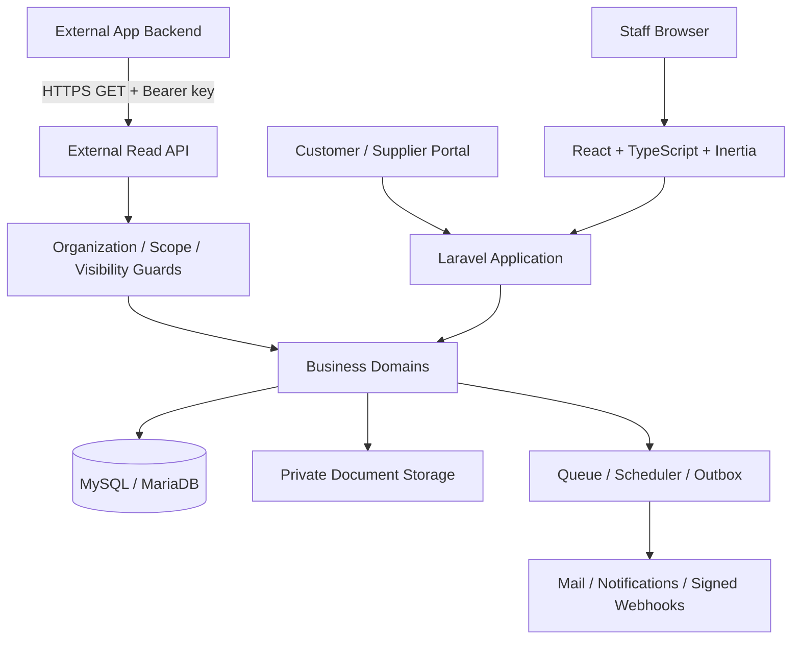

# Company OS / Lightweight ERP

ระบบบริหารองค์กรสำหรับ SME บริษัทบริการ ทีมโครงการ และธุรกิจจัดซื้อ/คลังสินค้า เชื่อมข้อมูลลูกค้า การขาย การเงิน โครงการ สินค้าคงคลัง และบุคลากรในระบบเดียว รองรับหลายองค์กรด้วยการแยกข้อมูลและสิทธิ์ผู้ใช้งาน

## ความสามารถหลัก

| กลุ่มงาน | ความสามารถ |
| --- | --- |
| CRM & Sales | ลูกค้า ผู้ติดต่อ Deals Pipeline ใบเสนอราคา และกิจกรรมติดตาม |
| Billing & Finance | ใบแจ้งหนี้ รับชำระบางส่วน/เต็มจำนวน Payment Reversal ค่าใช้จ่าย เอกสารรับ–จ่าย และรายงานอายุหนี้ |
| Accounting & Treasury | ผังบัญชี บัญชีคู่ งวดบัญชี งบทดลอง ธนาคาร กระทบยอด เงินสดย่อย เช็ค สินทรัพย์ และหลายสกุลเงิน |
| Procurement & Inventory | คู่ค้า PO/GRN Stock Ledger หลายคลัง Bin Locations Lot/Expiry Barcode/QR และต้นทุนเฉลี่ย |
| Projects & Tasks | โครงการจาก Won Deals สมาชิกโครงการ งานย่อย Checklists Comments และ Dashboard ตามบทบาท |
| HR & Payroll | ทะเบียนพนักงานและตำแหน่ง นำเข้า Excel/CSV ตารางกะ เวลาทำงานข้ามวัน การลา OT เงินเดือน และสลิป |
| Manufacturing | BOM หลายระดับ Work Orders และข้อมูลต้นทุนการผลิต |
| Documents & Approvals | เอกสารส่วนตัว Versioning Scan Gate ระดับความลับ Retention/Legal Hold สายอนุมัติ และ Delegation |
| Tax & Automation | เอกสารภาษี e-Tax XML/ลายเซ็นดิจิทัล คิวงาน AI OCR พร้อมผู้ตรวจยืนยัน และการพยากรณ์กระแสเงินสด |
| Portals & Notifications | Customer/Supplier Portal ผ่าน Magic Link การแจ้งเตือนในระบบ อีเมล และ External Channel Outbox |
| External Read API | Summary, Reference, Products, Inventory, HR/Employee, Sales, Procurement, Projects, Approvals, Manufacturing และ Documents |
| Administration | โครงสร้างองค์กร Users/Roles/Permissions Audit Logs 2FA และการจัดการ Integration Keys |

## ฟีเจอร์แยกตามโมดูล

รายการนี้ครอบคลุมหน้าที่ของระบบปัจจุบัน การเข้าถึงขึ้นกับ role/permission ของผู้ใช้ การเชื่อมบริการภายนอกต้องตั้งค่า credentials, queue และ scheduler ตามบริการนั้น ส่วนข้อมูล HR/Payroll ภายในระบบแยกจากข้อมูลที่อนุญาตให้อ่านผ่าน External API

### องค์กร ผู้ใช้งาน และสิทธิ์

- แยกข้อมูลหลายองค์กรด้วย `org_id`; จัดการข้อมูลบริษัท ชื่อนิติบุคคล และโครงสร้างสาขา/ฝ่าย/แผนก พร้อมกำหนดสำนักงานใหญ่
- เชิญผู้ใช้ด้วย token จัดการบัญชี เปิด–ปิดผู้ใช้ และกำหนดตำแหน่งในโครงสร้างองค์กร
- Roles และ Permission Matrix พร้อมบทบาทเริ่มต้น Owner, Admin, Sales, Project Manager, Finance, Member และ Viewer
- สมัคร/เข้าสู่ระบบ ยืนยันอีเมล รีเซ็ตรหัสผ่าน แก้ไขโปรไฟล์ และยืนยันรหัสผ่านซ้ำสำหรับงานสำคัญ
- TOTP 2FA, Recovery Codes, Trusted Devices และนโยบายบังคับตามบทบาท พร้อมการ reset โดย Owner
- Audit Logs สำหรับการเปลี่ยนข้อมูลสำคัญ และการตั้งรูปแบบ/ลำดับเลขเอกสารแยกตามประเภท

### CRM และ Sales Pipeline

- ทะเบียนลูกค้า ข้อมูลบริษัท/ภาษี ผู้ติดต่อหลายคน และ Primary Contact
- จัดการ Deals ตาม stage, มูลค่า, โอกาสปิดการขาย และสถานะ Won/Lost
- บันทึกกิจกรรม นัดหมายติดตาม และปิดกิจกรรมที่ทำแล้ว
- แปลง Won Deal เป็นโครงการ และติดตามข้อมูลขายผ่าน Sales Dashboard ตามสิทธิ์

### สินค้า บริการ และเอกสารขาย

- Product Catalog สำหรับสินค้า/บริการ พร้อม SKU หน่วย ราคา ต้นทุน และสถานะใช้งาน
- กำหนดภาษีแบบ Exclusive, Inclusive หรือ No Tax และคำนวณยอด/ส่วนลด/VAT ฝั่ง server
- ใบเสนอราคา: สร้าง แก้ไข อนุมัติ/ปฏิเสธ และแปลงเป็นใบแจ้งหนี้
- ใบแจ้งหนี้จาก Deal หรือสร้างโดยตรง พร้อมรายการสินค้า/บริการ สถานะ และการ void
- ใบลดหนี้/เพิ่มหนี้ (CN/DN), ใบวางบิล, ใบส่งของ (DO) และใบสำคัญรับ/จ่าย (RV/PV)
- พิมพ์และสร้าง PDF สำหรับเอกสารที่รองรับ พร้อมรูปแบบเอกสารทางการและข้อมูลภาษี

### รับชำระ ค่าใช้จ่าย และจ่ายคู่ค้า

- รับชำระบางส่วนหรือเต็มจำนวน ป้องกันยอดชำระเกินด้วย transaction/locking และกลับรายการรับชำระโดยเก็บประวัติ
- ค่าใช้จ่ายพร้อมเอกสารแนบ ผูกโครงการ/PO และกระบวนการ Draft → Approved/Paid หรือ Rejected
- บันทึก Vendor Payments และกลับรายการจ่ายคู่ค้า โดยแยกสิทธิ์ดู อนุมัติ และจ่าย
- ใบรับเงิน หนังสือรับรองหัก ณ ที่จ่าย และเอกสารหลักฐานการรับ–จ่ายตามรายการต้นทาง

### จัดซื้อและคู่ค้า

- ทะเบียน Suppliers พร้อมข้อมูลบริษัท ภาษี และช่องทางติดต่อสำหรับผู้มีสิทธิ์
- ใบขอซื้อ (PR) พร้อมอนุมัติและแปลงเป็น Purchase Order
- PO แบบหลายรายการ อนุมัติ/ยกเลิก เชื่อมค่าใช้จ่ายและใบรับสินค้า พร้อมพิมพ์/PDF
- GRN รับสินค้าตาม PO และติดตาม ordered/received/outstanding quantities

### คลังสินค้าและสต็อก

- Stock Movement Ledger และต้นทุนเฉลี่ยเคลื่อนที่ (Moving Average Cost)
- หลายคลังสินค้าและ Bin Locations พร้อมโอนย้ายระหว่างคลัง
- Lot/Batch และวันหมดอายุสินค้า
- ตรวจนับสินค้า ปรับปรุงยอด และบันทึกการเคลื่อนไหวตามสิทธิ์
- Barcode/QR Scan สำหรับค้นหาและทำงานกับสินค้า
- Reorder/Low-stock information ตามจุดสั่งซื้อของสินค้า และ Procurement/Inventory Dashboard

### ธนาคาร เงินสดย่อย และเช็ค

- ทะเบียนบัญชีธนาคารพร้อมข้อมูลสำคัญเข้ารหัส และการโอนเงินระหว่างบัญชี
- นำเข้า CSV Bank Statement จับคู่/ยกเลิกการจับคู่รายการ และ Bank Reconciliation
- กองเงินสดย่อย คำขอเบิก อนุมัติ/ปฏิเสธ จ่าย และเติมคืนกองเงิน
- ทะเบียนเช็ค/PDC พร้อมวงจรสถานะ และ Treasury Reports

### บัญชีแยกประเภทและหลายสกุลเงิน

- ผังบัญชี งวดบัญชี และการปิดงวด
- บัญชีคู่ (Double-entry Journals) จากรายการต้นทางและรายการบันทึกโดยตรง พร้อมตรวจยอดสมดุล
- Reverse Journal โดยรักษาประวัติเดิม รายงาน Trial Balance และ General Ledger
- Currency/Exchange Rate Master พร้อมอัตราย้อนหลังและ snapshot ของเอกสารที่รองรับ
- Realized/Unrealized FX, AR Revaluation/Reverse และการเชื่อม AP/Inventory FX
- บัญชีเงินฝากเงินตราต่างประเทศ (FCD) และการเชื่อมบัญชีธนาคารกับ GL

### สินทรัพย์ถาวร

- หมวดหมู่และทะเบียนสินทรัพย์ พร้อมข้อมูลการได้มา อายุใช้งาน และเอกสารแนบ
- คำนวณค่าเสื่อมราคาเส้นตรงรายเดือนและบันทึก GL
- จำหน่าย/ตัดบัญชีสินทรัพย์พร้อมผลทางบัญชีและประวัติรายการ

### ภาษีและ e-Tax

- รายงานภาษีขาย/ซื้อ ภ.พ.30, ภ.ง.ด.3/53, หนังสือรับรอง50ทวิ และ AR/AP Aging
- Export รายงานตามรูปแบบที่แต่ละรายงานรองรับ รวม CSV/Excel และ RD Prep
- สร้าง e-Tax XML, เก็บไฟล์แบบ private และตรวจ hash
- Digital Signature แบบ Enveloped XML-DSig, RSA-SHA256 และการอ้างอิง certificate
- คิว submit, การ inquire status และ callback ที่ตรวจ HMAC; เลือกโหมด/adapter ตามการตั้งค่าผู้ให้บริการ
- การนำส่งจริงต้องใช้ credentials/certificate และผ่านข้อกำหนดของผู้ให้บริการและหน่วยงานปลายทาง

### Payment Gateway และ PromptPay

- สร้าง Thai PromptPay QR สำหรับใบแจ้งหนี้ รองรับข้อมูลรับเงินตามการตั้งค่าองค์กร
- Opn checkout/event verification และหน้าจัดการ Payment Gateway
- Signed settlement bridge พร้อม HMAC, timestamp window และการป้องกันรายการซ้ำ
- ตรวจหลักฐานการชำระก่อนสร้างรายการรับเงิน/GL; การตั้ง gateway ไม่ถือว่ารายการได้รับเงินจริงแล้ว

### โครงการและงาน

- สร้างโครงการโดยตรงหรือจาก Won Deal พร้อมสมาชิกโครงการและผู้รับผิดชอบ
- จัดการ Tasks, สถานะ, กำหนดส่ง, ความคืบหน้า และงานที่เกินกำหนด
- Checklists และ Comments ของงาน
- เชื่อมค่าใช้จ่ายกับโครงการเพื่อดูต้นทุน พร้อม Delivery Dashboard และ My Work ตามสิทธิ์

### บุคลากร ตำแหน่ง และเวลาทำงาน

- Employee Master แยกจาก User รองรับพนักงานที่มีและไม่มีบัญชีเข้าสู่ระบบ
- รหัสพนักงาน สถานะ/ประเภทการจ้าง โครงสร้างองค์กร ผู้บังคับบัญชา วันเริ่มงาน ทดลองงาน และพ้นสภาพ
- Position Master พร้อมค้นหา/เลือกตำแหน่งและสร้างตำแหน่งจากฟอร์มที่รองรับ
- Bulk Import พนักงานจาก Excel/CSV/TSV พร้อมตรวจข้อมูลและจัดการตำแหน่งตามการนำเข้า
- Shift Master, วันหยุด, Work Profile และ Roster Matrix สำหรับจัดกะ
- ลงเวลาเข้า–ออกและนำเข้าข้อมูลเครื่องสแกน พร้อม reconciliation, กะข้ามวัน และนาทีสาย/กลับก่อน/ทำงาน/OT
- การตั้ง privacy ของ attendance รวมการเก็บ IP แบบ hash และ GPS ตามนโยบาย/ความยินยอม
- ประเภทลา โควตาวันลา คำขอ/ส่งอนุมัติ/ยกเลิก และคืนสิทธิ์ตามกฎการลา
- สรุปเวลาทำงานพร้อม lock/reverse เพื่อส่งต่อข้อมูลที่ตรวจแล้วไปกระบวนการเงินเดือน

### เงินเดือนและสลิป

- Payroll Profile และนโยบายภาษี/ประกันสังคมแบบ effective-dated/versioned
- Payroll Run: สร้าง คำนวณ อนุมัติ และจ่ายตามสิทธิ์
- คำนวณรายรับ/รายการหักและ OT ตามข้อมูล/อัตราที่กำหนด พร้อม calculation snapshot
- รองรับพนักงานที่ไม่มี User และเชื่อมข้อมูลสรุปเวลาทำงานที่ตรวจแล้ว
- สลิปเงินเดือนสำหรับพิมพ์/PDF และส่งอีเมลตามสิทธิ์
- รายงาน/ไฟล์ประกอบ ภ.ง.ด.1/1ก และประกันสังคม รวมการบันทึก GL จากกระบวนการจ่าย
- ข้อมูลเงินเดือนและบัญชีธนาคารอยู่ภายใต้สิทธิ์ภายใน ไม่มีการเปิดผ่าน External Read API

### การผลิตและต้นทุน

- BOM พร้อม version, รายการวัตถุดิบ, sub-BOM และการ duplicate
- BOM Explosion หลายระดับ พร้อมตรวจ circular dependency และคำนวณความต้องการวัตถุดิบ
- Work Orders: สร้าง แก้ไข วางแผน release ตรวจคุณภาพ complete และ cancel ตามสถานะ
- บันทึก planned/actual/scrap quantities และข้อมูลคลังต้นทาง/ปลายทาง
- บันทึกต้นทุนวัตถุดิบ ค่าแรง และโสหุ้ย พร้อมเส้นทางเชื่อม stock/GL ตามรายการผลิต

### คลังเอกสารองค์กร

- Central DMS พร้อมหมวดหมู่และ immutable versions
- Private storage, สิทธิ์ตามเอกสาร/parent entity และระดับความลับ
- Scan Gate/Quarantine และดาวน์โหลดเฉพาะไฟล์ที่ผ่านเงื่อนไข
- เชื่อมเอกสารกับข้อมูลธุรกิจ พร้อม expiry/renewal และการแจ้งเตือน
- Retention Policy, Legal Hold, Archive และ explicit purge ผ่านคำสั่งสำหรับผู้ดูแล

### สายอนุมัติและการแจ้งเตือน

- Workflow Definitions แบบ versioned และ snapshot ต่อคำขอ
- Routing ตามวงเงิน บุคคล หัวหน้างาน หรือบทบาท พร้อมลำดับขั้นและรูปแบบ first-to-approve ที่รองรับ
- SoD ป้องกันอนุมัติคำขอตัวเอง, temporary delegation และ Approval Inbox
- In-app Notifications, อีเมลผ่าน queue และ preferences ของผู้ใช้
- LINE OA / Slack / Telegram ผ่าน outbox พร้อม encrypted credentials, retry/backoff และ dead-letter
- Quiet Hours และ Daily Digest ตามสิทธิ์ผู้รับ

### Customer และ Supplier Portal

- เข้าถึงผ่าน Magic Link ใช้ครั้งเดียว/หมดอายุ และแยก portal session จาก staff
- Customer ดูข้อมูลการค้าที่ได้รับอนุญาต ยืนยันใบเสนอราคา และเข้าถึงใบแจ้งหนี้/QR ตามสิทธิ์
- Supplier ส่ง vendor bill พร้อมกักกันไฟล์รอตรวจ ไม่สร้างรายการบัญชีที่อนุมัติแล้วโดยอัตโนมัติ
- ดาวน์โหลดเอกสารที่ portal grant อนุญาต และถอน session/access ได้ตามนโยบาย

### Dashboard และการพยากรณ์

- Admin, Executive, Sales, Finance, Delivery, My Work, Procurement/Inventory และ HR/Payroll Dashboards รวมมุมมอง portal
- ตัวกรองช่วงวันและมิติข้อมูลที่แต่ละหน้าอนุญาต เก็บ filter state ใน URL พร้อม filtered drill-down
- Charts และ widgets แสดงตาม permission และแยก current snapshot จากข้อมูลตามช่วงเวลา
- Cash Flow Forecast30–180วัน แบบ Base/Best/Worst พร้อมปรับ scenario และบันทึก daily snapshots
- ตัวชี้วัด Current Ratio, Quick Ratio, DSO, DPO และ Working Capital Runway ตาม source ที่มี
- แยก forecast จากยอดทางบัญชีจริง และระบุข้อมูลที่ source ยังไม่รองรับแทนการสมมติค่า

### AI OCR และการตรวจเอกสาร

- ตั้งค่า OpenAI-compatible Vision endpoint/model/credentials และทดสอบการเชื่อมต่อ
- รองรับ local endpoint เช่น Ollama/LM Studio หรือ cloud endpoint ที่เข้ากันได้
- Upload ภาพ/Scanned PDF สกัดข้อมูลเอกสาร และตรวจเลขภาษี/ยอดคำนวณ
- Split-screen Reviewer เทียบเอกสารต้นฉบับกับข้อมูลสกัด พร้อมยืนยันหรือ reject
- แปลงข้อมูลที่ผู้ตรวจยืนยันเป็น Assisted Draft Expense/Vendor Bill โดยไม่ auto-post GL

### External API และการเชื่อมแอป

- Summary10โดเมน และ read list/detail ของ Reference, Products, Inventory, Employees, Parties, เอกสารขาย/จัดซื้อ, Projects/Tasks, Approvals, Manufacturing และ Documents
- Bearer integration keys, scopes, expiry/revoke, one-time reveal และ Admin API Access
- Organization/party visibility, HR branch restrictions, document allowlist และ scope แยกราคา/ต้นทุน/สูตร/download
- Cursor pagination, watermark/delta ใน resource ที่รองรับ และ full reconciliation สำหรับข้อมูลลบ/สิทธิ์/derived changes
- Outbound signed webhooks พร้อม ownership verification, retry/dead-letter และ Admin delivery tracking
- ไม่มี business Write API และไม่ส่ง national_id/payroll/bank/private contacts ผ่านชุดข้อมูลภายนอก

### การติดตั้งและประสบการณ์ใช้งาน

- Web Setup Wizard พร้อม token activation, requirements report, database preflight, สร้าง environment/Owner และ installer lock
- รองรับ CLI setup, background queue และ scheduled tasks
- หน้าจอ React/Inertia พร้อม Dark/Light Theme และกราฟ SVG ที่รองรับการเข้าถึง
- Create/Edit Dialog พร้อม dirty detection, discard guard และการป้องกันส่งฟอร์มซ้ำใน flows ที่รองรับ
- File preview/download ตาม parent permission และการตั้งค่าองค์กร/เลขเอกสาร/notification channels จากหน้าผู้ดูแล

## สถาปัตยกรรมระบบ



### Diagrams และเอกสารสถาปัตยกรรม

ไฟล์ Mermaid อ่านได้บน GitHub ส่วน Interactive HTML ให้เปิดด้วย browser หลัง clone repository

| เอกสาร | รายละเอียด |
| --- | --- |
| [Diagram Index](document/README.md) | สารบัญสถาปัตยกรรมและ workflow |
| [Interactive Diagram Portal](document/index.html) | รวม HTML diagrams พร้อมเครื่องมือสำรวจ |
| [Domain Workflows](document/GROUPS_WORKFLOW.md) | การทำงานระหว่างโมดูลและวงจรสถานะ |
| [Database ER Diagram](document/DATABASE_ERD.md) | ความสัมพันธ์ของข้อมูล |
| [HR / Attendance / Payroll](document/17_hr_employee_attendance_payroll.md) | Employee Master ตารางกะ เวลาทำงาน และการคำนวณเงินเดือน |
| [e-Tax Pipeline](document/18_etax_gateway_pipeline.md) | XML Signature คิวส่ง และการรับสถานะ |
| [Cash Flow Forecasting](document/19_cash_flow_forecasting_engine.md) | สถานการณ์จำลองและตัวชี้วัดการเงิน |
| [AI OCR Ingestion](document/20_ai_ocr_document_ingestion.md) | การรับเอกสาร สกัดข้อมูล และตรวจยืนยัน |
| [Web Setup Wizard](document/21_setup_wizard_installer_lifecycle.md) | Preflight การติดตั้ง และ Installer Lock |
| [External API Architecture](document/22_external_api_architecture.md) | Read API, key lifecycle, visibility, sync และ outbound webhooks |

## Technology Stack

| ส่วน | เทคโนโลยี |
| --- | --- |
| Backend | PHP 8.3+, Laravel 13 |
| Frontend | React 18, TypeScript, Inertia.js, Tailwind CSS |
| Build | Vite, pnpm |
| Database | MySQL / MariaDB |
| Authentication | Laravel Breeze, RBAC, Password Confirmation, TOTP 2FA |
| Background Processing | Laravel Queue, Scheduler, Transactional Outbox |
| Documents | DomPDF, Private Storage, OpenSSL / XML-DSig |
| Quality Tools | PHPUnit, Laravel Pint, ESLint, Prettier |

## การติดตั้ง

### Web Setup Wizard

ใช้ release bundle ที่มี `backend/vendor/` และ `backend/public/build/` แล้ว

1. เตรียม PHP 8.3+ พร้อม `pdo_mysql`, `openssl`, `mbstring`, `fileinfo`, `dom`, `simplexml`, `curl` และฐานข้อมูล MySQL/MariaDB ว่าง
2. ตั้ง Web Document Root เป็น `backend/public` และให้ web-server user เขียน `backend/storage`, `backend/bootstrap/cache` และสร้าง `backend/.env` ได้
3. เปิด `/setup/system-requirements.php` เพื่อตรวจ runtime และสิทธิ์ไฟล์
4. คัดลอก `backend/setup/enable.php.example` เป็น `enable.php` แล้วตั้ง random token อย่างน้อย32ตัวอักษร หรือกำหนด `SETUP_TOKEN` ผ่าน server environment
5. เปิด `/setup` ผ่าน HTTPS กรอก token ตั้งค่า Application URL/ฐานข้อมูล/องค์กร และ Owner password อย่างน้อย12ตัวอักษร
6. ตรวจรายละเอียด พิมพ์ `INSTALL` และยืนยัน ระบบจะสร้าง environment รัน migrations สร้าง Owner และล็อก installer

รายละเอียด: [Setup Wizard Guide](docs/SETUP_WIZARD.md)

### Local Development

ต้องมี PHP/Composer, Node.js/pnpm และ MySQL/MariaDB

```sh
cd backend
composer install
pnpm install
```

คัดลอก `.env.example` เป็น `.env` แล้วตั้ง `APP_URL` และ `DB_*` ให้ตรงฐานข้อมูลสำหรับพัฒนา

```sh
php artisan key:generate
php artisan migrate
php artisan storage:link
```

หากต้องการข้อมูลตัวอย่าง ให้รัน `php artisan db:seed` เฉพาะฐานพัฒนา บัญชีตัวอย่าง เช่น `owner@example.com`, `admin@example.com`, `sales@example.com`, `pm@example.com`, `finance@example.com`, `member@example.com`, `viewer@example.com` ใช้รหัสผ่าน `password`; ไม่ใช้ข้อมูล seed เหล่านี้บน production

เปิดแยกสอง terminal จาก `backend/`:

```sh
php artisan serve
```

```sh
pnpm run dev
```

เข้าใช้งานที่ `http://127.0.0.1:8000`

### Background Jobs และ Production

สร้าง frontend bundle ด้วย `pnpm run build`, ตั้ง `APP_ENV=production`, `APP_DEBUG=false`, HTTPS และค่า mail/queue/storage ตาม deployment ของระบบ เก็บ `.env` และ private storage นอกเส้นทางไฟล์สาธารณะ สำรองฐานข้อมูลก่อนรัน migrations และรักษา `APP_KEY` สำหรับข้อมูลเข้ารหัส

รัน queue worker ด้วย process supervisor และตั้ง scheduler ทุกนาที:

```sh
php artisan queue:work
php artisan schedule:run
```

`queue:work` เป็น process ต่อเนื่อง ส่วน `schedule:run` ให้เรียกผ่าน cron/task scheduler การเชื่อม Payment Gateway, e-Tax และ notification channels ต้องตั้ง credentials และตรวจปลายทางของแต่ละบริการก่อนใช้งาน

## External Read-only API

Base path: `/api/v1` ใช้ `Authorization: Bearer <INTEGRATION_SECRET>` จาก backend ของแอปผู้เรียก รองรับ62 GET paths ตาม [OpenAPI](docs/openapi/external-read-v1.json)

| กลุ่ม | ตัวอย่าง endpoints |
| --- | --- |
| Summary | `/summaries/{domain}`: sales, finance, projects, inventory, hr, attendance, leaves, roster, procurement, manufacturing |
| Reference / Catalog | `/reference/branches`, `/reference/departments`, `/reference/warehouses`, `/products`, `/products/{id}` |
| Inventory | `/inventory/balances` พร้อม warehouse/bin/lot/expiry |
| Employee | `/employees`, `/employees/{id}`, `/employees/{id}/{resource}`: attendance, roster, leave-requests, leave-balances |
| Sales / Procurement | `/customers`, `/suppliers`, `/quotations`, `/invoices`, `/delivery-orders`, `/payments`, `/purchase-orders`, `/goods-receipts` พร้อม detail/items ตาม resource |
| Projects / Approvals | `/projects`, `/projects/{id}/tasks`, `/tasks`, `/approvals` และ detail |
| Manufacturing / Documents | `/manufacturing/boms`, `/manufacturing/work-orders`, `/documents`, `/documents/{id}/download` |

### Key Management และ Visibility

เปิด **Administration & Settings → API Access** (`/settings/api-access`)

- ดูด้วย `api_keys.view`; จัดการด้วย `api_keys.manage` พร้อม password confirmation/2FA policy
- Secret แสดงเต็มครั้งเดียว เก็บเฉพาะ hash และรับผ่าน Authorization header
- เลือก scopes เฉพาะที่ใช้; ราคา ต้นทุน สูตร และ download แยกสิทธิ์
- เลือก organization หรือ customer/supplier principal; party key เห็นเฉพาะข้อมูลของ party ที่กำหนด
- HR key ต้องระบุสาขาที่อ่านได้ Documents ต้องเลือก explicit document IDs ภายใต้ classification/ACL
- เปลี่ยน scopes/policy โดยสร้าง key ใหม่ อัปเดตแอปผู้เรียก แล้ว revoke key เก่า

```sh
curl --get 'https://erp.example.com/api/v1/employees' \
  --header 'Accept: application/json' \
  --header 'Authorization: Bearer <INTEGRATION_SECRET>' \
  --data-urlencode 'limit=50'
```

### ขอบเขตข้อมูลและ Sync

API ภายนอกใช้ GET/HEAD เท่านั้น ไม่มี create/update/delete หรือ approval actions และไม่ส่งเงินเดือน บัญชีธนาคาร เลขบัตรประชาชน ข้อมูลติดต่อส่วนตัว GPS หรือเหตุผลลา พนักงานใช้ UUID/`employee_code` อ้างอิง; Leave ของพนักงานที่ไม่มี linked User ตอบ409 `unsupported_employee_coverage`

List ใช้ cursor ค่าเริ่มต้น50 สูงสุด100รายการ มี fixed sync watermark สำหรับ resource ที่รองรับ delta ต้องทำ full reconciliation เพื่อจัดการข้อมูลลบ สิทธิ์ที่เปลี่ยน และ derived values; live pagination ไม่ใช่ database snapshot

เงินและปริมาณส่งเป็น decimal strings ไม่ส่ง organization cash balance หรือ inventory available-to-promise ที่ไม่มี reservation ledger ดาวน์โหลดเอกสารเป็น private stream และตรวจสิทธิ์กับ scan status ทุกครั้ง

### Outbound Webhooks

จัดการที่ `/settings/api-access/webhooks` ส่ง minimal event pointer เมื่อ invoice payment status, stock balance, task status หรือ approval status เปลี่ยน ให้ผู้รับตรวจ HMAC/timestamp, dedupe event ID แล้วดึงข้อมูลล่าสุดด้วย GET

ค่าเริ่มต้น `EXTERNAL_API_WEBHOOKS_ENABLED=false` เปิดหลังตั้ง migrations, cURL, scheduler และ verify receiver สำเร็จเท่านั้น รองรับ retry/dead-letter และส่งแบบ at-least-once ปลายทางต้อง HTTPS443/public DNS ไม่มี redirect

คู่มือ: [Read API & Sync](docs/EXTERNAL_READ_API.md) · [Integration / Client](docs/EXTERNAL_API_INTEGRATION.md) · [Summary Metric Dictionary](docs/EXTERNAL_SUMMARY_API.md) · [OpenAPI](docs/openapi/external-read-v1.json) · [Server Client / Receiver Examples](examples/external-api)

## Security & Data Integrity

- แยกองค์กรด้วย `org_id` และตรวจ parent/row permissions ก่อนเข้าถึงข้อมูล
- RBAC, password confirmation และ TOTP 2FA สำหรับการทำงานตามนโยบายองค์กร
- คำนวณเงินฝั่ง server ป้องกัน overpayment และเก็บ reversal/audit แทนลบประวัติการเงิน
- Private files ใช้ parent ACL, scan gate และ classification; ไม่เปิด storage paths ผ่าน API
- API ใช้ HTTPS, scope/expiry/revoke, no-store, rate limit และ sanitized telemetry; ไม่ฝัง secrets ใน browser/mobile binary
- AI OCR ต้องมีผู้ตรวจยืนยันก่อนส่งเข้ากระบวนการบัญชี

อ่านเพิ่มเติม: [Security Requirements](docs/SECURITY_REQUIREMENTS.md) · [Validation Rules](docs/VALIDATION_RULES.md) · [Architecture Decisions](docs/ARCHITECTURE_DECISIONS.md)

## การทดสอบและพัฒนา

รันจาก `backend/` โดยตรวจให้ environment ทดสอบแยกจากฐานใช้งานจริง:

```sh
php artisan test
php vendor/bin/pint --test
pnpm run lint
pnpm run check-format
pnpm run build
```

ทดสอบตัวอย่าง API client/receiver จาก repository root:

```sh
node --test examples/external-api/summary-client.test.mjs examples/external-api/webhook-verifier.test.mjs
```

สัญญา API และเอกสารโดเมนอยู่ใน [docs/](docs/README.md) การแก้ fields/scopes/metrics ต้องปรับ contract และ tests ให้สอดคล้องกัน
