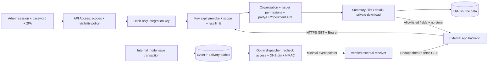

# External Read-only API — P1–P6

อัปเดต 2026-10-19: มี implementation รวม 62 GET paths ตาม [OpenAPI 1.2.0](openapi/external-read-v1.json). ทุก route `/api/v1` รับเฉพาะ GET/HEAD ผ่าน integration key. **ไม่มี business Write API, payroll, salary, bank account หรือ identity API** ตามคำสั่งผู้ใช้ล่าสุด. Admin session จัดการ key/webhook แยกจากสิทธิ์แอปภายนอก.

สถานะ: มีโค้ดและ automated checks; รอ Gemini ตรวจรวมและ Browser UAT. Deployment/แอปจริง/SLA deferred ตามผู้ใช้ ไม่ถือว่าผ่าน acceptance จากเอกสารนี้. หลักฐานคำสั่งและข้อจำกัดอยู่ใน [gpt.md](../gpt.md).

## ขอบเขต

| Phase | Read resources / สัญญา |
| --- | --- |
| P0 | Sales/Finance/Projects summaries — [metric dictionary](EXTERNAL_SUMMARY_API.md) |
| P1 | Reference branches/divisions/departments/positions/warehouses/currencies, Products list/detail, Inventory summary/balances/lot/expiry — [contract](EXTERNAL_API_P1_CONTRACT.md) |
| P2 | HR/Attendance/Leave/Roster summaries, Employee directory/profile/attendance/roster/leave requests/balances — [contract](EXTERNAL_API_P2_CONTRACT.md) |
| P3 | Customers/Suppliers, Quotations/Invoices/Delivery Orders/Payments list/detail และ document items — [contract](EXTERNAL_API_P3_P4_CONTRACT.md) |
| P4 | Procurement summary, PO/GRN list/detail/items, Projects/Tasks list/detail/project tasks — [contract](EXTERNAL_API_P3_P4_CONTRACT.md) |
| P5 | Approval list/detail; outbound signal + transactional outbox/delivery status — [contract](EXTERNAL_API_P5_CONTRACT.md) |
| P6 | Manufacturing summary/BOM/WO/items, Documents metadata/private download — [contract](EXTERNAL_API_P6_P7_CONTRACT.md) |
| P7 | ตัด sensitive/payroll/bank และ Write APIs ทั้งหมดออก ไม่ใช่งานที่จะเปิดเพิ่มในรอบนี้ |



Diagram HTML [22](../document/22_external_api_architecture.html) เป็น P0 baseline เดิม; diagram ด้านบนแสดงขอบเขตที่ขยาย ไม่แก้ artifact ตรวจรับเดิมย้อนหลัง.

## Key และสิทธิ์

หน้า **Administration & Settings → API Access** `/settings/api-access`; Webhooks `/settings/api-access/webhooks`. ใช้ `api_keys.view` / `api_keys.manage`, password confirmation และ 2FA policy เดิม. Key แสดง secret เต็มครั้งเดียว เก็บ hash; webhook signing secret ต้องเข้ารหัสเพราะใช้ sign payload. เก็บ secret เฉพาะ backend/secret store ของแอป.

- Scope ใหม่เป็น opt-in; key เดิมไม่ได้รับสิทธิ์เพิ่ม. แก้ scopes/visibility โดยสร้าง key ใหม่แล้ว revoke เก่า.
- เลือก organization หรือ customer/supplier principal. Party key เห็นเฉพาะ resource ของ party ที่ผูกและเอกสารที่เผยแพร่แล้ว; ไม่ได้สิทธิ์ organization summary/HR/documents โดยอัตโนมัติ.
- HR ต้องมีสิทธิ์โดเมนและระบุ `hr_all_branches=true` หรือ `hr_branch_ids` ชัดเจน. Summary scope ไม่ให้ employee detail.
- Documents ต้องเลือก `document_ids` ที่ผู้สร้าง key อ่านได้อย่าง explicit; จำกัด classification และ link ACL, ตรวจ current-version parent และ scan สะอาดก่อน download. ไม่เผย storage path/public URL. ต้องไม่เลือกไฟล์ข้อมูลที่ผู้ใช้ตัดออกผ่านช่องทางนี้.
- ราคา/ต้นทุน/สูตร/ดาวน์โหลดแยก scope; ตรวจ permission ผู้สร้าง key ปัจจุบันสำหรับ resource domains. ห้ามส่ง `org_id`, `user_id` หรือ arbitrary fields/include/table.
- Production บังคับ HTTPS; CORS ไม่เปิดให้ browser ถือ key. ค่าปริยาย 60 requests/minute/key; 429 เคารพ Retry-After. ทุก response no-store. Logs เก็บ request/key/route/status/duration ไม่เก็บ token/search/body.

## Pagination และ sync

List มาตรฐาน `limit=50` สูงสุด100, stable order `(updated_at,id)` และ opaque encrypted cursor อายุ30นาที. Cursor ผูก key/org/scopes/policy/path/filter/limit; เปลี่ยนบริบทหรือหมดอายุตอบ422. Inventory balances ใช้ tuple cursor ของกลุ่มยอดคงเหลือ ไม่มี row delta.

1. Bootstrap ดึงทุกหน้าด้วย filters เดิม เก็บข้อมูลเป็น UUID และเก็บ `meta.sync_watermark` ของหน้าแรก.
2. ใช้ `meta.next_cursor` จน null; watermark คงเดิมตลอดชุด ไม่ใช้ generated_at ของหน้าสุดท้ายเป็น checkpoint.
3. Resource ที่ `meta.delta_supported=true` รับ `updated_since=YYYY-MM-DDTHH:mm:ssZ` แบบ inclusive. เริ่มรอบใหม่จาก watermark ของรอบที่สำเร็จ เก็บทับตาม UUID เพื่อรับข้อมูลขอบวินาทีซ้ำได้.
4. Cursor หมดอายุ/เปลี่ยน policy ให้เริ่ม reconciliation ใหม่. ถ้า key revoked/401 หยุด sync และระงับสำเนาข้อมูลจนผู้มีสิทธิ์ตัดสินใจ; 403 ไม่ retry เพื่อข้ามสิทธิ์.
5. ทำ **full reconciliation ตามนโยบายผู้รับเสมอ**: ลบสำเนาที่ไม่อยู่ในชุดที่ credential ยังอ่านได้. Tombstone มีเฉพาะ resource ที่รองรับ soft deletes/delta; hard deletes, parent/ACL/visibility change และ derived fields อาจไม่เปลี่ยน updated_at ของ resource หลัก.

Live pagination ไม่ใช่ database snapshot. Row ที่เปลี่ยนหลัง watermark อาจหายจากรอบปัจจุบันและกลับมาใน delta รอบถัดไป; ต้องรับ duplicates และ reconcile. ไม่อ้าง exactly-once sync หรือ audit change feed.

`updated_since` ใช้ไม่ได้กับ inventory balances, approvals, PO items และ employee operational lists เพราะมี grouping/derived values/parent updates. ตอบ422; อ่านใหม่ตามช่วงวันหรือ reconcile. Directory/list อื่นที่รองรับ delta ก็ยังต้อง reconcile ความเปลี่ยนแปลงของลูก/สิทธิ์ เช่น receipt เปลี่ยนยอด PO, shift details, BOM costs หรือ document current version.

## ข้อจำกัด source data ที่เปิดเผยตรงไปตรงมา

- Inventory ส่ง `on_hand` เท่านั้น ไม่มี reservation ledger/ATP/available และไม่มี unit master ให้เปิด endpoint หน่วย. ปริมาณ decimal string4ตำแหน่ง; หน่วยตัวพิมพ์ต่างกันไม่รวมกัน.
- เงิน decimal string2ตำแหน่งแยกสกุลเงิน ไม่ส่ง organization cash balance. Manufacturing cost ไม่มี currency snapshot จึงส่ง null พร้อมเหตุผล; ปริมาณ summary ใช้หน่วย Product ปัจจุบัน ไม่อ้างหน่วยย้อนหลัง.
- Employee ใช้ Employee UUID รองรับ non-User. Leave ต้อง linked User ใน org เดียวกัน; ไม่มี bridge ตอบ409 `unsupported_employee_coverage`. Balance เป็น current year/current state ไม่อ้างย้อนหลัง. Work contact ถูกงดเพราะยังแยกส่วนตัวไม่ได้.
- HR snapshot แยกจาก period; active = active/probation ที่วันเริ่ม/พ้นสภาพครอบคลุมวันปัจจุบัน. กลุ่มโครงสร้าง/roster ที่เล็กกว่า5 suppress จำนวน, cap100groups.
- Attendance dedupe employee/work_date เลือก reconciled ก่อน; minutes นับเฉพาะ reconciled. ไม่มี punch ไม่ถือว่า absent. Leave approved employee-workdays dedupe employee/date เฉพาะวันทำงานจันทร์–ศุกร์ลบ org holiday ในช่วง; ไม่ใช่ payroll entitlement.
- Roster ใช้ current status + recorded employment dates. `missing_schedule_workdays=null` เพราะไม่มี required-workday calendar รายคนที่เชื่อถือได้. ไม่มี Project/Task time-entry schema จึงไม่ส่ง work hours.
- Manufacturing API อ่าน stored state; ประเด็น Phase27 เดิมใน gpt.md ยังไม่ถูกปิดด้วย API นี้.

## Client ตัวอย่าง

```js
import { createExternalReadClient } from '../examples/external-api/summary-client.mjs';
const api = createExternalReadClient({
  baseUrl: process.env.ERP_API_BASE_URL, // https://erp.example.com/ERP/api/v1
  secret: process.env.ERP_API_SECRET,
});
const page = await api.get('products', { limit: 50 });
// ต่อหน้าด้วย cursor + filters เดิม เก็บ meta.sync_watermark และ reconcile
```

Client อนุญาตเฉพาะ path/read filters ที่กำหนด, timeout/bounded retry/redirect guard และ sanitized errors. Download เป็น binary private stream ใช้ server HTTP client พร้อม Bearer และตรวจ status/content-type ก่อนเก็บ ไม่ใช้ JSON helper. ดู [Integration guide](EXTERNAL_API_INTEGRATION.md) และ `examples/external-api/smoke.mjs`.

## Outbound webhook — ค่าเริ่มต้นปิด

P5 เป็นสัญญาณไปยัง receiver เพื่อให้ดึง GET ใหม่ ไม่รับคำสั่งเขียนธุรกิจเข้า ERP. จัดการผ่าน Admin session; integration key ไม่มี route จัดการ endpoint.

- Event เฉพาะ invoice payment status, stock balance, task status, approval status; payload event UUID/version/time/resource pointer ไม่มีชื่อ/ยอดเงิน/PII. เช็ก key/party/row scope ใหม่ก่อนส่ง.
- Receiver ตรวจ `X-ERP-Signature` ด้วย HMAC SHA256(timestamp + '.' + exact bytes), timestamp ภายใน5นาที และ timing-safe compare ก่อน parse/ทำงาน. ใช้ [webhook-verifier.mjs](../examples/external-api/webhook-verifier.mjs).
- Ownership challenge ต้องตรวจลายเซ็นก่อน แล้วตอบ challenge และ HMAC(secret, 'verify:' + challenge). Rotate แล้ว pause จน verify ใหม่.
- เก็บ dedupe event UUID แบบ durable ก่อน enqueue, ตอบ2xxเมื่อรับงานได้ แล้ว worker GET current state ตาม scope. ห้ามถือว่า event order ตรง source order. ส่งซ้ำได้หลัง timeout; retries สูงสุด5 แล้ว dead-letter ไม่รับประกัน exactly-once.
- ปลายทาง HTTPS443/public DNS เท่านั้น, IP pinning/TLS/redirect off/proxy off/response-size/time limits. ไม่มี network จริงใน tests.
- Model saves ของ sources ที่มี observer เก็บ event/delivery ใน transaction; bulk SQL และ delete ไม่สร้าง webhook ให้ full reconciliation รองรับ.

## Deployment ที่ยัง deferred

ยังไม่รัน migration ใหม่บนฐาน ERP ใช้งานจริง: `2026_10_19_000001_add_integration_access_policy` และ `2026_10_19_000002_create_external_webhook_outbox`. ตรวจ prerequisite migrations ของ source domains และ indexes ด้วย deployment process/backup ปกติก่อนเปิด. Tests ใช้ SQLite in-memory ไม่ใช่ฐานจริง.

เปิด read APIs หลัง migrate และทดสอบ Admin policy ใน target environment; ปิด key ที่ไม่ต้องใช้. หลาย instance ต้องใช้ shared rate-limit cache และ app encryption key ที่จัดการถูกต้อง. Webhook ต้อง cURL พร้อม DNS pinning, scheduler และ `EXTERNAL_API_WEBHOOKS_ENABLED=true` หลังยืนยันปลายทางจริง; ตอนนี้ false และไม่ได้ส่ง live network. ตรวจ Browser UAT, integration จริง, MariaDB correctness/performance และ concurrent HTTP SLA ของโดเมนใหม่ก่อนประกาศพร้อม production. Benchmark P0 เดิมไม่ครอบคลุม P1–P6.
