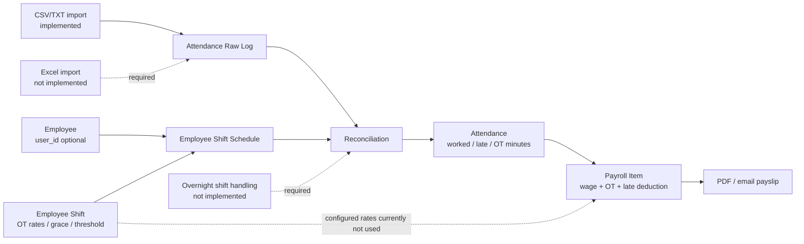

# Phase 23.3 — HR Employee Master, Shift, Attendance และ Payroll

> สถานะ ณ 2026-09-20: **In progress / ไม่ผ่านการตรวจรับปิด Phase**

เอกสารนี้อธิบาย implementation ที่มีอยู่จริงและช่องว่างก่อนปิด Phase 23.3. Source of truth ของ runtime คือ migration, route และ test ใน `backend/`.

## สิ่งที่มีแล้ว

- `employees` แยกจาก `users`; `user_id` เป็น nullable และ profile เดิมถูก bridge ด้วย `employee_id`.
- Employee Directory: `/hr/employees`; จัดการข้อมูลพนักงาน, ความสัมพันธ์องค์กร และการผูกบัญชี ERP.
- Roster: `/hr/roster`; มี Shift Master, ตารางกะรายบุคคล และ batch assignment.
- Attendance Import: `/hr/attendance-import`; รับ **CSV/TXT** พร้อม template, raw punch log, reconciliation และ correction audit.
- Payroll รองรับ employee ที่ไม่มี `user_id`, wage type `monthly`/`daily`/`hourly`, OT/late fields และส่ง payslip ทางอีเมล.

## Diagram: ข้อมูลและขอบเขตปัจจุบัน

## ช่องว่างที่ต้องปิด

| ระดับ | ประเด็น | เกณฑ์ปิด |
| --- | --- | --- |
| P1 | Excel import | รองรับ `.xlsx`/`.xls` พร้อม validation, mapping และ tests หรืออนุมัติปรับ requirement เป็น CSV-only |
| P1 | Shift OT rate | Payroll ใช้ `ot_rate_normal`, `ot_rate_holiday`, `ot_rate_special_holiday` จาก source ที่ snapshot ได้ และมี test custom rate |
| P2 | OT วันหยุด 3x | กำหนดเงื่อนไข special holiday และคำนวณ 3x ได้จริง |
| P2 | กะข้ามวัน | จัดกลุ่ม punch และคำนวณ shift end ของวันถัดไปได้ พร้อม regression test |

## สิทธิ์และเส้นทาง

| หน้าจอ/การกระทำ | Route | Permission |
| --- | --- | --- |
| Employee Directory | `GET /hr/employees` | `hr.employees.view` |
| จัดการ Employee / account link | `POST/PATCH /hr/employees...` | `hr.employees.manage` + password confirm |
| Roster / batch assignment | `GET/POST /hr/roster...` | `hr.shifts.manage` + password confirm สำหรับ write |
| Import / reconcile / correct attendance | `GET/POST /hr/attendance-import...` | `hr.attendance.import` + password confirm สำหรับ write |
| ส่ง payslip email | `POST /payroll/payslips/{payrollItem}/email` | `payroll.manage` + password confirm |

## Verification ที่รันแล้ว

`Phase233*`, `Phase16PayrollTest` และ `Phase19HrAttendanceTest`: **26 passed / 121 assertions**. ผลนี้ไม่ครอบคลุม Excel import, custom OT rate, special-holiday 3x หรือ overnight shift.
