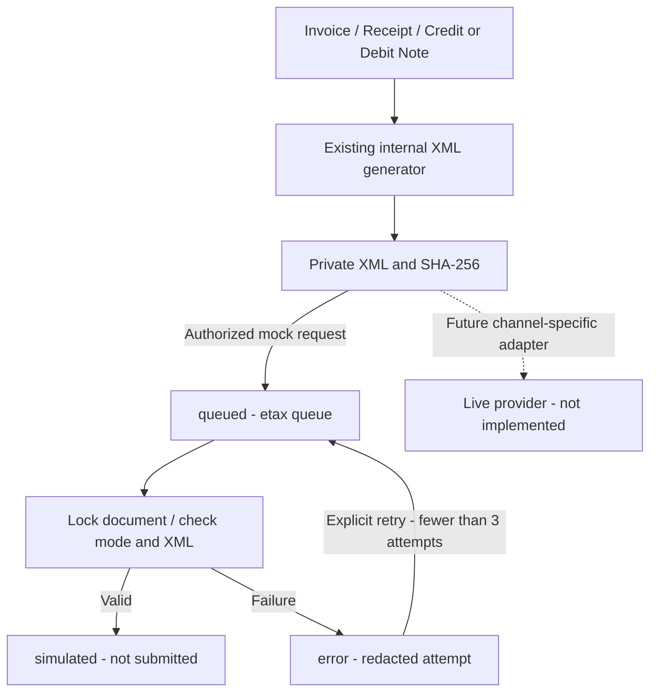

# Phase 24: Basic e-Tax Foundation

Scope: foundation complete on 2026-09-10. The user requested the simplest standard engineering foundation that can be extended later, not a certified tax filing integration.

## Existing System First

Reuse Phase 12's `e_tax_configs`, `e_tax_documents`, `e_tax_submission_attempts`, document generator, private XML storage, `/e-tax` screen and submission/signature interfaces. No new tables, migration or external dependencies are required. Existing Invoice, Receipt, Credit Note and Debit Note preparation and RD Prep draft export remain available.

`provider-mapping-v1` is an internal XML profile, not an approved RD schema or signed tax document. No PDF/A-3, XML-CAdES, certificate procurement or live endpoint is assumed before a channel is selected.

## Configuration and Workflow

- New organizations remain disabled by default. Existing configurations are not automatically enabled or migrated.
- `manual_export` retains the existing preparation/export workflow.
- `mock` is an explicit opt-in local simulation with no external HTTP, email, signature, Payment or GL.
- Saving `provider` mode is rejected until a real integration is implemented. Existing legacy provider settings cannot trigger live delivery through this job.
- Configuration/generation uses `e_tax.manage`; submission/retry uses `e_tax.submit`; viewing/download uses `e_tax.view`. Sensitive writes retain password confirmation and submission throttling.

Queueing locks the document, changes it to `queued` and dispatches after commit to the dedicated `etax` queue. Repeat queue requests do not create another job. The mock worker locks the row, validates current mock mode, checks private XML SHA-256 and basic internal XML completeness, and commits document/attempt updates together. A duplicate worker invocation on a completed document is a no-op.

Mock success is `simulated` with `SIMULATED_ONLY` in attempt history. It never sets `submitted_at`, `accepted_at`, or a real authority receipt. Failure is `error` with a generic error code; raw exceptions, credentials and document contents are not stored in the response message. Retry reuses the same snapshot and permits at most three recorded attempts. Transport/runtime failures before a transaction commits remain subject to the existing queue retry mechanism.

Queued, simulated, submitted, accepted or previously attempted documents cannot be regenerated through the document service. Generation locks the source row, uses UUID storage filenames rather than document numbers and preserves private storage. The XML hash is checked before simulation; `payload_json`, `xml_storage_path` and encrypted `provider_settings` are excluded from model serialization. This is application-level immutability, not a new database-level append-only constraint.



## Operations

Use the existing queue backend. For asynchronous connections, run only the dedicated queue:

```powershell
php artisan queue:work --queue=etax --tries=3
```

If queue dispatch failed after the database commit, recover queued mock documents with:

```powershell
php artisan etax:dispatch-pending --limit=100
```

The recovery command ignores non-mock organizations. Duplicate jobs remain safe because the worker rechecks document state under a lock. Mock failures are retried explicitly from the existing screen, not in an unbounded loop.

## Extension Boundary

Choose the actual channel/provider before implementing its schema, signing and transmission requirements. Existing `ETaxSubmissionAdapter` / `ETaxSignatureAdapter` interfaces remain the integration boundaries. The foundation worker deliberately accepts only the local mock; do not put a live HTTP request inside its database transaction. A live implementation needs durable claim ownership, idempotency keys, timeout/inquiry recovery, response verification and reconciliation before any accepted status. Certificate material belongs outside the database where signing is required.

Provider credentials, official schema compliance, digital signatures and real delivery are not verified by mock tests.

## Verification

On 2026-09-10, Phase 24 and Phase 12 passed 11 tests / 64 assertions. The broader SQLite regression across Phases 3, 11 GL, 12, 22, 23 and 24 passed 46 tests / 314 assertions. Tests cover opt-in, live-config rejection, duplicate queue/worker, XML tampering, retry limit, exception redaction, snapshot freeze, permissions/organization scope and pending recovery. No new migration is needed. This run does not claim a new MySQL concurrency test or live provider certification.

TypeScript, scoped ESLint, Pint and Vite production build passed. Local HTTP health check returned 200 at port 8010. The configured MySQL server on port 3306 was stopped; Windows denied starting `mysql8`, so the database-backed worker could not run in this environment. Start MySQL and the dedicated `etax` worker before interactive simulation. Automated tests used isolated SQLite, not the operational database.
