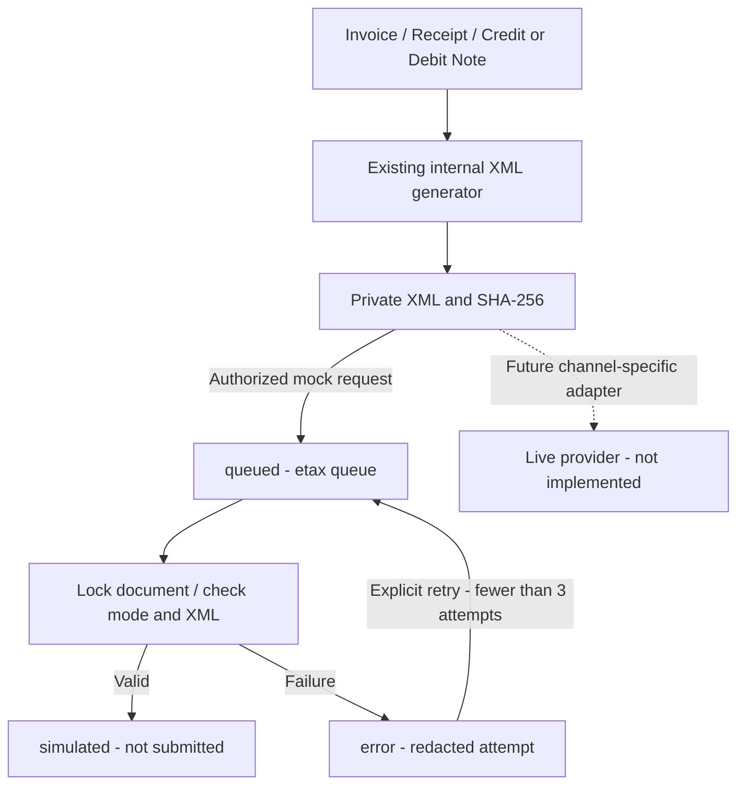

# Phase 24: Basic e-Tax Foundation

Scope: foundation complete on 2026-09-10. The user requested the simplest standard engineering foundation that can be extended later, not a certified tax filing integration.

## Existing System First

Reuse Phase 12's `e_tax_configs`, `e_tax_documents`, `e_tax_submission_attempts`, document generator, private XML storage, `/e-tax` screen and submission/signature interfaces. No new tables, migration or external dependencies are required. Existing Invoice, Receipt, Credit Note and Debit Note preparation and RD Prep draft export remain available.

`provider-mapping-v1` is an internal XML profile, not an approved RD schema or signed tax document. No PDF/A-3, XML-CAdES, certificate procurement or live endpoint is assumed before a channel is selected.

## Configuration and Workflow

- New organizations remain disabled by default. Existing configurations are not automatically enabled or migrated.
- `manual_export` retains the existing preparation/export workflow.
- `mock` is an explicit opt-in local simulation with no external HTTP, email, signature, Payment or GL.
- Saving `provider` mode is rejected until a real integration is implemented. Existing legacy provider settings cannot trigger live delivery through this job.
- Configuration/generation uses `e_tax.manage`; submission/retry uses `e_tax.submit`; viewing/download uses `e_tax.view`. Sensitive writes retain password confirmation and submission throttling.

Queueing locks the document, changes it to `queued` and dispatches after commit to the dedicated `etax` queue. Repeat queue requests do not create another job. The mock worker locks the row, validates current mock mode, checks private XML SHA-256 and basic internal XML completeness, and commits document/attempt updates together. A duplicate worker invocation on a completed document is a no-op.

Mock success is `simulated` with `SIMULATED_ONLY` in attempt history. It never sets `submitted_at`, `accepted_at`, or a real authority receipt. Failure is `error` with a generic error code; raw exceptions, credentials and document contents are not stored in the response message. Retry reuses the same snapshot and permits at most three recorded attempts. Transport/runtime failures before a transaction commits remain subject to the existing queue retry mechanism.

Queued, simulated, submitted, accepted or previously attempted documents cannot be regenerated through the document service. Generation locks the source row, uses UUID storage filenames rather than document numbers and preserves private storage. The XML hash is checked before simulation; `payload_json`, `xml_storage_path` and encrypted `provider_settings` are excluded from model serialization. This is application-level immutability, not a new database-level append-only constraint.



## Operations

Use the existing queue backend. For asynchronous connections, run only the dedicated queue:

```powershell
php artisan queue:work --queue=etax --tries=3
```

If queue dispatch failed after the database commit, recover queued mock documents with:

```powershell
php artisan etax:dispatch-pending --limit=100
```

The recovery command ignores non-mock organizations. Duplicate jobs remain safe because the worker rechecks document state under a lock. Mock failures are retried explicitly from the existing screen, not in an unbounded loop.

## Provider Gateway Architecture (Completed)

Phase 24's provider gateway architecture is fully implemented and operational:
1. **Multi-Provider Adapter (`RdApiSubmissionAdapter.php`)**:
   - Supports Revenue Department Web Service (`rd_api`), Certified Provider (`inet`), and Sandbox Gateway (`sandbox`).
   - Handles HTTP transmission with idempotency keys (`X-Idempotency-Key: ETAX-SUBMIT-{docId}`), custom timeouts, Bearer token resolution, and base64 XML packaging.
2. **Digital Signature Pipeline (`ETaxXmlSignatureService.php`)**:
   - Implements ETDA XML-DSig enveloped signature standard (`http://www.w3.org/2000/09/xmldsig#`).
   - Uses XML Canonicalization (C14N), RSA-SHA256 signature algorithm, DigestValue, KeyInfo, and X.509 certificate reference.
3. **Provider Gateway Service (`ETaxProviderGatewayService.php`)**:
   - Coordinates signing, multi-mode submission (mock vs provider), asynchronous inquiry, and webhook processing.
   - Enforces a strict 3-attempt retry ceiling with transition to `error` upon exceeding limit.
4. **Asynchronous Webhook Callback (`ETaxWebhookController.php`)**:
   - Endpoint: `POST /api/e-tax/{config}/callback` and `POST /api/e-tax/callback`.
   - Validates HMAC-SHA256 signature against `X-ETax-Signature` header using tenant's encrypted `webhook_secret`.
   - Transitions document to `accepted` or `rejected` with rejection reason and audit trail.
5. **Status Inquiry Artisan Command (`etax:inquire-status`)**:
   - Queries pending submitted documents (`submitted`, `queued`) from provider and reconciles status in bulk.
   - Registered in Laravel Scheduler to run every 30 minutes.
6. **Security & Guardrails**:
   - Private keys NEVER stored in database. Only vault/KMS ARN reference stored.
   - Provider API keys and webhook secrets encrypted at rest via Eloquent `encrypted:array`.
   - Audit logs and attempt response messages sanitize/redact confidential secrets.

## Verification

On 2026-09-20, Phase 24 provider gateway and foundation tests passed with 100% success:
- `Phase12ETaxTest`: 3 passed / 15 assertions.
- `Phase24ETaxFoundationTest`: 8 passed / 49 assertions.
- `Phase24ProviderGatewayTest`: 7 passed / 58 assertions.
- Total: **18 passed / 122 assertions (100% green)**.
- Frontend: TypeScript check (`npx tsc --noEmit`), ESLint (`npm run lint`), and Prettier (`npm run check-format`) passed with 0 errors.
