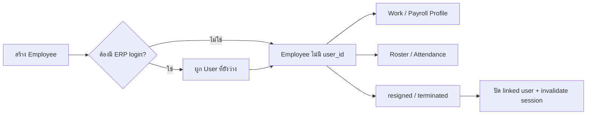

# Module: HR — Employees

| Meta | Value |
| --- | --- |
| Module code | `employees` |
| Version | Phase 23.3 implementation in progress |
| Status | Implemented core; Phase ยังไม่ปิด |
| Runtime source | `employees` migration, `EmployeeController`, `Hr/Employees.tsx` |

## หน้าที่

- Employee Master แยกจาก `users`; `user_id` เป็น nullable เพื่อรองรับพนักงานไม่มี ERP login.
- เก็บรหัสพนักงาน, ชื่อ, ข้อมูลติดต่อ, ตำแหน่ง, โครงสร้างองค์กร, สถานะ/ประเภทการจ้าง และข้อมูลจ่ายเงิน.
- `national_id` และ `bank_account_number` เข้ารหัส at rest; ห้ามส่งค่าเต็มไป log หรือ UI ที่ไม่มีสิทธิ์.
- ผูก Employee กับ `employee_work_profiles` และ `employee_payroll_profiles` ผ่าน `employee_id` โดยยังรองรับ legacy `user_id` ระหว่างเปลี่ยนผ่าน.
- เมื่อสถานะเป็น resigned/terminated จะปิดบัญชี user ที่ผูกอยู่และ invalidate session.

## Workflow

## Route และสิทธิ์

| Action | Route | Permission |
| --- | --- | --- |
| Directory | `GET /hr/employees` | `hr.employees.view` |
| Create / update | `POST/PATCH /hr/employees...` | `hr.employees.manage` + password confirm |
| Link account | `PATCH /hr/employees/account/{employee}` | `hr.employees.manage` + password confirm |

## ข้อจำกัดสถานะ

Employee Master ผ่าน feature tests แล้ว แต่ Phase 23.3 รวมยังไม่ปิด; ดู [`../PHASE_23_3_HR_EMPLOYEE_ATTENDANCE.md`](../PHASE_23_3_HR_EMPLOYEE_ATTENDANCE.md).
