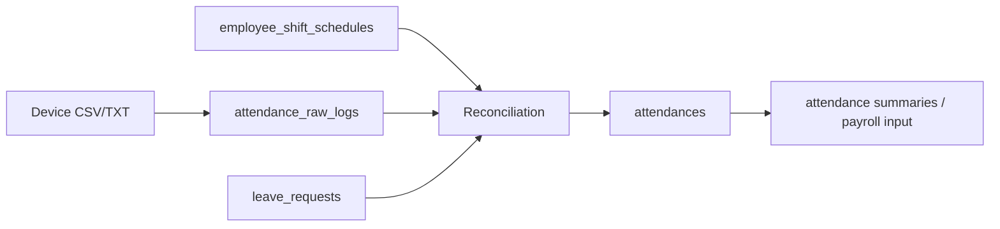

# Module: Attendance / Leave

| Meta | Value |
| --- | --- |
| Module code | `attendance_leave` |
| Version | Phase 19 core + Phase 23.3 extension in progress |
| Status | CSV/TXT import and reconciliation implemented; acceptance gaps remain |

## หน้าที่ปัจจุบัน

- Self-service clock-in/out, leave request/balance และ attendance summary ของ Phase 19.
- Phase 23.3 เพิ่ม raw logs, roster-driven reconciliation, late/early/worked/OT minutes, absence และ correction audit.
- Import route รับ **CSV/TXT** และ template CSV; Excel ยังไม่รองรับ.

## Data flow

## Route และสิทธิ์

| Action | Route | Permission |
| --- | --- | --- |
| Attendance page / self service | `/hr/attendance` | `attendance.*` ตาม action |
| Import workspace/template | `GET /hr/attendance-import...` | `hr.attendance.import` |
| Import, reconcile, correction | `POST /hr/attendance-import...` | `hr.attendance.import` + password confirm |

## ช่องว่างก่อนปิด

- Excel import, special-holiday OT 3x และกะข้ามวันยังไม่ครบ.
- รายละเอียดและเกณฑ์ปิด: [`../PHASE_23_3_HR_EMPLOYEE_ATTENDANCE.md`](../PHASE_23_3_HR_EMPLOYEE_ATTENDANCE.md).
