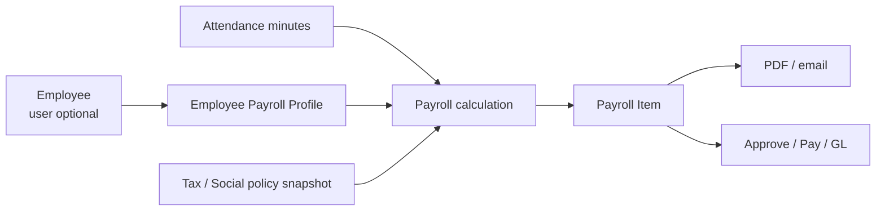

# Module: Payroll

| Meta | Value |
| --- | --- |
| Module code | `payroll` |
| Version | Phase 16B implemented; Phase 23.3 integration in progress |
| Status | Core payroll done; attendance/shift integration not accepted |

## หน้าที่

- Payroll policy แบบ effective-dated, calculation snapshot, payslip PDF, PND1/SSO workpaper และ GL posting.
- รองรับ `EmployeePayrollProfile` ที่ผูก Employee ไม่มี `user_id`; wage type `monthly`, `daily`, `hourly`.
- Payroll item เก็บ `employee_id`, `ot_amount` และ `late_deduction_amount`; ส่ง payslip เข้า email ส่วนตัวได้.

## Data flow

## Route และสิทธิ์

| Action | Route | Permission |
| --- | --- | --- |
| Payroll workspace | `GET /payroll` | `payroll.view` |
| Manage profile/run | `/payroll/profiles`, `/payroll/runs...` | `payroll.manage` + password confirm |
| Payslip PDF | `/payroll/payslips/{payrollItem}/pdf` | owner หรือ `payroll.view` |
| Email payslip | `POST /payroll/payslips/{payrollItem}/email` | `payroll.manage` + password confirm |

## ช่องว่างก่อนปิด Phase 23.3

Payroll ใช้ OT multiplier ตายตัว 1.5/2.0 จึงยังไม่ใช้ rate ที่ตั้งใน Shift Master และยังไม่มี special-holiday 3x. ดู [`../PHASE_23_3_HR_EMPLOYEE_ATTENDANCE.md`](../PHASE_23_3_HR_EMPLOYEE_ATTENDANCE.md).
