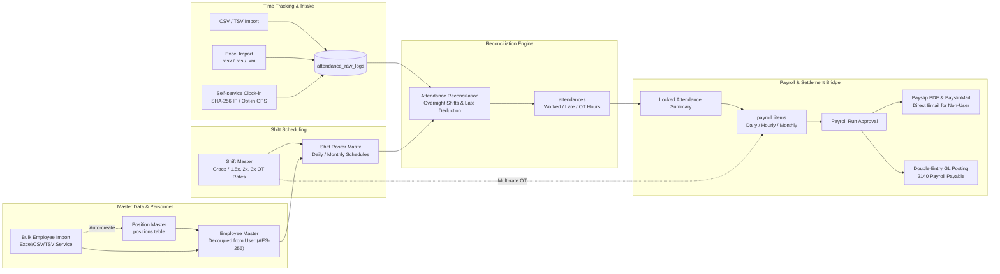

# HR Employee, Attendance & Payroll Integration — Phase 23.3 & HR Enhancements

> สถานะ: **เสร็จสมบูรณ์และผ่านการตรวจรับ 100% (Complete & Closed ณ 2026-09-20)**

### รายละเอียดสถาปัตยกรรมและการทำงาน

1. **Employee Master & Position Architecture:**
   - แบบจำลอง `Employee` เป็นอิสระจากบัญชีผู้ใช้ระบบ (`user_id` เป็น nullable foreign key) รองรับพนักงานปฏิบัติการที่ไม่มีสิทธิ์เข้าใช้ระบบ ERP
   - ตารางตำแหน่งงาน `positions` แยกเป็น Relational Master Data อิสระ เชื่อมต่อผ่าน `employees.position_id` พร้อม backward-compatible sync กับ `position_title`
   - ระบบนำเข้าประวัติพนักงานแบบชุด (`EmployeeImportService`) รองรับ Excel (`.xlsx`, `.xls`, `.xml`) และ CSV/TSV พร้อมระบบ Auto-create Position และเข้ารหัสเลขบัตร ปชช./เลขบัญชีธนาคาร (AES-256) ตาม PDPA
2. **Shift Scheduling & Attendance Reconciliation:**
   - จัดเวรและตารางกะผ่าน Roster Matrix Calendar (`employee_shift_schedules`)
   - นำเข้า Log เวลาสแกนนิ้ว/บัตร รองรับทั้ง Excel และ CSV/TSV
   - Reconciliation Engine จัดการกะข้ามวัน (Overnight Shift), คิดอัตราล่วงเวลาจาก Shift Master (1.5x วันทำงาน, 2.0x วันหยุดปกติ, 3.0x วันหยุดพิเศษตามประเพณี), และหักมาสายตาม Grace Period
3. **Non-User Payroll & Email Delivery:**
   - คำนวณค่าจ้างรายวัน/รายชั่วโมง/รายเดือนเข้าสู่ `payroll_items`
   - ออกใบจ่ายเงินเดือน Payslip PDF และจัดส่งสลิปผ่านอีเมลส่วนตัว (`personal_email`) ด้วย `PayslipMail` สำหรับพนักงานที่ไม่มี User Account ในระบบ

ดูรายละเอียด implementation, route, permission และ verification ที่ [`../docs/PHASE_23_3_HR_EMPLOYEE_ATTENDANCE.md`](../docs/PHASE_23_3_HR_EMPLOYEE_ATTENDANCE.md).
