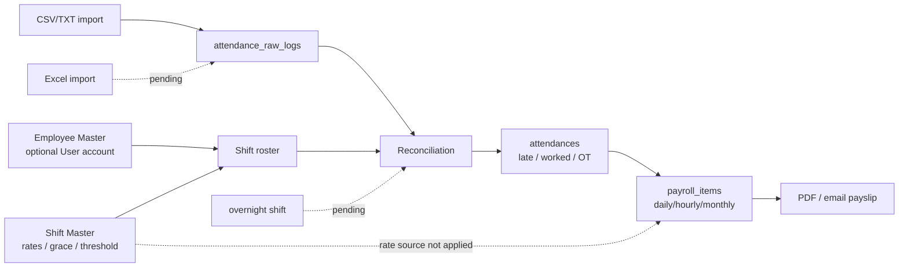

# HR Employee, Attendance & Payroll Integration — Phase 23.3

> สถานะ: **In progress / ไม่ผ่านการตรวจรับปิด Phase ณ 2026-09-20**

ระบบรองรับ Employee ที่ไม่มี ERP login, schedule รายบุคคล, import CSV/TXT, reconciliation และ payroll แบบรายวัน/รายชั่วโมงแล้ว. ก่อนปิด Phase ต้องเพิ่ม Excel import, ใช้ OT rate จาก Shift Master, นิยาม/คำนวณ 3x special holiday และรองรับกะข้ามวัน.

ดูรายละเอียด implementation, route, permission และ verification ที่ [`../docs/PHASE_23_3_HR_EMPLOYEE_ATTENDANCE.md`](../docs/PHASE_23_3_HR_EMPLOYEE_ATTENDANCE.md).
