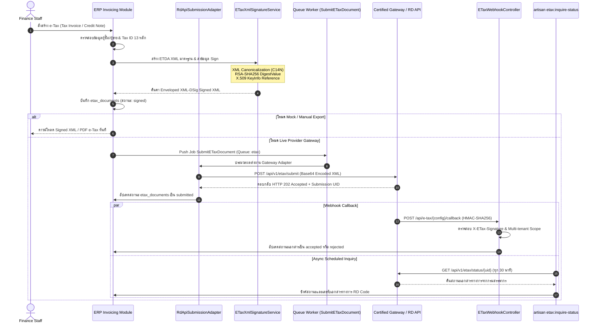

# e-Tax Invoice & RD Prep Gateway Architecture — Phase 24

> สถานะ: **เสร็จสมบูรณ์และผ่านการตรวจรับ 100% (Complete & Closed ณ 2026-09-20)**

### รายละเอียดสถาปัตยกรรมและการควบคุมความปลอดภัย

1. **Digital Signature Pipeline:** ท่อประมวลผลลายมือชื่อดิจิทัลรองรับมาตรฐาน ETDA Enveloped XML-DSig (`http://www.w3.org/2000/09/xmldsig#`) โดยแยก Private Key ไว้นอกฐานข้อมูลอย่างเข้มงวด (จัดเก็บบน Server/Cloud Vault Reference เท่านั้น)
2. **Provider Adapters:** รองรับ 4 โหมดการทำงาน: `disabled`, `manual_export`, `mock`, และ `provider` (เชื่อมต่อ RD Web Service, Certified Provider INET, หรือ Sandbox)
3. **Queue & Idempotency:** ใช้ Job Worker `SubmitETaxDocument` พร้อมเพดาน Retry 3 ครั้งและบันทึกประวัติการส่งลงในตาราง `etax_submission_attempts`
4. **Webhook Security:** ตรวจสอบ HMAC-SHA256 Signature ทุก Callback Request ป้องกันการปลอมแปลงผลการอนุมัติเอกสาร

ดูรายละเอียดเพิ่มเติมที่ [`../docs/PHASE_24_ETAX_FOUNDATION.md`](../docs/PHASE_24_ETAX_FOUNDATION.md).
