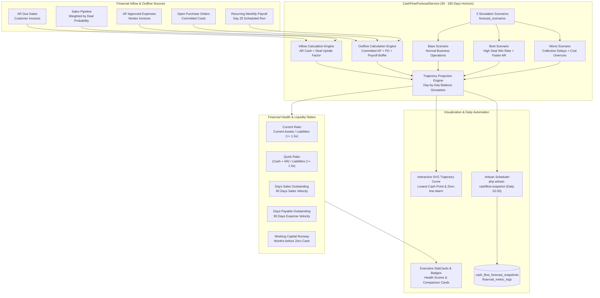

# Cash Flow Forecasting & Financial Health Analytics — Phase 25

> สถานะ: **เสร็จสมบูรณ์และผ่านการตรวจรับ 100% (Complete & Closed ณ 2026-09-20)**

### รายละเอียดสถาปัตยกรรมและการคำนวณ

1. **Multi-Scenario Modeling:**
   - **Base:** การดำเนินงานตามงวดปกติ คิด Inflow จาก AR 100% และยอดดีลตาม % Probability ที่บันทึกไว้
   - **Best:** สมมติฐานเชิงบวก (Optimistic) รับชำระหนี้เร็วกว่ากำหนด + ดีลขายชนะเพิ่มขึ้นตาม Multiplier
   - **Worst:** การทดสอบภาวะวิกฤต (Stress Test) สมมติฐานหนี้ค้างรับล่าช้า (Haircut) และค่าใช้จ่ายสำรองฉุกเฉิน
2. **Dynamic Day-by-Day Cash Curve:**
   - จำลองยอดเงินสดคงเหลือสะสมวันต่อวัน คำนวณหา "จุดต่ำสุดของเงินสด" (Lowest Cash Point) และวันที่เงินสดจะลดลงต่ำสุด
3. **Liquidity & Working Capital Ratios:**
   - คำนวณอัตราส่วนสภาพคล่องหมุนเวียนเร็ว (Quick Ratio), อัตราส่วนหมุนเวียน (Current Ratio), ระยะเวลาเก็บหนี้เฉลี่ย (DSO), ระยะเวลาชำระหนี้เจ้าหนี้ (DPO) และจำนวนเดือนที่เงินสดจะอยู่รอด (Runway)
4. **Data Isolation & Privacy Guard:**
   - ไม่มีการเปิดเผยตัวเลขยอดเงินสดรวมดิบ (Unreconciled Cash Balance) สู่ภายนอก โดยคำนวณจาก Delta การหมุนเวียนและโมเดลสมมติฐานที่ปิดความเสี่ยง

ดูรายละเอียด implementation และ controller ได้ที่ [`backend/app/Services/Finance/CashFlowForecastService.php`](file:///c:/LocalDevine/www/ERP/backend/app/Services/Finance/CashFlowForecastService.php).
