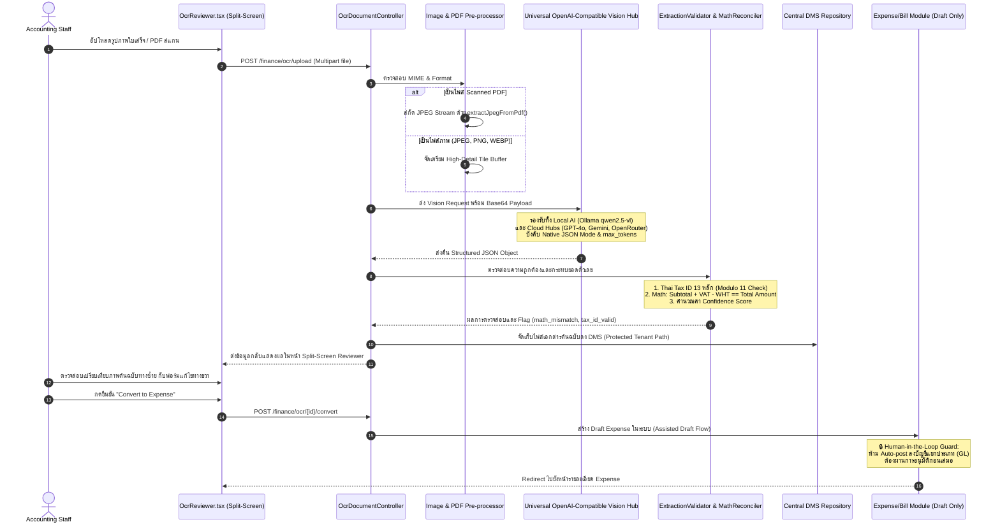

# AI OCR Document Ingestion — Phase 26

> สถานะ: **เสร็จสมบูรณ์และผ่านการตรวจรับ 100% (Complete & Closed ณ 2026-09-21)**

### รายละเอียดสถาปัตยกรรมและ Security Guardrails

1. **Universal OpenAI-Compatible Vision Architecture:**
   - ออกแบบ API Adapter มาตรฐานเดียว สามารถสลับใช้งานระหว่าง **On-Premise Local AI** (Ollama / LM Studio) เพื่อรักษาความลับสูงสุดของข้อมูลองค์กร และ **Cloud Vision Hubs** (GPT-4o, OpenRouter, Gemini) ได้แบบ Plug-and-Play
2. **Robust Extraction & Math Reconciliation:**
   - ตรวจสอบความถูกต้องของเลขประจำตัวผู้เสียภาษี 13 หลักด้วยอัลกอริทึม **Thai Tax ID Modulo 11**
   - คำนวณตรวจสอบสมดุลตัวเลข (Math Check): ยอดก่อนภาษี + ภาษีมูลค่าเพิ่ม 7% - ภาษีหัก ณ ที่จ่าย = ยอดรวมสุทธิ หากไม่ตรงระบบจะไฮไลต์เตือน `math_mismatch: true`
3. **Split-Screen Reviewer UI:**
   - หน้าจอตรวจสอบแบบแบ่ง 2 ฝั่ง: ฝั่งซ้ายแสดงเอกสารต้นฉบับพร้อมระบบ Pan & Zoom, ฝั่งขวาเป็นฟอร์มข้อมูลที่สกัดได้ พร้อมตัวบ่งชี้ความเชื่อมั่น (Confidence Badge)
4. **Human-in-the-Loop & No Auto-GL Guard:**
   - ผลการสแกนทุกรายการจะถูกแปลงเป็น **Draft Expense** หรือ Draft Vendor Bill เท่านั้น เพื่อให้พนักงานฝ่ายบัญชีตรวจสอบและลงนามอนุมัติ ห้ามระบบลงบัญชีแยกประเภททั่วไป (GL Posting) อัตโนมัติโดยเด็ดขาด

ดูรายละเอียดเพิ่มเติมที่ [`../gemini.md`](../gemini.md#8-บันทึกข้อสงสัย-การวินิจฉัยปัญหา-และแนวทางแก้ไขการเชื่อมต่อ-gpt-openai-diagnostic--resolution-record).
