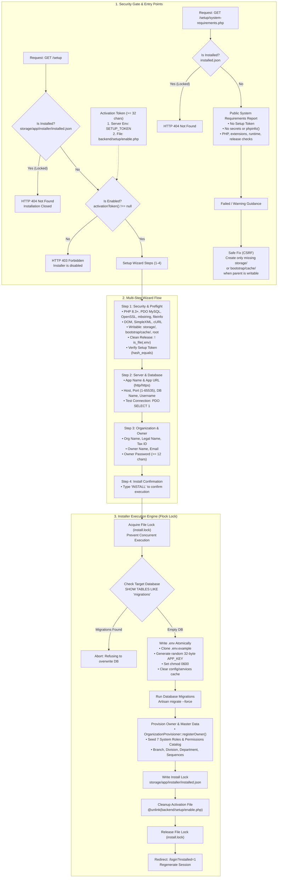

# Web Setup Wizard Architecture & Installer Lifecycle

> สถานะ: **เสร็จสมบูรณ์และผ่านการตรวจรับ 100% (Complete & Closed ณ 2026-09-22)**

### มาตรการความปลอดภัยเชิงสถาปัตยกรรม (Security Architecture Guardrails)

1. **Direct Access Protection:** โฟลเดอร์ซอร์สโค้ดและแกนของตัวติดตั้ง `backend/setup/` ถูกปิดกั้นจากการเข้าถึงผ่านเว็บโดยตรงด้วยทั้ง Root `.htaccess` (`RewriteRule ^backend/setup(?:/|$) - [F,L]`) และ `backend/setup/.htaccess` (`Require all denied`)
2. **Double Activation Guard:** ตัวติดตั้งปิดการทำงานเป็นค่าเริ่มต้น ต้องเปิดใช้งานด้วย Setup Token ที่มีความยาวอย่างน้อย 32 ตัวอักษร ผ่านตัวแปรสภาพแวดล้อม `SETUP_TOKEN` หรือไฟล์ชั่วคราว `backend/setup/enable.php`
3. **Clean Release & No Overwrite:** ปฏิเสธการติดตั้งบนไดเรกทอรีที่มีไฟล์ `.env` อยู่แล้ว และปฏิเสธฐานข้อมูลที่มีตาราง `migrations` อยู่เดิม เพื่อป้องกันการเขียนทับระบบหรือข้อมูลการผลิตเดิมโดยไม่ได้ตั้งใจ
4. **Atomic Operations & Lockout:** การสร้าง `.env` ทำงานผ่าน Temporary File + Atomic Rename พร้อมตั้งสิทธิ์ `chmod 0600`, ใช้ File Lock ป้องกันคำขอติดตั้งซ้ำซ้อน และหลังติดตั้งสำเร็จไฟล์ `enable.php` จะถูกลบทิ้งทันทีพร้อมเขียน Lock `installed.json` ส่งผลให้หน้า `/setup` ตอบกลับด้วย HTTP 404 ถาวร
5. **Public Readiness Check:** `/setup/system-requirements.php` เปิดได้ก่อนติดตั้งโดยไม่ใช้ Setup Token เพื่อให้ผู้ดูแล server แก้ environment ได้ก่อนเปิด installer; ไม่เปิดเผย secret หรือ `phpinfo()`. การแก้ไขจากหน้าเว็บจำกัดเฉพาะการสร้าง `storage/` หรือ `bootstrap/cache/` ที่ยังไม่มี, ตรวจ CSRF และทำได้เมื่อ parent directory เขียนได้เท่านั้น

ดูรายละเอียดเพิ่มเติมที่ [`../docs/SETUP_WIZARD.md`](../docs/SETUP_WIZARD.md).
