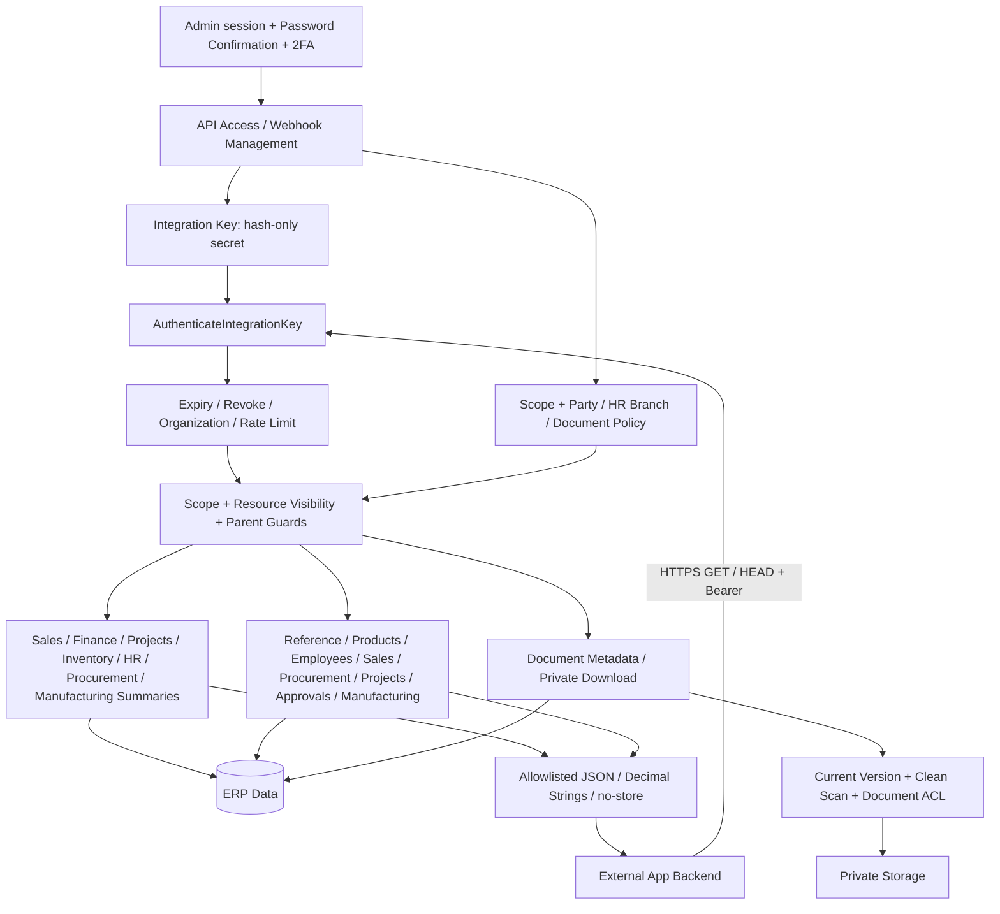
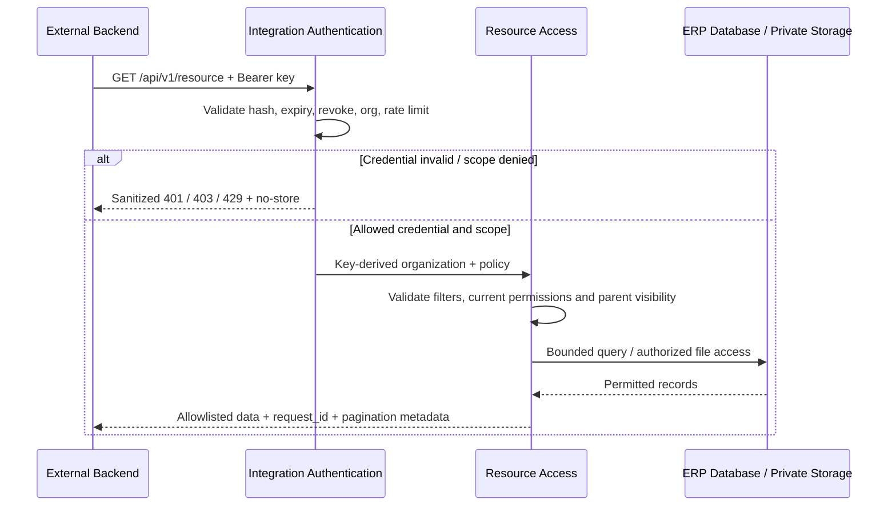
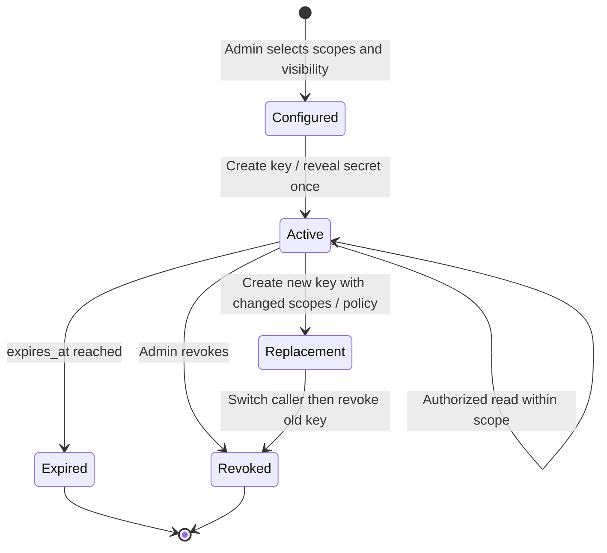
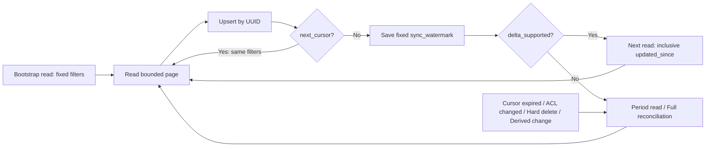
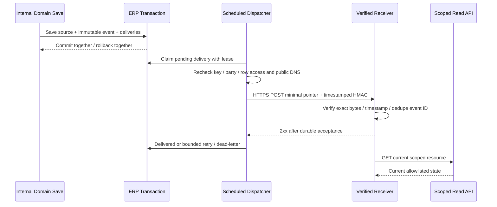

# External Read-only API Architecture

API สำหรับให้ backend ของแอปภายนอกอ่านข้อมูล ERP ผ่าน `/api/v1` โดยใช้ integration key, scopes และ visibility policy ไม่มี business Write API และไม่เปิด payroll/salary/bank/identity fields

สัญญา endpoints: [OpenAPI](../docs/openapi/external-read-v1.json) · การใช้งาน: [Read API Guide](../docs/EXTERNAL_READ_API.md) · ตัวอย่าง: [Client / Receiver](../examples/external-api)

## Architecture และขอบเขตข้อมูล

- Organization มาจาก key ไม่รับ client เลือก `org_id`
- Customer/Supplier key ถูกจำกัด party และเอกสารที่เผยแพร่; HR ต้องระบุ branch policy; Documents ต้อง explicit document IDs/classification/link ACL
- Scope summary ไม่ให้สิทธิ์ list/detail; ราคา ต้นทุน สูตร และ download เป็นสิทธิ์แยก
- Employee ใช้ UUID/employee_code ไม่ส่ง national_id, salary, bank, private contact, GPS หรือเหตุผลลา
- Document download ตรวจ current version/scan/ACL ทุกครั้งและไม่คืน storage paths/public URLs

## Request Sequence

## Key Lifecycle

API key secret เก็บเฉพาะ hash ส่วน webhook signing secret เก็บแบบ encrypted เพื่อใช้ลงลายเซ็น Key management ใช้ admin session และ permission แยกจาก integration key

## Pagination และ Sync

Default50/max100, encrypted cursor30นาทีผูก credential/path/filters, stable order `(updated_at,id)` สำหรับ row lists Watermark คงเดิมทั้งรอบ Resource ที่ไม่รองรับ delta ตอบ422 เมื่อส่ง updated_since Inventory balances ใช้ grouped tuple cursor

Live pagination ไม่ใช่ database snapshot ผู้รับต้องรับ duplicates และทำ full reconciliation เพื่อเอาข้อมูลที่ลบหรือไม่มีสิทธิ์แล้วออกจากสำเนา ไม่ใช้ generated_at ของหน้าสุดท้ายเป็น delta checkpoint

## Outbound Webhook / Transactional Outbox

Events: invoice payment status, stock balance, task status, approval status ไม่มีชื่อ/ยอดเงิน/PII ใน payload การส่งเป็น at-least-once ต้อง dedupe และรับ out-of-order ได้ ใช้ model save paths ไม่ครอบคลุม bulk SQL/delete

ค่าเริ่มต้น `EXTERNAL_API_WEBHOOKS_ENABLED=false` Admin ต้องตั้ง endpoint และ verify ownership ก่อนเปิดใช้งาน HTTPS443/public DNS/IP pinning, no redirects/proxy, bounded time/response size และ encrypted signing secret การ rotate secret จะ pause จน verify ใหม่

POST ใน diagram คือการส่งสัญญาณออกไปยัง receiver; `/api/v1` ของ ERP มีเฉพาะ GET/HEAD ไม่มี task/document writes หรือ approve/reject actions
