# คู่มือและผังการทำงาน 7 กลุ่มโมดูลหลัก (Domain Group Workflows — 35 Modules)

เอกสารนี้รวบรวม **Diagram ผังการทำงาน, วงจรสถานะ (Lifecycle), และลำดับการทำงาน (Sequence)** ของทั้ง **7 กลุ่มงานหลัก ครอบคลุม 35 โมดูลทั้งหมด** ของระบบ Company OS / Lightweight ERP พร้อมคำอธิบายภาษาไทยอย่างละเอียดในทุกขั้นตอน ครอบคลุมทั้ง Position Master, Bulk Import, Overnight Shifts, 1.5x/2x/3x OT Rates, e-Tax Gateway, Cash Flow Forecasting, AI OCR Ingestion และ Setup Wizard

---

## 📑 สารบัญกลุ่มงาน (Table of Domain Groups)

| กลุ่ม | ชื่อกลุ่มงาน | โมดูลที่ครอบคลุม | จำนวน Diagram | รายละเอียดโดยสังเขป |
|:---:|---|---|:---:|---|
| **Group 1** | [Foundation & Security](#group-1-foundation--security-โมดูล-01-04) | `01-04` (Org, User/Role, Settings, Audit, 2FA) | 4 | โครงสร้างองค์กร, สิทธิ์ RBAC 7 บทบาท, Audit Trail และ 2FA TOTP |
| **Group 2** | [CRM & Sales Pipeline](#group-2-crm--sales-pipeline-โมดูล-05-08) | `05-08` (Customers, Contacts, Deals, Quotations) | 3 | รับ Lead &rarr; จัดการผู้ติดต่อ &rarr; ดัน Deal &rarr; ออกใบเสนอราคา |
| **Group 3** | [Project Delivery & Execution](#group-3-project-delivery--execution-โมดูล-09-11) | `09-11` (Projects, Tasks, Milestones) | 3 | แปลง Deal สู่ Project &rarr; จ่ายงาน Tasks &rarr; ตรวจรับ Milestones |
| **Group 4** | [Finance, Billing & Cost Control](#group-4-finance-billing--cost-control-โมดูล-12-16) | `12-16` (Products, Suppliers, Invoices, Payments, Expenses, Assets, FX, E-Tax) | 5 | ออกบิล &rarr; รับเงิน (Anti-Overpay) &rarr; รายจ่าย &rarr; Treasury/GL &rarr; สินทรัพย์, FX, e-Tax |
| **Group 5** | [Insights, Platform & Automation](#group-5-insights-platform--automation-โมดูล-17-23) | `17-23` (Dashboard, Reports, Files, Notifications, Automation, DMS, Outbox) | 5 | Event Trigger, Dashboard, ระบบไฟล์แนบ, DMS Lifecycle และ Notification Outbox |
| **Group 6** | [Operations & Advanced Extensions](#group-6-operations--advanced-extensions-phase-7-23) | `24-31` (PO, Inventory/Lots, Payroll, Accounting, Workflows, Portal, Gateway, Dialog Standard) | 7 | จัดซื้อ, สต็อก/Lot, ทะเบียนพนักงาน/ตำแหน่งงาน, บันทึกเวลาข้ามวัน/OT 3 อัตรา, เงินเดือน, Central Workflow, Customer/Supplier Portal, Gateway Settlement, และ Master Dialog Standard |
| **Group 7** | [Intelligent Automation, Compliance & Deployment](#group-7-intelligent-automation-compliance--system-deployment-phase-24-26--setup-wizard) | `32-35` (e-Tax Gateway, Cash Flow Forecasting, AI OCR Ingestion, Web Setup Wizard) | 4 | นำส่งภาษีอิเล็กทรอนิกส์ ETDA/RD, คาดการณ์กระแสเงินสด 3 สถานการณ์, สกัดข้อมูลใบเสร็จ AI Vision (No Auto-GL), และตัวติดตั้งระบบ Web Setup Wizard |

---

## 🗺️ ภาพรวมความเชื่อมโยงระหว่าง 6 กลุ่มงาน (High-Level Interaction)

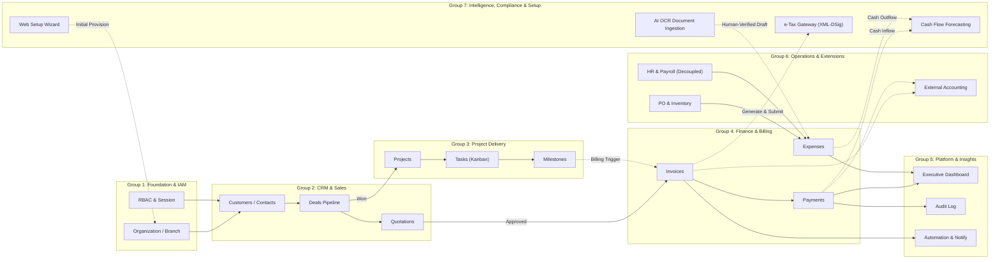

---

## Group 1: Foundation & Security (โมดูล 01-04)
**โมดูลที่เกี่ยวข้อง:** `01-organization`, `02-user-role-permission`, `03-settings`, `04-audit-log`

### 1.1 Diagram: Org Hierarchy & Multi-Tenancy Scoping Flow
ผังแสดงลำดับชั้นองค์กรและการจำกัดสิทธิ์ข้อมูลด้วย `org_id`

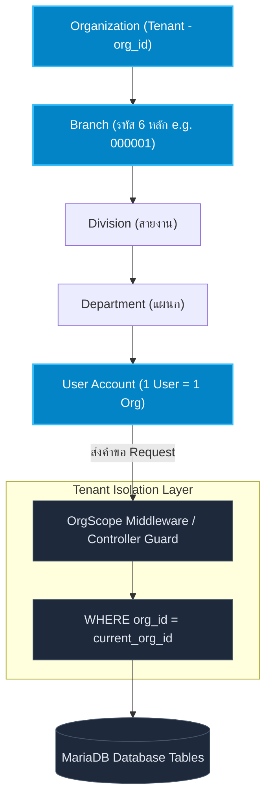

**คำอธิบายการทำงาน (Workflow Description):**
1. **ระดับชั้นสูงสุด (Root Tenant):** องค์กร (`Organization`) ถูกระบุด้วย `org_id` ซึ่งเป็น Partition สูงสุดของข้อมูล
2. **โครงสร้างสาขาและสายงาน:** ภายใต้องค์กรสามารถมีหลายสาขา (`Branch`) ระบุด้วยรหัส 6 หลัก (เช่น สำนักงานใหญ่ `000001`), มีสายงาน (`Division`), แผนก (`Department`)
3. **ผู้ใช้งาน (User):** ผู้ใช้ 1 คนจะผูกกับ 1 องค์กร และสังกัดแผนกที่กำหนด
4. **Tenant Isolation Guard:** ทุก Controller และ Model Query จะถูกบังคับใส่เงื่อนไข `WHERE org_id = current_org_id` เสมอ เพื่อป้องกันไม่ให้ข้อมูลข้ามองค์กรกัน

---

### 1.2 Diagram: RBAC Permission Resolution Flow
ลำดับขั้นตอนการตรวจสอบสิทธิ์ 7 บทบาทหลัก

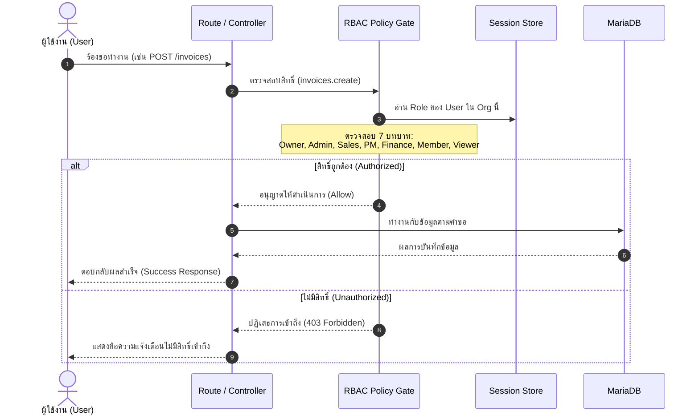

**คำอธิบายบทบาทและสิทธิ์ (Role & Permission Rules):**
- **Owner / Admin:** จัดการได้ทุกโมดูลในองค์กร ตั้งค่าระบบ และจัดการผู้ใช้
- **Sales:** จัดการลูกค้า (CRM), Contacts, Deals, และดูใบเสนอราคา/บิลที่เกี่ยวข้องได้
- **Project Manager (PM):** บริหาร Projects, Tasks, Milestones และดูต้นทุนโครงการ
- **Finance:** มีสิทธิ์เต็มในโมดูล Invoices, Payments, Expenses, และรายงานการเงิน
- **Member:** ผู้ใช้งานทั่วไป ทำงานกับ Tasks ที่ได้รับมอบหมาย และบันทึกเวลาทำงาน
- **Viewer:** สิทธิ์ดูข้อมูลอย่างเดียว (Read-only) ไม่สามารถสร้างหรือแก้ไขได้

---

### 1.3 Diagram: Application Audit Logging Trail
ผังการบันทึกประวัติการเปลี่ยนแปลงข้อมูลที่ไม่สามารถลบได้ (Immutable Log)

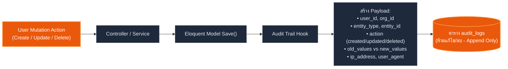

**คำอธิบายกฎการบันทึก (Audit Rules):**
1. ทุกเหตุการณ์ที่เปลี่ยนแปลงข้อมูลการเงิน, สถานะสิทธิ์, หรือข้อมูลธุรกิจหลัก จะถูกบันทึกอัตโนมัติ
2. ตาราง `audit_logs` เป็นแบบ Append-Only ไม่เปิดให้ลบหรือแก้ไข เพื่อความโปร่งใสและตรวจสอบย้อนหลังได้ 100%

---

### 1.4 Diagram: Two-Factor Authentication (2FA) & Trusted Device Gate (Phase 18)
ลำดับขั้นตอน TOTP RFC 6238 / recovery code และนโยบายระดับองค์กร โดยค่าเริ่มต้น 2FA ปิดอยู่; เมื่อเปิด policy จะบังคับ enrollment สำหรับ privileged roles ตามการตั้งค่า

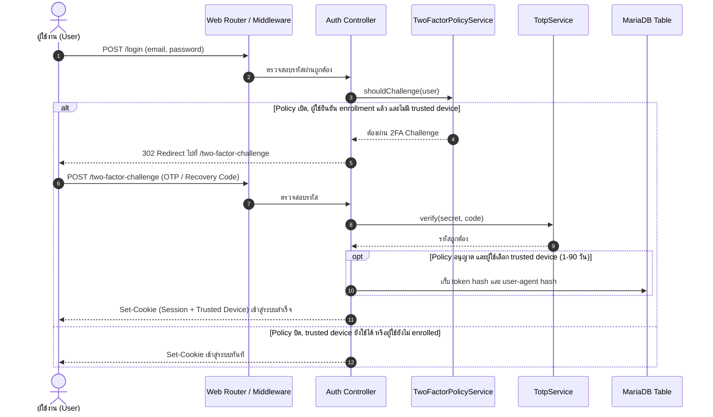

---

## Group 2: CRM & Sales Pipeline (โมดูล 05-08)
**โมดูลที่เกี่ยวข้อง:** `05-crm`, `06-contacts`, `07-deals`, `08-quotations`

### 2.1 Diagram: Lead-to-Quote Sales Process Flow
กระบวนการขายตั้งแต่ได้ลูกค้ารายใหม่จนถึงปิดการขาย

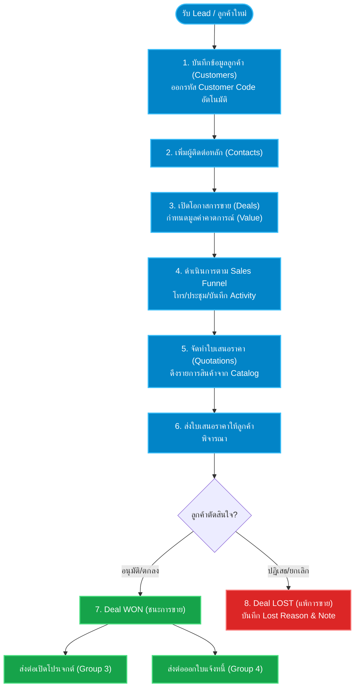

---

### 2.2 Diagram: Deal Stage & Funnel Lifecycle (State Machine)
วงจรสถานะของ Deal ในแต่ละช่วงการขาย

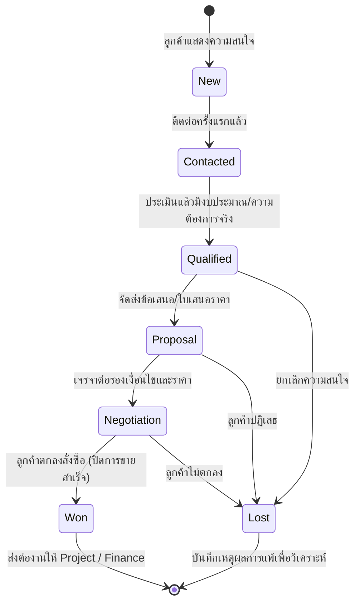

**คำอธิบายสถานะ Deal:**
- **New:** โอกาสการขายใหม่ ยังไม่ได้ติดต่อเชิงลึก
- **Contacted:** ได้พูดคุยเบื้องต้นทางโทรศัพท์/LINE/อีเมล
- **Qualified:** ประเมินแล้วว่าลูกค้ามีคุณสมบัติและงบประมาณตรงกับบริการ
- **Proposal:** ส่งข้อเสนอหรือใบเสนอราคาอย่างเป็นทางการ
- **Negotiation:** อยู่ระหว่างการปรับแก้ขอบเขตงานหรือราคา
- **Won (Terminal Success):** ปิดการขายสำเร็จ ล็อคมูลค่าและเตรียมส่งต่องาน
- **Lost (Terminal Closed):** ปิดไม่สำเร็จ ต้องระบุเหตุผล (เช่น แพ้ราคา, ลูกค้ายกเลิกโครงการ)

---

### 2.3 Diagram: Quotation Issuance & Conversion Sequence
ลำดับการออกใบเสนอราคาและการแปลงเอกสาร

```mermaid
sequenceDiagram
    autonumber
    actor Sales as ฝ่ายขาย (Sales)
    participant QC as Quotation Controller
    participant Catalog as Product/Service Catalog
    participant DB as MariaDB
    actor Customer as ลูกค้า (Customer)
    participant Next as Project / Invoice Module

    Sales->>QC: สร้างใบเสนอราคาใหม่ (เลือก Deal + Customer)
    QC->>Catalog: ดึงรายการสินค้า/บริการ และราคามาตรฐาน
    Catalog-->>QC: ข้อมูลราคาและหน่วยนับ
    Sales->>QC: ระบุส่วนลด, ภาษี, เงื่อนไขการชำระเงิน
    QC->>DB: บันทึก Quotation (สถานะ: Draft &rarr; Sent)
    QC-->>Customer: ส่งเอกสารใบเสนอราคา (PDF/Email)
    
    Customer->>Sales: ยืนยันสั่งซื้อ / เซ็นอนุมัติ
    Sales->>QC: อัปเดตสถานะเป็น "Approved / Accepted"
    QC->>DB: อัปเดต Deal เป็น Won
    QC->>Next: Trigger ระบบเพื่อสร้าง Project หรือ Invoice อัตโนมัติ
```

---

## Group 3: Project Delivery & Execution (โมดูล 09-11)
**โมดูลที่เกี่ยวข้อง:** `09-projects`, `10-tasks`, `11-milestones`

### 3.1 Diagram: Project Initiation & Delivery Workflow
กระบวนการดำเนินโครงการและส่งมอบงาน

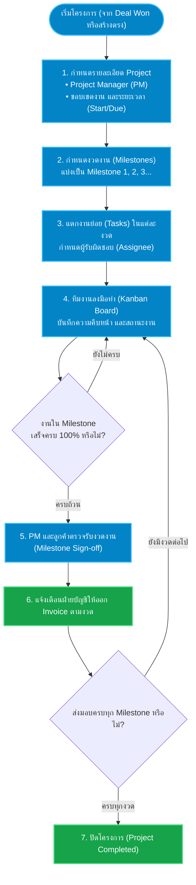

---

### 3.2 Diagram: Task Kanban Lifecycle & Blocker Handling (State Machine)
วงจรสถานะของงานย่อยและการจัดการปัญหาติดขัด

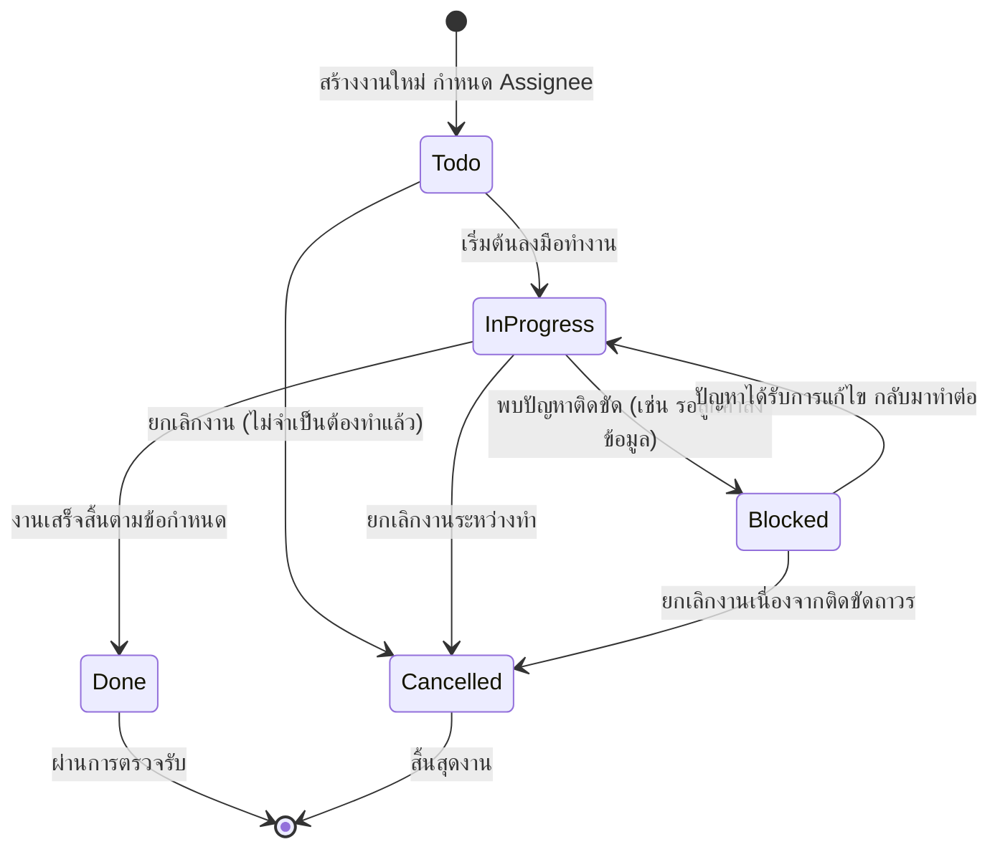

**คำอธิบายการจัดการงานติดขัด (Blocker Rules):**
- เมื่องานถูกเปลี่ยนสถานะเป็น `Blocked` ระบบจะบังคับให้ใส่เหตุผลที่ติดขัด (`blocker_reason`)
- Dashboard และการแจ้งเตือนจะแจ้งเตือน PM ทันทีเพื่อเข้าช่วยเหลือแก้ไขปัญหาอย่างรวดเร็ว

---

### 3.3 Diagram: Milestone Verification & Billing Trigger Sequence
ลำดับการตรวจรับงวดงานและส่งสัญญาณออกบิล

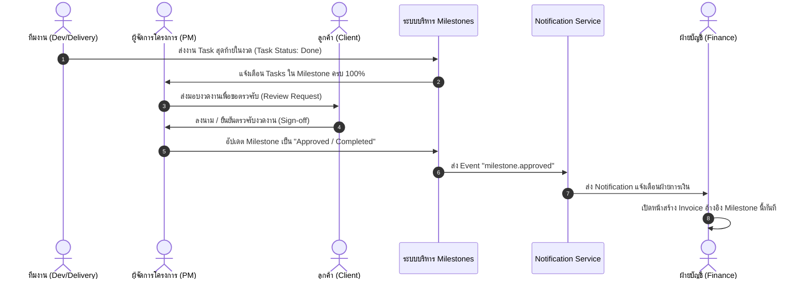

---

## Group 4: Finance, Billing & Cost Control (โมดูล 12-16)
**โมดูลที่เกี่ยวข้อง:** `12-products`, `13-suppliers`, `14-invoices`, `15-payments`, `16-expenses`

### 4.1 Diagram: Order-to-Cash & Expense Control Flow
ผังกระบวนการเงินทั้งขาเข้า (รับชำระ) และขาออก (ค่าใช้จ่าย)

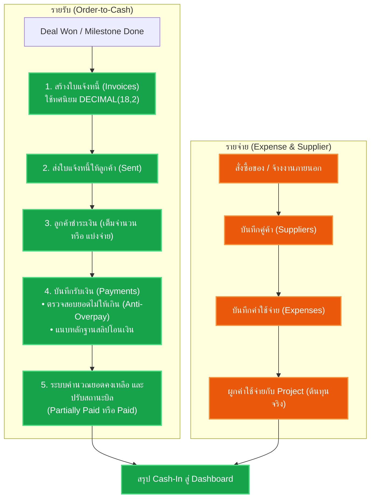

---

### 4.2 Diagram: Invoice Status Machine & Anti-Overpayment Settlement Sequence
วงจรสถานะใบแจ้งหนี้และการดักจับการชำระเงินเกิน

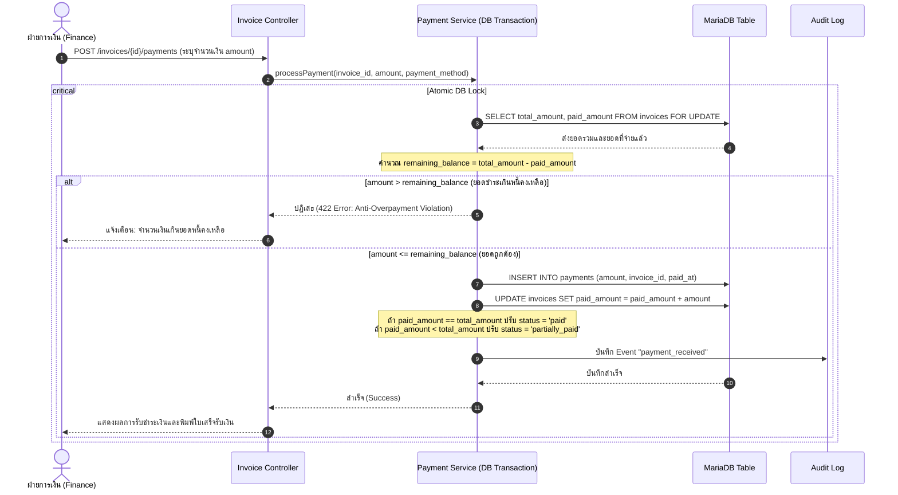

---

### 4.3 Diagram: Expense Recording & Project Cost Allocation Flow
การบันทึกค่าใช้จ่ายและการวิเคราะห์กำไรของโครงการ

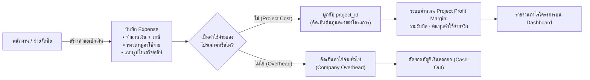

---

### 4.4 Diagram: Fixed Assets, Multi-Currency FX & E-Tax Compliance (Phase 12-14)
การจัดการสินทรัพย์ถาวร, การรับชำระเงินหลายสกุลเงินพร้อมบันทึกกำไร/ขาดทุนจากอัตราแลกเปลี่ยน (Realized FX), และการออกใบกำกับภาษีอิเล็กทรอนิกส์ e-Tax

```mermaid
flowchart TD
    subgraph Assets ["สินทรัพย์ถาวร (Fixed Assets)"]
        AssetAcq["ซื้อสินทรัพย์ (จาก Expense หรือ GRN)"] --> RegAsset["บันทึกทะเบียนสินทรัพย์ (Asset Register)"]
        RegAsset --> DeprecRun["คำนวณค่าเสื่อมราคาเส้นตรงรายเดือน (Straight-Line)"]
        DeprecRun --> PostDeprecGL["ลงบัญชี GL อัตโนมัติ (Idempotent Posting)"]
    end

    subgraph FX ["สกุลเงินและ FX (Multi-Currency)"]
        FXInv["ออกใบแจ้งหนี้สกุลต่างประเทศ (e.g. USD)"] --> SnapshotRate["Snapshot อัตราแลกเปลี่ยน ณ วันทำรายการ"]
        SnapshotRate --> PayFX["รับชำระเงินสกุลต่างประเทศ"]
        PayFX --> RealizedGainLoss["คำนวณ Realized Gain/Loss ลงสมุดรายวัน GL"]
    end

    subgraph ETax ["ใบกำกับภาษีอิเล็กทรอนิกส์ (e-Tax)"]
        TaxInv["ออกใบกำกับภาษีเต็มรูป"] --> GenXML["สร้าง XML ตามมาตรฐาน ETDA พร้อม SHA256 Hash"]
        GenXML --> StorePrivate["จัดเก็บใน Private Storage แยก Tenant"]
        StorePrivate --> RDPrep["ส่งออกข้อมูลสำหรับ RD Prep ยื่นสรรพากร"]
    end
```

---

### 4.5 Diagram: Treasury, General Ledger & Reconciliation (Phase 10-11)
Financial journal เป็น double-entry และ immutable หลัง post. การรับเงิน/จ่ายเงิน/ค่าเสื่อม/Payroll ส่ง source posting เข้า GL; รายการ statement จึงถูก match เพื่อสร้างสถานะ reconciliation โดยไม่แก้ journal เดิม

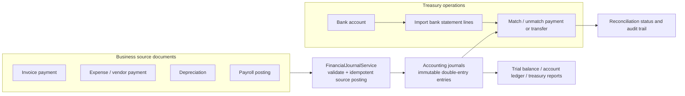

---

## Group 5: Insights, Platform & Automation (โมดูล 17-23)
**โมดูลที่เกี่ยวข้อง:** `17-dashboard`, `18-reports`, `19-files`, `20-notifications`, `21-automation`, `22-import-export`, `23-api`

### 5.1 Diagram: Event-Driven Platform & Automation Pipeline
โครงสร้างการกระจาย Event สู่การแจ้งเตือนและการทำงานอัตโนมัติ

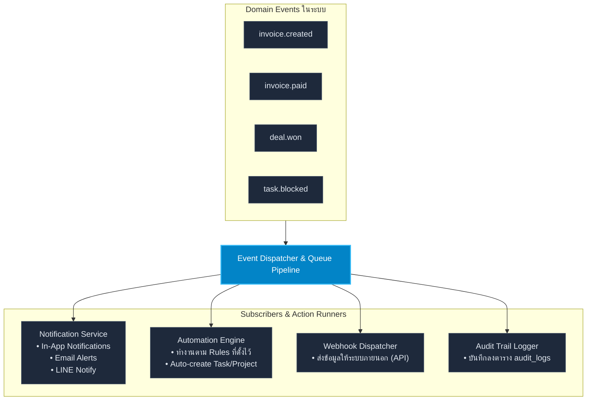

---

### 5.2 Diagram: Executive & Financial Dashboard Metric Lineage
ผังการรวบรวมข้อมูลดิบสู่ตัวชี้วัด KPI ของผู้บริหาร

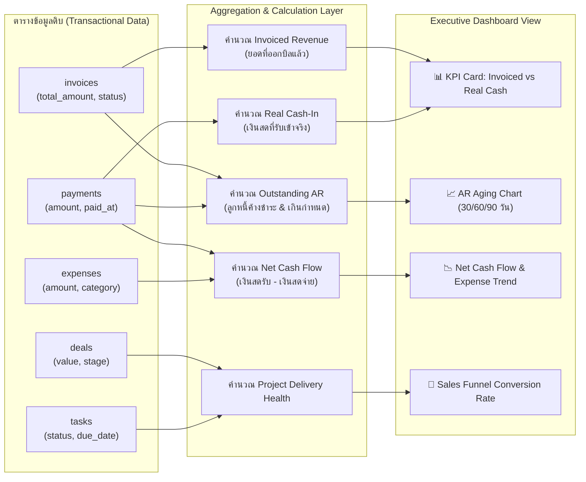

---

### 5.3 Diagram: File Attachment & Tenant Storage Security Flow
ลำดับการอัปโหลดไฟล์แนบและรักษาความปลอดภัยของไฟล์

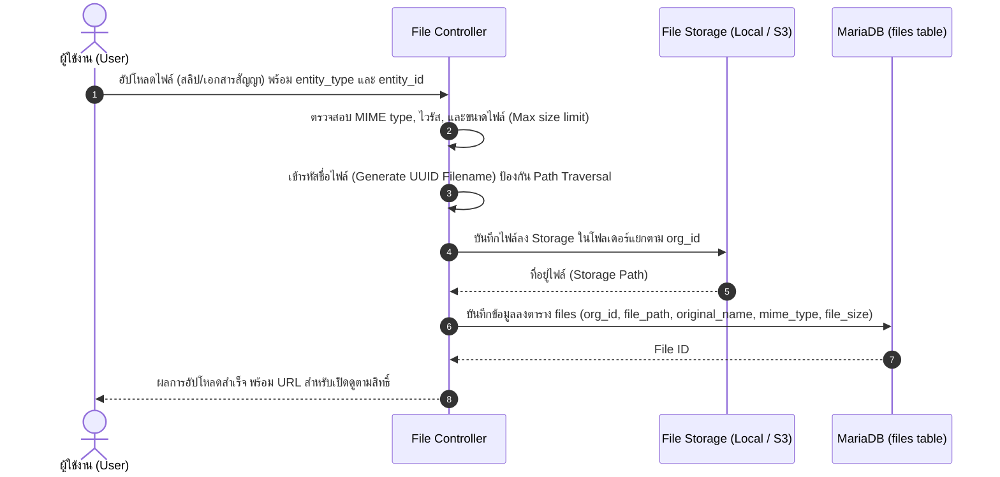

---

### 5.4 Diagram: Enterprise Document Management (DMS) Lifecycle & Compliance (Phase 17-18.1)
วงจรชีวิตเอกสารองค์กร: private storage, SHA256 checksum, scan gate, versioning, sensitivity 5 ระดับ, expiry alert, parent authorization และ retention/legal-hold enforcement

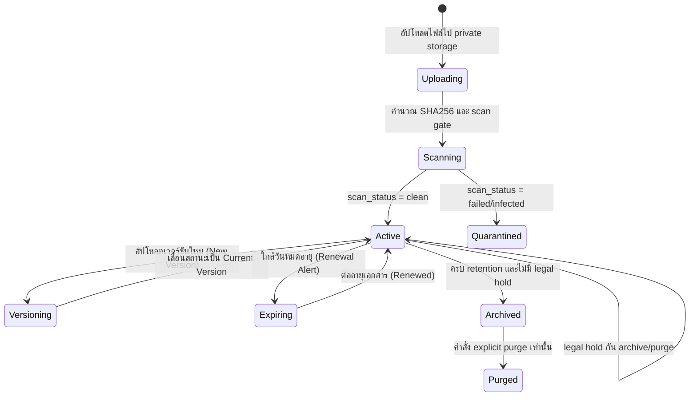

---

### 5.5 Diagram: Operational Notification Outbox & Multi-Channel Delivery (Phase 21)
ผังกระบวนการของ Notification Outbox: การแยกช่องทาง (Email, LINE Notify, Slack, Telegram) พร้อม Encrypted Credentials, Idempotent Queueing, Retry with Exponential Backoff, Dead-Letter Queue (DLQ), และการเคารพ Quiet Hours / User Preferences

```mermaid
flowchart TD
    subgraph Trigger ["1. ผู้สร้างเหตุการณ์ (Event Origin)"]
        Evt["ERP Event<br>(Invoice Due, Approval Queued, Task Due)"]
    end

    subgraph PrefEngine ["2. Preference & Routing Filter"]
        CheckPref{"User Preferences<br>• Channel enabled?<br>• Quiet hours?"}
        HoldQueue["พักรอส่งหลังพ้น Quiet Hours<br>(Delayed Scheduled Time)"]
        Enqueue["ส่งเข้า Outbox Queue<br>(Idempotency Key Hash)"]
    end

    subgraph OutboxWorker ["3. Outbox Dispatcher & Delivery"]
        Worker["Outbox Worker Process"]
        ChannelRouter{"ตรวจช่องทางส่ง"}
        SendEmail["Email (SMTP / Mailgun)"]
        SendLine["LINE Notify (Encrypted Token)"]
        SendSlack["Slack Webhook (Encrypted URL)"]
        SendTelegram["Telegram Bot (Encrypted Token)"]
    end

    subgraph Reliability ["4. Error Handling & Dead Letter"]
        SendResult{"ส่งสำเร็จหรือไม่?"}
        Success["สถานะ sent<br>(บันทึก timestamp)"]
        Retry{"จำนวนครั้ง retry &lt; max?"}
        Backoff["คำนวณ Exponential Backoff<br>(next_retry_at = now + 2^attempts)"]
        DLQ["ย้ายเข้า Dead-Letter Queue (failed)<br>พร้อม Error Reason ให้ผู้ดูแลตรวจสอบ"]
    end

    Evt --> CheckPref
    CheckPref -- อยู่ในช่วง Quiet Hours --> HoldQueue
    HoldQueue --> Enqueue
    CheckPref -- ส่งได้ทันที --> Enqueue
    Enqueue --> Worker
    Worker --> ChannelRouter
    ChannelRouter --> SendEmail & SendLine & SendSlack & SendTelegram
    SendEmail & SendLine & SendSlack & SendTelegram --> SendResult
    SendResult -- สำเร็จ --> Success
    SendResult -- ล้มเหลว --> Retry
    Retry -- ยังไม่เกิน --> Backoff --> Worker
    Retry -- ครบโควตา --> DLQ
```

---

## Group 6: Operations & Advanced Extensions (Phase 7-23)
**โมดูลที่เกี่ยวข้อง:** `24-purchase-orders`, `25-inventory`, `26-employees`, `27-attendance-leave`, `28-payroll`, `29-ai-assistant`, `30-accounting-integration`, `31-customer-portal`, `32-payment-gateway`

### 6.1 Diagram: Multi-Warehouse, Bin Locations & Lot Tracking Flow (Phase 15)
กระบวนการจัดซื้อ, รับสินค้าแยกตามคลังและ Bin, ควบคุม Lot และวันหมดอายุ, และการโอนย้ายสต็อกระหว่างคลัง

```mermaid
flowchart TD
    PO["1. ออกใบสั่งซื้อ (Purchase Order)"] --> GRN["2. รับสินค้าเข้าคลัง (Goods Receipt)"]
    GRN --> SelectBin["3. ระบุคลัง (Warehouse) และตำแหน่งจัดเก็บ (Bin Location)"]
    SelectBin --> GenLot["4. บันทึกรุ่นผลิต (Lot No.) และวันหมดอายุ (Expiry Date)"]
    GenLot --> StockIn["5. บันทึกสต็อกคงเหลือแยกตาม Bin & Lot พร้อม Movement Log"]
    
    StockIn --> MoveStock{"ต้องการโอนย้าย<br>ระหว่างคลัง/Bin?"}
    MoveStock -- โอนย้าย --> Transfer["6. เปิดใบโอนย้ายสินค้า (Stock Transfer)"]
    Transfer --> MoveOut["ตัดสต็อกคลังต้นทาง (In-Transit)"]
    MoveOut --> MoveIn["รับเข้าสต็อกคลังปลายทาง (Completed)"]
    MoveStock -- สั่งขาย/ตัดจ่าย --> StockOut["7. ตัดสต็อกตาม FIFO หรือ FEFO (ตามวันหมดอายุ)"]
```

---

### 6.2 Diagram: Phase 16B Payroll, Policy & GL Flow
Phase 16B ใช้ `users` เป็น employee identity. Phase 23.3 เพิ่ม Employee Master และ attendance input แล้ว แต่ยัง **ไม่ผ่านการปิด Phase**: Excel import, configured OT rate, 3x special holiday และ overnight shift ยังไม่ครบ. ดู [`17_hr_employee_attendance_payroll.md`](./17_hr_employee_attendance_payroll.md).

```mermaid
flowchart TD
    User["User"] --> Profile["Employee Payroll Profile<br>salary / recurring allowance & deduction"]
    TaxPolicy["Tax Policy<br>effective-dated brackets"] --> Run["Payroll Run: draft<br>lock policy IDs"]
    SocialPolicy["Social Security Policy<br>effective-dated rates & ceiling"] --> Run
    Profile --> Calculate["Calculate payroll"]
    Run --> Calculate
    Calculate --> Items["Payroll Items<br>immutable calculation snapshot"]
    Items --> Approve["Approve run"]
    Approve --> GLAccrual["GL: debit salary/SS expense<br>credit payroll/tax/SS liabilities"]
    Approve --> Payslip["Owner-or-finance payslip PDF"]
    Approve --> Workpaper["PND1 / SSO workpaper CSV"]
    Approve --> Pay["Mark paid"]
    Pay --> GLSettlement["GL: debit payroll payable<br>credit mapped bank/cash"]
```

### 6.2A Diagram: Phase 23.3 HR Employee, Attendance & Payroll Boundary

```mermaid
flowchart LR
    Employee["Employee\nuser optional"] --> Roster["Shift schedule"]
    Shift["Shift Master"] --> Roster
    Csv["CSV/TXT import"] --> Raw["Raw logs"] --> Recon["Reconciliation"]
    Roster --> Recon --> Attendance["Attendance minutes"] --> Payroll["Payroll item"]
    Excel["Excel import"] -. open .-> Raw
    Shift -. "OT rate not yet applied" .-> Payroll
    Overnight["Overnight shifts"] -. open .-> Recon
```

---

### 6.3 Diagram: External Accounting & Customer Portal Integration Grid
ผังการเชื่อมต่อระบบบัญชีภายนอกและการเปิดพอร์ทัลให้ลูกค้า

```mermaid
flowchart LR
    subgraph CoreERP ["Company OS / Lightweight ERP"]
        InvModule["Invoices Module"]
        PayModule["Payments Module"]
        ProjModule["Projects & Tasks"]
    end

    subgraph IntegrationLayer ["Integration & Security Gateway"]
        AuthBridge["Customer Portal Auth<br>(Magic Link / Token)"]
        AccountingSync["Accounting Sync Worker<br>(REST API / OAuth2)"]
    end

    subgraph ExternalServices ["ระบบภายนอก (External Platforms)"]
        PortalUI["🌐 Customer Portal Web<br>• ลูกค้าดูความคืบหน้าโปรเจกต์<br>• ตรวจสอบบิลและดาวน์โหลดใบเสร็จ"]
        FlowAccount["📦 FlowAccount API"]
        PEAK["📊 PEAK Engine API"]
        XeroQB["💼 Xero / QuickBooks"]
    end

    ProjModule --> AuthBridge
    InvModule --> AuthBridge
    AuthBridge --> PortalUI

    InvModule --> AccountingSync
    PayModule --> AccountingSync
    AccountingSync --> FlowAccount
    AccountingSync --> PEAK
    AccountingSync --> XeroQB
```

---

### 6.4 Diagram: Central Dynamic Approval Workflow Engine (Phase 20)
ผังกระบวนการทำงานของ Central Approval Engine ครอบคลุมการจับคู่นิยาม (Definition Match), การสร้างสแนปช็อต (Immutable Snapshot), การตรวจสอบ SoD และผู้ปฏิบัติหน้าที่แทน (Delegation), ลำดับการอนุมัติแบบคู่ขนาน/เรียงลำดับ, และการสะท้อนสถานะกลับสู่โมดูลต้นทางพร้อมบันทึกบัญชี GL / คืนสิทธิ์วันลา

```mermaid
flowchart TD
    subgraph Creator ["1. ผู้ยื่นขออนุมัติ (Requester & Creator)"]
        SubmitDoc["ส่งเอกสารเข้าสายอนุมัติ<br>(Leave / Expense / PO / PR)"]
    end

    subgraph Engine ["2. Central Workflow Engine"]
        MatchDef["จับคู่นิยามตามเงื่อนไข<br>subject_type + amount threshold [min, max]"]
        FreezeSnap["บันทึก Immutable Snapshot<br>(definition_snapshot + subject_snapshot)"]
        AssignSteps["คำนวณผู้ตรวจตาม Step<br>• user (รายคน)<br>• manager (สายบังคับบัญชา)<br>• role (ตามรหัสบทบาท)"]
        SoDGuard{"ตรวจสอบ SoD Guard<br>(ผู้ยื่นห้ามตรวจเอกสารตนเอง)"}
        Delegation{"ตรวจสอบ Delegation<br>(มีตัวแทนที่เปิดใช้ในเวลานี้หรือไม่?)"}
        StepExec{"โหมดการตรวจ (Execution Mode)"}
        SuperPeers["Parallel Mode:<br>คนแรกที่อนุมัติถือว่าผ่านทันที<br>(ผู้ตรวจร่วมถูกปรับเป็น superseded)"]
        SeqSteps["Sequential Mode:<br>ต้องรออนุมัติครบทุกคน<br>จึงจะเลื่อนไปยัง Step ถัดไป"]
    end

    subgraph Decision ["3. การตัดสินใจ & ผลลัพธ์ (Action & Outcomes)"]
        InboxAct["ผู้ตรวจลงนามผ่าน Inbox<br>(Approve / Reject / Revision)"]
        ApprovedOutcome["Final Step Approved:<br>อัปเดตสถานะเอกสารเป็น approved"]
        ExpenseGL["กรณี Expense:<br>บันทึกเดบิต/เครดิตสมุดรายวันทั่วไป (GL Journal)"]
        RejectOutcome["Rejected / Revision:<br>เปลี่ยนสถานะเอกสารเป็น rejected / draft"]
        LeaveRefund["กรณี Leave Request:<br>คืนยอดวันลาที่ถูกหักชั่วคราวกลับเข้า Balance ทันที"]
    end

    SubmitDoc --> MatchDef
    MatchDef --> FreezeSnap
    FreezeSnap --> AssignSteps
    AssignSteps --> SoDGuard
    SoDGuard -- ผู้ยื่นไม่ได้ตรวจเอง --> Delegation
    Delegation -- มีตัวแทน --> InboxAct
    Delegation -- ผู้ตรวจหลัก --> InboxAct
    InboxAct -- อนุมัติ --> StepExec
    StepExec -- Parallel --> SuperPeers
    StepExec -- Sequential --> SeqSteps
    SuperPeers --> ApprovedOutcome
    SeqSteps --> ApprovedOutcome
    ApprovedOutcome --> ExpenseGL
    InboxAct -- ส่งกลับแก้ไข/ปฏิเสธ --> RejectOutcome
    RejectOutcome --> LeaveRefund
```

---

### 6.5 Diagram: Customer & Supplier Passwordless Self-Service Portal (Phase 22)
ผังกระบวนการของ External Self-Service Portal สำหรับลูกค้าและคู่ค้า: การเข้าถึงแบบไร้รหัสผ่าน (Passwordless Magic Link 30 นาที), เซสชันที่มีการ Hash และยกเลิกได้ (Hashed Session 8 ชม.), การตอบรับใบเสนอราคาออนไลน์และร่างบิล, การยื่นวางบิลคู่ค้าเข้าพื้นที่กักกัน (Vendor Bill Quarantine), และการห้ามสร้างรายการบัญชี AP/GL อัตโนมัติจนกว่าจะผ่านการตรวจรับโดยเจ้าหน้าที่การเงิน

```mermaid
flowchart TD
    subgraph ExternalUser ["1. ผู้ใช้งานภายนอก (Customer / Supplier)"]
        ReqLink["ขอลิงก์เข้าพอร์ทัล<br>(ระบุอีเมล)"]
        ClickLink["คลิก Magic Link จากอีเมล<br>(อายุ 30 นาที, ใช้ได้ครั้งเดียว)"]
        PortalApp["เข้าใช้งาน Portal Dashboard<br>(Cookie Session อายุ 8 ชม.)"]
    end

    subgraph PortalCore ["2. Portal Auth & Scoping Engine"]
        GenToken["สร้าง Single-Use Token<br>บันทึก SHA256 Hash ลงตาราง"]
        VerifyToken{"ตรวจสอบ Token<br>• ถูกต้อง & ยังไม่หมดอายุ?<br>• ยังไม่เคยถูกใช้งาน?"}
        IssueSession["ออก Portal Session<br>(สุ่ม Session Token 80 ตัวอักษร)"]
        ScopeCheck["Tenant & Party Isolation<br>(บังคับ WHERE org_id AND customer/supplier_id)"]
    end

    subgraph CustomerActions ["3. ฟังก์ชันลูกค้า (Customer Portal)"]
        ViewQuote["ดูใบเสนอราคาที่ส่งมอบแล้ว"]
        AcceptQuote["กดยอมรับใบเสนอราคาออนไลน์<br>(บันทึก quotation_acceptances)"]
        DraftInv["สร้าง Invoice ฉบับร่างอัตโนมัติ<br>(อ้างอิงเลขเสนอราคา & ผู้ยอมรับ)"]
        ViewPayQR["ดูและสแกน PromptPay QR เพื่อชำระเงิน"]
    end

    subgraph SupplierActions ["4. ฟังก์ชันคู่ค้า (Supplier Portal)"]
        ViewPO["ตรวจสอบใบสั่งซื้อ (Purchase Orders)"]
        CheckPay["ตรวจสอบสถานะการจ่ายเงิน & ภาษีหัก ณ ที่จ่าย"]
        UploadBill["ยื่นวางบิล (Submit Vendor Bill)"]
        Quarantine["Quarantine Gate:<br>ไฟล์ถูกกักกันรอตรวจไวรัส & ห้ามลง AP/GL ทันที"]
        FinanceReview["Finance Staff ตรวจรับและอนุมัติ<br>จึงจะสร้าง Expense / AP Journal"]
    end

    ReqLink --> GenToken
    GenToken --> ClickLink
    ClickLink --> VerifyToken
    VerifyToken -- ถูกต้อง --> IssueSession
    IssueSession --> PortalApp
    PortalApp --> ScopeCheck
    ScopeCheck --> CustomerActions & SupplierActions
    ViewQuote --> AcceptQuote --> DraftInv
    DraftInv --> ViewPayQR
    ViewPO --> UploadBill --> Quarantine --> FinanceReview
```

---

### 6.6 Diagram: PromptPay Thai QR & Payment Gateway Settlement Reconciliation (Phase 23)
ผังกระบวนการของระบบรับชำระเงินผ่านเกตเวย์และพร้อมเพย์: การคำนวณยอดสตางค์เป๊ะ, การสร้าง Thai QR Tag 29 (Tax ID) / Tag 30 (Biller ID), การสร้าง Charge และรับ Sanitized SVG QR จาก Opn, การยืนยัน Event ด้วย Secret Key ฝั่งเซิร์ฟเวอร์, และการรับ Webhook ที่ลงลายมือชื่อ HMAC-SHA256 จาก Settlement Bridge เพื่อลงบัญชี Payment และ Double-Entry GL ใน Transaction เดียวกัน

```mermaid
sequenceDiagram
    autonumber
    actor Customer as ลูกค้า (Customer)
    participant ERP as ระบบ ERP (Gateway Service)
    participant Opn as Opn / Omise API
    participant Bank as ธนาคาร / App ธนาคาร
    participant Bridge as Trusted Settlement Bridge
    participant GL as Ledger & Database

    Customer->>ERP: ขอเปิดหน้าชำระเงิน (GET /invoice-payment/{id})
    ERP->>GL: ล็อกใบแจ้งหนี้ (Pessimistic Lock) & คำนวณยอดสตางค์
    opt ใช้งาน Opn Provider
        ERP->>Opn: สร้าง PromptPay Charge (POST /charges)
        Opn-->>ERP: ส่งกลับ Charge ID & URL ดาวน์โหลด QR
        ERP->>ERP: โหลดและ Sanitize SVG ตรวจสอบความปลอดภัย
    end
    ERP-->>Customer: แสดง QR พร้อมเพย์ยอดตรงบิล (หมดอายุใน 30 นาที)

    Customer->>Bank: สแกน QR และโอนเงินผ่านระบบพร้อมเพย์
    Bank->>Opn: Interbank PromptPay Clearing

    opt Opn Webhook Notification
        Opn->>ERP: แจ้งเตือนเหตุการณ์ (POST /api/gateway/{id}/opn)
        ERP->>Opn: ยืนยันข้อมูล Charge ผ่าน Authenticated API
        ERP->>GL: บันทึก provider_confirmed (ยังไม่บันทึกบัญชี GL)
    end

    Bank->>Bridge: ยืนยันยอดเงินเข้าบัญชีธนาคารของบริษัทจริง
    Bridge->>ERP: ส่งข้อมูลการ Settlement (POST /api/gateway/{id}/settlement)
    Note over Bridge,ERP: Headers: X-Settlement-Signature (HMAC-SHA256) & Timestamp (&le; 300s)

    ERP->>ERP: ตรวจสอบ HMAC Signature, Timestamp Window และ Deduplication
    alt ข้อมูลถูกต้องและงวดบัญชีเปิดอยู่
        ERP->>GL: บันทึก Payments record, ปรับ Invoice = paid, และบันทึก Double-Entry GL Journal
        GL-->>ERP: บันทึกสำเร็จใน Single Database Transaction
        ERP-->>Bridge: 200 OK (status: processed)
    else ยอดเงินไม่ตรง หรือชำระนอกหน้าต่าง QR
        ERP->>GL: บันทึก webhook_events เป็น review (ไม่มีการลงบัญชี)
        ERP-->>Bridge: 200 OK (status: review)
    else งวดบัญชีปิดอยู่
        ERP-->>Bridge: 422 Unprocessable (Rollback ทั้งหมดเพื่อให้ Retry ภายหลัง)
    end
```

---

### 6.7 Diagram: Master Create/Edit Dialog Standard & Editor Coordinator Lifecycle (Phase 23.1)
ผังกระบวนการมาตรฐานของฟอร์ม Create / Edit Dialog และ Single Active Editor Lifecycle: การรับประกันมีฟอร์มเปิดได้เพียง 1 รายการผ่าน `useEditorCoordinator`, การตรวจสอบสถานะข้อมูลถูกแก้ไข (Deep Dirty Detection), การแจ้งเตือนก่อนปิดฟอร์มเมื่อมีข้อมูลที่ยังไม่ได้บันทึก (`confirmUnsavedChanges`), การป้องกันส่งฟอร์มซ้ำระดับ Frontend (`isSubmitting` flag & disabled state) และการป้องกันระดับ Backend Idempotency ด้วย `EnsureFormSubmission` Middleware ร่วมกับ `X-Submission-Key` (UUIDv4) และตาราง `form_submissions`

```mermaid
sequenceDiagram
    autonumber
    actor User as ผู้ใช้งาน (User)
    participant Page as หน้าจอหลัก (Master Page / List)
    participant Coord as useEditorCoordinator
    participant Dialog as Create/Edit Dialog
    participant Mid as EnsureFormSubmission Middleware
    participant Svc as Backend Service & DB
    participant FormSub as ตาราง form_submissions

    User->>Page: 1. กดปุ่มสร้าง/แก้ไขรายการ (Create / Edit Action)
    Page->>Coord: 2. เรียก open(editorId, initialData)
    alt มี Editor อื่นเปิดค้างอยู่และมีการแก้ไขข้อมูล (Dirty)
        Coord-->>User: แสดงคำเตือน "มีฟอร์มอื่นที่ยังไม่บันทึก ต้องการสลับหรือไม่?"
        opt ผู้ใช้กดยกเลิก
            User-->>Coord: ยกเลิกการเปิดใหม่ คงฟอร์มเดิมไว้
        end
    end
    Coord->>Dialog: 3. เปิด Dialog + สร้าง X-Submission-Key (UUIDv4) ใหม่
    Dialog-->>User: แสดงหน้าต่างฟอร์มพร้อมข้อมูลเริ่มต้น

    User->>Dialog: 4. กรอกข้อมูลหรือปรับปรุงฟิลด์ต่างๆ
    Dialog->>Coord: 5. คำนวณ Dirty State (Deep Compare vs Initial State)
    
    alt ผู้ใช้กดปิด (ESC / Backdrop Click / Close Button)
        User->>Dialog: กดปิดหน้าต่าง
        Dialog->>Coord: ตรวจสอบสถานะ isDirty
        alt isDirty == true
            Coord-->>User: แสดง Unsaved Changes Alert Modal
            opt ยืนยันการปิด
                User->>Coord: ยืนยันปิดฟอร์ม (Discard Changes)
                Coord->>Dialog: Reset ฟอร์มและปิด Dialog (close())
            end
        else isDirty == false
            Coord->>Dialog: ปิด Dialog ทันทีโดยไม่รบกวนผู้ใช้
        end
    end

    User->>Dialog: 6. กดปุ่มบันทึก (Submit Form)
    Dialog->>Dialog: 7. ตรวจสอบ Client Validation + ตั้ง isSubmitting = true (Disable Submit Button)
    Dialog->>Mid: 8. POST/PUT Request พร้อม Headers: X-Submission-Key: {UUID}
    
    Mid->>FormSub: 9. ตรวจสอบ submission_key + user_id
    alt พบ Key ซ้ำและผลการประมวลผลถูก Cache ไว้แล้ว (Idempotent Replay)
        FormSub-->>Mid: คืนค่า Response JSON เดิมที่เคยบันทึกไว้
        Mid-->>Dialog: 200/201 OK Replayed Response (ไม่ทำงานซ้ำ)
    else มี Request กำลังประมวลผลอยู่ภายใต้ Key เดียวกัน (In-Flight Lock)
        Mid-->>Dialog: 409 Conflict / 422 ซ้ำซ้อน กำลังประมวลผล
    else เป็น Request ใหม่ (First Seen)
        Mid->>Svc: 10. ส่งต่อไปยัง Controller & Domain Service
        Svc->>Svc: 11. ตรวจสอบ Business Rules & อัปเดตข้อมูลใน DB Transaction
        Svc-->>Mid: ผลการบันทึกสำเร็จ (Success Payload)
        Mid->>FormSub: 12. บันทึก submission_key, user_id, fingerprint, result JSON
        Mid-->>Dialog: 13. 200/201 Created/Updated Response
    end

    Dialog->>Coord: 14. Reset isDirty & markClean()
    Dialog->>Page: 15. Trigger refreshData() รีเฟรชตารางข้อมูล
    Coord->>Dialog: 16. ปิด Dialog (close())
    Dialog-->>User: แสดง Toast แจ้งเตือน "บันทึกข้อมูลเรียบร้อย"
```

---

## Group 7: Intelligent Automation, Compliance & System Deployment (Phase 24-26 & Setup Wizard)
**โมดูลที่เกี่ยวข้อง:** `32-etax-gateway`, `33-cash-flow-forecasting`, `34-ai-ocr-document-ingestion`, `35-web-setup-wizard`

### 7.1 Diagram: e-Tax Invoice & RD Prep Gateway Pipeline (Phase 24)
กระบวนการจัดเตรียมและนำส่งใบกำกับภาษีอิเล็กทรอนิกส์ e-Tax Invoice / Credit Note ตามมาตรฐาน ETDA พร้อมการลงลายมือชื่อดิจิทัล Enveloped XML-DSig Signature (RSA-SHA256), คิวประมวลผลแบ็กกราวด์, เว็บบุ๊กรับผลยืนยันจาก Certified Provider/RD API (HMAC-SHA256) และ Cron Inquire Status ทุก 30 นาที

```mermaid
sequenceDiagram
    autonumber
    actor Staff as เจ้าหน้าที่การเงิน
    participant System as โมดูลใบแจ้งหนี้ / ใบกำกับภาษี
    participant SignEngine as บริการ XML Signature (ETDA C14N)
    participant Queue as คิวประมวลผล (SubmitETaxDocument)
    participant Gateway as Certified Gateway / กรมสรรพากร
    participant Webhook as Webhook Controller (HMAC)
    participant Artisan as ระบบตรวจสอบสถานะตามรอบเวลา

    Staff->>System: สั่งออก e-Tax Invoice / Credit Note
    System->>System: ตรวจสอบความถูกต้องของข้อมูล & เลขผู้เสียภาษี 13 หลัก
    System->>SignEngine: ร้องขอสร้าง XML ตามมาตรฐาน ETDA และลงลายมือชื่อดิจิทัล
    Note over SignEngine: XML Canonicalization (C14N)<br/>RSA-SHA256 DigestValue<br/>X.509 KeyInfo Reference
    SignEngine-->>System: คืนค่า Enveloped XML-DSig Signed XML
    System->>System: บันทึกลงตาราง etax_documents (สถานะ: signed)

    alt โหมด Mock / ดาวน์โหลดนำส่งเอง
        System-->>Staff: ดาวน์โหลด Signed XML / PDF ทันที
    else โหมด Live Gateway Provider
        System->>Queue: นำเข้าคิวส่งเอกสาร (Queue: etax)
        Queue->>Gateway: POST /api/v1/etax/submit (Base64 XML)
        Gateway-->>Queue: ตอบรับ 202 Accepted + Submission UID
        Queue->>System: อัปเดตสถานะเป็น submitted

        par รับผลผ่าน Webhook Callback
            Gateway->>Webhook: POST /api/e-tax/{config}/callback (HMAC-SHA256)
            Webhook->>Webhook: ยืนยัน X-ETax-Signature & Multi-tenant Scope
            Webhook->>System: อัปเดตสถานะเป็น accepted หรือ rejected
        and ตรวจสอบสถานะรอบอัตโนมัติ (Polling)
            Artisan->>Gateway: GET /api/v1/etax/status/{uid}
            Gateway-->>Artisan: รายงานสถานะจากกรมสรรพากร
            Artisan->>System: บันทึกเลขรับเอกสารทางการ (RD Code)
        end
    end
```

---

### 7.2 Diagram: Cash Flow Forecasting & Financial Health Analytics (Phase 25)
เอนจินจำลองกระแสเงินสดรับและจ่ายล่วงหน้า 30-180 วัน ใน 3 สถานการณ์ (Base, Best, Worst Scenario), คำนวณ Trajectory Curve รายวันพร้อมแจ้งเตือนจุดเงินสดต่ำสุด (Lowest Cash Dip) และประเมินอัตราส่วนสภาพคล่อง (Current Ratio, Quick Ratio, DSO, DPO, Runway) อัตโนมัติทุกคืน

```mermaid
flowchart TD
    subgraph Inflows ["แหล่งกระแสเงินสดรับ (Cash Inflow)"]
        AR["ลูกหนี้การค้าค้างรับ (AR)<br>คำนวณตาม Due Date"]
        Deals["ไปป์ไลน์การขาย (Deals Pipeline)<br>ถ่วงน้ำหนักตาม Win Probability"]
    end

    subgraph Outflows ["แหล่งกระแสเงินสดจ่าย (Cash Outflow)"]
        AP["เจ้าหนี้การค้าค้างจ่าย (AP)<br>รายจ่ายที่อนุมัติแล้ว"]
        PO["ใบสั่งซื้อค้างส่ง (Open POs)<br>ภาระผูกพันต้นทุนสินค้า"]
        Payroll["เงินเดือนและค่าจ้างประจำ (Payroll)<br>รอบจ่ายวันที่ 25 ของทุกเดือน"]
    end

    subgraph Engine ["CashFlowForecastService (30-180 Days Horizon)"]
        Scenarios["3 สถานการณ์จำลอง<br>• Base: การดำเนินงานปกติ<br>• Best: ยอดขายเข้าเป้า & เก็บเงินเร็ว<br>• Worst: หนี้ล่าช้า & ค่าใช้จ่ายเพิ่ม"]
        Calc["Trajectory Projection Engine<br>คำนวณยอดคงเหลือเงินสดรายวัน (Day-by-Day)"]
        Scenarios --> Calc
        Inflows & Outflows --> Calc
    end

    subgraph Ratios ["วิเคราะห์ดัชนีสุขภาพทางการเงิน"]
        CR["Current Ratio (>= 1.5x)"]
        QR["Quick Ratio (>= 1.0x)"]
        DSO["Days Sales Outstanding"]
        DPO["Days Payable Outstanding"]
        Runway["Working Capital Runway (Months)"]
        Calc --> CR & QR & DSO & DPO & Runway
    end

    subgraph Delivery ["การแสดงผลและระบบอัตโนมัติ"]
        Chart["Interactive SVG Trajectory Chart<br>แสดงเส้นเตือนสภาพคล่อง & จุดต่ำสุด"]
        Cron["Artisan Scheduler (cashflow:snapshot)<br>สแนปช็อตข้อมูลทุกตีสอง (Daily 02:00)"]
        CR & QR & DSO & DPO & Runway --> Chart
        Calc --> Cron
    end
```

---

### 7.3 Diagram: AI OCR Document Ingestion & Human Verification (Phase 26)
สถาปัตยกรรมนำเข้าและสกัดข้อมูลใบเสร็จ/ใบแจ้งหนี้ด้วย Universal OpenAI-Compatible Vision Hub (รองรับ Local Ollama และ Cloud GPT/Gemini), สกัด JPEG จาก Scanned PDF, ตรวจสอบเลขประจำตัวผู้เสียภาษี 13 หลักด้วย Modulo 11, และหน้าจอ Split-Screen Reviewer ให้พนักงานตรวจรับก่อนแปลงเป็น Draft Expense (ห้าม Auto-GL เด็ดขาด)

```mermaid
sequenceDiagram
    autonumber
    actor Staff as เจ้าหน้าที่บัญชี
    participant UI as หน้าจอ Split-Screen Reviewer
    participant Ctrl as OcrDocumentController
    participant Pre as Image & PDF Pre-processor
    participant Vision as Universal Vision Hub (Ollama / OpenAI)
    participant Val as ExtractionValidator & MathReconciler
    participant DMS as ศูนย์จัดเก็บเอกสาร DMS
    participant Exp as โมดูลบันทึกรายจ่าย (Draft Expense)

    Staff->>UI: อัปโหลดรูปภาพใบเสร็จ หรือ Scanned PDF
    UI->>Ctrl: POST /finance/ocr/upload (Multipart)
    Ctrl->>Pre: ตรวจสอบ MIME Type & จัดเตรียมภาพ
    alt เป็นไฟล์ Scanned PDF
        Pre->>Pre: สกัด JPEG Stream ภายในด้วย extractJpegFromPdf()
    else เป็นไฟล์ภาพปกติ
        Pre->>Pre: ปรับขนาดและเตรียม High-Detail Tile Buffer
    end

    Ctrl->>Vision: ส่งคำขอ Vision พร้อมภาพ Base64
    Note over Vision: รองรับ Local (Ollama qwen2.5-vl)<br/>และ Cloud (GPT-4o, Gemini)<br/>บังคับใช้ JSON Mode & max_tokens
    Vision-->>Ctrl: ส่งคืนผลลัพธ์ Structured JSON

    Ctrl->>Val: ตรวจสอบความถูกต้องและกระทบยอดตัวเลข
    Note over Val: 1. ตรวจสอบ Tax ID 13 หลักตามสูตร Modulo 11<br/>2. ตรวจยอด: Subtotal + VAT - WHT == Total<br/>3. คำนวณคะแนนความมั่นใจ (Confidence Score)
    Val-->>Ctrl: ผลการตรวจและ Flag เตือน (math_mismatch, tax_id_valid)

    Ctrl->>DMS: จัดเก็บไฟล์ต้นฉบับลงที่จัดเก็บที่ปลอดภัย (DMS)
    Ctrl-->>UI: แสดงผลข้อมูลในหน้าจอ Split-Screen Reviewer

    Staff->>UI: เปรียบเทียบภาพต้นฉบับ (ซ้าย) กับฟอร์มแก้ไข (ขวา)
    Staff->>UI: กดยืนยัน "Convert to Expense"
    UI->>Ctrl: POST /finance/ocr/{id}/convert
    Ctrl->>Exp: สร้างรายการ Draft Expense (Assisted Draft)
    Note over Exp: 🔒 Human-in-the-Loop Rule:<br/>ห้าม Auto-post ลงสมุดบัญชีแยกประเภท (GL)<br/>ต้องผ่านขั้นตอนอนุมัติตามปกติเสมอ
    Exp-->>UI: นำทางไปยังหน้ารายการค่าใช้จ่ายฉบับร่าง
```

---

### 7.4 Diagram: Web Setup Wizard Architecture & Installer Lifecycle
วงจรชีวิตการติดตั้งระบบ Company OS / Lightweight ERP ผ่านเบราว์เซอร์ 4 ขั้นตอน ควบคุมความปลอดภัยด้วย Setup Token, ตรวจสอบสภาพแวดล้อม (Preflight Check & Clean Release), ล็อกไฟล์ป้องกันติดตั้งซ้อน (`install.lock`), เขียนไฟล์ `.env` แบบ Atomic พร้อมตั้งค่า `chmod 0600`, รันการสร้างฐานข้อมูล (58 Migrations), สร้างบัญชีผู้ดูแลระบบและ Master Data และล็อกการเข้าถึงถาวรด้วย `installed.json`

```mermaid
flowchart TD
    subgraph Guard ["1. ความปลอดภัยและการเข้าถึง"]
        Req["Request: GET /setup"] --> CheckLock{"ติดตั้งแล้วหรือยัง?<br>installed.json"}
        CheckLock -- "ติดตั้งแล้ว" --> HTTP404["HTTP 404 Not Found<br>ปิดการเข้าถึงถาวร"]
        CheckLock -- "ยังไม่ได้ติดตั้ง" --> CheckToken{"เปิดใช้งานแล้วหรือยัง?<br>SETUP_TOKEN / enable.php"}
        CheckToken -- "ยังไม่เปิด" --> HTTP403["HTTP 403 Forbidden<br>Installer is disabled"]
        CheckToken -- "ยืนยัน Token ผ่าน" --> Wizard["เข้าสู่หน้าต่างตัวติดตั้ง 4 ขั้นตอน"]
    end

    subgraph Steps ["2. ขั้นตอนการติดตั้ง (Setup Wizard Steps)"]
        Wizard --> S1["Step 1: Security & Preflight<br>• PHP 8.3+, PDO MySQL, OpenSSL, mbstring<br>• สิทธิ์เขียนโฟลเดอร์ storage/, bootstrap/cache/<br>• ตรวจสอบ Clean Release (! is_file(.env))"]
        S1 --> S2["Step 2: Server & Database<br>• App Name & App URL (http/https)<br>• ฐานข้อมูล MySQL (Host, Port, DB, User, Pass)<br>• ทดสอบการเชื่อมต่อจริง (PDO SELECT 1)"]
        S2 --> S3["Step 3: Organization & Owner<br>• ข้อมูลบริษัท (ชื่อ, เลขผู้เสียภาษี)<br>• ข้อมูลผู้ดูแลระบบ (ชื่อ, อีเมล, รหัสผ่าน >= 12 ตัว)"]
        S3 --> S4["Step 4: Confirmation<br>• ยืนยันการสั่งติดตั้งโดยพิมพ์ 'INSTALL'"]
    end

    subgraph Engine ["3. เอนจินการติดตั้งระบบ (Execution Engine)"]
        S4 --> AcquireLock["ถือครอง File Lock (install.lock)<br>ป้องกันการรันติดตั้งซ้อน"]
        AcquireLock --> CheckEmptyDB{"ตรวจฐานข้อมูลเป้าหมาย<br>SHOW TABLES LIKE 'migrations'"}
        CheckEmptyDB -- "มีตารางเดิมอยู่" --> AbortDB["ยกเลิกทันที: ปฏิเสธการเขียนทับ DB เดิม"]
        CheckEmptyDB -- "ฐานข้อมูลว่าง" --> WriteEnv["สร้างและเขียนไฟล์ .env แบบ Atomic<br>• โคลนจาก .env.example<br>• สร้าง APP_KEY สุ่ม 32 ไบต์<br>• กำหนดสิทธิ์ chmod 0600"]
        
        WriteEnv --> RunMigrate["รัน Migration ฐานข้อมูลทั้งหมด<br>Artisan migrate --force"]
        RunMigrate --> Seed["สร้างข้อมูลเริ่มต้นและบัญชี Owner<br>• OrganizationProvisioner::registerOwner()<br>• ติดตั้ง 7 System Roles และ Permissions Catalog<br>• สร้างสาขา ฝ่าย แผนก และ Number Sequences"]
        
        Seed --> LockFile["เขียนไฟล์ล็อกการติดตั้งสำเร็จ<br>storage/app/installer/installed.json"]
        LockFile --> DelEnable["ลบไฟล์เปิดใช้งานชั่วคราว<br>@unlink(backend/setup/enable.php)"]
        DelEnable --> ReleaseLock["ปลดล็อก File Lock (install.lock)"]
        ReleaseLock --> DoneRedirect["นำทางไปยัง /login?installed=1<br>พร้อมใช้งานทันที"]
    end
```

---

## 🎯 สรุปการนำไปใช้งาน (Usage & Navigation)

1. **สำหรับ Developers:** สามารถใช้อ้างอิง Entity State Transitions และ Service Workflow ในการเขียน Code และ Unit Tests
2. **สำหรับ Project Managers / Business Analysts:** ใช้ตรวจสอบความครบถ้วนของกระบวนการทำงานและเกณฑ์การตรวจรับงาน (Acceptance Criteria)
3. **สำหรับ Stakeholders / Executives:** ใช้ทำความเข้าใจภาพรวมการไหลของข้อมูลตั้งแต่ต้นน้ำ (Lead/Customer) จนถึงปลายน้ำ (Cash-In & Financial Statements)
