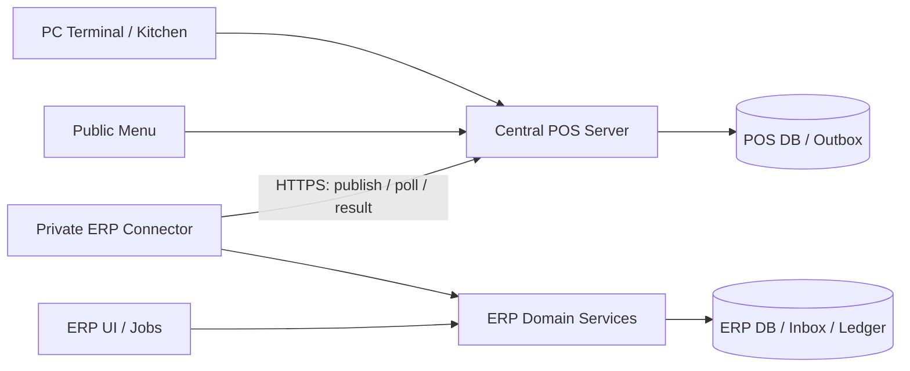

# Phase 28.2 — POS Architecture & Contract — Local Accepted

สถานะล่าสุด2026-10-27: Local implementation/architecture ผ่าน Geminiหมวด17. ฐานตามconfig migrateแล้ว; production/provider/network gates ยัง pending. [Current runtime](../docs/PHASE_28_POS.md) · [API](PHASE_28_API.md) · [Schema](PHASE_28_DATABASE.md). Design decisions ด้านล่างเป็น baseline2026-10-25; ให้ยึด current runtime เมื่อขัดกัน

ฐาน requirement: [D01–D10](PHASE_28_1_POS_SCOPE.md), [checklist 28.2](../checklist.md), [Gemini section 15](../gemini.md). ผู้ใช้ยืนยันรอบนี้ว่ายังไม่มี e-Tax provider. Signing-owner selector และ local ABB/FULL/schema พัฒนาแล้ว; actual signing certificate/provider contract ยังไม่เลือกแทนผู้ใช้

ชื่อ service, operation, field และ endpoint ด้านล่างเป็นข้อเสนอ ไม่ใช่ API/schema ที่มีแล้ว ค่าจำกัดเป็น design candidates รอ review และ load test

## 1. Topology และขอบเขตความเชื่อถือ



- ERP/POS แยก Server, DB, credentials, session และ deployment principal; POS ไม่มี ERP DB credential หรือ ERP write token
- Connector อยู่ ERP zone เริ่มทุก connection ไป POS; response ต่อ connection นี้รับ event ได้ โดยไม่เปิด inbound ERP Write API และไม่เปลี่ยน External API `/api/v1` เดิม
- PC และครัวต้อง online ถึง POS ส่วนกลาง; POS/network ล่มให้หยุดรับธุรกรรม แสดง unavailable ไม่บันทึกยอดขายลง browser เพื่อ replay เอง
- ERP ล่ม: POS ขายเงินสดได้เฉพาะ catalog ที่ยังใช้ได้และ stock quota ที่โอนสิทธิ์สำเร็จแล้ว; หมดสิทธิ์ให้หยุดขายรายการนั้น
- เสนอแยก POS repository/release จาก ERP; contract fixtures เก็บตาม version ทั้งสอง repo ไม่แชร์ DB models หรือบังคับ deploy พร้อมกัน ทิศทางนี้ยังรอ review

## 2. Data ownership และ authority

| ข้อมูล | Master / เจ้าของ | กฎรับเข้า |
| --- | --- | --- |
| Org/branch/warehouse/instance mappings | ERP provisioning | ผูก authenticated instance กับ allowlist; payload เลือก org/บัญชี/สิทธิ์เองไม่ได้ |
| Product/price/tax/UoM/lot/recipe | ERP versioned catalog | POS ใช้ published snapshot ที่ acknowledge แล้ว; import ตรวจ version ที่อนุญาต ไม่เขียนทับด้วยราคาปัจจุบัน |
| Shift/cart/order/kitchen/physical cash evidence | POS | Core ตรวจ staff scope และเก็บ immutable snapshots; ลายเซ็นไม่พิสูจน์ว่าเงินสดมีจริง |
| POS stock entitlement และ local reservation | ERP grant / POS consume | Terminal/online ใช้สิทธิ์ชุดเดียวกันบน POS DB; ERP ไม่ใช้ส่วนที่ให้ POS แล้ว |
| Stock ledger/cost/GL/account mapping | ERP | ผ่าน domain services; ไม่รับ GL account หรือ cost ที่ POS กำหนดเป็น authority |
| ABB/Full numbering และต้นฉบับที่ POS ออก | POS issuance owner | ERP เก็บ correlation; ไม่ออกต้นฉบับภาษีซ้ำจาก import |
| e-Tax signing/submission | ยังไม่เลือก | ต้องเลือก channel/provider/signing owner และ contract จริงก่อนล็อก |
| Prescription attachment | POS private storage | optional, ไม่สร้าง patient/visit/history; ส่ง ERP เฉพาะ reference ที่จำเป็นและได้รับสิทธิ์ |

HQ overview ตรวจ org และ branch permission ทุก query ไม่รวมข้อมูลข้ามองค์กร

## 3. Stock ownership: เสนอ partitioned quota

เลือกเสนอ quota แยกสิทธิ์ แทน shared real-time reservation ข้าม Server เพื่อรักษา outbound-only และขายต่อเมื่อ ERP ล่ม เป็นข้อเสนอรอ review ไม่ใช่ requirement ที่ผู้ใช้เลือกแล้ว

Pool ระบุ `(org, warehouse, product, lot-or-explicit-no-lot)` ใช้ lock row ที่สร้างแบบ unique upsert แล้ว lock จริง แม้ ledger ว่าง; lock parent product/warehouse ก่อน lot ตามลำดับคงที่ เพื่อคุม aggregate และ lot ไม่แข่งขันกัน

- `ERP_available = ledger_on_hand - outstanding_POS_entitlement - ERP_reservations - blocked_stock` ต่อ pool โดยไม่ลบ blocked ซ้ำกับส่วนที่ grant ไม่ได้
- outstanding entitlement รวมยอดให้ POS ที่ยังไม่ consume ใน ERP แม้ POS ขายแล้วแต่ event ยังไม่ import; import ต้องลด ledger และ outstanding entitlement ใน transaction เดียวกัน จึงไม่คืนสิทธิ์ ERP จากการ import
- ERP writer ทุกตัวที่ลด stock ต้องใช้ available ข้างต้น รวม Delivery Order, transfer, count adjustment, production และ correction; receipt/reversal ต้องใช้ lock/order/cost rules เดียวกัน
- ให้ quota ได้เฉพาะ stock พร้อมขายและ lot ไม่หมดอายุ; allocation ไม่ใช่ movement และไม่ลง COGS
- POS จองจาก `granted - consumed - active_reservations - frozen` ในหน่วยฐาน ภายใน transaction Core; checkout consume reservation พร้อม outbox atomically; ยกเลิกก่อนใช้ release ครั้งเดียว

### Grant/reclaim protocol

1. ERP lock pool และ grant identity; หักสิทธิ์ available ของ ERP และเก็บ durable outbound grant ก่อนส่ง ห้ามรอ POS ตอบแล้วค่อยกันยอด
2. Connector ส่ง grant เดิมซ้ำได้; POS unique grant identity/hash/epoch และเพิ่มสิทธิ์ครั้งเดียว Ack หายให้ส่งซ้ำ ไม่สร้าง grant ใหม่
3. ERP ไม่ reclaim จาก timeout, credential revoke หรือ catalog stale โดยอัตโนมัติ เพราะ POS อาจใช้แล้ว
4. Reclaim ต้อง freeze grant ที่ POS ภายใต้ lock, ส่ง final consumed/reserved counters และ event watermark, import ให้ครบ watermark แล้วจึงปิด epoch และคืนเฉพาะ unused ที่ยืนยันตรงกัน; POS ปฏิเสธ consume epoch ปิดแล้ว
5. หาก POS ติดต่อไม่ได้/restore เก่า: quarantine instance และคง outstanding entitlement จน reconcile หลักฐาน ไม่แจก quota เดิมใหม่; ห้ามเปิด restored POS ขายก่อน fencing/reprovision สำเร็จ
6. Physical count ต่ำกว่า outstanding entitlement: freeze pool/แจ้งผู้จัดการ reconciliation ไม่ลด quota เงียบ ๆ ขณะ POS ยังขายได้; เมื่อแบ่งสิทธิ์แล้ว ERP ขายได้เฉพาะส่วนของตนจนได้รับคืน

ตัวอย่าง on-hand 10, ให้ POS 6: ERP ขายได้ 4. POS ขาย 2 ระหว่าง ERP ล่มยังกันสิทธิ์ ERP 6; เมื่อ import 2: ledger เหลือ 8 และ outstanding เหลือ 4, ERP available ยังคง 4

สิทธิ์ ERP/POS ใช้ stock สาขาร่วมกันยังคงอยู่ แต่การโยกสิทธิ์ระหว่าง outage ทำไม่ได้ ต้องให้ผู้ใช้/reviewer ยอมรับข้อจำกัดนี้ก่อนปิด gate

## 4. Service Extraction Plan และหลักฐานเดิม

| Source ที่ตรวจ | พฤติกรรม/ช่องว่าง | แผน |
| --- | --- | --- |
| `CommercialDocumentController::storeDeliveryOrder` | สร้าง movement ใน Controller, SUM/float, warehouse optional; lock invoice ไม่ใช่ lock stock pool | สกัด stock operation, บังคับ warehouse สำหรับ POS, รักษา ERP behavior ที่อนุมัติและออก policy สำหรับ legacy warehouse-null |
| `InventoryOperationsController` | transfer/count เขียน StockMovement | เข้า shared pool lock/entitlement guard ก่อนเปิด quota; ไม่แก้แค่ Delivery Order |
| `GoodsReceiptController` | receipt/movement เป็นอีก writer | รักษา source trace, cost และ locking ร่วม |
| `ProductionCostingService` | issue/completion/reversal เขียน StockMovement | รักษา production semantics และเรียก shared stock primitive ไม่สร้าง Work Order ต่อจาน |
| `StockMovement` | quantity decimal:4, cost decimal:2 | ตรวจ decimal precision/cost residual ก่อน schema; ห้าม float สะสมหน่วยยา |
| `FinancialJournalService` | `postInvoice`, `postPayment`, cash fallback `1100` | reuse posting หลังเพิ่ม explicit drawer/account validation; ไม่ใช้ fallback แทน mapping |
| `ETaxProviderGatewayService` / `RdApiSubmissionAdapter` | มี sign/submit และ generic adapter | ยังไม่ใช่หลักฐานว่าตรง provider ที่จะเลือก หรือรองรับ POS outage/issuance แล้ว |

เสนอ `InventoryMovementService` รับ command แบบ typed DTO: actor/service principal, trusted org/warehouse, source identity/line/lot, quantity/unit conversion snapshot, reason และ posting date; ไม่มี HTTP Request จำลอง

Contract ที่เสนอ: reserve/release/consume/receive/reverse โดย Core/ERP application service คุม transaction ครอบ document + stock + COGS + import result. Shared service ตรวจ scope, permission, lot/expiry, unit/scale, negative stock, quota, period และ moving-average policy; unique source operation กันซ้ำ. Notification ส่งหลัง commit ผ่าน durable mechanism ไม่ส่งก่อน transaction สำเร็จ

ลำดับงานหลัง review: (1) characterization ERP เดิม (2) lock/source identity primitives และ legacy pool reconciliation (3) extract Delivery Order (4) ต่อ writers ทุกตัวที่กระทบ quota (5) regression/concurrency บน DB engine เป้าหมาย (6) จึงสร้าง Connector import ที่พึ่งบริการนี้

DO ที่อ้าง POS ต้องผูก stock posting identity เดิมและห้าม deduct ใหม่; refund ไม่ลบ movement เดิม ใช้ authorized reversal ที่อ้างต้นฉบับ ปริมาณรวมคืนไม่เกินที่ขาย/คืนได้

## 5. Shared Core / Module contract

- Core owns transaction, price/tax validation, cash payment, reservation, numbering, audit, outbox และ idempotency; QR payment ไม่อยู่ v1
- Module ให้ `validate`, `stockDemand`, `onLifecycleTransition` และ immutable module snapshot; ห้าม Module post payment/GL/movement เอง
- Branch มี business type เดียว; server ตรวจ capability และกฎต่อ SKU ไม่บังคับสินค้าทั่วไปผ่าน pharmacist เพียงเพราะอยู่ร้านขายยา ปิด Module แล้วอ่าน/คืนรายการเก่าผ่าน authorized historical workflow ได้ แต่ห้ามสร้าง operation ใหม่เฉพาะ Module
- Retail ก่อน จากนั้น Restaurant/Pharmacy; lot/UoM/expiry เป็น shared stock capabilities
- Online menu ใช้ catalog และ quota เดียวกับ Terminal; คำขอจากลูกค้ายังไม่ใช่ sale ต้องพนักงาน accept และ revalidate ราคา/availability ไม่เปิด online pharmacy ordering

### Restaurant lifecycle — proposal รอ workflow review

`requested → staff_accepted/reserved → kitchen_sent → kitchen_acknowledged → preparing/consumed → served/ready → settled`

ส่งครัว/ack ไม่ consume โดยปริยาย; เสนอ consume เมื่อครัวยืนยันเริ่มเตรียมครั้งแรก เก็บ recipe/modifier/conversion snapshot จาก order ที่ accept และ actual lot ณ consume. Retry/พิมพ์ซ้ำ/จ่ายเงินไม่ consume ซ้ำ. สินค้าสำเร็จรูปใช้ sale fulfillment แทนสูตร

ก่อน consume: cancel release reservation. หลัง consume: manager อนุมัติ waste/reclassification ต้นทุน ไม่ตัดวัตถุดิบเดิมซ้ำ; คืน stock ได้เฉพาะหลักฐานคืนจริงและ policy ที่ตรวจแล้ว. Split bill โยก financial allocation อ้าง source line เดิม ไม่ clone consumption; fractional split/rounding ต้อง sum กลับเท่าต้นฉบับ. Dine-in จ่ายหลังกิน, takeaway จ่ายตอนรับ; merge bill ไม่อยู่ scope

### Pharmacy / attachments

Conversion factor เป็น decimal exact/versioned; base unit เม็ดหรือปริมาตรจริงตาม SKU, scale ไม่เกินที่ schema ที่ review รองรับ; เกิน scale ให้ reject ไม่ round เงียบ ๆ. FEFO เลือก lot พร้อมขาย ไม่หมดอายุ บันทึก actual lot; คืนยาเข้า quarantine ก่อน inspection ไม่เพิ่ม available ทันที

รายการที่ต้องเภสัชกรตรวจและจังหวะตรวจรับยังรอ policy; เสนอ gate ก่อนส่งมอบ/settlement สำหรับ SKU ที่กำหนด. แนบใบสั่งยา optional ไม่สร้าง patient entity: allowlist MIME จากเนื้อหา, จำกัดขนาด, quarantine/scan, private storage, scoped short-lived download, ACL เภสัชกร/ผู้มีสิทธิ์, audit read/delete และ retention policy ที่เจ้าของข้อมูลอนุมัติ ห้ามใส่เนื้อหาไฟล์ใน sync/log

## 6. Versioned Sync contract — candidate v1

ทุก path อยู่ POS Server; ไม่ใช่ ERP public endpoint

| Operation | Candidate path | กฎ |
| --- | --- | --- |
| Publish catalog | `PUT /connector/v1/catalog/{version}` | immutable manifest/hash + staged chunks; activate แบบ atomic เมื่อครบและตรวจผ่าน; version เดิม hash ต่าง reject |
| Publish entitlement | `PUT /connector/v1/grants/{grant_id}` | grant identity/epoch; เพิ่มสิทธิ์ครั้งเดียว |
| Poll events | `GET /connector/v1/events?cursor=...&limit=...` | opaque cursor, stable order, instance-bound; ไม่ลบ event เมื่อ fetch |
| Record results | `PUT /connector/v1/results/{event_id}` | result revision + accepted/rejected/needs_review/dependency_pending/inventory_pending และ ERP correlation; retry เหมือนเดิมได้ |
| Reconcile | `GET /connector/v1/reconciliation?cursor=...` | watermark/counters/totals by branch/shift/grant/currency; ไม่ส่งข้อมูล PII เกินจำเป็น |

เสนอ batch 100 events, event body 256 KiB, response 2 MiB, connect timeout 5s/read 30s; attachment แยก private resource. oversized event เข้าสถานะ rejection ที่ตรวจได้ ไม่ทำให้ cursor ทั้งชุดค้าง. Poll ทุก 5s ขณะปกติและ backoff+jitter สูงสุด 60s เป็นค่าทดลอง ไม่ใช่ SLA

Envelope ต้องมี `schema_version`, `instance_id`, `event_id` UUID, `aggregate_id`, `aggregate_version`, `source_sequence`, `event_type`, `occurred_at` UTC, `business_timezone`, `catalog_version`, `payload_hash`, `key_id`, `signature` และ payload snapshots ของ line/price/tax/discount/lot/conversion/cash/grant/source references ตาม event type

- Currency เป็น ISO code, quantity/money เป็น decimal string; เสนอ quantity สูงสุด 4 decimal ตาม ledger ปัจจุบัน, money ตาม currency scale; ห้ามรับ float/NaN หรือ scale เกิน. Cost calculation/rounding ยังต้อง review และเก็บ residual แบบตรวจยอดได้
- Hash SHA-256 จาก canonical UTF-8 payload bytes ตามกติกา canonicalization ที่ version ระบุชัด; เก็บ bytes/hash เดิมใน POS transaction เดียวกับ outbox. Authentication ลงนาม identity/version/sequence/hash; method/path/request nonce ป้องกัน request replay แยกจาก business dedupe. canonicalization fixtures ต้อง review ก่อน freeze wire schema
- Unique inbox `(trusted_instance, event_id)` และ unique business source `(instance, aggregate, operation, line, lot)` ตามชนิด operation; event เดิม hash ต่าง quarantine และเก็บ evidence ไม่ overwrite
- Minor version เพิ่ม optional field ได้; consumer reject required capability/major version ที่ไม่รองรับก่อน activate. รองรับ current/previous ที่ทดสอบแล้ว; ไม่ downgrade ผ่านการทิ้ง field ภาษี/Stock
- ขาด catalog version/parent event ให้ dependency_pending; refund-before-sale ไม่สร้าง sale สมมติ. ลำดับต่อ aggregate ตรวจ version; poison event ไม่ขวาง aggregate อื่น

## 7. Import transaction / acknowledgement / recovery

```mermaid
sequenceDiagram
    participant P as POS Core
    participant C as ERP Connector
    participant E as ERP Domain/DB
    P->>P: Commit sale + quota consume + outbox
    C->>P: Poll cursor
    P-->>C: Immutable events
    C->>E: Persist inbox + received bytes + durable cursor
    C->>E: Lock source/pools; validate and post atomically
    E-->>C: Commit documents + movements + GL + result outbox
    C->>P: PUT result (retry same identity)
    P-->>C: Ack result revision
```

Cursor หมายถึงรับลง durable inbox แล้ว ไม่ใช่ import สำเร็จ; result accepted ส่งหลัง commit เท่านั้น. Crash ก่อน commit retry; หลัง commit แต่ ack หาย replay คืน result เดิม ไม่ลงบัญชี/Stock ใหม่. Worker ใช้ bounded retries/backoff, lease และ DLQ พร้อม original payload; manual replay ใช้ pipeline/identity เดิมและ audit

หาก verified physical cash sale ติด inventory discrepancy: เก็บ sale/payment evidence และสถานะ inventory_pending อย่าง durable; ห้าม force negative หรือแสดง COGS complete. เสนอ staging ทั้ง posting group ไว้ก่อนจน resolve เพื่อไม่ลงผลบางส่วน; dashboard แสดงยอดเงินรับแล้วแต่ยังไม่ post ERP ชัดเจน. การอนุญาตแยก financial/stock posting ต้องออก approved transaction/reconciliation policy เพิ่ม ไม่ทำโดยปริยาย. Forged/unverifiable event ต้อง needs_review/rejected ไม่ใช้คำว่า physical sale เป็น bypass

## 8. Event-to-ERP / accounting boundaries

เสนอใช้ Invoice/Payment path เดียว ไม่ทำ direct POS GL คู่ขนาน แต่ต้อง extract document application service และตรวจ posting trigger ก่อน reuse

| Source event | ERP owner / ผลที่เสนอ | ไม่ทำซ้ำ |
| --- | --- | --- |
| sale finalized / receivable recognized | Sales application service → invoice + `postInvoice` เมื่อผ่าน recognition policy | sale/source identity เดียว; ห้ามอีก direct revenue/VAT entry |
| cash settled | Payment application service → receipt/payment + `postPayment` ด้วย drawer mapping | tender identity เดียว; cash tender-change = applied amount |
| stock consumed | InventoryMovementService → stock + COGS posting ผ่าน approved journal service | source line/lot/consumption identity; DO import ไม่ deduct อีก |
| recipe consumed | service เดียวกัน + frozen recipe demands | ไม่สร้าง work_orders รายจาน; payment ไม่ consume อีก |
| refund/void | return/credit note + payment reversal/refund และ stock inspection แยกตามหลักฐาน | cumulative quantity/amount ไม่เกินต้นฉบับ; period lock ใช้ authorized adjustment ไม่ย้อนแก้รายการ |
| waste after consume | cost reclassification + evidence | ไม่ลดวัตถุดิบเดิมอีก |
| shift close / bank deposit | cash discrepancy หรือ cash-to-bank transfer ที่อนุมัติ | ไม่ post sales/VAT/COGS อีก; bank เดียวไม่แปลว่าเงินสดทุก drawer รวมกะ |

บัญชี drawer/AR/revenue/VAT/inventory/COGS/waste/over-short ต้อง explicit org mapping และ account type validation; mapping ขาดให้ hold ไม่ fallback `1100`. Restaurant แยก consumption ออกจาก revenue recognition/settlement; จังหวะ invoice/ภาษีและ unpaid receivable ต้องให้บัญชี review ก่อน freeze. รายงานต้องแยก sold/paid/consumed/imported/pending ไม่รวมยอดซ้ำ

QR/late gateway receipt ยัง deferred; เมื่อนำกลับมาต้องมี suspended receipt/clearing/liability/reconcile ไม่ drop เงินเข้าจริงหรือ apply ซ้ำ เลขบัญชีจาก Gemini เป็นตัวอย่าง ไม่ hard-code ใน v1 เงินสด

## 9. Numbering / tax gate

POS UUID เป็น source identity แยก display receipt เช่น `{Branch}-{Terminal}-{YYYYMMDD}-{Sequence}`. Server ออก sequence ใน transaction + unique constraint, ใช้ Asia/Bangkok business date; retry request identity เดิมได้เลขเดิม หลาย tab ใช้ counter เดียว. Reprovision ใช้ terminal incarnation ใหม่ไม่ reset เลขเก่า; restore ต้อง reconcile issued ranges และ fence เครื่องเก่าก่อนรับธุรกรรม

เลข ABB/Full แยก namespace/series ตาม policy ที่ผู้รับผิดชอบภาษีตรวจ; replace/reissue อ้างต้นฉบับ ไม่เพิ่มยอดขาย/VAT. ไม่ใช้ display receipt pattern เป็นข้อสรุปด้านกฎหมาย

**e-Tax gate เปิดค้างตามคำตอบผู้ใช้:** ยังไม่เลือก provider/channel/signing owner. ก่อน freeze integration/schema ต้องระบุ contract จริง, certificate/key custody, issuer/branch numbering, XML/receipt formats, replacement/cancellation, timeout/status query/idempotency, outage/delayed submission policy, retention และผลทดสอบจริงกับช่องทางที่เลือก. ห้ามถือ generic `RdApiSubmissionAdapter` หรือ mock acceptance เป็นหลักฐานผ่าน

POS ต้องแสดง pending/retry/error/accepted ตามผลยืนยันจริง และใช้ durable submission queue; ไม่ส่ง live หรือสร้าง provider-specific schema ตอนนี้. Queue อย่างเดียวไม่ใช่หลักฐานว่าข้อกำหนดภาษีครบ

## 10. Threat model / operations

| Threat | Control / ข้อจำกัด |
| --- | --- |
| POS host/key ถูกยึด | ตรวจ mapping, quota, catalog authority, cash reconciliation/manager evidence อิสระ; signature/hash ไม่ทำให้ event tamper-proof |
| Credential รั่ว/ข้าม tenant | mTLS + instance scopes, rotation/revoke/expiry; key ไม่อยู่ browser; revoke ไม่ reclaim quota อัตโนมัติ |
| SSRF ผ่าน POS URL | admin allowlist, fixed paths, DNS/IP validation, redirect deny, TLS verify และ bounded body/time |
| Public menu spoof/spam | scoped revocable branch/table-session token, server price/availability check, rate limits; public token ไม่มี staff scope |
| Concurrent sale/replay | POS local transaction, ERP pool row lock, unique source identity, aggregate version และ signed immutable evidence |
| Disk เต็ม/queue ค้าง | backlog/disk/age alert, backpressure; commit outbox ไม่ได้ต้องไม่รับ sale สำเร็จ; pending/review ห้าม prune |
| Backup rewind | fence instance/grant epoch, reconcile watermarks และ issued numbers ก่อนขายต่อ; archive ต้องคง dedupe tombstones |

เสนอ catalog stale limit 24h เป็น candidate ให้เจ้าของธุรกิจยืนยัน; price/tax/recall revocation อาจกำหนด short validity ต่อ snapshot. Expired snapshot หยุดขายรายการนั้น ไม่ลดระดับ validation เพื่อขายต่อ. Catalog ใหม่ไม่เปลี่ยนหลักฐานรายการเก่า

Backup ERP/POS แยกพร้อม encrypted evidence/outbox/inbox/key custody; restore drill ต้องทดสอบ crash-before/after-ack, pending grant และ e-Tax result unknown. RPO/RTO, retention, alert thresholds, peak load และ deployment version window ยังต้องตกลงก่อน acceptance ไม่อ้าง real-time จาก polling interval

## 11. Review / acceptance gates

| Gate | สถานะ / หลักฐานที่ต้องมี |
| --- | --- |
| Architecture + extraction review | รอ review เอกสารนี้ รวม stock writers ทุกตัว, legacy warehouse-null และ transaction boundaries; Gemini เดิมไม่ใช่อนุมัติ draft นี้ |
| Quota policy | รอยืนยันการ partition สิทธิ์/หมด quota ช่วง outage และ protocol reclaim/fencing; ทดสอบ invariant เมื่อ ledger ว่าง/ERP+POS แย่งหน่วยสุดท้าย |
| e-Tax | ผู้ใช้ยังไม่มี provider; ต้องเลือกและ review contract/signing owner ก่อน freeze tax integration/schema |
| Business workflow | รอ kitchen consume trigger, pharmacist SKU gate, precision/rounding, invoice recognition และ attachment retention/ACL review |
| Operations | รอ stale limits/RPO/RTO/load/retention; pilot business/printer model เป็น setup/UAT gate |
| Implementation | ยังไม่เริ่ม Application/Connector/schema/migrations; regression หลัง extraction และก่อน Connector |

ชุดทดสอบที่ต้องออกหลังอนุมัติ: ทุก stock writer เคารพ quota, concurrent empty pool/last unit, lost grant/result ack, reclaim ขณะขาย, restore epoch เก่า, payload เดิม ID/hash ต่าง, refund-before-sale, split bill ไม่ consume ซ้ำ, waste ไม่ deduct ซ้ำ, FEFO/decimal conversion, explicit account mapping/period lock, real e-Tax accept/reject/unknown status, isolation ระหว่าง org/branch และ deployment สอง Server

การส่ง draft นี้ปิดเฉพาะงานจัดทำข้อเสนอ ไม่ติ๊ก 28.2 ว่าผ่าน และไม่แก้ผลรับรองใน gemini.md แทน reviewer
