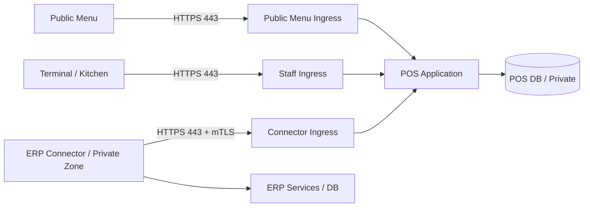

# Phase 28.3 — Network / Authentication / Security

สถานะล่าสุด2026-10-27: Local security implementation ผ่าน Geminiหมวด17; [current status](../docs/PHASE_28_POS.md). Target firewall/mTLS/real credentials/network isolation และ production/UAT ยัง pending. Configured DB migratedแล้ว ไม่ใช่ network acceptance

อ้างอิง [Scope](PHASE_28_1_POS_SCOPE.md), [Architecture Draft](PHASE_28_2_POS_ARCHITECTURE_CONTRACT.md), [Security Requirements](../docs/SECURITY_REQUIREMENTS.md) และ [checklist](../checklist.md). เป็นข้อเสนอที่ตรวจรับได้ ยังไม่ได้ติดตั้ง firewall, สร้างบัญชีจริง, ออก credential หรือพิสูจน์ network isolation. Local design/code ได้รับการอนุมัติและตรวจรับแล้ว; ตาราง target controls ด้านล่างยังต้องพิสูจน์บนสภาพแวดล้อมจริง

## 1. Trust zones / firewall matrix

| Source → Destination | Policy ที่เสนอ | ตรวจรับ |
| --- | --- | --- |
| Internet/POS/Terminal → ERP application/DB | deny new connections ทั้ง IPv4/IPv6 | connect จากแต่ละ zone ต้องไม่สำเร็จ |
| ERP Connector → POS Connector ingress | allow เฉพาะ provisioned host/IP และ TCP 443 | approved path สำเร็จ, host/port อื่นถูก deny |
| Terminal/Kitchen → POS staff ingress | HTTPS 443 + staff authentication | เข้าถึง Connector/admin DB path ไม่ได้ |
| Customer → public menu ingress | HTTPS 443, public routes เท่านั้น | staff/Connector routes ถูก deny แม้รู้ URL |
| POS app → POS DB | private interface, DB port ตาม engine ที่เลือก, app principal เฉพาะ | public/Terminal/ERP Connector เข้าฐานตรงไม่ได้ |
| Admin → infrastructure | management network/VPN และแยก principal | ไม่มี public DB/admin management port |

Default deny ทุก zone และ DB ingress; เปิด established reply ของ connection ที่อนุญาต ไม่เปิด POS เริ่ม connection ใหม่เข้า ERP. Egress DNS/NTP/backup/monitoring/CA verification ต้อง inventory และ allowlist แยกตามความจำเป็น; e-Tax egress รอ provider ไม่เปิด wildcard Internet โดยอ้าง future integration

แยก DNS/origin ของ public menu, staff, Connector และ administration ตาม deployment ที่จะเลือก; ถ้าใช้ proxy ร่วมต้องบังคับ route/host policy ทุกชั้น. Proxy เป็นผู้ยืนยัน client certificate; application เชื่อ verified identity เฉพาะ header ที่ proxy ล้างและเขียนเองผ่าน private hop ป้องกัน direct-origin bypass และ forged certificate header

## 2. Connector service identity

- เสนอ mTLS ที่ Connector ingress; cert ผูก `connector_identity` กับ instance/org/branch mappings ใน registry ฝั่ง POS ไม่อ่าน authority จาก body หรือ CN ที่ยังไม่ตรวจ registry
- แยก credentials ต่อ POS instance/org; scopes ที่เสนอ `catalog:publish`, `grants:manage`, `events:read`, `results:write`, `reconciliation:read`. แต่ละ method/path ตรวจ scope และ mapping ก่อนอ่าน resource
- Private key ของ client อยู่ ERP Connector secret store เท่านั้น. POS เก็บ public certificate/fingerprint/CA trust และ registry ไม่เก็บ ERP login credential. POS event signing key เป็นอีก key คนละวัตถุประสงค์ ไม่ใช่ ERP access credential
- Service auth ไม่ใช้ ERP admin key, browser session หรือ External Summary API key. Client certificate ไม่แทน import business validation
- HTTPS ตรวจ hostname/chain/validity ทุกครั้ง; ห้าม insecure TLS fallback. TLS policy/cipher เลือกตาม infrastructure ที่ review โดยไม่มี public plaintext credential endpoint

### Lifecycle ที่เสนอ

1. ERP admin re-authenticate เพื่อ provision mapping และส่ง public material ผ่าน authenticated management flow; audit ผู้สร้าง/ผู้อนุมัติ ไม่ส่ง private key ทาง payload/log
2. ออก client certificate แบบอายุสั้นตาม PKI ที่เลือก; expiry alert และ renew ก่อนหมดอายุ. อายุ/overlap จริงเป็น deployment gate ไม่สมมติว่ามี PKI แล้ว
3. Rotation ให้ old/new identity มีช่วง overlap ที่ระบุ start/end; issuer/key id ชัด, ห้ามขยาย trust ทุก certificate ของ CA เป็นทุก org
4. Revoke/pause ต้องปฏิเสธ request ถัดไปแม้ connection เดิมยังอยู่; ตรวจ registry ทุก request และหยุด active worker ตาม policy ไม่รอ certificate หมดอายุ
5. Revoke ไม่คืน stock quota อัตโนมัติ; ใช้ freeze/reclaim/fencing ตาม 28.2. Break-glass เป็นสิทธิ์แยก มี expiry/reason/audit และห้ามข้าม stock guard

## 3. Staff accounts / session / permissions

บัญชี POS แยกจาก ERP ไม่ reuse session cookie/password hash/token; provisioning ส่งเฉพาะ staff reference และสิทธิ์จำเป็น ไม่ส่ง HR/payroll หรือ ERP role ทั้งชุด. Password เก็บ hash, login/reset มี rate limit และ account enumeration protection

| Role ที่เสนอ | อนุญาตตาม branch/terminal scope | ต้องมี gate เพิ่ม |
| --- | --- | --- |
| Cashier | เปิดกะตนเอง, รับเงินสด, checkout, ปิดกะพร้อมยอดนับ | discount เกิน threshold, void/refund, reopen ต้อง manager |
| Manager | อนุมัติส่วนลด/void/refund/reopen/over-short ภายในสาขา | re-authentication + reason + source transaction + audit |
| Restaurant staff | รับออเดอร์/โต๊ะ/split bill ตาม capability | ห้ามแก้ settled amount/clone stock consumption |
| Kitchen | อ่านรายการครัวและเปลี่ยนสถานะที่อนุญาต | ไม่เห็นต้นทุน/ข้อมูลผู้ซื้อ/ใบสั่งยา; ไม่รับเงิน |
| Pharmacist | ตรวจรับ SKU ที่ policy กำหนด, ตรวจของคืน/ใบสั่งยา | กฎ SKU และจังหวะ gate รอ workflow review; ไม่มี patient history |
| POS administrator | จัดการบัญชี/config ตามสิทธิ์ | ไม่ให้การตั้งค่าแปลเป็น refund/financial approval อัตโนมัติ |

ทุก query ตรวจ trusted org → assigned branch → terminal/shift → operation permission → resource state; deny by default. ห้ามให้ branch_id/terminal_id/role จาก browser เป็น authority. Terminal binding เป็น scope เพิ่ม ไม่แทน staff authentication

เสนอ idle timeout 15 นาที และ absolute lifetime 8 ชั่วโมงเป็นค่ารอ operational review; screen lock ต้อง login/re-auth เพื่อทำงานต่อ และไม่ปิดกะ/ทิ้ง order อัตโนมัติ. Shared PC ต้องสลับผู้ใช้ชัดเจน ไม่ใช้ shared cashier account

Cookie host-only, Secure/HttpOnly/SameSite=Lax, จำกัด path ตาม app; CSRF สำหรับ mutation แบบ cookie, rotate session เมื่อ login/privilege change และ revoke เมื่อ disable/reset/change permission. Manager/administrator เสนอ MFA; approval token ผูก operation/source/amount/version อายุสั้นและใช้ครั้งเดียว ห้าม client ส่ง `approved=true` แทนหลักฐานอนุมัติ

## 4. Public menu / table session

- Public token เป็น opaque cryptographically random token เก็บ hash ฝั่ง server; ผูก branch และ purpose, table/session เพิ่มเฉพาะ restaurant ที่เปิดโต๊ะแล้ว มี expiry/revoke/rotation
- QR สาขาใช้ดู catalog ได้ตาม policy แต่ order token ต้องผูก active table session หรือ takeaway channel; ปิดโต๊ะแล้ว token ส่ง order เก่าใช้ไม่ได้
- Validate token scope กับ mapping ฝั่ง server ไม่เชื่อ table/branch/product price/modifier/total ใน body. Customer submission เป็น request ให้ staff ตรวจรับ ไม่ใช่ paid/fulfilled sale
- Public DTO allowlist เฉพาะชื่อสินค้า/ราคา/ภาษีที่ใช้แสดง/ตัวเลือก/availability; ไม่ส่ง exact internal stock, quota, cost, staff, prescription หรือ ERP identifiers ที่ไม่จำเป็น
- Escape customer notes/menu text, จำกัดขนาด/จำนวนรายการ/rate; token ใน URL ต้อง redact จาก access log/analytics, ใช้ Referrer-Policy ที่ไม่รั่ว token และเลี่ยง third-party assets บนหน้า session
- Public session ไม่ให้เข้าหน้า pharmacy order หรือ attachment; QR payment ยัง deferred แยกจาก QR เมนู

## 5. Destination allowlist / SSRF

ERP admin กำหนด POS destination ผ่าน re-authenticated configuration เท่านั้น; event/payload/redirect ไม่มีสิทธิ์เปลี่ยนปลายทาง. ใช้ fixed HTTPS origin, approved port และ fixed relative paths; reject userinfo/fragment/non-HTTPS/unapproved host/port, path traversal และ ambiguous URL encoding

Resolve DNS แล้วตรวจ IP ทุก address ที่จะเชื่อมต่อทั้ง IPv4/IPv6; deny loopback/link-local/metadata/multicast/reserved และ private ranges ที่ไม่ provisioned. POS private endpoint อนุญาตได้เฉพาะ exact approved addresses ไม่เปิดทั้ง private subnet. Bind validation กับ address ที่ transport ใช้จริงเพื่อกัน DNS rebinding และยังตรวจ TLS hostname/SNI; proxy/redirect ห้ามข้าม validation. ปิด automatic redirects รวม cross-origin/port และไม่ใช้ proxy environment โดยไม่ตรวจ config

กำหนด bounded request/response/timeout ตาม 28.2 รวม decompressed body limit และ streaming cutoff; ไม่ fetch URL ที่มากับ event/attachment อัตโนมัติ. Error เก็บ category/destination reference ไม่เผย credentials หรือเนื้อหาผู้ซื้อ

## 6. Catalog / data minimization / prescription

Catalog serializer ใช้ explicit allowlist: external product reference, display name/barcode, published price/tax/UoM/conversion/version, approved lot availability/expiry ตาม capability, recipe demand snapshot และ quota reference ที่จำเป็น. ไม่ serialize ERP model ทั้ง object

ไม่ส่ง HR/payroll, bank account/secret, national_id, internal GL mapping หรือต้นทุนโดยปริยาย. Refund/invoice buyer details ส่งเฉพาะเอกสารที่ต้องใช้ ผ่าน authenticated scope แยก; public catalog ห้าม reuse staff DTO

ใบสั่งยา optional ใช้ private object storage/quarantine/scan/type-by-content/size limit และ ACL ตาม 28.2; download ตรวจ scope ทุกครั้ง ใช้ short-lived URL และ audit. ไม่ส่งไฟล์แนบใน catalog/events/log และไม่อนุมานว่าเภสัชกรเห็นไฟล์ทุกสาขาได้. Retention/delete/legal hold และ allowed file formats ต้อง review ก่อนเปิด upload

## 7. Event authentication / replay / key custody

เสนอ asymmetric event signature แยกจาก mTLS เพื่อให้ ERP เก็บ public verification key และตรวจ archived evidence ได้. Algorithm/library/canonicalization ต้อง review ก่อน freeze wire contract ไม่เขียน crypto เอง

- POS ลงนาม domain-separated envelope ที่รวม instance/event_id/schema_version/source_sequence/aggregate_version/occurred_at/payload_hash/key_id; hash จาก immutable canonical payload bytes ที่ commit พร้อม outbox
- ERP ตรวจ authenticated mapping → supported version/limits → allowed signing key/key validity → signature/hash → unique event identity → business authority/quota/payment evidence ก่อน post
- Request timestamp/nonce แยกจาก event occurred_at: request เก่าปฏิเสธตาม skew window ที่ review; event backlog ที่เก่ายังรับตรวจได้ผ่าน request ใหม่ ไม่บังคับ re-sign event ที่ immutable
- Event เดิม/hash เดิมคืน result เดิม; ID เดิม/hash ต่างเป็น integrity conflict เก็บ original+conflicting evidence แยก ไม่ overwrite. Signature ไม่ได้แทน unique business source/transaction locks
- Rotation เก็บ public keys และ validity/compromise metadata สำหรับ historical verification; เลิก active signing ไม่ลบ key ที่ยังต้อง verify archive. Unknown/revoked/compromised key ให้ quarantine/review ตาม incident cutoff ไม่ถือ claimed occurred_at เป็นเวลาเชื่อถือได้เอง
- Signing private key แยกสิทธิ์จาก DB และ backup ตาม key custody; หาก POS host/key ถูกยึด ผู้โจมตียังปลอม events ได้ ต้องมี quota/catalog validation, drawer reconciliation และ independent manager evidence

## 8. Audit / rate limits / incident response

Audit provisioning, destination/config changes, login/disable, role changes, manager approval, shift/cash actions, key lifecycle, token revoke, attachment access และ import/replay decisions. เก็บ actor/service identity, trusted scope, source/correlation, action/outcome/reason และ server timestamp; จำกัดผู้แก้/ลบและส่ง immutable evidence ไป storage ที่ POS principal แก้ย้อนหลังไม่ได้ตาม deployment policy

Redact Authorization/Cookie/private keys, QR/session tokens, prescription, bank secrets และ buyer PII; error response ไม่เผย stack trace/SQL/tenant existence. Failed authentication audit ใช้ bounded metadata ไม่เก็บ raw credential/payload

แยก limiter สำหรับ login/public menu/order/upload/connector/admin ตาม identity+scope+IP ที่ proxy ยืนยัน; ไม่ใช้ IP เดียวเป็น tenant authority. Rate/burst/concurrency และ retention เป็นค่า pending load/operations review. ตอบ 429 พร้อม retry policy; ห้าม retry checkout ด้วย identity ใหม่เพราะ timeout. Limit body/items ก่อน expensive signature/DB work และไม่ให้ public load แย่ง worker ของ cashier/Connector จนหยุดขาย

Incident runbook: disable affected identity/instance → isolate ingress/stop workers → preserve received bytes/audit/queue → freeze quota ไม่ reclaim เอง → rotate compromised keys และกำหนด cutoff → manager reconcile cash/stock/document → controlled replay/fencing ก่อน resume. ห้ามล้าง pending/DLQ เพื่อให้ dashboard ดูปกติ

## 9. Verification matrix / gates

| Checklist 28.3 | หลักฐานที่ต้องทดสอบหลัง implementation | สถานะ |
| --- | --- | --- |
| Network isolation | connect matrix จากทุก zone, IPv4/IPv6, direct-origin/proxy bypass | Design draft; ยังไม่ทดสอบสอง Server |
| HTTPS / service auth | wrong/expired/revoked cert, scope mismatch, rotation, forged identity header | Design draft |
| Credential custody | secret scan/runtime inspection และ POS ไม่มี ERP access credential | Design draft |
| Staff/session | cross-org/branch/terminal access, CSRF, session revoke, manager approval replay | Design draft; ยังไม่สร้างบัญชี |
| Role segregation | kitchen/cashier/public เปิดต้นทุน/ใบสั่งยาไม่ได้; pharmacist ตาม assigned scope | รอ workflow policy |
| QR token | table close/revoke/expiry, forged branch/table/price, repeat order idempotency | Design draft |
| SSRF | redirect/rebinding/mixed IP/IPv6/metadata/proxy/oversized compressed body | Design draft |
| Data minimization | allowlist contract fixtures และ public/staff catalog field leakage | Design draft |
| Integrity | changed bytes/ID conflict/wrong key/backlog after rotation/compromised key cutoff | Design draft |
| Audit / abuse | redaction/retention/access controls, limiter isolation, replay audit | รอ thresholds/retention |

ก่อนลง code/config จริง: review 28.2 Architecture/Service Extraction และ security draft นี้, ระบุ host/IP/DB engine/proxy/PKI/secret store/admin access; ยืนยัน role/workflow/retention/session limits ตามที่กระทบผู้ใช้. e-Tax identity/egress/signing custody ยังค้าง provider gate ไม่ย้ายมาเลือกโดยปริยายใน 28.3

ไม่ถือว่า checklist ผ่านจากเอกสาร design; network/auth implementation และ acceptance ยังเป็นงานค้าง ไม่แก้ gemini.md เพื่อรับรองแทน reviewer
