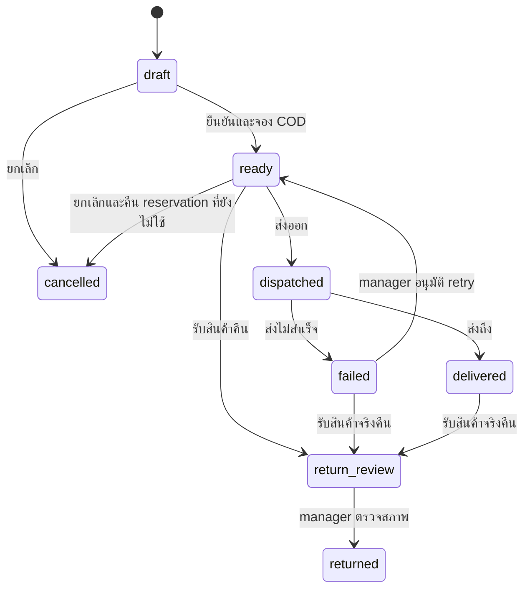

# Phase 28.8.1 — Ordering / Delivery

อัปเดต 2026-10-30: **Local operational scope complete** สำหรับ Retail/Restaurant ตามขอบเขตที่ผู้ใช้ยืนยัน ไม่ใช่ production/accounting sign-off. Pharmacy Delivery ปิดทั้งหมด

ผู้ใช้ยืนยัน COD เป็น cash-custody evidence: รับเงินลูกค้า/ส่งเงินคืนร้าน/คุมข้ามกะได้ โดยยังไม่สร้าง ABB/FULL, Payment หรือ GL ของ COD อัตโนมัติ. ค่าจัดส่ง/บรรจุภัณฑ์เป็น local policy รอตรวจรับบัญชี/ภาษี. [Checklist](../checklist.md) · [หลักฐาน](acceptance/phase28_8_1/README.md)

## เรียกใช้ใน isolated local environment

1. ใช้ POS config/DB/APP_KEY/signing key แยกจาก ERP ตาม [คู่มือ POS](README_POS.md). ใช้ Retail หรือ Restaurant branch ที่ provision catalog/quota/Terminal/staff แล้ว
2. ใช้ APP_ENV=local หรือ testing และ loopback URL. ตั้ง POS_LOCAL_DELIVERY_ENABLED=true เฉพาะ environment แยกของ POS และ ERP ที่ทดสอบการรับ revisions. ค่าเริ่มต้น false; ไม่เปิด production. Prepaid refund/inspection ต้องเปิด POS_LOCAL_REFUNDS_ENABLED และ POS_LOCAL_RETURN_INSPECTIONS_ENABLED แยกใน isolated POS/ERP ด้วย
3. รัน migration ในฐานทดสอบแยกก่อนเปิดหน้า. งานนี้มี POS migrations เพิ่ม 2 ไฟล์ และ ERP 1 ไฟล์; ไม่ได้รันกับฐานที่ตั้งค่าใช้งานอยู่
4. Login cashier/manager แล้วเข้า /deliveries หรือปุ่ม Delivery บน POS. ผู้จัดการต้องยืนยันรหัสผ่านสำหรับ fees, ส่งใหม่, ส่งเงิน/คืนเงิน และตรวจรับคืน
5. COD กดพร้อมจัดส่งโดยเลือก Terminal. Retail ต้องมี quota; Restaurant ต้องเตรียมรายการครัวให้ ready ก่อน dispatch. กดใบส่งของเพื่อพิมพ์ข้อมูลอ้างอิงงาน

## ขั้นตอนและผู้รับผิดชอบ

| ขั้นตอน | ผู้ทำ/ข้อกำหนด |
| --- | --- |
| draft | Cashier/manager รับที่อยู่และรายการ; COD ใช้ราคา/VAT/precision จาก catalog ที่ server ยอมรับ ไม่รับราคาจาก browser |
| edit | แก้ผู้รับ/ที่อยู่ใน draft; แก้รายการได้เฉพาะ COD draft และล้าง fee quote เดิม. failed แก้ผู้รับได้โดย manager |
| fees | Manager กำหนด net delivery/packaging fee และ tax rate จากรายการ server; snapshot net/tax/total และปัดเศษด้วย BCMath |
| ready | Retail COD จอง shared quota; Restaurant COD สร้าง takeaway kitchen order เดิม. Prepaid อ้าง sale ที่จ่าย cash สำเร็จและยังไม่มี refund |
| dispatched | ระบุพนักงานส่งที่ active ในสาขา. ตรวจ reserved quota/epoch/recall/expiry หรือ kitchen ready; ไม่จอง/ตัดซ้ำ |
| delivered | ยืนยันส่งถึง. แยกจากการรับเงินและส่งเงินคืนร้าน |
| collect | บันทึกจำนวนเงินตรงยอดค้างครั้งเดียว พร้อมผู้ถือเงิน/เวลาลูกค้าจ่าย; ยังไม่เข้าลิ้นชัก |
| remit | Manager รับเงินเข้ากะเปิดของตนบน Terminal ที่เลือก. ใช้กะใหม่ได้หลังปิดกะเดิม; ไม่แก้ยอดกะที่ปิด |
| failed / retry | บันทึกเหตุผล; manager อนุมัติส่งใหม่โดยใช้ reservation เดิม. ห้ามส่งใหม่หลังรับเงินหรือรับสินค้าเข้าตรวจคืนแล้ว |
| receive / inspect | รับสินค้าจริงเข้า return_review แล้ว manager ตรวจสภาพก่อน restock/destroy; ไม่ปล่อย Stock จาก failed อัตโนมัติ |
| refund | คืน custody ครั้งเดียว; หากเงินเข้าร้านแล้ว ใช้กะเปิด/เงินพอและบันทึก drawer out. ถ้ายังอยู่กับผู้ส่ง ไม่สร้าง drawer movement |

เป็น full-order delivery/return รุ่นแรก. Prepaid ที่มี partial refund เดิมต้องกระทบยอดโดยชัดแจ้งก่อน bridge รับคืน; ไม่สร้าง refund ซ้ำเพื่อข้ามข้อขัดแย้ง

## สถานะงาน

การรับเงิน/ส่งเงิน/คืนเงินเป็น evidence แยกจากสถานะการขนส่ง. returned หมายถึงตรวจสินค้าคืนแล้ว ต้องดู cash_collected/cash_remitted/cash_refunded และ source refund ประกอบ ไม่ถือว่าคืนเงินแล้วอัตโนมัติ. Prepaid ที่ cancelled รับเข้าตรวจคืนได้; COD ที่ยกเลิกก่อนส่งไม่มี physical return

## เงิน เอกสาร และ Stock

- **Prepaid cash:** สร้างจาก sale เดิมที่ completed และชำระ cash ครบ. ไม่สร้าง sale/VAT/payment/quota consumption ซ้ำ. ค่าจัดส่งเพิ่มแยกเป็น custody pending review. รับคืนเรียก RefundService เดิมและเชื่อม source refund; full refund เดิมใช้ซ้ำได้โดยตรวจ physical returned quantity
- **COD:** snapshot ยอดสินค้าและ fees; รับเงิน/ส่งเงิน/คืนเงินเป็น custody เท่านั้น. ใบส่งของและยอดรับฝากไม่ใช่ใบเสร็จหรือใบกำกับภาษี. ERP เก็บ delivery revisions โดยไม่มี Invoice/Payment/GL/Stock Movement ใหม่จาก event นี้
- **Retail COD:** shared reserved_quantity กัน stock เดียวกับ checkout/kitchen. ส่งสำเร็จยังถือ reservation รอ settlement policy; ไม่คืน quota ให้ขายซ้ำ. รับคืนผ่านตรวจสภาพจึง release; destroy เปลี่ยนเป็น local consumed ครั้งเดียว. ยังไม่ post COD inventory/COGS ฝั่ง ERP จนกติกา settlement ตรวจรับ
- **Retail prepaid return:** ใช้ original allocation/refund/inspection และ original-cost ERP return path; lot ว่างได้สำหรับสินค้าทั่วไป. ไม่คืน quota ที่ใช้แล้ว. Pharmacy inspection เดิมยังต้องผู้จัดการที่เป็นเภสัชกรและ lot ตามเงื่อนไขเดิม
- **Restaurant:** ใช้ kitchen reservation/recipe consumption เดิม. ห้าม bill COD-bound kitchen line ซ้ำ. อาหารปรุงแล้วคืนได้เฉพาะ destroy/waste อ้าง consumption เดิม ไม่คืนวัตถุดิบดีหรือตัดวัตถุดิบซ้ำ. Prepaid ใช้ refund เดิมและบันทึก disposed evidence อ้าง sale/consumption เดิม ไม่สร้าง ingredient deduction รอบสองหรือ reclass GL ใหม่ในรอบนี้
- **Fees/promotions:** tax rate 0.00/7.00 เป็น candidate config สำหรับ local ไม่ใช่การรับรองภาษี. promotion_eligible=false ใน snapshot รุ่นนี้เพราะยังไม่มี engine 28.8.2; ไม่ใช่นโยบายว่า fees ต้องถูกตัดออกจากทุกโปรโมชันในอนาคต. ยังไม่มี account mapping/GL สำหรับ fees

## Guards และ sync

- Active staff + branch scope + role; Pharmacy ปิดทั้งเมนู/หน้า/API รวม cashier/manager/pharmacist/kitchen
- POS Server เป็น authority; browser ต้องรอ response จึงแสดงสำเร็จ. ใช้ version/state guards และ request_key/action receipt. หลายแท็บ stale ได้ 409; lost response retry คำสั่งเดิมไม่รับเงิน/จอง Stock ซ้ำ
- Operation, audit, reservations/drawer evidence และ signed outbox อยู่ใน transaction เดียว. immutable delivery.updated แต่ละ revision ใช้ aggregate UUID แยกและ envelope aggregate_version=1; delivery_id/version เป็นลำดับ workflow
- ERP ตรวจ signature/hash/instance/branch/staff/currency/schema, dedupe และพัก predecessor ที่ยังไม่มา. delivery revision ไม่มีการสร้างเอกสารการเงิน. source checkpoint audit ตรวจ revision hash ใน inbox
- Contact encrypted ที่ POS และ hidden จาก JSON model; ไม่ส่งชื่อ/โทรศัพท์/ที่อยู่ใน outbox. หน้า/ใบส่งของ no-store และ branch scoped; manager password ไม่อยู่ใน command hash/audit และถูกล้างจากฟอร์มหลังส่ง
- ไม่ใช่ browser offline queue/PWA หรือ target two-server HTTP/mTLS acceptance. งาน offline/durable client queue อยู่ 28.8.3

## ผลตรวจ 2026-10-30

| ตรวจ | ผล |
| --- | --- |
| POS regression | 61 tests / 432 assertions ผ่าน |
| ERP Phase28/Manufacturing | 62 tests / 509 assertions ผ่าน; ไม่ใช่ full ERP suite |
| Chrome synthetic 1280/375 | 2 lifecycles ผ่าน: fees/reserve/dispatch/deliver, stale 409, lost-response retry, collect/remit/receive/refund/restock, slip และ containment; ไม่มี page errors |
| Actual POS signed outbox → isolated ERP service | 35 revisions accepted; checkpoint verified, issues=[]; Invoice/Payment/Journal/Stock counts ไม่เปลี่ยน |

ชุดทดสอบมีส่วนทับซ้อน ไม่บวกจำนวน cases เป็นยอดรวม. หลักฐาน browser/roundtrip เป็นข้อมูลจำลอง ไม่ใช่ live connector หรือการรับรองบัญชี. คำสั่งและ hashes ดู [acceptance report](acceptance/phase28_8_1/README.md)

## Release gates ที่ยังไม่ทำ

- ตรวจรับกติกา COD/fees, ABB/FULL/รับรู้รายได้/VAT/COGS, account mapping และ settlement ของ reserved stock ก่อนพัฒนา/เปิด financial posting จริง
- **ยังไม่ได้ทดสอบกับระบบจริง**: อุปกรณ์/เครื่องพิมพ์/ผู้ให้บริการ, target two-server transport/mTLS, MariaDB concurrent transactions และ real branch operations
- Migration code พร้อม: POS 19 / ERP 84 migration files; configured DB snapshot เดิม POS17/ERP83 ไม่ใช่ current migration acceptance. ไม่เปลี่ยน .env หรือเปิด flags ในฐานใช้งาน
- ไม่ส่งโค้ดรอบนี้ให้ Gemini ด้วยสิทธิ์ POS Config 6 ไฟล์เดิม; review เดิมไม่ครอบคลุม feature นี้
- 28.8.2–28.8.6 เป็นงานถัดไปตาม checklist; ไม่เปิด Pharmacy Delivery/clinical data/online payment เพิ่ม
