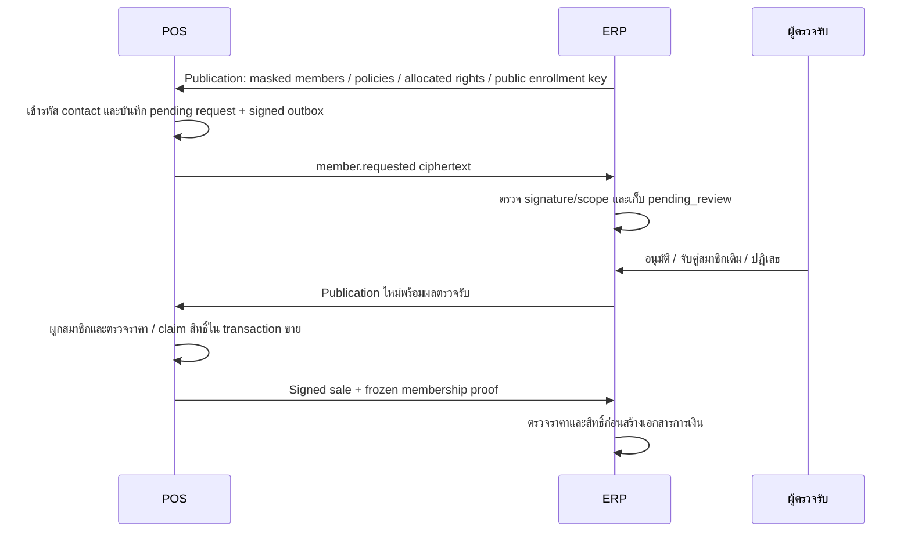

# Phase 28.8.2 — สมาชิกและโปรโมชัน

สถานะ 2026-11-01: **Local Complete — production gates remain**. ผ่านlocal acceptanceตามกติกาผู้ใช้; ยังไม่ได้ทดสอบกับระบบหรืออุปกรณ์จริง

## ขอบเขตและข้อมูล

- ใช้ร่วม Retail, Restaurant และ Pharmacy; สมาชิกไม่ใช่เวชระเบียน ไม่แทนผู้ป่วยหรือผู้ซื้อสำหรับ FULL tax invoice
- ERP เป็น member master ขององค์กร คำขอสมัครจาก POS มีสถานะ `pending_review`; ต้องตรวจรับหรือจับคู่สมาชิกเดิมโดยผู้มีสิทธิ์ก่อนเผยแพร่ให้ใช้
- ค้นหาหมายเลขซ้ำด้วย keyed fingerprint แยกองค์กร ไม่รวมสมาชิกอัตโนมัติ การ normalize ตัดเครื่องหมายออก แต่ไม่เดารหัสประเทศ
- POS ได้เฉพาะ member ID/code, ชื่อและโทรศัพท์ที่ mask, tier/status ตาม publication ของสาขา
- ข้อมูลติดต่อเข้ารหัสในฐานข้อมูลทั้งสองฝั่ง; outbox ของคำขอใช้ AES-256-GCM และ RSA-OAEP ที่ผูก instance/branch/request ไม่ส่ง plaintext contact
- **Retention local ที่ผู้ใช้ยืนยัน:** ใช้ข้อมูลทดสอบ เข้ารหัสข้อมูลติดต่อ จำกัดสิทธิ์ และไม่ลบข้อมูลสมาชิก/audit อัตโนมัติ จนกำหนดนโยบายใช้งานจริง

## เปิดใช้สำหรับ local

ค่าเริ่มต้น `POS_LOCAL_MEMBERSHIP_ENABLED=false` ทั้ง ERP และ POS และอนุญาตเฉพาะ environment `local` / `testing`

1. สำรองข้อมูลและตรวจ migrations ทั้งสอง app ก่อน migrate ฐานข้อมูลที่ต้องการ รอบพัฒนานี้ยังไม่ได้ migrate configured DB
2. ERP กำหนด `POS_MEMBER_LOOKUP_KEY` เป็น secret เฉพาะอย่างน้อย 32 ตัวอักษร และ `POS_MEMBER_ENROLLMENT_PRIVATE_KEY_PATH` เป็น RSA private key เฉพาะ enrollment อย่างน้อย 2048 bits เก็บนอก public/web root ไม่ commit หรือส่งให้ browser
3. รักษา APP_KEY ของแต่ละ app สำหรับข้อมูลเข้ารหัส และแยก enrollment key ออกจาก event signing key; ไม่เปลี่ยน lookup/encryption key โดยไม่มีแผนย้ายข้อมูลและตรวจอ่านกลับ
4. เปิด flag ทั้งสองฝั่งใน local ที่แยกข้อมูลทดสอบ ผู้ใช้ ERP ต้องมี `pos.manage`; การเขียนและอ่าน contact เต็มต้องยืนยันรหัสผ่าน
5. ERP เปิด `/pos-membership`: สร้างสมาชิก/โปรโมชัน จัดสรรสิทธิ์แบบจำกัด แล้วเลือกสมาชิกและโปรโมชันเพื่อเผยแพร่ให้ instance
6. Worker ส่ง publication ผ่าน connector scope `membership:publish` ตาม mTLS/instance/branch เดิม ต้อง provision สิทธิ์ connector นี้โดยชัดเจน
7. POS เปิด `/membership` สำหรับคำขอสมัคร/สถานะ และใช้ตัวเลือกสมาชิก/โปรโมชันในหน้าชำระเงินของกิจการนั้น ตรวจราคาก่อนรับเงิน

Publication มีอายุไม่เกิน 15 นาที Worker ต่ออายุเมื่อเหลือไม่เกิน 5 นาที; profile หมดอายุหรือเปลี่ยนแล้วต้องตรวจสิทธิ์/ราคาใหม่ ไม่ใช้ quote เป็นสิทธิ์อนุมัติในตัวเอง

ขนาด publication ไม่เกิน 2 MiB, สมาชิกไม่เกิน 500, policies ไม่เกิน 100, rights ไม่เกิน 500 ต่อ publication; ผลตรวจรับส่งล่าสุดไม่เกิน 500 รายการ จึงยังต้องกำหนด paging/retention สำหรับปริมาณใช้งานจริง

การเปลี่ยน enrollment private key ปัจจุบันยังไม่รองรับ previous-key map อัตโนมัติ ต้องรักษา key เดิมจนคำขอ/outbox ที่ใช้ key นั้นถูกตรวจรับครบ และวางแผน rotation ก่อนใช้จริง

## กติกาโปรโมชัน local

- ส่วนลด fixed amount หรือ percent ก่อน VAT เลือกหนึ่งโปรโมชันต่อบิล ไม่ซ้อน manual discount
- กำหนดสาขา ประเภทธุรกิจ SKU tier/member eligibility ช่วงเวลา และยอดขั้นต่ำแยกจากฐานส่วนลดได้
- เลือก merchandise/delivery/packaging แยกสำหรับ minimum และ discount; ใช้ค่าจริงจาก server ไม่รับราคาสุทธิจาก browser
- กระจายส่วนลดเป็นหน่วยสตางค์แบบ largest remainder ผูก line ID คงที่ คำนวณ VAT หลังส่วนลดและคง frozen proof สำหรับตรวจซ้ำ
- แบบจำกัดใช้สิทธิ์ที่ ERP จัดสรรให้ instance/member ไว้ล่วงหน้า ใช้ CAS/transaction ป้องกันสอง terminal ใช้ slot เดียวกัน ไม่ย้ายหรือคืน allocation ข้าม server อัตโนมัติ
- จำกัดจำนวนเป็น allocated slots ที่ถือ/ใช้สิทธิ์อยู่ ไม่ใช่ lifetime historical redemptions เมื่อ full refund คืน slot เดิมได้ครั้งเดียว; partial refund ไม่คืนสิทธิ์
- ERP รอ `promotion_release` หาก sale ใหม่มาถึงก่อน signed refund ที่ปล่อย slot เดิม โดยยังไม่ลงบัญชี sale ใหม่นั้น
- cash checkout ยังต้องมียอดสุทธิมากกว่า 0

## Delivery และธุรกิจเฉพาะ

- Prepaid ใช้สิทธิ์ใน sale เดิม ไม่ claim ซ้ำที่ Delivery
- COD คำนวณ merchandise/fees จากฐานเดิม Claim เมื่อ ready; failed/retry ถือสิทธิ์เดิมไว้ แม้ publication หมดอายุภายหลัง
- คืนครบตาม custody evidence หรือรับคืนที่ผ่าน manager inspection ตามเงื่อนไข จึงปล่อยสิทธิ์ครั้งเดียว การคืนสิทธิ์ไม่ทำให้ Stock กลับมาขายได้เอง
- COD ยังเป็น cash-custody evidence ไม่สร้าง ABB/Payment/GL/ERP Stock Movement อัตโนมัติ รอตรวจรับบัญชี/ภาษี
- Pharmacy ยังคง pharmacist/Rx/unit/lot guards และปิด Delivery ทั้งหมดตามที่ผู้ใช้กำหนด
- Restaurant ใช้ frozen bill/recipe เดิม ไม่ตัดวัตถุดิบซ้ำเพราะคิดส่วนลด

## หลักฐานและข้อจำกัด

[ผลตรวจรับ/หลักฐาน](acceptance/phase28_8_2/README.md): ERP subset82 tests /1,937 assertions; POS full81 tests /1,851 assertions ผ่าน. TypeScriptและVite buildทั้งสองappผ่าน. Chrome1280/375ทั้งสามประเภทผ่าน, pending enrollmentไม่เปิดสิทธิ์เอง, actualERP reviewกลับPOSผ่าน, cart-change/stale409/lost-response/replayผ่าน. Retail signed roundtrip10events (7sales+3requests) และpublic-key verification26/26source envelopesผ่าน; ไม่ใช่ทั้งหมดถูกimportหรือเป็นtwo-server/mTLS acceptance

ConfiguredDBยังไม่migrateและflagsdefaultfalse. Fixtureปิดและsealedแล้ว บัญชีทดสอบdisabled ลบsessions/privatekeys ไม่ลบmember/audit. Geminiตรวจlocal scopeแล้วตามgemini.mdหมวด9วันที่2026-11-01ที่ผู้ใช้ให้ตรวจอ่าน; ไม่ใช่production sign-off และไม่ได้ส่งไฟล์เพิ่มออกภายนอก

ก่อนใช้งานจริงต้องตรวจรับบัญชี/ภาษี ข้อมูลส่วนบุคคล/consent/retention, key custody/rotation, migration/backup และระบบจริงแยกจาก local acceptance
