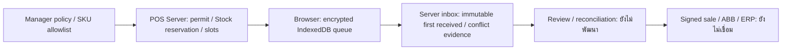

# Phase 28.8.3 — Browser / PWA Offline

สถานะ 2026-11-01: **In Progress — foundation implementation**. ยังไม่พร้อมใช้รับเงิน offline และยังไม่ได้ตรวจรับทั้ง Phase

## กติกาที่ผู้ใช้ยืนยัน

- Local cash offline เฉพาะรายการที่ POS Server จัดสรรราคา/Stock quota ไว้ล่วงหน้า
- สมาชิก/โปรโมชัน งานครัว ยาที่ต้องตรวจเภสัชกร/Rx และ Delivery เก็บได้เพียง draft/คำขอรอตรวจรับ ไม่แสดงว่างานสำเร็จเอง
- ค่าเริ่มต้นต่อ device: permit15นาที, สูงสุด20ธุรกรรม, ยอดรวม10,000บาท; Manager ปรับได้และผูก policy version กับ permit เดิม
- เปิดโปรแกรมใหม่หรือพบclock/sleepผิดปกติต้องonlineรับรองเวลาใหม่ก่อนใช้สิทธิ์ที่อาศัยเวลา ไม่เชื่อเวลาจากbrowserข้ามcontext
- คิวเข้ารหัสด้วยรหัสปลดล็อกเฉพาะdevice อย่างน้อย12ตัวอักษร; ไม่มี recovery ที่ได้รับอนุมัติ หากลืมรหัสจะถอดรหัสคิวเดิมไม่ได้
- logout/sessionหมดอายุ/เปลี่ยนกะไม่ลบคิว ต้องยืนยันตัวตนใหม่ก่อนsync
- รับเงินจริงแล้วแต่permitหมดอายุ/ราคาเปลี่ยน/กะปิด: พักreviewและคงยอดเดิม ไม่คิดเงินเพิ่มเอง; Managerตรวจหลักฐานและยืนยันรับเงินเข้ากะปัจจุบันก่อนลงsaleครั้งเดียว รุ่นlocalใช้วันที่ตรวจรับ ยังรอตรวจนโยบายบัญชี/ภาษีก่อนข้อมูลจริง (ผู้ใช้ยืนยันแล้ว; ยังไม่พัฒนาreconciliation)

## ทำแล้วใน foundation รอบแรก

1. `OfflineIngressService` / `/offline/devices`, `/offline/inbox`: ผูกdeviceกับinstance/branch/staff/terminal; เก็บpayloadแบบเข้ารหัสบนserverและเก็บ `server_received_at` ครั้งแรกโดยไม่เขียนทับตอนretry
2. เปลี่ยนpayloadแต่ใช้transactionidentityเดิมจะเก็บทั้งpayloadต้นฉบับและconflictเข้ารหัส แทนการทับหลักฐานหรือสร้างยอดเงินซ้ำ คำขอทั้งหมดเข้า `review` เพราะยังไม่มี financial reconciliation
3. `OfflinePermitService`: Managerตั้งpolicyผ่านAPIที่ต้องยืนยันรหัสผ่าน (`POST /offline/policies`); optimistic version guard; defaultsข้างต้นและ SKU allowlist เริ่มว่าง
4. PermitจองStockใน `reserved_quantity` ของgrantเดิม และแยกdocument slotsไว้ล่วงหน้า Online/Retail/Restaurant/Deliveryเดิมจึงไม่สามารถใช้Stockส่วนที่จองนี้ซ้ำ ออกpermitซ้ำrequestเดิมไม่จองเพิ่ม
5. หนึ่งterminalมีpermitที่ยังไม่reconcileได้หนึ่งชุด แม้หมดอายุแล้วไม่ปล่อย quota/slot อัตโนมัติ เพราะอาจมีรายการรับเงินที่ยังไม่ส่ง
6. `EncryptedQueue.ts`: IndexedDB + AES-256-GCM, PBKDF2-SHA256 600,000iterations, salt/IVสุ่ม, AADผูกscopeและrecordID; keyอยู่ในmemoryและnon-extractable ไม่เก็บรหัสหรือplaintextkeyคู่กับข้อมูล
7. คิวเขียนrecordและbudget countersในIndexedDBtransactionเดียวกัน รอtransactioncompleteก่อนคืนผลสำเร็จ; revisionCASกันสองtabชนกัน; ตรวจจำนวน/ยอดของrecordsกับencryptedmetadata เมื่อข้อมูลหายหยุดรับใหม่และคงหลักฐานที่เหลือ
8. `TrustedClock.ts`: หลักฐานเวลามีเฉพาะcontextปัจจุบัน; ต้องเริ่มจากfresh live response, ตรวจelapsed/clock-change/suspend/expiry และfreezeจนรับเวลาonlineใหม่ เป็นhonest-client guard ไม่ใช่หลักฐานป้องกันการแก้browser

`GET /offline/context` ส่งIDs/policy/server timeเท่านั้น มี `Cache-Control: private, no-store`. APIทั้งหมดจำกัดlocal/testing +loopback +authenticatedstaff และflag `POS_LOCAL_BROWSER_OFFLINE_ENABLED` ซึ่งdefaultfalse ไม่มีการเปิดใช้งานจริงในรอบนี้

ขอบเขตcapacityของpolicyAPIรุ่นนี้: permit1–1440นาที, transactions1–500, amountต้องเป็นdecimal stringมากกว่า0และไม่เกินเพดานเงินที่POSรองรับ. Cash permitใช้กับTHBและRetail/Pharmacyสินค้าทั่วไปที่Managerอนุญาตอย่างชัดเจนเท่านั้น; ไม่ออกcash permitให้clinical/kitchen product metadata แม้ผู้ขอเป็นเภสัชกร. Restaurantยังใช้draftรอตรวจรับครัว

## ยังต้องทำก่อนปิด Phase

- PWA shell/service worker และUIตั้งdevice/ปลดล็อก/คำเตือนพื้นที่/คิว/รหัส provisional พร้อมการกันธุรกรรมที่ต้องonline
- เลขprovisionalที่ไม่ใช่ABB/FULL, slot consumption, per-SKU quota/cash budget และhash-chain/rollback evidence ในbrowser เชื่อมกับpermitจริง
- sync/reconnect/ACK state machine: pending/syncing/synced/failed/review, retryหลังcrash/lost response และสถานะเดิมไม่หายเมื่อlogout/เปลี่ยนกะ
- Server reconciliationที่ตรวจราคา/expiry/recall/current authority/shift/clock/duplicate แล้วสร้างsaleและsigned eventเพียงครั้งเดียว พร้อมผูก provisionalกับเอกสารจริง
- Manager conflict/cash-custody resolution, ขอบเขตคืนunused quotaหลังreconcile โดยไม่คืนสิทธิ์ที่อาจถูกใช้ไปแล้ว
- Browser acceptanceทุกPOSแบบoffline/online/reconnect/restart/storage-loss และERP signed roundtrip; ยังไม่ใช้browser testsของ28.8.2แทนผลนี้

ตอนนี้ `offline_sale_authorized=false`, permitเป็น `provisional_only=true` และ `reconciliation_available=false`; เป็นfoundation API ไม่ใช่คำอนุมัติรับเงิน ไม่มีการสร้างsale/ABB/FULL/Payment/GLจากคิวนี้

## Storage / ข้อจำกัด

Browserอาจไม่อนุญาตpersistentstorageและผู้ใช้ยังล้างข้อมูลได้ ต้องแสดงผลจริงและเตรียมrecovery ห้ามรับประกันว่าคิวไม่มีวันหาย ตาม [MDN StorageManager.persist](https://developer.mozilla.org/en-US/docs/Web/API/StorageManager/persist). Smoke testรอบนี้ขอแล้วได้ `persistent=false` แต่ข้อมูลยังอยู่หลังปิด/เปิดChrome profileเดิม

การเขียนคิวใช้transactioncompleteและdurabilitystrict แต่ยังต้องทดสอบfailure/eviction/crashเพิ่ม ตาม [MDN IDBTransaction](https://developer.mozilla.org/en-US/docs/Web/API/IDBTransaction). KDFใช้ [WebCrypto deriveKey](https://developer.mozilla.org/en-US/docs/Web/API/SubtleCrypto/deriveKey). การcacheต้องเลือกเฉพาะshell/assets ไม่cacheAPI/session/contact/เวชระเบียน ตาม [Service worker guidance](https://developer.mozilla.org/en-US/docs/Web/API/Service_Worker_API/Using_Service_Workers)

ไม่อ้างว่าbrowserสามารถป้องกันผู้ควบคุมเครื่องที่copy/rollbackprofileได้สมบูรณ์ ต้องให้serverdedupe/hold/reviewเป็นauthority ไม่มีevent/checkpoint/e-Tax privatekeyในbrowser

Migrationใหม่เฉพาะPOS `2026_11_01_000001_create_offline_ingress.php` (codeรวมPOS22 / ERP87). ยังไม่migrateconfiguredDB ไม่แก้ `.env` จริง และยังไม่ได้ทดสอบระบบ/อุปกรณ์จริง
