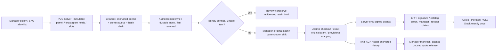

# Phase 28.8.3 — Browser / PWA Offline

> อัปเดตภายหลัง local acceptance: configuredDB migrateครบแล้ว ERP88/88 และPOS22/22 วันที่2026-11-04; ดู [รายงาน](DATABASE_UPDATE_20261104.md). `.env`, environment และflagsคงเดิม. ผลทดสอบ/ข้อความรอบพัฒนาด้านล่างเป็นsnapshotก่อนอัปเดตฐาน

สถานะ 2026-11-04: **Local Complete — ตามขอบเขตที่ผู้ใช้ยืนยัน**. ยังไม่ได้ทดสอบกับระบบ/อุปกรณ์จริง ส่วน configured database อัปเดตแล้วตามรายงาน โดยไม่แก้ `.env` จริง

## ขอบเขตแต่ละ POS

| ประเภท | ขณะ offline | หลังเชื่อมต่อ |
| --- | --- | --- |
| Retail | เงินสดเฉพาะ SKU/ราคา/Stock quota ที่ Manager อนุญาตและ POS Server จองล่วงหน้า | ส่งหลักฐานเข้า review; Manager ตรวจรับเงินเข้ากะปัจจุบันก่อนสร้าง sale |
| Pharmacy | เงินสดเฉพาะสินค้าทั่วไปที่ไม่มี clinical metadata; ยา/Rx/เภสัชกรเป็นคำขอ | ต้องตรวจสิทธิ์และความปลอดภัยสดก่อนดำเนินงาน; ห้าม force bypass recall/lot expiry |
| Restaurant | คำขอรอตรวจรับเท่านั้น | ครัว/คิว/การเตรียมอาหารใช้ server authority เดิม ไม่แสดงว่าส่งครัวหรือปรุงสำเร็จจาก browser |
| ทุก POS | สมาชิก/โปรโมชัน/Delivery เป็นคำขอ ไม่ใช้สิทธิ์หรือ dispatch เอง | ตรวจรับใน workflow ออนไลน์เดิม; Pharmacy Delivery ยังคงปิด |

รุ่น local ใช้ **Manager review ทุกบิล offline cash** รวมกรณี permit หมดอายุ ราคาเปลี่ยน เวลาไม่แน่นอน หรือกะเดิมปิด ยอดที่รับเดิมต้องตรงราคาที่ permit จองไว้ ห้ามคิดเงินเพิ่มเอง ใช้วันที่ Manager ตรวจรับและกะเปิดของ Manager. กติกาบัญชี/ภาษีจริงยังรอตรวจรับ

## เริ่มใช้ใน local

1. สำรองฐานข้อมูลและตรวจ connection ก่อนรัน migration ของ POS และ ERP ตามขั้นตอนติดตั้งเดิม. Code มี POS22 / ERP88 migrations; ชุดทดสอบฟีเจอร์ใช้ SQLite fixtures ส่วน configuredDB migrateแยกหลังตรวจรับตามรายงาน2026-11-04
2. ตั้ง `POS_LOCAL_BROWSER_OFFLINE_ENABLED=true` แยกใน local POS และ local ERP เมื่อเตรียมทดสอบ. ค่าเริ่มต้นทั้งสองฝั่งเป็น `false`; API จำกัด local/testing, loopback และ authenticated staff
3. Build POS ด้วย `node backend/node_modules/vite/bin/vite.js build --config pos/vite.config.mjs` จาก root โปรเจกต์
4. เข้าสู่ระบบ POS แล้วเปิดลิงก์ **Offline** หรือ `/offline/app`. Manager ตั้ง policy/SKU allowlist; ค่าเริ่มต้น permit15นาที/20ธุรกรรม/10,000บาท และ allowlist ว่าง
5. เลือก Terminal, ลงทะเบียน device, สร้างรหัสปลดล็อกเฉพาะเครื่องอย่างน้อย12ตัวอักษร. เก็บรหัสตามผู้ดูแลเครื่อง ไม่มี recovery ที่อนุมัติ
6. ขอ permit ขณะออนไลน์และมีกะเปิด. Server จอง Stock grant เดิมและ document slots เฉพาะ permit; หนึ่ง Terminal มี permit ที่ยังไม่ reconcile ได้หนึ่งชุด
7. บันทึกบิลเงินสดเฉพาะรายการที่มีสิทธิ์. รอ IndexedDB transaction complete ก่อนแสดงบันทึกสำเร็จ เลข `OFF-<permit UUID>-<ordinal>` เป็นหลักฐานชั่วคราว **ไม่ใช่ ABB/FULL**
8. หลังกลับออนไลน์ กด Sync เพื่อยืนยัน session/เจ้าของคิวใหม่. Manager เปิดรายการ review ตรวจหลักฐาน ยืนยันยอดเดิมและรับเงินเข้ากะปัจจุบัน จากนั้นจึงสร้าง sale/payment/signed event/ABB ตาม flag เดิมครั้งเดียว
9. Sync อีกครั้งเพื่อรับ final ACK และผูก provisional กับ sale/เอกสารจริง. เก็บประวัติคิวไว้ ไม่ลบเมื่อ logout
10. Manager รอ permit หมดอายุ ตรวจคิวทุกเครื่องและ manifest ให้ครบก่อนปิด permit ยืนยันเฉพาะส่วนที่ไม่ได้ใช้ พร้อมรหัสผ่านและเหตุผล ระบบคืนเฉพาะ quota ที่ไม่ถูก consume; ส่วนที่รับเงินแล้วหรือยังไม่แน่ชัดต้องคง hold; ห้ามคืน unused ก่อนหมดอายุ เพราะเครื่อง offline อาจยังใช้สิทธิ์เดิมได้

Policy ปรับได้1–1440นาที/1–500ธุรกรรม/จำนวนเงินตามเพดาน POS. การปรับไม่แก้ permit เก่า. เปิดโปรแกรมใหม่/กลับจาก sleep/เวลาเปลี่ยนต้องใช้ปุ่มรับรองเวลา permit เดิมแบบออนไลน์ ไม่ต่ออายุสิทธิ์เดิมอัตโนมัติ

## ข้อมูลบนเครื่องและความปลอดภัย

- IndexedDB แยก scope instance/branch/staff/terminal/device; AES-256-GCM, random salt/IV, PBKDF2-SHA256600,000iterations. ไม่เก็บรหัสหรือ plaintext key ลง storage; non-extractable key อยู่เฉพาะ memory
- เข้ารหัส permit, SKU usage, cash budget, slot usage, queue payload และ ACK. การจอง slot/quota และเขียนบิลอยู่ใน transaction เดียวกัน มี revision CAS กันหลายแท็บ
- Hash chain ผูก immutable record bodies กับ encrypted head; ตรวจ record count/amount/chain และหยุด intake เมื่อข้อมูลหายหรือขัดแย้ง
- คิวมี pending/syncing/synced/failed/review. Retry หลัง crash/response หายใช้ identity/payload เดิม. Final ACK ไม่ถูก downgrade เป็น pending และคงข้อมูลดั้งเดิม
- logout/pagehide/idle15นาที/absolute8ชั่วโมงล็อก key; logout/login จากหน้าขายส่งสัญญาณให้แท็บ offline ล็อกด้วย. Sync ต้องมี session สดและตรงเจ้าของคิว; เปลี่ยนผู้ใช้ไม่เปิดอ่านคิวเดิม
- ขอ Persistent Storage และแสดงผลอนุญาตจริงพร้อมพื้นที่เหลือ. พื้นที่ไม่พอ/เขียนไม่ได้/เต็ม/เสียหายให้หยุดรายการใหม่ ไม่ล้างคิวเดิม
- ไม่เก็บ contact สมาชิก/ข้อมูลผู้ป่วย/เวชระเบียน/RSA event/checkpoint/e-Tax key ใน shell. คำขอหมายเหตุไม่ควรใส่ข้อมูลส่วนบุคคล. ข้อมูล inbox บน server เข้ารหัสและ Manager อ่านพร้อม access audit
- Service worker cache เฉพาะ public `/offline/app` และ immutable `/build/assets/*`; ไม่ cache API, CSRF token, session, `/state`, contacts หรือเวชระเบียน

หาก storage ถูกล้างหรือรหัสหาย: รายการที่ server รับแล้วกู้สถานะจาก inbox/audit ได้ ส่วนที่ยังไม่ส่งและไม่มีสำเนาเข้ารหัสที่ถอดได้ **กู้ไม่ได้**. ต้องคง server quota hold และสอบสวน ห้ามออก permit ใหม่/คืน Stock โดยอาศัยว่า browser ว่าง. ไม่มี API ลบ pending/review queue อัตโนมัติ; retention90วันของ online archive เดิมไม่ใช่คำสั่งลบคิว browser

ไม่รับประกันการป้องกันผู้ควบคุมเครื่องที่ copy/rollback profile ได้สมบูรณ์. Server เป็น authority: hold quota, slot dedupe, transaction identity, immutable conflict evidence และ Manager review; ERP กัน slot/client identity ซ้ำอีกชั้น

## Server reconciliation และบัญชี

POS ตรวจ branch/role/active staff, permit/device/staff binding, slot, original catalog hash/ราคา/ยอด/VAT, cash budget, current SKU safety, grant epoch/lot/recall/expiry และกะเปิดของ Manager. ไม่ใช้ client timestamp เป็นเวลาขาย. `server_received_at` เก็บครั้งแรกและไม่เปลี่ยนเมื่อ retry. Payload เปลี่ยนแต่ identity เดิมเก็บ conflict แยกเข้ารหัส ไม่ทับหลักฐานเดิม

Checkout ภายในรับ typed offline authority เท่านั้น; HTTP checkout ปกติใช้ request key prefix `offline:` ไม่ได้. ใช้ reservation ของ grant เดิมโดยตรง ไม่ release แล้วไปเลือก FEFO grant อื่น. การตัด quota, sale/payment, signed outbox, inbox/slot mapping อยู่ใน transaction เดียวกัน

ERP ตรวจ event signature เดิม, registered Manager, original published catalog hash และ valid-at-permit-issue, accepted-at/event date, cash/VAT/line allocations และ claims ที่ unique ต่อ instance+slot / instance+device+transaction. ออก Invoice/Payment/GL/Stock จาก sale เดียว และ retry ไม่เพิ่มยอด. Signed POS event ไม่ได้หมายความว่า e-Tax ลงนามแล้ว

Lot ที่ recall/หมดอายุ, SKU ที่เปลี่ยนเป็น clinical หรือ identity conflict ยังต้องสอบสวน ไม่เปิด Manager force override ในรุ่นนี้. คงหลักฐานเงินและ Stock hold ไว้

## การตรวจรับ

POS93tests/1958assertions, ERP subset57/1792, actual browser Retail signed roundtrip1/14, Chromeสามประเภทและstorage6กลุ่มผ่าน. ดู [หลักฐานและข้อจำกัด](acceptance/phase28_8_3/README.md). ชุด foundation เดิมเป็น snapshot วันที่2026-11-01; ผล local acceptance ใหม่แยกไฟล์ ไม่เขียนทับผล Phase28.8.2

**หมายเหตุ: ยังไม่ได้ทดสอบกับระบบจริง** ได้แก่ อุปกรณ์/เครื่องพิมพ์จริง, สอง server HTTP/mTLS, MariaDB/MySQL concurrency, key custody/rotation และบัญชี/ภาษีจริง. Flag defaultfalse ไม่ใช่ production release. ไม่รวม Phase28.8.4 เวชระเบียน,28.8.5 คิว/ที่นั่ง หรือ28.8.6 payment providers

อ้างอิง: [StorageManager.persist](https://developer.mozilla.org/en-US/docs/Web/API/StorageManager/persist), [IDBTransaction](https://developer.mozilla.org/en-US/docs/Web/API/IDBTransaction), [WebCrypto deriveKey](https://developer.mozilla.org/en-US/docs/Web/API/SubtleCrypto/deriveKey), [Service workers](https://developer.mozilla.org/en-US/docs/Web/API/Service_Worker_API/Using_Service_Workers). Clock guard ใช้ performance.now ใน context เดียว ตรวจ sleep/rollback และหัก bounded RTT สูงสุด30วินาทีจากอายุสิทธิ์ ไม่ถือเป็น trusted clock ข้าม restart หรือหลักฐานป้องกันการแก้ browser
