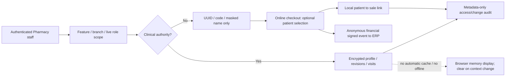

# Phase 28.8.4 — Patient history / Pharmacy local

สถานะ 2026-11-05: **Local Complete — ข้อมูลสังเคราะห์ตามขอบเขตที่ยืนยัน**

## ขอบเขตที่ผู้ใช้ยืนยัน

- ชื่อ/วันเกิด/เบอร์ติดต่อ, ประวัติแพ้ยาที่บันทึกเอง, บันทึกรับบริการ และประวัติรายการจากบิล
- ไม่เก็บเลขบัตรประชาชน ไม่วินิจฉัยหรือเตือนแพ้ยา/ข้อห้ามใช้ยาอัตโนมัติ
- เก็บเข้ารหัสที่ POS Server เฉพาะสาขา ไม่ sync ERP/ข้ามสาขา และไม่เก็บใน offline queue
- เภสัชกรและ Manager ที่ `pharmacist_qualified=true` อ่าน/แก้รายละเอียดได้; cashier และ Manager ที่ไม่มีคุณสมบัติเห็นเฉพาะรหัส/ชื่อ mask เพื่อเลือกผู้ป่วยให้บิล
- ใช้ข้อมูลสังเคราะห์เท่านั้น เก็บ revisions/access audit ไม่ลบอัตโนมัติจนกำหนด retention/key custody/นโยบายข้อมูลจริง; ไฟล์ใบสั่งยาเดิมยัง synthetic-only

ข้อจำกัดไม่มี patient history ใน Phase28.1 เป็น baseline เดิม โมดูลใหม่นี้ supersede เฉพาะ local scope ที่พัฒนา/ทดสอบแล้ว ไม่เปิดใช้ข้อมูลจริงจากการแก้ checklist หรือการเพิ่ม schema

## การทำงาน

1. เปิด Pharmacy local/testing และ `POS_LOCAL_PATIENT_HISTORY_ENABLED` หลังเตรียม schema/APP_KEY/ผู้ใช้. ค่าเริ่มต้น false และ production hard-block. API จำกัด loopback/authenticated staff
2. เข้าเมนู **ประวัติผู้ป่วย** หรือ `/patients`. Cashier เห็นเฉพาะข้อมูล mask; ผู้มีสิทธิ์ clinical สร้าง/อ่าน/แก้ไขทะเบียนได้ โดยต้องยืนยันข้อมูลสังเคราะห์
3. ผู้มีสิทธิ์ clinical ค้นหาชื่อเต็ม/โทรศัพท์แบบ exact match ผ่าน POST ได้ โดยไม่ส่งคำค้นใน URL และไม่บันทึกคำค้นดิบใน audit; ไม่จับคู่หรือรวมประวัติอัตโนมัติ. วันเกิด/โทรศัพท์ไม่ทราบให้เว้นว่าง. ประวัติแพ้ยาว่างหมายถึง **ยังไม่ได้บันทึก** ไม่ใช่การรับรองว่าไม่แพ้ยา. วันที่ตรวจตาม timezone ของสาขา
4. แก้ทะเบียนใช้ expected version; stale=409 และต้องอ่านข้อมูลใหม่. UUID request key เดิม replay ได้ครั้งเดียว; key เดิมแต่เนื้อหาเปลี่ยน=409 ไม่ overwrite
5. บันทึกรับบริการ append-only. ใช้ปุ่มแก้ไขโดยเพิ่มบันทึกและเหตุผล อ้างต้นฉบับไว้ ไม่ลบหรือทับข้อความเดิม
6. หน้าขายเลือกผู้ป่วยจากรหัส/ชื่อ mask ก่อนยืนยันเงินสด. ผูกหนึ่งผู้ป่วยต่อบิลในตาราง local เท่านั้น พร้อม sale transaction; ไม่มี patient ID/name/contact/allergies ใน signed sale event หรือ ERP
7. ประวัติรายการจากบิลแสดงรายการ/จำนวน/ยอดบิล/ยอดคืนเงินจากหลักฐานเดิม ไม่ยืนยันว่าผู้ป่วยใช้ยาจริง. Link กับบิลเป็น immutable ใน local รุ่นนี้; ต้องตรวจรหัสผู้ป่วยก่อนรับเงิน

## ข้อมูลและสิทธิ์

| ส่วน | ที่เก็บ / การป้องกัน |
| --- | --- |
| `pos_patients` | payload ชื่อ/วันเกิด/โทรศัพท์/แพ้ยาเข้ารหัสด้วย Laravel Crypt; มี UUID, branch, non-PII code/version/actor/timestamps และ branch-keyed HMAC lookup ภายนอก ciphertext |
| `pos_patient_revisions` | snapshot เข้ารหัสทุก revision; unique patient/version และ branch/request key; request fingerprint เป็น keyed HMAC |
| `pos_patient_visits` | note/date/reason เข้ารหัส; correction อ้างต้นฉบับและแก้ได้ต่อจาก correction ล่าสุดเท่านั้น |
| `pos_patient_dispensing` | อ้างอิงบิลเข้ารหัส เชื่อมเฉพาะ POS; keyed HMAC unique order reference; sale/payment/Stock ไม่ถูกสร้างใหม่จากการอ่านประวัติ |
| `pos_audit` | actor/resource/version/IDs/counts เท่าที่จำเป็น ไม่มีชื่อ/โทรศัพท์/วันเกิด/แพ้ยา/note ดิบ |

ทุก read/write ตรวจ active staff/branch/role/คุณสมบัติปัจจุบันอีกครั้งใน transaction. Retail/Restaurant และข้ามสาขาถูกปิดทั้งเมนู/หน้า/API. ไม่มี endpoint ลบ/merge/export ผู้ป่วยหรือเปิด public patient API

UI/API เป็น private/no-store, ป้องกัน validation flash โดย API รับ JSON เท่านั้น. ไม่ใช้ localStorage/sessionStorage/IndexedDB/serviceworker เก็บข้อมูลผู้ป่วย. ล้างหน้าจอเมื่อ hidden/pagehide/offline/logout/หมดเวลาที่ server รับรอง; scope token เปลี่ยนให้ล้างและยืนยันใหม่. การอ่านใน browser ของผู้มีสิทธิ์ใช้ memory เพื่อแสดงผลเท่านั้น ไม่รับประกันป้องกันผู้ใช้ที่ตั้งใจถ่ายภาพ/คัดลอก

Offline queue และ inbox ปฏิเสธ structured patient/clinical fields รวมใน nested payload. ไม่อ้างว่าระบบตรวจจับข้อมูลสุขภาพที่ผู้ใช้จงใจพิมพ์ใน free text ทุกชนิดได้ จึงยังห้ามใส่ข้อมูลส่วนบุคคลในหมายเหตุ offline

## การติดตั้งและข้อจำกัด

Migration POS ใหม่ `2026_11_05_000001_create_patient_history.php` เพิ่ม4ตาราง. Code รวมPOS23/ERP88; configured POS อัปเดตครบ23/23 เพิ่ม4ตารางว่างและ pending0 ตาม [รายงาน2026-11-05](DATABASE_UPDATE_20261105.md). ERPคง88/88จากรอบก่อน; `.env`/environment/flagsเดิมไม่เปลี่ยนและไม่เปิดใช้ข้อมูลจริง

Local ใช้ APP_KEY ของ POS ผ่าน Laravel Crypt/HMAC; ห้ามเปลี่ยน/ทำ key:generate แล้วคาดว่าจะอ่านข้อมูลเก่าได้เอง. Key custody/backup/rotation/retention/clinical correction workflow และนโยบายข้อมูลจริงต้องตรวจรับก่อน production. ไม่มี automatic deletion หรือ automatic medical decision

**ยังไม่ได้ทดสอบกับระบบจริง** รวมข้อมูลผู้ป่วยจริง, อุปกรณ์จริง, two-server/mTLS หรือ clinical/security/privacy sign-off. ผล local acceptance แยกที่ [หลักฐาน](acceptance/phase28_8_4/README.md); ไม่ใช้ผล Phase28.8.3 แทนการทดสอบโมดูลนี้
