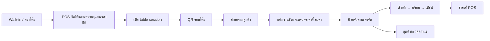

# Phase 28.8.5 — Restaurant POS

ขอบเขต local สำหรับคิวครัว คิวที่นั่ง การจองโต๊ะ และ QR สั่งอาหาร ใช้ POS Server ของสาขาเป็นผู้ยืนยันสถานะและจัดสรรโต๊ะ

## พนักงานร้านอาหาร

1. Manager เพิ่มโต๊ะและกำหนดความจุ โต๊ะจากรุ่นก่อนเริ่มที่ 4 ที่นั่ง
2. เปิด **คิวที่นั่งและจองโต๊ะ** เพื่อบันทึกจำนวนลูกค้า Walk-in หรือเลือกโต๊ะ วันเวลา และข้อมูลติดต่อสำหรับการจอง เจ้าหน้าที่เรียกคิว ยืนยันมาถึง หรือยกเลิกได้
3. การจองใช้ช่วงโต๊ะ 90 นาที ระบบกันการจองซ้อนและกันการจัด Walk-in ลงโต๊ะที่จะถึงนัดภายใน 90 นาที เมื่อถึงเวลานัดให้จัดผู้จองก่อน หากเลยเวลานัด 15 นาทีและยังไม่มาถึง ให้พนักงานยืนยัน **ไม่มา** เพื่อปล่อยสิทธิ์ โต๊ะไม่ถูกปล่อยอัตโนมัติ
4. สำหรับ Walk-in ระบบเลือกคิวเก่าสุดที่จำนวนลูกค้าไม่เกินความจุของโต๊ะที่เลือก การจัดที่นั่งเปิด table session ในธุรกรรมเดียวกัน การกดซ้ำคืน session เดิม และโต๊ะที่มี session อยู่รับคิวใหม่ไม่ได้ พนักงานปิดโต๊ะเมื่อเคลียร์รายการแล้ว
5. สร้าง QR จาก table session ที่เปิดอยู่ ลูกค้าดูเมนู ราคา และตัวเลือกจาก SKU ที่เผยแพร่ เลือกจำนวนแล้วส่งคำขอ พนักงานกด **รับออเดอร์เข้าครัว** เพื่อรับและกันวัตถุดิบในธุรกรรมเดียวกัน หากราคาเปลี่ยน ให้ลูกค้าโหลดเมนูและส่งใหม่
6. ครัวเรียงตามเลขคิวต่อสาขาที่ออกเมื่อรับออเดอร์ รายการสั่งเพิ่มได้เลขใหม่ ช่วงรอทำเริ่มที่รายการเก่าสุดที่ยังไม่พัก Manager ระบุเหตุผลเพื่อพัก คืนคิว หรือข้ามคิว ระบบบันทึก audit เริ่มเตรียมจึงตัดวัตถุดิบตามเส้นทางเดิม พนักงานอัปเดตพร้อมเสิร์ฟ เสิร์ฟแล้ว และชำระที่ POS
7. ลูกค้ากดตรวจสถานะเพื่อดูเลขคิวและจำนวนจานในแต่ละสถานะ จากมือถือแต่ละเครื่องส่งเพิ่มในรอบโต๊ะเดิมได้ เมื่อปิดโต๊ะ เพิกถอน หรือ QR หมดอายุ ต้องใช้ QR ใหม่

## ติดตั้ง local

- รัน POS migrations และตั้งค่า local Restaurant ตาม [คู่มือร้านอาหาร](README_POS_RESTAURANT.md) สำหรับ QR เปิด `POS_LOCAL_PUBLIC_MENU_ENABLED=true` และตั้ง `APP_URL` ตรงกับ origin
- ค่าเริ่มต้น QR ใช้ loopback สำหรับทดสอบบนเครื่อง POS หากต้องทดลองมือถือบน LAN ให้ตั้ง `POS_LOCAL_MENU_PRIVATE_LAN_ENABLED=true` และ `APP_URL=https://<private-ip>:<port>` ใช้ HTTPS ที่เครื่องลูกค้าเชื่อถือได้ ระบบตรวจ origin และ IP ส่วนตัวของผู้เข้าถึง LAN
- ระหว่างหลุดการเชื่อมต่อ หน้า QR และหน้าคิวที่นั่งเก็บแบบฟอร์มในหน่วยความจำ การส่งคำขอที่ยังไม่ทราบผลใช้ idempotency key เดิมเมื่อเชื่อมต่อกลับ การเปิดหน้าใหม่ต้องเริ่มแบบฟอร์มใหม่
- ข้อมูลติดต่อจองโต๊ะเข้ารหัสใน POS ของสาขา จำกัดการอ่านให้ cashier และ Manager และงดส่งไป ERP การจองไม่มีมัดจำหรือการชำระออนไลน์
- **ยังไม่ได้ทดสอบกับระบบจริง** รวมการสแกนด้วยมือถือจริง HTTPS บน LAN จริง อุปกรณ์ และ concurrency บนฐานเป้าหมาย

