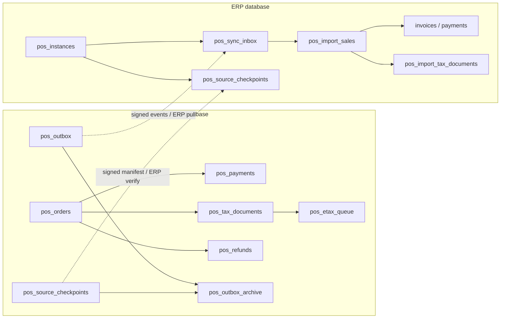

# Phase 28 — Database inventory and relationships — 2026-10-27

ERP/POS เป็นคนละฐาน ไม่มี cross-database foreign key หรือ POS credential สำหรับ ERP DB. Source of truth คือ migrations; ตารางนี้เป็น inventory ของ create-table declarations ใน Phase28 ไม่รวม Laravel framework tables/columns เดิมทุกตัว

Configured ERP MySQL `erp`: 83 migrations applied / pending 0. POS SQLite `pos/database/database.sqlite`: 17 applied / pending 0, quick_check=ok, foreign-key violations=0. ดู [backup/data verification](DATABASE_UPGRADE_20261027.md). POS ยังไม่มี staff/orders และยังต้อง provision

## ERP — 22 application tables created

| Table | Migration |
| --- | --- |
| `pos_stock_entitlements` | [2026_10_25_000001_create_pos_stock_entitlements.php](../backend/database/migrations/2026_10_25_000001_create_pos_stock_entitlements.php) |
| `pos_instances` | [2026_10_25_000002_create_pos_connector_tables.php](../backend/database/migrations/2026_10_25_000002_create_pos_connector_tables.php) |
| `pos_catalog_publications` | [2026_10_25_000002_create_pos_connector_tables.php](../backend/database/migrations/2026_10_25_000002_create_pos_connector_tables.php) |
| `pos_sync_inbox` | [2026_10_25_000002_create_pos_connector_tables.php](../backend/database/migrations/2026_10_25_000002_create_pos_connector_tables.php) |
| `pos_sync_conflicts` | [2026_10_25_000002_create_pos_connector_tables.php](../backend/database/migrations/2026_10_25_000002_create_pos_connector_tables.php) |
| `pos_import_sales` | [2026_10_25_000002_create_pos_connector_tables.php](../backend/database/migrations/2026_10_25_000002_create_pos_connector_tables.php) |
| `pos_product_policies` | [2026_10_25_000004_create_pos_product_policies.php](../backend/database/migrations/2026_10_25_000004_create_pos_product_policies.php) |
| `pos_staff_authorities` | [2026_10_25_000004_create_pos_product_policies.php](../backend/database/migrations/2026_10_25_000004_create_pos_product_policies.php) |
| `pos_import_refunds` | [2026_10_26_000001_create_pos_refund_subledger.php](../backend/database/migrations/2026_10_26_000001_create_pos_refund_subledger.php) |
| `pos_import_cash_movements` | [2026_10_26_000002_create_pos_cash_movements.php](../backend/database/migrations/2026_10_26_000002_create_pos_cash_movements.php) |
| `pos_import_kitchen_consumptions` | [2026_10_26_000006_create_pos_kitchen_import.php](../backend/database/migrations/2026_10_26_000006_create_pos_kitchen_import.php) |
| `pos_import_kitchen_sales` | [2026_10_26_000006_create_pos_kitchen_import.php](../backend/database/migrations/2026_10_26_000006_create_pos_kitchen_import.php) |
| `pos_import_kitchen_waste` | [2026_10_26_000006_create_pos_kitchen_import.php](../backend/database/migrations/2026_10_26_000006_create_pos_kitchen_import.php) |
| `pos_sync_dependencies` | [2026_10_26_000006_create_pos_kitchen_import.php](../backend/database/migrations/2026_10_26_000006_create_pos_kitchen_import.php) |
| `pos_tax_settings` | [2026_10_26_000007_create_pos_tax_settings.php](../backend/database/migrations/2026_10_26_000007_create_pos_tax_settings.php) |
| `pos_import_return_inspections` | [2026_10_26_000008_create_pos_return_inspections.php](../backend/database/migrations/2026_10_26_000008_create_pos_return_inspections.php) |
| `pos_lot_recalls` | [2026_10_26_000009_create_pos_lot_recalls.php](../backend/database/migrations/2026_10_26_000009_create_pos_lot_recalls.php) |
| `pos_recall_deliveries` | [2026_10_26_000009_create_pos_lot_recalls.php](../backend/database/migrations/2026_10_26_000009_create_pos_lot_recalls.php) |
| `pos_source_checkpoints` | [2026_10_26_000010_create_pos_checkpoints.php](../backend/database/migrations/2026_10_26_000010_create_pos_checkpoints.php) |
| `pos_tax_profile_publications` | [2026_10_26_000011_create_pos_tax_document_links.php](../backend/database/migrations/2026_10_26_000011_create_pos_tax_document_links.php) |
| `pos_import_tax_documents` | [2026_10_26_000011_create_pos_tax_document_links.php](../backend/database/migrations/2026_10_26_000011_create_pos_tax_document_links.php) |
| `pos_restaurant_variants` | [2026_10_26_000012_create_pos_restaurant_variants.php](../backend/database/migrations/2026_10_26_000012_create_pos_restaurant_variants.php) |
## POS — 34 application tables created

| Table | Migration |
| --- | --- |
| `pos_branches` | [2026_10_25_000001_create_pos_core.php](../pos/database/migrations/2026_10_25_000001_create_pos_core.php) |
| `pos_terminals` | [2026_10_25_000001_create_pos_core.php](../pos/database/migrations/2026_10_25_000001_create_pos_core.php) |
| `pos_staff` | [2026_10_25_000001_create_pos_core.php](../pos/database/migrations/2026_10_25_000001_create_pos_core.php) |
| `pos_catalogs` | [2026_10_25_000001_create_pos_core.php](../pos/database/migrations/2026_10_25_000001_create_pos_core.php) |
| `pos_grants` | [2026_10_25_000001_create_pos_core.php](../pos/database/migrations/2026_10_25_000001_create_pos_core.php) |
| `pos_shifts` | [2026_10_25_000001_create_pos_core.php](../pos/database/migrations/2026_10_25_000001_create_pos_core.php) |
| `pos_orders` | [2026_10_25_000001_create_pos_core.php](../pos/database/migrations/2026_10_25_000001_create_pos_core.php) |
| `pos_order_items` | [2026_10_25_000001_create_pos_core.php](../pos/database/migrations/2026_10_25_000001_create_pos_core.php) |
| `pos_payments` | [2026_10_25_000001_create_pos_core.php](../pos/database/migrations/2026_10_25_000001_create_pos_core.php) |
| `pos_outbox` | [2026_10_25_000001_create_pos_core.php](../pos/database/migrations/2026_10_25_000001_create_pos_core.php) |
| `pos_audit` | [2026_10_25_000001_create_pos_core.php](../pos/database/migrations/2026_10_25_000001_create_pos_core.php) |
| `pos_receipt_sequences` | [2026_10_25_000002_create_receipt_sequences.php](../pos/database/migrations/2026_10_25_000002_create_receipt_sequences.php) |
| `pos_prescriptions` | [2026_10_25_000003_create_synthetic_prescriptions.php](../pos/database/migrations/2026_10_25_000003_create_synthetic_prescriptions.php) |
| `pos_menu_tokens` | [2026_10_26_000001_create_customer_requests.php](../pos/database/migrations/2026_10_26_000001_create_customer_requests.php) |
| `pos_customer_requests` | [2026_10_26_000001_create_customer_requests.php](../pos/database/migrations/2026_10_26_000001_create_customer_requests.php) |
| `pos_refunds` | [2026_10_26_000002_create_refund_subledger.php](../pos/database/migrations/2026_10_26_000002_create_refund_subledger.php) |
| `pos_refund_lines` | [2026_10_26_000002_create_refund_subledger.php](../pos/database/migrations/2026_10_26_000002_create_refund_subledger.php) |
| `pos_cash_movements` | [2026_10_26_000003_create_cash_movements.php](../pos/database/migrations/2026_10_26_000003_create_cash_movements.php) |
| `pos_discount_approvals` | [2026_10_26_000004_create_discount_approvals.php](../pos/database/migrations/2026_10_26_000004_create_discount_approvals.php) |
| `pos_restaurant_tables` | [2026_10_26_000005_create_restaurant_core.php](../pos/database/migrations/2026_10_26_000005_create_restaurant_core.php) |
| `pos_table_sessions` | [2026_10_26_000005_create_restaurant_core.php](../pos/database/migrations/2026_10_26_000005_create_restaurant_core.php) |
| `pos_kitchen_orders` | [2026_10_26_000005_create_restaurant_core.php](../pos/database/migrations/2026_10_26_000005_create_restaurant_core.php) |
| `pos_kitchen_lines` | [2026_10_26_000005_create_restaurant_core.php](../pos/database/migrations/2026_10_26_000005_create_restaurant_core.php) |
| `pos_kitchen_reservations` | [2026_10_26_000005_create_restaurant_core.php](../pos/database/migrations/2026_10_26_000005_create_restaurant_core.php) |
| `pos_kitchen_waste` | [2026_10_26_000005_create_restaurant_core.php](../pos/database/migrations/2026_10_26_000005_create_restaurant_core.php) |
| `pos_return_inspections` | [2026_10_26_000006_create_return_inspections.php](../pos/database/migrations/2026_10_26_000006_create_return_inspections.php) |
| `pos_lot_recalls` | [2026_10_26_000007_create_lot_recalls.php](../pos/database/migrations/2026_10_26_000007_create_lot_recalls.php) |
| `pos_source_checkpoints` | [2026_10_26_000008_create_source_checkpoints.php](../pos/database/migrations/2026_10_26_000008_create_source_checkpoints.php) |
| `pos_outbox_archive` | [2026_10_26_000008_create_source_checkpoints.php](../pos/database/migrations/2026_10_26_000008_create_source_checkpoints.php) |
| `pos_tax_profiles` | [2026_10_26_000009_create_tax_documents.php](../pos/database/migrations/2026_10_26_000009_create_tax_documents.php) |
| `pos_tax_sequences` | [2026_10_26_000009_create_tax_documents.php](../pos/database/migrations/2026_10_26_000009_create_tax_documents.php) |
| `pos_tax_documents` | [2026_10_26_000009_create_tax_documents.php](../pos/database/migrations/2026_10_26_000009_create_tax_documents.php) |
| `pos_etax_queue` | [2026_10_26_000009_create_tax_documents.php](../pos/database/migrations/2026_10_26_000009_create_tax_documents.php) |
| `pos_runtime_fence` | [2026_10_26_000010_create_recovery_fence.php](../pos/database/migrations/2026_10_26_000010_create_recovery_fence.php) |

## Main relationships

Arrows เป็นความสัมพันธ์เชิง workflow/correlation บางส่วน ไม่ใช่ foreign-key specification ทุกเส้น. ชื่อ `pos_source_checkpoints` สองฝั่งเป็นคนละตารางคนละฐาน

## Constraints / lifecycle

- ERP unique instance+event และ instance+source sequence; source sale/refund/kitchen/inspection/tax links ป้องกัน replay ลงเอกสารซ้ำ
- Stock source identity ใช้ shared InventoryMovementService; financial-imported แยก inventory-pending; quota consumed ไม่คืนเพราะ pause/refund โดยอัตโนมัติ
- Tax documents unique document number/current sale slot/replacement identity; source snapshots immutable. ABB→Full ไม่สร้าง revenue/VAT ใหม่
- Receipt/tax sequences ผูก terminal/day. Independent runtime recovery anchor ต้องเก็บนอก DB restore set; ห้าม initialize ใหม่เพื่อข้าม fence
- `pos_outbox_archive` เก็บ source/result/dedupe metadata; payload gzip+authenticated encryption ใน private file; ต้องเก็บ POS APP_KEY/archives ใน backup. `hold_at` อยู่ทั้ง hot/archive และ checkpoint
- เพิ่ม columns/indexes ใน stock_movements และ instance publication/recovery/backoff metadata ตาม migration; ไม่ใช้ inventory นี้แทน column schema เต็ม
- MySQL compatibility: ใช้ explicit constraint/index names ที่สั้นกว่า64 characters ใน migrations ที่แก้ตาม database-upgrade report. ERP รองรับการ migrate จริงแล้ว; ผลนี้ยังไม่ใช่ MariaDB contention proof

## Schema prerequisites applied in the same upgrade

| Migration area | Tables created |
| --- | --- |
| [Phase27 Manufacturing](../backend/database/migrations/2026_09_25_000001_create_phase27_manufacturing_tables.php) | `bill_of_materials`, `bom_items`, `work_orders`, `work_order_items`, `production_costs` |
| [Integration webhook outbox](../backend/database/migrations/2026_10_19_000002_create_external_webhook_outbox.php) | `integration_webhooks`, `integration_webhook_events`, `integration_webhook_deliveries` |

Access-policy/summary/project indexes และ permissions ตาม upgrade report appliedพร้อมกัน. นี่เป็นการอัปเดต schema ตามconfig ไม่ได้ enable webhook network หรือเปิด production POS
