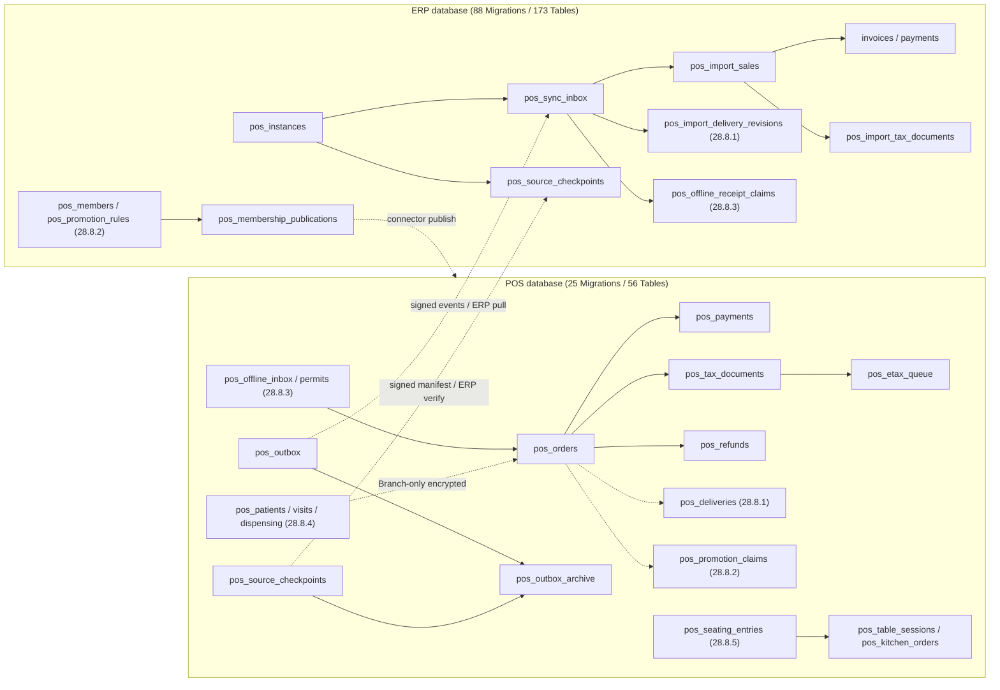

# Phase 28 & 28.8.1–28.8.5 — Database inventory and relationships — อัปเดต 2026-11-06

> **สถานะฐานข้อมูลปัจจุบัน (2026-11-05 / 2026-11-06):**
> - **Configured ERP MySQL (`erp`):** **88/88 migrations applied** (`pending = 0`, `173` tables) — ดูรายงาน [`DATABASE_UPDATE_20261104.md`](DATABASE_UPDATE_20261104.md)
> - **Configured POS SQLite (`pos/database/database.sqlite`):** **25/25 migrations applied** (`pending = 0`, `56` tables, `integrity_check = ok`, `foreign_key_check = 0`) — ดูรายงาน [`DATABASE_UPDATE_20261105.md`](DATABASE_UPDATE_20261105.md) และ [`DATABASE_UPDATE_20261105_PHASE28_8_5.md`](DATABASE_UPDATE_20261105_PHASE28_8_5.md)
> - **POS Setup Wizard (`/setup`) & Manager Config (`/config`):** ใช้ตารางแกนกลางเดิม (`pos_branches`, `pos_terminals`, `pos_staff`, `pos_audit`) ดู [`POS_CONFIGURATION.md`](POS_CONFIGURATION.md)

ERP/POS เป็นคนละฐาน ไม่มี cross-database foreign key หรือ POS credential สำหรับ ERP DB. Source of truth คือ migrations; ตารางนี้เป็น inventory ของ create-table declarations ใน Phase 28 และ Phase 28.8.1–28.8.5 ไม่รวม Laravel framework tables/columns เดิมทุกตัว

## ERP — 30 POS application tables created (88 total ERP migrations)

| Table | Migration | Phase / Scope |
| --- | --- | --- |
| `pos_stock_entitlements` | [2026_10_25_000001_create_pos_stock_entitlements.php](../backend/database/migrations/2026_10_25_000001_create_pos_stock_entitlements.php) | Phase 28 Core |
| `pos_instances` | [2026_10_25_000002_create_pos_connector_tables.php](../backend/database/migrations/2026_10_25_000002_create_pos_connector_tables.php) | Phase 28 Core |
| `pos_catalog_publications` | [2026_10_25_000002_create_pos_connector_tables.php](../backend/database/migrations/2026_10_25_000002_create_pos_connector_tables.php) | Phase 28 Core |
| `pos_sync_inbox` | [2026_10_25_000002_create_pos_connector_tables.php](../backend/database/migrations/2026_10_25_000002_create_pos_connector_tables.php) | Phase 28 Core |
| `pos_sync_conflicts` | [2026_10_25_000002_create_pos_connector_tables.php](../backend/database/migrations/2026_10_25_000002_create_pos_connector_tables.php) | Phase 28 Core |
| `pos_import_sales` | [2026_10_25_000002_create_pos_connector_tables.php](../backend/database/migrations/2026_10_25_000002_create_pos_connector_tables.php) | Phase 28 Core |
| `pos_product_policies` | [2026_10_25_000004_create_pos_product_policies.php](../backend/database/migrations/2026_10_25_000004_create_pos_product_policies.php) | Phase 28 Core |
| `pos_staff_authorities` | [2026_10_25_000004_create_pos_product_policies.php](../backend/database/migrations/2026_10_25_000004_create_pos_product_policies.php) | Phase 28 Core |
| `pos_import_refunds` | [2026_10_26_000001_create_pos_refund_subledger.php](../backend/database/migrations/2026_10_26_000001_create_pos_refund_subledger.php) | Phase 28 Core |
| `pos_import_cash_movements` | [2026_10_26_000002_create_pos_cash_movements.php](../backend/database/migrations/2026_10_26_000002_create_pos_cash_movements.php) | Phase 28 Core |
| `pos_import_kitchen_consumptions` | [2026_10_26_000006_create_pos_kitchen_import.php](../backend/database/migrations/2026_10_26_000006_create_pos_kitchen_import.php) | Phase 28 Restaurant |
| `pos_import_kitchen_sales` | [2026_10_26_000006_create_pos_kitchen_import.php](../backend/database/migrations/2026_10_26_000006_create_pos_kitchen_import.php) | Phase 28 Restaurant |
| `pos_import_kitchen_waste` | [2026_10_26_000006_create_pos_kitchen_import.php](../backend/database/migrations/2026_10_26_000006_create_pos_kitchen_import.php) | Phase 28 Restaurant |
| `pos_sync_dependencies` | [2026_10_26_000006_create_pos_kitchen_import.php](../backend/database/migrations/2026_10_26_000006_create_pos_kitchen_import.php) | Phase 28 Core |
| `pos_tax_settings` | [2026_10_26_000007_create_pos_tax_settings.php](../backend/database/migrations/2026_10_26_000007_create_pos_tax_settings.php) | Phase 28 Tax |
| `pos_import_return_inspections` | [2026_10_26_000008_create_pos_return_inspections.php](../backend/database/migrations/2026_10_26_000008_create_pos_return_inspections.php) | Phase 28 Pharmacy/Return |
| `pos_lot_recalls` | [2026_10_26_000009_create_pos_lot_recalls.php](../backend/database/migrations/2026_10_26_000009_create_pos_lot_recalls.php) | Phase 28 Pharmacy |
| `pos_recall_deliveries` | [2026_10_26_000009_create_pos_lot_recalls.php](../backend/database/migrations/2026_10_26_000009_create_pos_lot_recalls.php) | Phase 28 Pharmacy |
| `pos_source_checkpoints` | [2026_10_26_000010_create_pos_checkpoints.php](../backend/database/migrations/2026_10_26_000010_create_pos_checkpoints.php) | Phase 28 Core |
| `pos_tax_profile_publications` | [2026_10_26_000011_create_pos_tax_document_links.php](../backend/database/migrations/2026_10_26_000011_create_pos_tax_document_links.php) | Phase 28 Tax |
| `pos_import_tax_documents` | [2026_10_26_000011_create_pos_tax_document_links.php](../backend/database/migrations/2026_10_26_000011_create_pos_tax_document_links.php) | Phase 28 Tax |
| `pos_restaurant_variants` | [2026_10_26_000012_create_pos_restaurant_variants.php](../backend/database/migrations/2026_10_26_000012_create_pos_restaurant_variants.php) | Phase 28 Restaurant |
| `pos_import_delivery_revisions` | [2026_10_30_000001_create_pos_delivery_revisions.php](../backend/database/migrations/2026_10_30_000001_create_pos_delivery_revisions.php) | Phase 28.8.1 Delivery |
| `pos_members` | [2026_10_30_000002_create_pos_membership_master.php](../backend/database/migrations/2026_10_30_000002_create_pos_membership_master.php) | Phase 28.8.2 Membership |
| `pos_promotion_rules` | [2026_10_30_000002_create_pos_membership_master.php](../backend/database/migrations/2026_10_30_000002_create_pos_membership_master.php) | Phase 28.8.2 Membership |
| `pos_membership_publications` | [2026_10_31_000001_create_membership_publications.php](../backend/database/migrations/2026_10_31_000001_create_membership_publications.php) | Phase 28.8.2 Membership |
| `pos_promotion_allocations` | [2026_10_31_000001_create_membership_publications.php](../backend/database/migrations/2026_10_31_000001_create_membership_publications.php) | Phase 28.8.2 Membership |
| `pos_import_promotion_claims` | [2026_10_31_000001_create_membership_publications.php](../backend/database/migrations/2026_10_31_000001_create_membership_publications.php) | Phase 28.8.2 Membership |
| `pos_import_member_requests` | [2026_10_31_000002_create_member_request_inbox.php](../backend/database/migrations/2026_10_31_000002_create_member_request_inbox.php) | Phase 28.8.2 Membership |
| `pos_offline_receipt_claims` | [2026_11_04_000001_create_pos_offline_receipt_claims.php](../backend/database/migrations/2026_11_04_000001_create_pos_offline_receipt_claims.php) | Phase 28.8.3 Offline |

## POS — 55 POS application tables created (25 total POS migrations / 56 SQLite tables incl. `migrations`)

| Table | Migration | Phase / Scope |
| --- | --- | --- |
| `pos_branches` | [2026_10_25_000001_create_pos_core.php](../pos/database/migrations/2026_10_25_000001_create_pos_core.php) | Phase 28 Core |
| `pos_terminals` | [2026_10_25_000001_create_pos_core.php](../pos/database/migrations/2026_10_25_000001_create_pos_core.php) | Phase 28 Core |
| `pos_staff` | [2026_10_25_000001_create_pos_core.php](../pos/database/migrations/2026_10_25_000001_create_pos_core.php) | Phase 28 Core |
| `pos_catalogs` | [2026_10_25_000001_create_pos_core.php](../pos/database/migrations/2026_10_25_000001_create_pos_core.php) | Phase 28 Core |
| `pos_grants` | [2026_10_25_000001_create_pos_core.php](../pos/database/migrations/2026_10_25_000001_create_pos_core.php) | Phase 28 Core |
| `pos_shifts` | [2026_10_25_000001_create_pos_core.php](../pos/database/migrations/2026_10_25_000001_create_pos_core.php) | Phase 28 Core |
| `pos_orders` | [2026_10_25_000001_create_pos_core.php](../pos/database/migrations/2026_10_25_000001_create_pos_core.php) | Phase 28 Core |
| `pos_order_items` | [2026_10_25_000001_create_pos_core.php](../pos/database/migrations/2026_10_25_000001_create_pos_core.php) | Phase 28 Core |
| `pos_payments` | [2026_10_25_000001_create_pos_core.php](../pos/database/migrations/2026_10_25_000001_create_pos_core.php) | Phase 28 Core |
| `pos_outbox` | [2026_10_25_000001_create_pos_core.php](../pos/database/migrations/2026_10_25_000001_create_pos_core.php) | Phase 28 Core |
| `pos_audit` | [2026_10_25_000001_create_pos_core.php](../pos/database/migrations/2026_10_25_000001_create_pos_core.php) | Phase 28 Core |
| `pos_receipt_sequences` | [2026_10_25_000002_create_receipt_sequences.php](../pos/database/migrations/2026_10_25_000002_create_receipt_sequences.php) | Phase 28 Core |
| `pos_prescriptions` | [2026_10_25_000003_create_synthetic_prescriptions.php](../pos/database/migrations/2026_10_25_000003_create_synthetic_prescriptions.php) | Phase 28 Pharmacy |
| `pos_menu_tokens` | [2026_10_26_000001_create_customer_requests.php](../pos/database/migrations/2026_10_26_000001_create_customer_requests.php) | Phase 28 Public Menu |
| `pos_customer_requests` | [2026_10_26_000001_create_customer_requests.php](../pos/database/migrations/2026_10_26_000001_create_customer_requests.php) | Phase 28 Public Menu |
| `pos_refunds` | [2026_10_26_000002_create_refund_subledger.php](../pos/database/migrations/2026_10_26_000002_create_refund_subledger.php) | Phase 28 Refund |
| `pos_refund_lines` | [2026_10_26_000002_create_refund_subledger.php](../pos/database/migrations/2026_10_26_000002_create_refund_subledger.php) | Phase 28 Refund |
| `pos_cash_movements` | [2026_10_26_000003_create_cash_movements.php](../pos/database/migrations/2026_10_26_000003_create_cash_movements.php) | Phase 28 Cash |
| `pos_discount_approvals` | [2026_10_26_000004_create_discount_approvals.php](../pos/database/migrations/2026_10_26_000004_create_discount_approvals.php) | Phase 28 Discount |
| `pos_restaurant_tables` | [2026_10_26_000005_create_restaurant_core.php](../pos/database/migrations/2026_10_26_000005_create_restaurant_core.php) | Phase 28 / 28.8.5 (`+capacity`) |
| `pos_table_sessions` | [2026_10_26_000005_create_restaurant_core.php](../pos/database/migrations/2026_10_26_000005_create_restaurant_core.php) | Phase 28 Restaurant |
| `pos_kitchen_orders` | [2026_10_26_000005_create_restaurant_core.php](../pos/database/migrations/2026_10_26_000005_create_restaurant_core.php) | Phase 28 / 28.8.5 (`+queue_number`, `+queue_held`) |
| `pos_kitchen_lines` | [2026_10_26_000005_create_restaurant_core.php](../pos/database/migrations/2026_10_26_000005_create_restaurant_core.php) | Phase 28 Restaurant |
| `pos_kitchen_reservations` | [2026_10_26_000005_create_restaurant_core.php](../pos/database/migrations/2026_10_26_000005_create_restaurant_core.php) | Phase 28 Restaurant |
| `pos_kitchen_waste` | [2026_10_26_000005_create_restaurant_core.php](../pos/database/migrations/2026_10_26_000005_create_restaurant_core.php) | Phase 28 Restaurant |
| `pos_return_inspections` | [2026_10_26_000006_create_return_inspections.php](../pos/database/migrations/2026_10_26_000006_create_return_inspections.php) | Phase 28 Pharmacy/Return |
| `pos_lot_recalls` | [2026_10_26_000007_create_lot_recalls.php](../pos/database/migrations/2026_10_26_000007_create_lot_recalls.php) | Phase 28 Pharmacy |
| `pos_source_checkpoints` | [2026_10_26_000008_create_source_checkpoints.php](../pos/database/migrations/2026_10_26_000008_create_source_checkpoints.php) | Phase 28 Core |
| `pos_outbox_archive` | [2026_10_26_000008_create_source_checkpoints.php](../pos/database/migrations/2026_10_26_000008_create_source_checkpoints.php) | Phase 28 Core |
| `pos_tax_profiles` | [2026_10_26_000009_create_tax_documents.php](../pos/database/migrations/2026_10_26_000009_create_tax_documents.php) | Phase 28 Tax |
| `pos_tax_sequences` | [2026_10_26_000009_create_tax_documents.php](../pos/database/migrations/2026_10_26_000009_create_tax_documents.php) | Phase 28 Tax |
| `pos_tax_documents` | [2026_10_26_000009_create_tax_documents.php](../pos/database/migrations/2026_10_26_000009_create_tax_documents.php) | Phase 28 Tax |
| `pos_etax_queue` | [2026_10_26_000009_create_tax_documents.php](../pos/database/migrations/2026_10_26_000009_create_tax_documents.php) | Phase 28 Tax |
| `pos_runtime_fence` | [2026_10_26_000010_create_recovery_fence.php](../pos/database/migrations/2026_10_26_000010_create_recovery_fence.php) | Phase 28 Recovery |
| `pos_deliveries` | [2026_10_30_000001_create_delivery_workflow.php](../pos/database/migrations/2026_10_30_000001_create_delivery_workflow.php) | Phase 28.8.1 Delivery |
| `pos_delivery_actions` | [2026_10_30_000001_create_delivery_workflow.php](../pos/database/migrations/2026_10_30_000001_create_delivery_workflow.php) | Phase 28.8.1 Delivery |
| `pos_delivery_reservations` | [2026_10_30_000002_add_delivery_operations.php](../pos/database/migrations/2026_10_30_000002_add_delivery_operations.php) | Phase 28.8.1 Delivery |
| `pos_delivery_kitchen_lines` | [2026_10_30_000002_add_delivery_operations.php](../pos/database/migrations/2026_10_30_000002_add_delivery_operations.php) | Phase 28.8.1 Delivery |
| `pos_delivery_cash` | [2026_10_30_000002_add_delivery_operations.php](../pos/database/migrations/2026_10_30_000002_add_delivery_operations.php) | Phase 28.8.1 Delivery |
| `pos_membership_publications` | [2026_10_31_000001_create_membership_runtime.php](../pos/database/migrations/2026_10_31_000001_create_membership_runtime.php) | Phase 28.8.2 Membership |
| `pos_promotion_rights` | [2026_10_31_000001_create_membership_runtime.php](../pos/database/migrations/2026_10_31_000001_create_membership_runtime.php) | Phase 28.8.2 Membership |
| `pos_promotion_claims` | [2026_10_31_000001_create_membership_runtime.php](../pos/database/migrations/2026_10_31_000001_create_membership_runtime.php) | Phase 28.8.2 Membership |
| `pos_member_drafts` | [2026_10_31_000002_create_member_drafts.php](../pos/database/migrations/2026_10_31_000002_create_member_drafts.php) | Phase 28.8.2 Membership |
| `pos_offline_devices` | [2026_11_01_000001_create_offline_ingress.php](../pos/database/migrations/2026_11_01_000001_create_offline_ingress.php) | Phase 28.8.3 Offline |
| `pos_offline_inbox` | [2026_11_01_000001_create_offline_ingress.php](../pos/database/migrations/2026_11_01_000001_create_offline_ingress.php) | Phase 28.8.3 Offline |
| `pos_offline_conflicts` | [2026_11_01_000001_create_offline_ingress.php](../pos/database/migrations/2026_11_01_000001_create_offline_ingress.php) | Phase 28.8.3 Offline |
| `pos_offline_policies` | [2026_11_01_000001_create_offline_ingress.php](../pos/database/migrations/2026_11_01_000001_create_offline_ingress.php) | Phase 28.8.3 Offline |
| `pos_offline_permits` | [2026_11_01_000001_create_offline_ingress.php](../pos/database/migrations/2026_11_01_000001_create_offline_ingress.php) | Phase 28.8.3 Offline |
| `pos_offline_reservations` | [2026_11_01_000001_create_offline_ingress.php](../pos/database/migrations/2026_11_01_000001_create_offline_ingress.php) | Phase 28.8.3 Offline |
| `pos_offline_slots` | [2026_11_01_000001_create_offline_ingress.php](../pos/database/migrations/2026_11_01_000001_create_offline_ingress.php) | Phase 28.8.3 Offline |
| `pos_patients` | [2026_11_05_000001_create_patient_history.php](../pos/database/migrations/2026_11_05_000001_create_patient_history.php) | Phase 28.8.4 Pharmacy Patient |
| `pos_patient_revisions` | [2026_11_05_000001_create_patient_history.php](../pos/database/migrations/2026_11_05_000001_create_patient_history.php) | Phase 28.8.4 Pharmacy Patient |
| `pos_patient_visits` | [2026_11_05_000001_create_patient_history.php](../pos/database/migrations/2026_11_05_000001_create_patient_history.php) | Phase 28.8.4 Pharmacy Patient |
| `pos_patient_dispensing` | [2026_11_05_000001_create_patient_history.php](../pos/database/migrations/2026_11_05_000001_create_patient_history.php) | Phase 28.8.4 Pharmacy Patient |
| `pos_seating_entries` | [2026_11_05_000003_create_restaurant_seating.php](../pos/database/migrations/2026_11_05_000003_create_restaurant_seating.php) | Phase 28.8.5 Restaurant Queue/Booking |

## Main relationships

Arrows เป็นความสัมพันธ์เชิง workflow/correlation บางส่วน ไม่ใช่ foreign-key specification ทุกเส้น. ชื่อ `pos_source_checkpoints` สองฝั่งเป็นคนละตารางคนละฐาน

## Constraints / lifecycle

- ERP unique instance+event และ instance+source sequence; source sale/refund/kitchen/inspection/tax links ป้องกัน replay ลงเอกสารซ้ำ
- Stock source identity ใช้ shared InventoryMovementService; financial-imported แยก inventory-pending; quota consumed ไม่คืนเพราะ pause/refund โดยอัตโนมัติ
- Tax documents unique document number/current sale slot/replacement identity; source snapshots immutable. ABB→Full ไม่สร้าง revenue/VAT ใหม่
- Receipt/tax sequences ผูก terminal/day. Independent runtime recovery anchor ต้องเก็บนอก DB restore set; ห้าม initialize ใหม่เพื่อข้าม fence
- `pos_outbox_archive` เก็บ source/result/dedupe metadata; payload gzip+authenticated encryption ใน private file; ต้องเก็บ POS APP_KEY/archives ใน backup. `hold_at` อยู่ทั้ง hot/archive และ checkpoint
- เพิ่ม columns/indexes ใน stock_movements และ instance publication/recovery/backoff metadata ตาม migration; ไม่ใช้ inventory นี้แทน column schema เต็ม
- MySQL compatibility: ใช้ explicit constraint/index names ที่สั้นกว่า64 characters ใน migrations ที่แก้ตาม database-upgrade report. ERP รองรับการ migrate จริงแล้ว; ผลนี้ยังไม่ใช่ MariaDB contention proof

## Schema prerequisites applied in the same upgrade

| Migration area | Tables created |
| --- | --- |
| [Phase27 Manufacturing](../backend/database/migrations/2026_09_25_000001_create_phase27_manufacturing_tables.php) | `bill_of_materials`, `bom_items`, `work_orders`, `work_order_items`, `production_costs` |
| [Integration webhook outbox](../backend/database/migrations/2026_10_19_000002_create_external_webhook_outbox.php) | `integration_webhooks`, `integration_webhook_events`, `integration_webhook_deliveries` |

Access-policy/summary/project indexes และ permissions ตาม upgrade report appliedพร้อมกัน. นี่เป็นการอัปเดต schema ตามconfig ไม่ได้ enable webhook network หรือเปิด production POS
