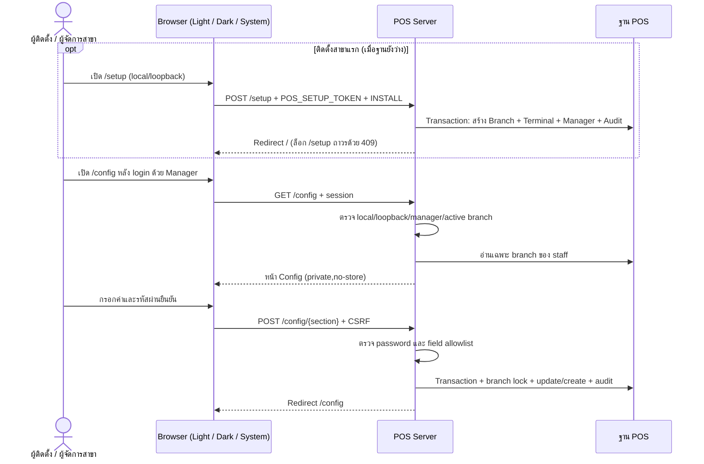
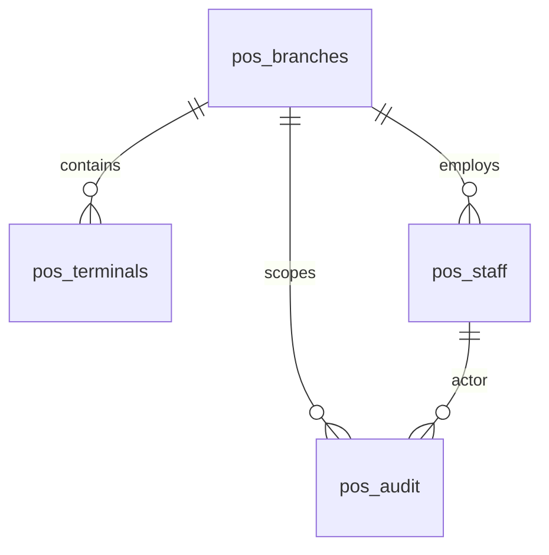

# POS Setup Wizard (`/setup`) และ POS Config (`/config`) — คู่มือตั้งค่าและขอบเขตปัจจุบัน — อัปเดต 2026-11-06

เพิ่มหลัง Gemini ตรวจรับ Phase 28 local วันที่ 2026-10-27 และขยายเพิ่ม **POS Setup Wizard (`/setup`)** พร้อมโหมดธีม `Light / Dark / System` ในวันที่ 2026-11-06. โค้ดชุดปัจจุบันทดสอบ POS **115 tests / 2,160 assertions** (รวม `SetupTest` และ `ConfigurationTest`), TypeScript, Vite และ Chrome 390/1440 px ผ่านครบ; ดู [รายงานขอบเขตเดิม](POS_CONFIG_GEMINI_REVIEW_20261029.md) และ [ทะเบียนตรวจรับ UI](design/ui-acceptance-register.md). ยังไม่ได้ทดสอบระบบ/อุปกรณ์จริงและไม่เปิด production.

## เปิดใช้งาน

- **สร้างสาขาแรกด้วย POS Setup Wizard (`/setup`):** เปิดใช้เฉพาะ `local`/`testing` จาก loopback (`127.0.0.1` หรือ `::1`) บนฐาน POS ที่ยังไม่มีสาขา Terminal หรือพนักงาน โดยต้องตั้ง `POS_SETUP_TOKEN` (อย่างน้อย 32 ตัวอักษร) ใน `pos/.env` แล้วเปิด `/setup` เพื่อสร้างสาขาแรก เลือก `retail`/`restaurant`/`pharmacy` สร้าง Terminal แรกและบัญชี Manager คนแรก พร้อมพิมพ์ `INSTALL` ยืนยัน ([ดูขั้นตอนละเอียด](README_POS.md#pos-setup-wizard-สำหรับสาขาแรก))
- **ตั้งค่าสาขาด้วย Manager Config (`/config`):** เปิด POS ตาม [คู่มือติดตั้ง](README_POS.md) แล้ว login ด้วย manager ของสาขา กด **ตั้งค่า POS** หรือเข้า `/config`. ใช้เฉพาะ `local`/`testing` จาก loopback. บัญชี `cashier`/`kitchen`/`pharmacist` เข้าไม่ได้.

## ตั้งค่าอะไรได้

| ส่วน | ทำได้ | เงื่อนไข |
| --- | --- | --- |
| สาขาแรก (`/setup`) | สร้างรหัส/ชื่อสาขา เลือกประเภทกิจการ สร้างรหัส Terminal แรก และบัญชี Manager คนแรก | เฉพาะฐาน POS ว่าง (`pos_branches`, `pos_terminals`, `pos_staff` เป็น 0), มี `POS_SETUP_TOKEN` และพิมพ์ `INSTALL` ยืนยัน; ล็อกอัตโนมัติทันทีหลังสร้างเสร็จ |
| สาขา (`/config`) | แก้ชื่อ เลือก retail/restaurant/pharmacy | เปลี่ยนประเภทได้ก่อนมี Terminal/catalog/grant/order/tax profile เท่านั้น |
| Terminal (`/config`) | เพิ่มรหัสเครื่อง ระบบสร้าง UUID | รหัสไม่ซ้ำภายในสาขา ต้องลงทะเบียน ERP แยก |
| พนักงาน (`/config`) | เพิ่มชื่อ อีเมล รหัสผ่าน role | รหัสผ่านอย่างน้อย 12 ตัวและยืนยัน; kitchen เฉพาะ restaurant, pharmacist เฉพาะ pharmacy |
| สถานะ (`/config`) | ดู UUID, รายชื่อ/สถานะพนักงาน, instance และ local flags ที่เป็น boolean | ค่า flags แบบ boolean เท่านั้น; ไม่เผย keys หรือ passwords |

ทุกการเขียนใน `/config` ต้องยืนยันรหัสผ่าน manager ปัจจุบันและบันทึก audit ใน transaction. `branch_id` มาจาก session staff ฝั่ง server ไม่รับสิทธิ์ข้ามสาขาจาก request. Browser form ใช้ web middleware/CSRF และ POST จำกัด 5 requests/minute. GET ส่ง `Cache-Control: private, no-store`.

## ขอบเขตที่ยังตั้งผ่านผู้ดูแล

- สร้างสาขา/manager คนแรกผ่าน `/setup` (เฉพาะฐานว่างพร้อม `POS_SETUP_TOKEN`) หรือผ่าน CLI; ไม่ clone UUID/บัญชี/keys ของสาขาเดิม
- รหัสสาขา currency timezone และสถานะ active แสดงอ่านอย่างเดียว ไม่มี rename identity หรือ delete ประวัติ
- คุณสมบัติ `pharmacist_qualified` provision ผ่านผู้ดูแล CLI ไม่รับ self-grant จาก form
- keys, `.env`, feature flags และ HTTPS/mTLS ตั้งที่ Server; หน้า `/setup` และ `/config` ไม่เขียนไฟล์ `.env`
- catalog/ราคา/VAT/quota/BOM/หน่วยยา/lot/issuer profile/GL mappings และ ERP staff authority ตั้งจาก ERP หรือ provisioning ที่รองรับ แล้ว sync ตาม contract
- ยังไม่มี edit/deactivate/reset-password พนักงานหรือ Terminal ในหน้านี้
- หน้า `/setup` และ `/config` ใช้ schema เดิม สำหรับสถานะฐานล่าสุดดู [รายงาน Phase 28.8.5](DATABASE_UPDATE_20261105_PHASE28_8_5.md)

## Routes และผลตอบกลับ

| Method | URI | หน้าที่ |
| --- | --- | --- |
| GET / HEAD | `/setup` | หน้า POS Setup Wizard สำหรับสร้างสาขาแรก (เฉพาะฐานว่าง + local/loopback + `POS_SETUP_TOKEN`) |
| POST | `/setup` | สร้างสาขาแรก + Terminal + Manager และล็อกการติดตั้งซ้ำ (`throttle:5,1`) |
| GET / HEAD | `/config` | หน้า Blade ของ manager สาขาปัจจุบัน |
| POST | `/config/branch` | บันทึกชื่อ/ประเภทสาขา |
| POST | `/config/terminal` | เพิ่มเครื่องขาย |
| POST | `/config/staff` | เพิ่มพนักงาน |

POST `/config/*` สำเร็จ redirect `/config` พร้อมข้อความ; POST `/setup` สำเร็จ redirect `/` พร้อมข้อความแจ้งเตือนให้ลบ `POS_SETUP_TOKEN`. Validation แบบ form redirect พร้อม errors; JSON ได้ 422. ไม่มี login ได้ 401; role/IP/environment/active branch/password/token ไม่ผ่านได้ 403; เปลี่ยนประเภทหลัง provision หรือเรียก `/setup` ซ้ำเมื่อมีข้อมูลแล้วได้ 409; rate limit ได้ 429; CSRF ไม่ผ่านตาม web middleware ได้ 419.

## ลำดับและข้อมูล

ERD แสดง logical relations; ไม่รับรองว่า audit actor_id/branch_id ทุกตัวมี DB foreign key. ใช้ schema เดิม; ไม่มีตาราง POS config ใหม่.

## Source / Diagram

[SetupController](../pos/app/Http/SetupController.php) · [Setup View](../pos/resources/views/setup.blade.php) · [SetupTest](../pos/tests/SetupTest.php) · [ConfigurationController](../pos/app/Http/ConfigurationController.php) · [ConfigurationAccess](../pos/app/Http/ConfigurationAccess.php) · [Routes](../pos/routes/configuration.php) · [Config View](../pos/resources/views/configuration.blade.php) · [ConfigurationTest](../pos/tests/ConfigurationTest.php)

[POS Server / Setup / Config diagram](23_pos_server_configuration.html) · [JSON source](specs/23_pos_server_configuration.json) · [คู่มือ POS](README_POS.md) · [Diagrams การใช้งานรายร้าน](24_pos_workflows.html) · [Diagram portal](index.html)

Diagram เขียนคำอธิบายใหม่เป็นภาษาไทย ส่วน Viewer UI และ html lang ของ Archify fallback เป็น English.
