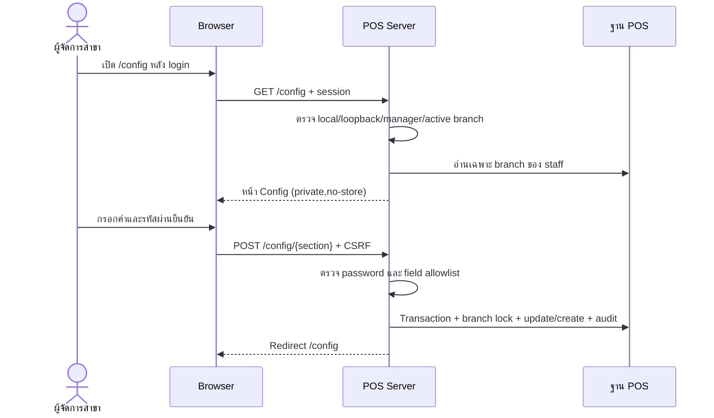
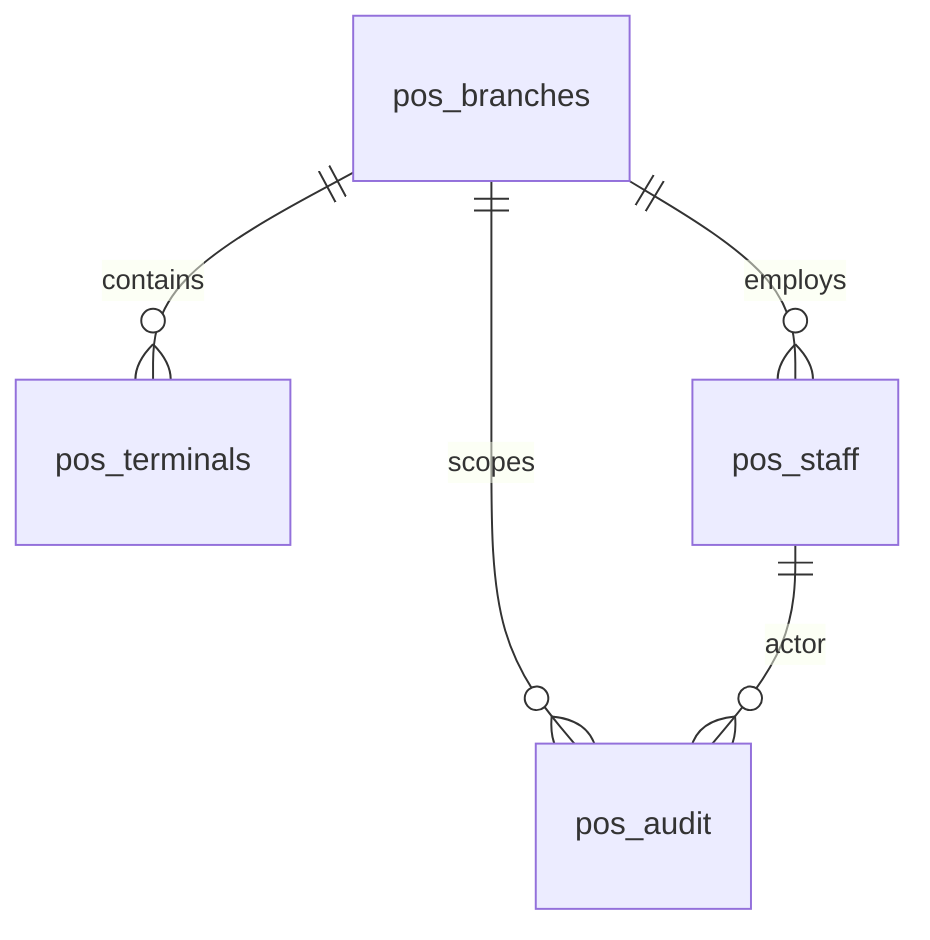

# POS Config — คู่มือตั้งค่าและขอบเขตปัจจุบัน — 2026-10-29

เพิ่มหลัง Gemini ตรวจรับ Phase 28 local วันที่ 2026-10-27. โค้ด Config รอบนี้ทดสอบ POS 45 tests / 268 assertions, TypeScript, Vite และ Pint ผ่าน; Gemini ตรวจเฉพาะ 6 ไฟล์ที่ผู้ใช้อนุญาตแล้ว ไม่พบข้อบกพร่องสำคัญในขอบเขต Local-only ดู [รายงานและขอบเขต](POS_CONFIG_GEMINI_REVIEW_20261029.md). ยังไม่ได้ทดสอบระบบ/อุปกรณ์จริงและไม่เปิด production.

## เปิดใช้งาน

เปิด POS ตาม README_POS.md แล้ว login ด้วย manager ของสาขา กด **ตั้งค่า POS** หรือเข้า `/config`. ใช้เฉพาะ local/testing จาก loopback (127.0.0.1 หรือ ::1). บัญชี cashier/kitchen/pharmacist เข้าไม่ได้. สาขาและผู้จัดการคนแรกยังใช้ CLI; ไม่มี anonymous setup และไม่มีผู้จัดการส่วนกลางข้ามสาขาในหน้านี้.

## ตั้งค่าอะไรได้

| ส่วน | ทำได้ | เงื่อนไข |
| --- | --- | --- |
| สาขา | แก้ชื่อ เลือก retail/restaurant/pharmacy | เปลี่ยนประเภทได้ก่อนมี Terminal/catalog/grant/order/tax profile เท่านั้น |
| Terminal | เพิ่มรหัสเครื่อง ระบบสร้าง UUID | รหัสไม่ซ้ำภายในสาขา ต้องลงทะเบียน ERP แยก |
| พนักงาน | เพิ่มชื่อ อีเมล รหัสผ่าน role | รหัสผ่านอย่างน้อย 12 ตัวและยืนยัน; kitchen เฉพาะ restaurant, pharmacist เฉพาะ pharmacy |
| สถานะ | ดู UUID, รายชื่อ/สถานะพนักงาน, instance และ local flags ที่เป็น boolean | ค่า flags แบบ boolean เท่านั้น; ไม่เผย keys หรือ passwords |

ทุกการเขียนต้องยืนยันรหัสผ่าน manager ปัจจุบันและบันทึก audit ใน transaction. branch_id มาจาก session staff ฝั่ง server ไม่รับสิทธิ์ข้ามสาขาจาก request. Browser form ใช้ web middleware/CSRF และ POST จำกัด 5 requests/minute. GET ส่ง Cache-Control private,no-store.

## ขอบเขตที่ยังตั้งผ่านผู้ดูแล

- สร้างสาขา/manager คนแรกผ่าน CLI; ไม่ clone UUID/บัญชี/keys ของสาขาเดิม
- รหัสสาขา currency timezone และสถานะ active แสดงอ่านอย่างเดียว ไม่มี rename identity หรือ delete ประวัติ
- คุณสมบัติ pharmacist_qualified provision ผ่านผู้ดูแล ไม่รับ self-grant จาก form
- keys, .env, feature flags และ HTTPS/mTLS ตั้งที่ Server; หน้า Config ไม่เขียน environment
- catalog/ราคา/VAT/quota/BOM/หน่วยยา/lot/issuer profile/GL mappings และ ERP staff authority ตั้งจาก ERP หรือ provisioning ที่รองรับ แล้ว sync ตาม contract
- ยังไม่มี edit/deactivate/reset-password พนักงานหรือ Terminal ในหน้าใหม่นี้
- ไม่มี migration ใหม่ และไม่ได้แก้ข้อมูลฐานที่ตั้งค่าใช้อยู่ในงานพัฒนานี้

## Routes และผลตอบกลับ

| Method | URI | หน้าที่ |
| --- | --- | --- |
| GET / HEAD | `/config` | หน้า Blade ของ manager สาขาปัจจุบัน |
| POST | `/config/branch` | บันทึกชื่อ/ประเภทสาขา |
| POST | `/config/terminal` | เพิ่มเครื่องขาย |
| POST | `/config/staff` | เพิ่มพนักงาน |

POST สำเร็จ redirect `/config` พร้อมข้อความ. Validation แบบ form redirect พร้อม errors; JSON ได้ 422. ไม่มี login ได้ 401; role/IP/environment/active branch/password ไม่ผ่านได้ 403; เปลี่ยนประเภทหลัง provision ได้ 409; rate limit ได้ 429; CSRF ไม่ผ่านตาม web middleware ได้ 419. ผู้ดูแลควรคงประเภทเดิมหลังเริ่ม provision.

## ลำดับและข้อมูล

ERD แสดง logical relations; ไม่รับรองว่า audit actor_id/branch_id ทุกตัวมี DB foreign key. ใช้ schema เดิม; ไม่มีตาราง POS config ใหม่.

## Source / Diagram

[Controller](../pos/app/Http/ConfigurationController.php) · [Access](../pos/app/Http/ConfigurationAccess.php) · [Routes](../pos/routes/configuration.php) · [View](../pos/resources/views/configuration.blade.php) · [Tests](../pos/tests/ConfigurationTest.php)

[POS Server / Config diagram](23_pos_server_configuration.html) · [JSON source](specs/23_pos_server_configuration.json) · [คู่มือ POS](README_POS.md) · [Diagram portal](index.html)

Diagram เขียนคำอธิบายใหม่เป็นภาษาไทย ส่วน Viewer UI และ html lang ของ Archify fallback เป็น English.
