# Company OS / Lightweight ERP — System Diagrams & Architecture

เอกสารนี้รวบรวม **Diagram ทั้งหมดของระบบ** ครอบคลุมทั้งระดับสถาปัตยกรรม (Architecture), เวิร์กโฟลว์ธุรกิจ (Workflow), ลำดับการทำงาน (Sequence), การไหลของข้อมูล (Dataflow), และวงจรสถานะ (Lifecycle) โดยถูกสร้างขึ้นด้วย **Archify Showcase Standard** และบันทึกเป็น Interactive Standalone HTML พร้อม JSON Spec

🌐 **หน้าเมนูรวมไดอะแกรมทั้งหมด:** เปิดไฟล์ [`document/index.html`](./index.html) ในเบราว์เซอร์

---

## 📑 สารบัญไดอะแกรมทั้งหมด (Table of Diagrams)

| # | ชื่อไดอะแกรม | ประเภท | ไฟล์ Interactive HTML | ไฟล์ JSON Spec |
|---|---|---|---|---|
| **01** | [System & Tech Stack Architecture](#01-system--tech-stack-architecture) | Architecture | [`01_system_architecture.html`](./01_system_architecture.html) | [`specs/01_system_architecture.json`](./specs/01_system_architecture.json) |
| **02** | [Multi-Tenancy & Org Hierarchy](#02-multi-tenancy--org-hierarchy) | Architecture | [`02_multitenancy_org_hierarchy.html`](./02_multitenancy_org_hierarchy.html) | [`specs/02_multitenancy_org_hierarchy.json`](./specs/02_multitenancy_org_hierarchy.json) |
| **03** | [Core Business Workflow](#03-core-business-workflow) | Workflow | [`03_business_core_workflow.html`](./03_business_core_workflow.html) | [`specs/03_business_core_workflow.json`](./specs/03_business_core_workflow.json) |
| **04** | [Auth, Session & RBAC Flow](#04-auth-session--rbac-flow) | Sequence | [`04_auth_session_rbac_sequence.html`](./04_auth_session_rbac_sequence.html) | [`specs/04_auth_session_rbac_sequence.json`](./specs/04_auth_session_rbac_sequence.json) |
| **05** | [Invoice Creation & Payment Settlement](#05-invoice-creation--payment-settlement) | Sequence | [`05_invoice_creation_payment_sequence.html`](./05_invoice_creation_payment_sequence.html) | [`specs/05_invoice_creation_payment_sequence.json`](./specs/05_invoice_creation_payment_sequence.json) |
| **06** | [ERP Data Lineage & Pipeline](#06-erp-data-lineage--pipeline) | Dataflow | [`06_erp_data_lineage_flow.html`](./06_erp_data_lineage_flow.html) | [`specs/06_erp_data_lineage_flow.json`](./specs/06_erp_data_lineage_flow.json) |
| **07** | [Sales Opportunity & Deal Lifecycle](#07-sales-opportunity--deal-lifecycle) | Lifecycle | [`07_deal_sales_lifecycle.html`](./07_deal_sales_lifecycle.html) | [`specs/07_deal_sales_lifecycle.json`](./specs/07_deal_sales_lifecycle.json) |
| **08** | [Invoice Status & Payment Lifecycle](#08-invoice-status--payment-lifecycle) | Lifecycle | [`08_invoice_lifecycle.html`](./08_invoice_lifecycle.html) | [`specs/08_invoice_lifecycle.json`](./specs/08_invoice_lifecycle.json) |
| **09** | [Task Status Lifecycle](#09-task-status-lifecycle) | Lifecycle | [`09_task_project_lifecycle.html`](./09_task_project_lifecycle.html) | [`specs/09_task_project_lifecycle.json`](./specs/09_task_project_lifecycle.json) |
| **10** | [Database ER & Domain Model](#10-database-er--domain-model) | Architecture | [`10_database_er_domain_model.html`](./10_database_er_domain_model.html) | [`specs/10_database_er_domain_model.json`](./specs/10_database_er_domain_model.json) |
| **11** | [Payroll Policy, Approval & GL Flow](#11-payroll-policy-approval--gl-flow) | Workflow | [`11_payroll_policy_gl_flow.html`](./11_payroll_policy_gl_flow.html) | [`specs/11_payroll_policy_gl_flow.json`](./specs/11_payroll_policy_gl_flow.json) |
| **12** | [Enterprise Document Lifecycle & Compliance](#12-enterprise-document-lifecycle--compliance) | Lifecycle | [`12_document_management_lifecycle.html`](./12_document_management_lifecycle.html) | [`specs/12_document_management_lifecycle.json`](./specs/12_document_management_lifecycle.json) |
| **13** | [Two-Factor Authentication & Privileged Access Flow](#13-two-factor-authentication--privileged-access-flow) | Sequence | [`13_two_factor_auth_sequence.html`](./13_two_factor_auth_sequence.html) | [`specs/13_two_factor_auth_sequence.json`](./specs/13_two_factor_auth_sequence.json) |
| **14** | [Approval Workflow Instance Lifecycle](#14-approval-workflow-instance-lifecycle) | Lifecycle | [`14_approval_workflow_engine.html`](./14_approval_workflow_engine.html) | [`specs/14_approval_workflow_engine.json`](./specs/14_approval_workflow_engine.json) |
| **15** | [PromptPay Thai QR & Payment Gateway Settlement Flow](#15-promptpay-thai-qr--payment-gateway-settlement-flow) | Sequence | [`15_payment_gateway_settlement.html`](./15_payment_gateway_settlement.html) | [`specs/15_payment_gateway_settlement.json`](./specs/15_payment_gateway_settlement.json) |
| **16** | [Master Dialog Standard & Editor Lifecycle](#16-master-dialog-standard--editor-lifecycle) | Lifecycle | [`16_master_dialog_editor_lifecycle.html`](./16_master_dialog_editor_lifecycle.html) | [`specs/16_master_dialog_editor_lifecycle.json`](./specs/16_master_dialog_editor_lifecycle.json) |
| **17** | [HR Employee, Attendance & Payroll Integration](#17-hr-employee-attendance--payroll-integration) | Workflow / Dataflow | [`17_hr_employee_attendance_payroll.md`](./17_hr_employee_attendance_payroll.md) | — |
| **18** | [e-Tax Invoice & RD Prep Gateway Architecture](#18-e-tax-invoice--rd-prep-gateway-architecture) | Sequence / Architecture | [`18_etax_gateway_pipeline.md`](./18_etax_gateway_pipeline.md) | — |
| **19** | [Cash Flow Forecasting & Financial Health Analytics](#19-cash-flow-forecasting--financial-health-analytics) | Workflow / Analytics | [`19_cash_flow_forecasting_engine.md`](./19_cash_flow_forecasting_engine.md) | — |
| **20** | [AI OCR Document Ingestion](#20-ai-ocr-document-ingestion) | Sequence / Architecture | [`20_ai_ocr_document_ingestion.md`](./20_ai_ocr_document_ingestion.md) | — |
| **21** | [Web Setup Wizard Architecture & Installer Lifecycle](#21-web-setup-wizard-architecture--installer-lifecycle) | Lifecycle / Security | [`21_setup_wizard_installer_lifecycle.md`](./21_setup_wizard_installer_lifecycle.md) | — |
| **All** | [Full Database ER Diagram (70+ Tables)](#22-full-database-er-diagram-70-ตาราง) | Database ERD | [`document/DATABASE_ERD.md`](./DATABASE_ERD.md) | [Central Database Schema](../docs/database/DATABASE.md) |
| **Groups** | [6 Domain Group Workflows (31 Modules)](#23-6-domain-group-workflows-31-modules) | Group Workflows | [`document/GROUPS_WORKFLOW.md`](./GROUPS_WORKFLOW.md) | — |

---

## 🧩 ไดอะแกรมรายกลุ่มการทำงาน 6 กลุ่ม (31 Modules Workflow)

นอกจากภาพรวมสถาปัตยกรรมระดับระบบ 13 ชุดด้านบนแล้ว ยังมีเอกสารผังการทำงานเจาะลึกเฉพาะ **6 กลุ่มงานหลัก ครอบคลุม 31 โมดูลทั้งหมด** พร้อมคำอธิบายภาษาไทยและ Mermaid Diagrams รวม 19 ชุด:

📄 **ดูรายละเอียดฉบับเต็ม:** [`document/GROUPS_WORKFLOW.md`](./GROUPS_WORKFLOW.md)

| กลุ่มงาน (Domain Group) | โมดูลที่ครอบคลุม | หัวข้อไดอะแกรมหลัก |
|---|---|---|
| **Group 1: Foundation & Security** | `01-04` (Org, User/Role, Settings, Audit) | • Multi-Tenant Scope Flow<br>• RBAC 7 Roles Policy Gate<br>• Audit Trail Pipeline |
| **Group 2: CRM & Sales Pipeline** | `05-08` (Customers, Contacts, Deals, Quotations) | • Lead-to-Quote Workflow<br>• Deal Stage State Machine<br>• Quotation Issuance Sequence |
| **Group 3: Project Delivery & Execution** | `09-11` (Projects, Tasks, Milestones) | • Project Delivery Workflow<br>• Task Kanban Lifecycle<br>• Milestone Sign-off Trigger |
| **Group 4: Finance, Billing & Cost Control** | `12-16` (Products, Suppliers, Invoices, Payments, Expenses) | • Order-to-Cash & Expenses<br>• Invoice Anti-Overpay Sequence<br>• Project Cost Allocation |
| **Group 5: Insights, Platform & Automation** | `17-23` (Dashboard, Reports, Files, Notifications, Automation, API, Import/Export) | • Event & Automation Engine<br>• Executive Metric Lineage<br>• Tenant File Storage Flow |
| **Group 6: Operations & Advanced Extensions (Phase 7-18)** | `24-31` (PO, Inventory, Payroll, AI, Accounting, Portal) | • Procurement & Stock Movement<br>• Payroll Policy, Payslip & GL<br>• External Accounting & Portal Grid |

---

## รายละเอียดแต่ละไดอะแกรม (Diagram Details)

### 01. System & Tech Stack Architecture
- **ไฟล์ HTML:** [`01_system_architecture.html`](./01_system_architecture.html)
- **วัตถุประสงค์:** แสดง Full-Stack Monolith: React + Inertia + Vite + Tailwind CSS ทำงานกับ Laravel ผ่าน Inertia Protocol พร้อม database session, rate limiter, audit log และฐานข้อมูล MySQL/MariaDB
- **Mermaid Preview:**

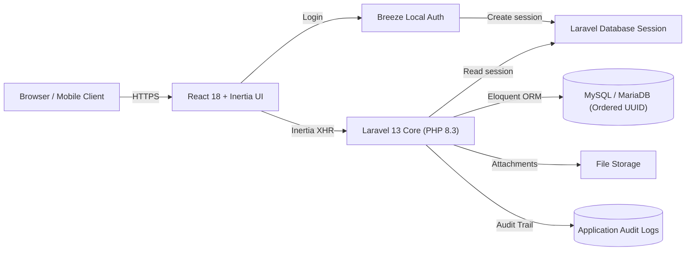

---

### 02. Multi-Tenancy & Org Hierarchy
- **ไฟล์ HTML:** [`02_multitenancy_org_hierarchy.html`](./02_multitenancy_org_hierarchy.html)
- **วัตถุประสงค์:** แสดงลำดับชั้นขององค์กรและการแบ่งสิทธิ์ (Tenant Isolation ผ่าน `org_id` และ 7 Built-in Roles: `owner`, `admin`, `sales`, `project_manager`, `finance`, `member`, `viewer`)
- **Mermaid Preview:**

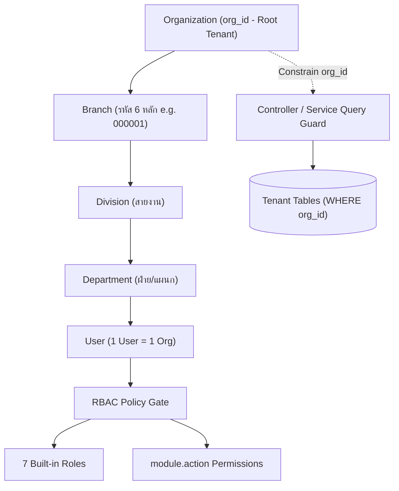

---

### 03. Core Business Workflow
- **ไฟล์ HTML:** [`03_business_core_workflow.html`](./03_business_core_workflow.html)
- **วัตถุประสงค์:** เวิร์กโฟลว์แกนธุรกิจหลัก ตั้งแต่รับลูกค้า &rarr; ดีลการขาย &rarr; ส่งมอบโปรเจกต์ &rarr; ออกใบแจ้งหนี้ &rarr; รับเงิน &rarr; รายงาน Dashboard
- **Mermaid Preview:**

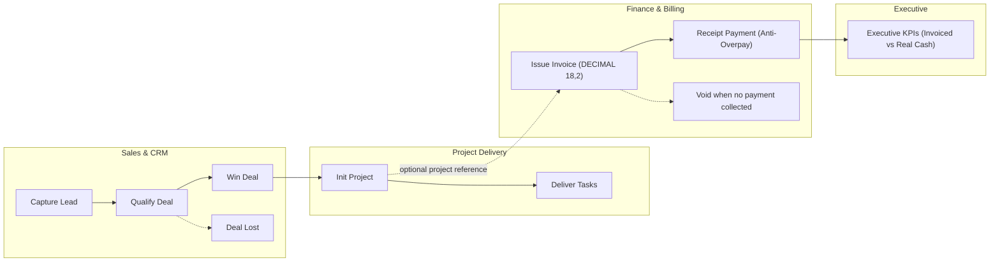

---

### 04. Auth, Session & RBAC Flow
- **ไฟล์ HTML:** [`04_auth_session_rbac_sequence.html`](./04_auth_session_rbac_sequence.html)
- **วัตถุประสงค์:** ลำดับการยืนยันตัวตน, Rate Limit ป้องกันการสุ่มรหัสผ่าน, การสร้าง Session ในฐานข้อมูล และการตรวจสิทธิ์ก่อนส่ง Inertia Props
- **Mermaid Preview:**

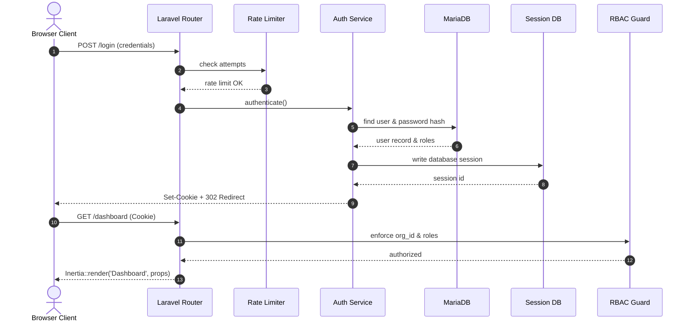

---

### 05. Invoice Creation & Payment Settlement
- **ไฟล์ HTML:** [`05_invoice_creation_payment_sequence.html`](./05_invoice_creation_payment_sequence.html)
- **วัตถุประสงค์:** ลำดับการออกบิล, การคำนวณเงินระดับ `DECIMAL(18,2)`, การบันทึกรับเงินพร้อม Anti-Overpayment Guard และ Audit Log
- **Mermaid Preview:**

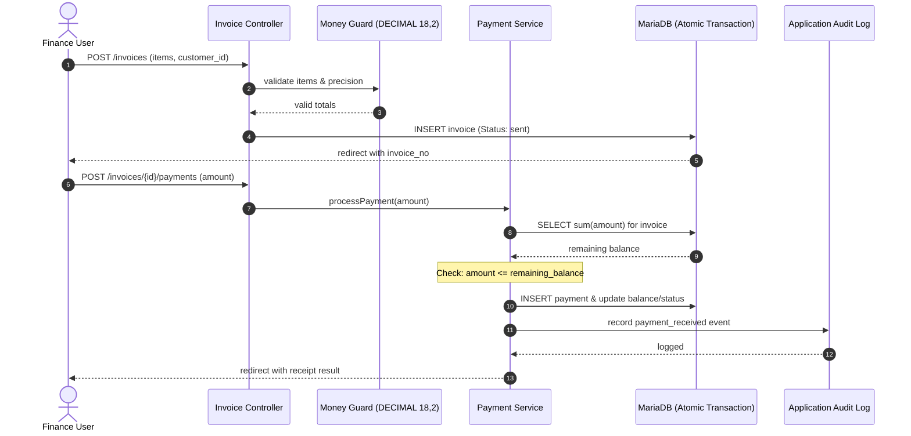

---

### 06. ERP Data Lineage & Pipeline
- **ไฟล์ HTML:** [`06_erp_data_lineage_flow.html`](./06_erp_data_lineage_flow.html)
- **วัตถุประสงค์:** แสดงการเดินทางของข้อมูลใน 5 ลำดับขั้น (Master Data &rarr; Sales Pipeline &rarr; Delivery &rarr; Transactions &rarr; Dashboards)
- **Mermaid Preview:**

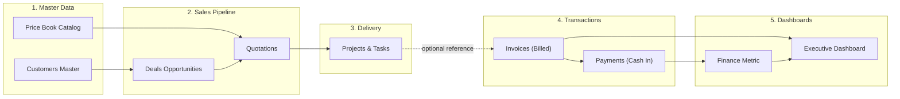

---

### 07. Sales Opportunity & Deal Lifecycle
- **ไฟล์ HTML:** [`07_deal_sales_lifecycle.html`](./07_deal_sales_lifecycle.html)
- **วัตถุประสงค์:** แสดงสถานะ Deal ที่ระบบรองรับ: `new`, `contacted`, `qualified`, `proposal`, `negotiation`, `won`, `lost`
- **Mermaid Preview:**

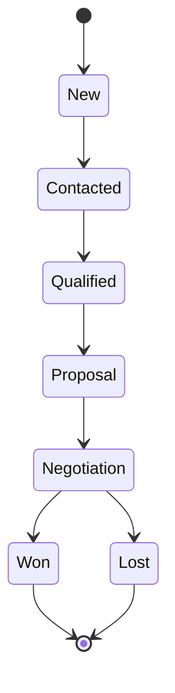

---

### 08. Invoice Status & Payment Lifecycle
- **ไฟล์ HTML:** [`08_invoice_lifecycle.html`](./08_invoice_lifecycle.html)
- **วัตถุประสงค์:** แสดงสถานะ Invoice ที่ระบบรองรับ: `draft`, `sent`, `partially_paid`, `paid`, `overdue`, `void`
- **Mermaid Preview:**

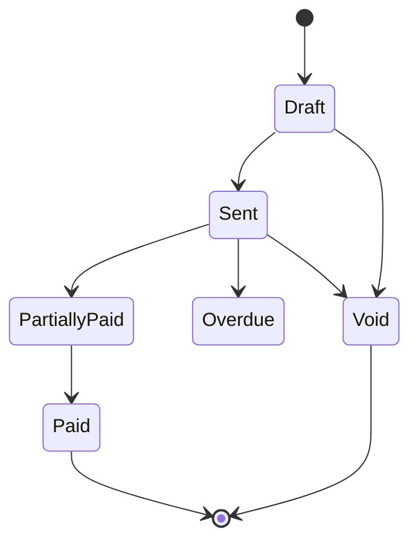

---

### 09. Task Status Lifecycle
- **ไฟล์ HTML:** [`09_task_project_lifecycle.html`](./09_task_project_lifecycle.html)
- **วัตถุประสงค์:** แสดงสถานะ Task ที่ระบบรองรับ: `todo`, `in_progress`, `blocked`, `done`, `cancelled`
- **Mermaid Preview:**

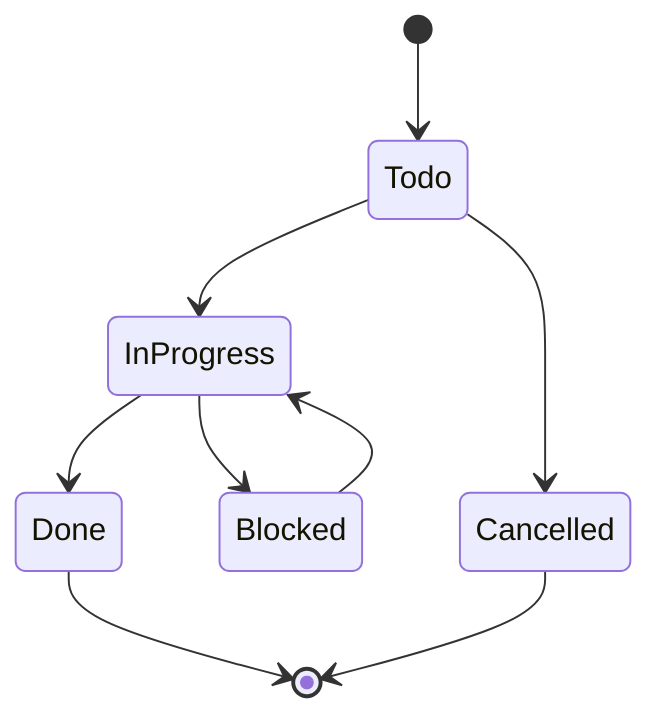

---

### 10. Database ER & Domain Model
- **ไฟล์ HTML:** [`10_database_er_domain_model.html`](./10_database_er_domain_model.html)
- **วัตถุประสงค์:** แสดงความสัมพันธ์ Entity หลักของ ERP: identity, CRM, project, finance, treasury และ general ledger โดยใช้ ordered UUID, `org_id` tenant scope และ decimal money fields
- **Mermaid Preview:**

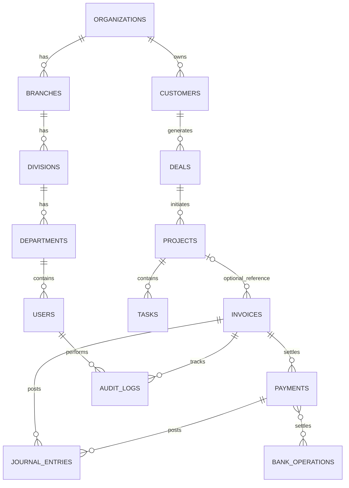

---

### 11. Payroll Policy, Approval & GL Flow
- **ไฟล์ HTML:** [`11_payroll_policy_gl_flow.html`](./11_payroll_policy_gl_flow.html)
- **วัตถุประสงค์:** แสดง Payroll Phase 16B ตามที่ใช้งานจริง: โปรไฟล์เงินเดือนและ policy แบบ effective-dated, การคำนวณ item snapshot, การอนุมัติ, การบันทึก GL แยก accrual/settlement และ output payslip/CSV
- **ขอบเขต:** ใช้ `users`, `employee_payroll_profiles`, `payroll_runs`, `payroll_items` โดย PND1/SSO CSV เป็น workpaper สำหรับตรวจทานก่อนยื่น

---

### 12. Enterprise Document Lifecycle & Compliance
- **ไฟล์ HTML:** [`12_document_management_lifecycle.html`](./12_document_management_lifecycle.html)
- **วัตถุประสงค์:** แสดง DMS ที่ implement แล้ว: private storage แยกองค์กร, SHA256 checksum, scan gate, version history, sensitivity 5 ระดับ, expiry/renewal และ compliance enforcement. ทุก document link/download ต้องผ่าน parent authorization; policy คำนวณ retention/legal hold, scheduler quarantine failed scan/archive และ purge ใช้ explicit command
- **Mermaid Preview:**

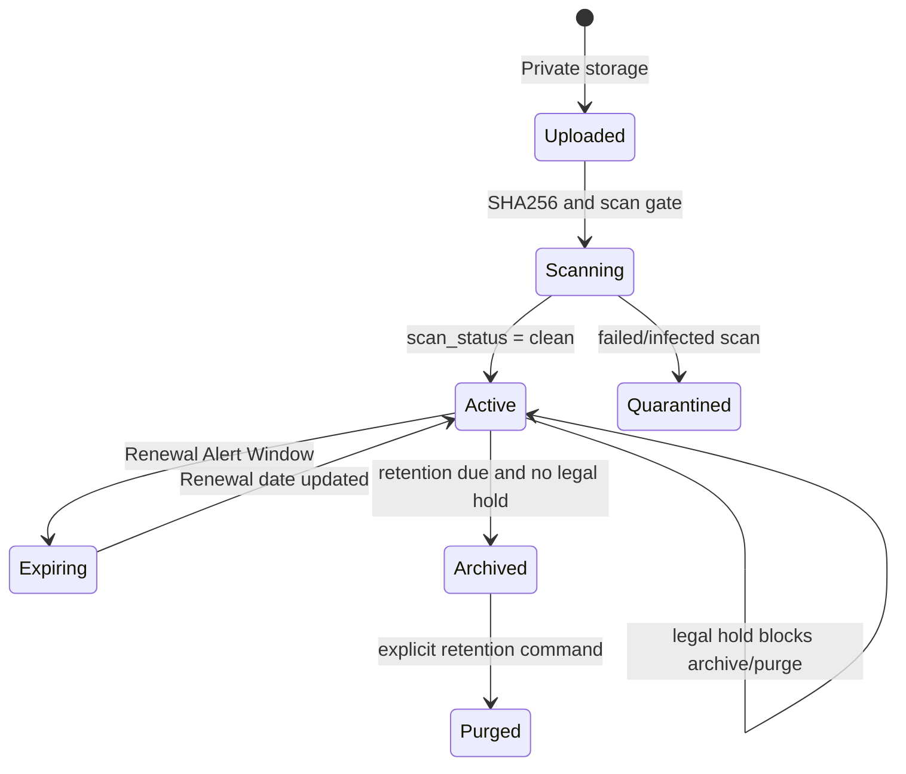

---

### 13. Two-Factor Authentication & Privileged Access Flow
- **ไฟล์ HTML:** [`13_two_factor_auth_sequence.html`](./13_two_factor_auth_sequence.html)
- **วัตถุประสงค์:** แสดง 2FA/TOTP ที่กำหนดได้ใน Organization Settings. Policy ปิดเป็นค่าเริ่มต้น; เมื่อเปิด สามารถบังคับ privileged roles, ใช้ recovery code และ trusted device ตามระยะ 1-90 วันที่ตั้งค่าได้
- **Mermaid Preview:**

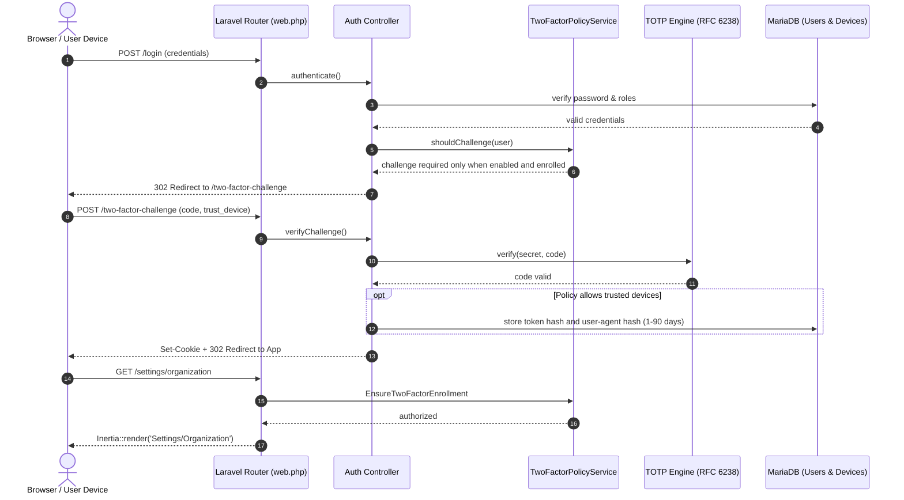

---

### 14. Approval Workflow Instance Lifecycle
- **ไฟล์ HTML:** [`14_approval_workflow_engine.html`](./14_approval_workflow_engine.html)
- **ไฟล์ JSON Spec:** [`specs/14_approval_workflow_engine.json`](./specs/14_approval_workflow_engine.json)
- **วัตถุประสงค์:** แสดงกระบวนการทำงานของ Central Approval Workflow Engine (Phase 20) ตั้งแต่การส่งเอกสารเข้าตรวจ, การจับคู่นิยามและบันทึก snapshot, การตรวจสอบ SoD และการมอบหมายสิทธิ์แทน (Delegation), ลำดับการอนุมัติ (Sequential vs Parallel), ไปจนถึงการสะท้อนสถานะปลายทางและการบันทึกบัญชี GL / คืนสิทธิ์วันลา
- **Mermaid Preview:**

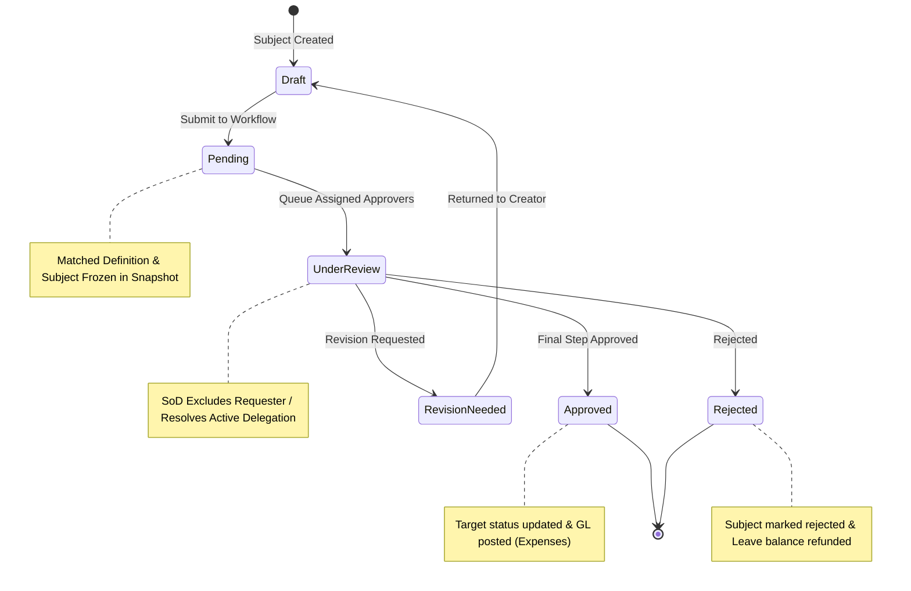

---

### 15. PromptPay Thai QR & Payment Gateway Settlement Flow
- **ไฟล์ HTML:** [`15_payment_gateway_settlement.html`](./15_payment_gateway_settlement.html)
- **ไฟล์ JSON Spec:** [`specs/15_payment_gateway_settlement.json`](./specs/15_payment_gateway_settlement.json)
- **วัตถุประสงค์:** แสดงกระบวนการรับชำระเงินผ่านเกตเวย์และพร้อมเพย์ (Phase 23) ตั้งแต่การขอสร้าง QR พร้อมเพย์ (Tag 29/30) ระบุยอดสตางค์, การสร้าง Charge และดาวน์โหลด Sanitized SVG จาก Opn, การยืนยัน Event ด้วย Secret Key ฝั่งเซิร์ฟเวอร์, ไปจนถึงการรับ Webhook ที่ลงลายมือชื่อ HMAC-SHA256 จาก Settlement Bridge เพื่อลงบัญชี Payment และสมุดรายวันทั่วไป (Double-Entry GL) ใน Transaction เดียวกัน
- **Mermaid Preview:**

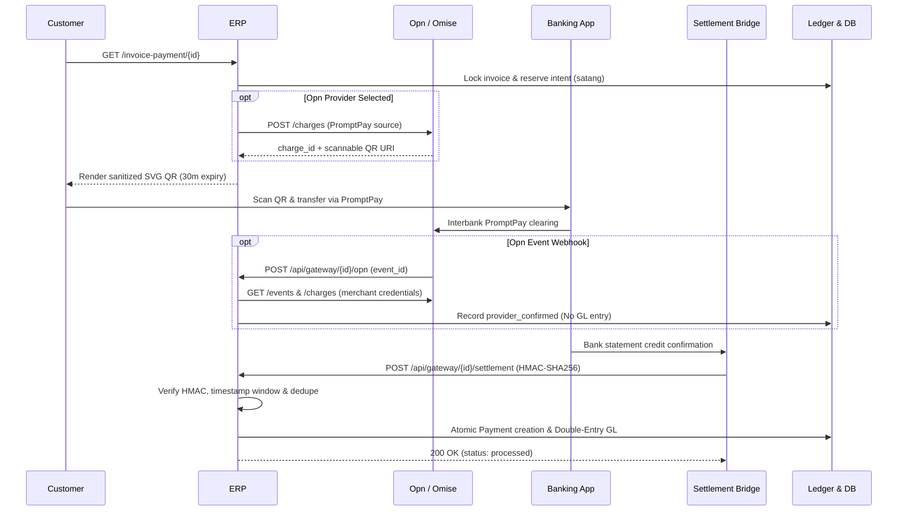

---

### 16. Master Dialog Standard & Editor Lifecycle
- **ไฟล์ HTML:** [`16_master_dialog_editor_lifecycle.html`](./16_master_dialog_editor_lifecycle.html)
- **ไฟล์ JSON Spec:** [`specs/16_master_dialog_editor_lifecycle.json`](./specs/16_master_dialog_editor_lifecycle.json)
- **วัตถุประสงค์:** วงจรสถานะของ Master Create/Edit Dialog and Single Active Editor Lifecycle (Phase 23.1): ควบคุมการเปิด Modal เพียง 1 ตัวผ่าน `useEditorCoordinator`, ตรวจจับการเปลี่ยนแปลงข้อมูล (Comprehensive Deep Dirty Detection), ยืนยันก่อนปิดเมื่อมีข้อมูลที่ยังไม่ได้บันทึก (`confirmUnsavedChanges`), ป้องกันการกดส่งซ้ำฝั่ง Client และรับประกัน Idempotent Backend Submission ผ่าน `EnsureFormSubmission` Middleware + `X-Submission-Key`
- **Mermaid Preview:**

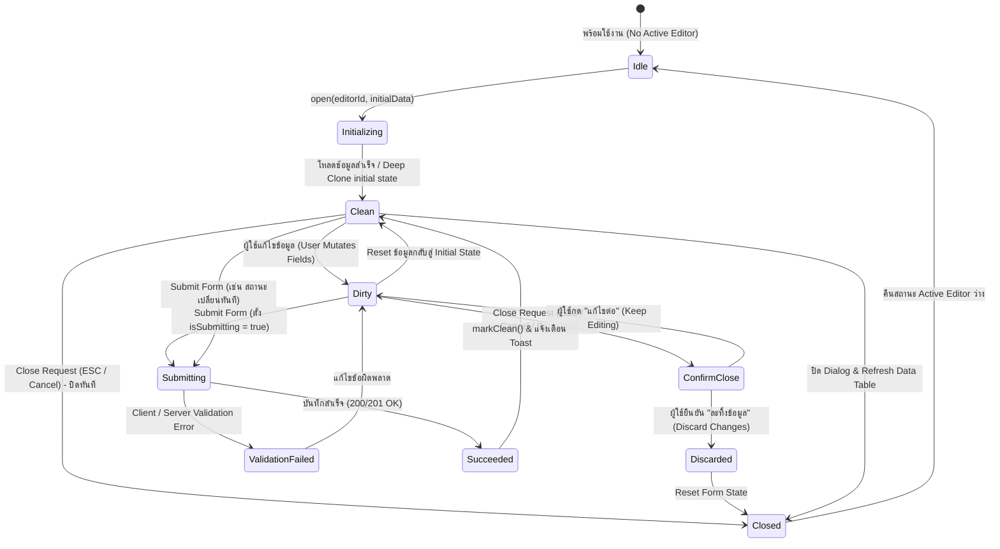

---

### 17. HR Employee, Attendance & Payroll Integration
- **ไฟล์เอกสาร:** [`17_hr_employee_attendance_payroll.md`](./17_hr_employee_attendance_payroll.md)
- **วัตถุประสงค์:** สถาปัตยกรรม HR บุคลากร, ระบบตารางกะ (Shift Roster), นำเข้าเวลาทำงาน (Excel / CSV / Self-Punch), และการคำนวณเงินเดือนสำหรับพนักงานทั้งที่มีและไม่มีบัญชีผู้ใช้ระบบ (Non-User Employees) พร้อมจัดส่ง Payslip PDF ทางอีเมลส่วนตัว
- **Mermaid Preview:**

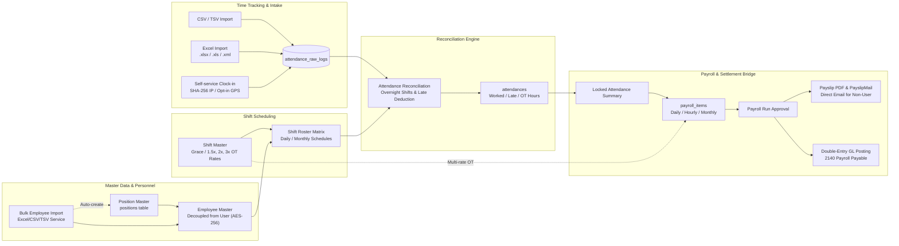

---

### 18. e-Tax Invoice & RD Prep Gateway Architecture
- **ไฟล์เอกสาร:** [`18_etax_gateway_pipeline.md`](./18_etax_gateway_pipeline.md)
- **วัตถุประสงค์:** ไปป์ไลน์จัดเตรียมและนำส่งใบกำกับภาษีอิเล็กทรอนิกส์ e-Tax Invoice / Credit Note ตามมาตรฐาน ETDA พร้อม Enveloped XML-DSig Signature (RSA-SHA256), Queue Worker อัตโนมัติ, Webhook Callback (HMAC-SHA256) และ Cron Inquire Status ทุก 30 นาที
- **Mermaid Preview:**

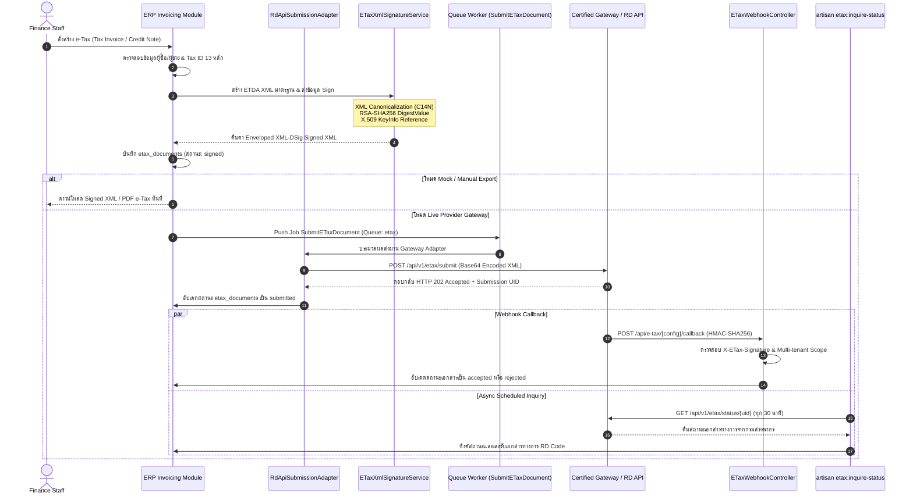

---

### 19. Cash Flow Forecasting & Financial Health Analytics
- **ไฟล์เอกสาร:** [`19_cash_flow_forecasting_engine.md`](./19_cash_flow_forecasting_engine.md)
- **วัตถุประสงค์:** เอนจินวิเคราะห์กระแสเงินสดล่วงหน้า 30-180 วัน จำลอง 3 สถานการณ์ (Base, Best, Worst Scenario) พร้อมการวิเคราะห์อัตราส่วนสภาพคล่อง (CR, QR, DSO, DPO, Runway) และบันทึก Snapshot รายวันอัตโนมัติ
- **Mermaid Preview:**

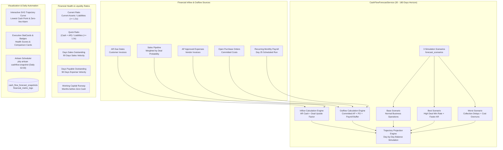

---

### 20. AI OCR Document Ingestion
- **ไฟล์เอกสาร:** [`20_ai_ocr_document_ingestion.md`](./20_ai_ocr_document_ingestion.md)
- **วัตถุประสงค์:** สถาปัตยกรรมสกัดข้อมูลใบเสร็จและใบแจ้งหนี้ด้วย Universal Vision Hub (Local Ollama / Cloud GPT), PDF JPEG extraction, ตรวจสอบเลขประจำตัวผู้เสียภาษี 13 หลักตามสูตร Modulo 11, และหน้าจอ Split-Screen Human Reviewer ยืนยันก่อนแปลงเป็น Draft Expense (ห้าม Auto-GL)
- **Mermaid Preview:**

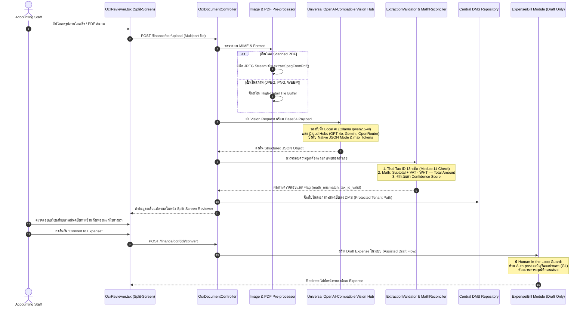

---

### 21. Web Setup Wizard Architecture & Installer Lifecycle
- **ไฟล์เอกสาร:** [`21_setup_wizard_installer_lifecycle.md`](./21_setup_wizard_installer_lifecycle.md)
- **วัตถุประสงค์:** วงจรการติดตั้งระบบผ่านเว็บวิซาร์ด (Setup Wizard 4 ขั้นตอน) และหน้า System Requirements แบบไม่ใช้ token, การตรวจสอบความปลอดภัยล่วงหน้า (Preflight Check & Clean Release), การเขียน `.env` แบบ Atomic ด้วย File Lock (`install.lock`), การรัน Migration 58 ไฟล์, การสร้าง Owner Account พร้อม Master Data และการล็อกการเข้าถึงถาวรด้วย `installed.json`
- **Mermaid Preview:**

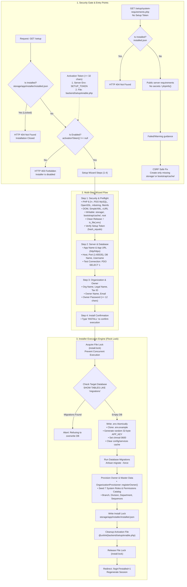

---

### 22. Full Database ER Diagram (70+ Tables)
- **ไฟล์เอกสาร:** [`DATABASE_ERD.md`](./DATABASE_ERD.md)
- **วัตถุประสงค์:** ผังโครงสร้างฐานข้อมูลฉบับสมบูรณ์ 70+ ตาราง ครอบคลุม 21 โดเมน พร้อม Data Types, Primary Keys (UUIDv7), Foreign Keys, กฎ Multi-Tenancy Scoping (`org_id`), และระบบป้องกันส่งซ้ำ `form_submissions`
- **Mermaid Preview (Master Cross-Domain):**

```mermaid
erDiagram
    ORGANIZATIONS ||--o{ BRANCHES : "1:N"
    BRANCHES ||--o{ DIVISIONS : "1:N"
    DIVISIONS ||--o{ DEPARTMENTS : "1:N"
    DEPARTMENTS ||--o{ USERS : "1:N"
    USERS ||--o{ FORM_SUBMISSIONS : "1:N (Phase 23.1)"
    ORGANIZATIONS ||--o{ CUSTOMERS : "1:N"
    CUSTOMERS ||--o{ CONTACTS : "1:N"
    CUSTOMERS ||--o{ DEALS : "1:N"
    DEALS ||--o{ PROJECTS : "1:N"
    PROJECTS ||--o{ TASKS : "1:N"
    CUSTOMERS ||--o{ INVOICES : "1:N"
    INVOICES ||--o{ PAYMENTS : "1:N"
    SUPPLIERS ||--o{ PURCHASE_ORDERS : "1:N"
    WAREHOUSES ||--o{ WAREHOUSE_BINS : "1:N"
    WAREHOUSES ||--o{ STOCK_MOVEMENTS : "1:N"
    ORGANIZATIONS ||--o{ POSITIONS : "1:N (Phase 23.3)"
    ORGANIZATIONS ||--o{ EMPLOYEES : "1:N (Phase 23.3)"
    POSITIONS ||--o{ EMPLOYEES : "1:N"
    EMPLOYEES ||--o{ EMPLOYEE_SHIFT_SCHEDULES : "1:N"
    SHIFT_TEMPLATES ||--o{ EMPLOYEE_SHIFT_SCHEDULES : "1:N"
    EMPLOYEES ||--o{ ATTENDANCES : "1:N"
    USERS ||--o| EMPLOYEE_PAYROLL_PROFILES : "0..1:1"
    PAYROLL_RUNS ||--o{ PAYROLL_ITEMS : "1:N"
    ORGANIZATIONS ||--o{ DOCUMENTS : "1:N"
    DOCUMENTS ||--o{ DOCUMENT_VERSIONS : "1:N"
    DOCUMENTS ||--o{ DOCUMENT_LINKS : "1:N"
    USERS ||--o{ TWO_FACTOR_TRUSTED_DEVICES : "1:N"
    ORGANIZATIONS ||--o{ WORKFLOW_DEFINITIONS : "1:N"
    WORKFLOW_DEFINITIONS ||--o{ WORKFLOW_STEPS : "1:N"
    WORKFLOW_DEFINITIONS ||--o{ WORKFLOW_INSTANCES : "1:N"
    WORKFLOW_INSTANCES ||--o{ WORKFLOW_APPROVALS : "1:N"
    ORGANIZATIONS ||--o{ WORKFLOW_DELEGATIONS : "1:N"
    ORGANIZATIONS ||--o{ NOTIFICATION_CHANNELS : "1:N"
    NOTIFICATION_CHANNELS ||--o{ NOTIFICATION_OUTBOX : "1:N"
    CUSTOMERS ||--o{ PORTAL_USERS : "1:N"
    PORTAL_USERS ||--o{ PORTAL_SESSIONS : "1:N"
    ORGANIZATIONS ||--o| PAYMENT_GATEWAY_CONFIGS : "1:1"
    PAYMENT_GATEWAY_CONFIGS ||--o{ GATEWAY_TRANSACTIONS : "1:N"
    PAYMENT_GATEWAY_CONFIGS ||--o{ WEBHOOK_EVENTS : "1:N"
    ORGANIZATIONS ||--o| ETAX_CONFIGURATIONS : "1:1 (Phase 24)"
    ETAX_CONFIGURATIONS ||--o{ ETAX_DOCUMENTS : "1:N"
    ETAX_DOCUMENTS ||--o{ ETAX_SUBMISSION_ATTEMPTS : "1:N"
    ORGANIZATIONS ||--o{ FORECAST_SCENARIOS : "1:N (Phase 25)"
    ORGANIZATIONS ||--o{ CASH_FLOW_FORECAST_SNAPSHOTS : "1:N"
    ORGANIZATIONS ||--o{ FINANCIAL_METRIC_LOGS : "1:N"
    ORGANIZATIONS ||--o| AI_CONFIGURATIONS : "1:1 (Phase 26)"
    ORGANIZATIONS ||--o{ OCR_EXTRACTIONS : "1:N"
    OCR_EXTRACTIONS ||--o{ OCR_FIELD_RESULTS : "1:N"
```

---

### 23. 6 Domain Group Workflows (31 Modules)
- **ไฟล์เอกสาร:** [`GROUPS_WORKFLOW.md`](./GROUPS_WORKFLOW.md)
- **วัตถุประสงค์:** ผังกระบวนการทำงานและวงจรสถานะเจาะลึก 6 กลุ่มงานหลัก ครอบคลุมทั้ง 31 โมดูล พร้อมส่วนต่อขยาย Phase 23.2-26 และ Setup Wizard (รวม 25+ Mermaid Diagrams พร้อมคำอธิบายภาษาไทย)
- **Mermaid Preview (Inter-Group Interaction):**

```mermaid
flowchart LR
    G1["1. Foundation & Security"] --> G2["2. CRM & Sales"]
    G2 --> G3["3. Project Delivery"]
    G2 --> G4["4. Finance & Billing"]
    G3 -. Milestone Done .-> G4
    G4 --> G5["5. Insights & Dashboard"]
    G4 -. Procure/Sync .-> G6["6. Operations & Extensions"]
```

---

## 🛠️ วิธีการเปิดดูและใช้งาน

1. **เปิดผ่านเบราว์เซอร์:**
   - ดับเบิลคลิกไฟล์ [`document/index.html`](./index.html) หรือไฟล์ `.html` ใดๆ เพื่อเปิด interactive viewer ในเบราว์เซอร์
   - สามารถกดปุ่มสลับ **Light / Dark mode**, **Focus View**, **Pan & Zoom**, และ **Export เป็น SVG / PNG / WebP** ได้ทันที
2. **เปิดดูเอกสารผังรายกลุ่มและ ERD:**
   - ผังการทำงาน 6 กลุ่มโมดูล (31 Modules): [`document/GROUPS_WORKFLOW.md`](./GROUPS_WORKFLOW.md)
   - ผังฐานข้อมูล 61+ ตาราง: [`document/DATABASE_ERD.md`](./DATABASE_ERD.md)
3. **แก้ไขหรือสร้างใหม่:**
   - ไฟล์ JSON Specification อยู่ในโฟลเดอร์ [`document/specs/`](./specs/)
   - สามารถรันคำสั่ง `node <archify-path>/bin/archify.mjs deliver <type> <spec.json> <output.html> --quality showcase --json` เพื่อ render ใหม่ได้ตลอดเวลา
