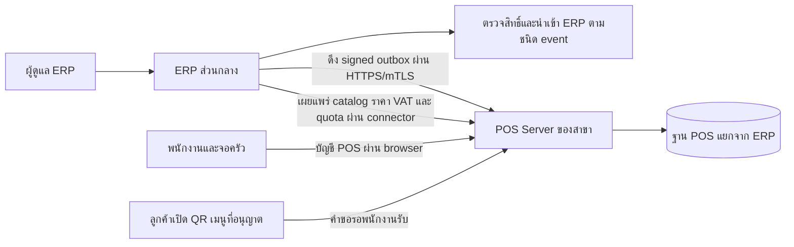

# ติดตั้ง ตั้งค่า และใช้งาน POS

อัปเดต 2026-11-05 ถึง **Phase 28.8.5** ในขอบเขต local ระบบ POS ทำงานแยกจาก ERP ทั้งบัญชีผู้ใช้ ฐานข้อมูล session และ APP_KEY ผลอัปเดตฐานที่บันทึกไว้ล่าสุดคือ POS SQLite 25/25 migrations และ ERP 88/88 [รายงานฐาน POS](DATABASE_UPDATE_20261105_PHASE28_8_5.md)

> **ยังไม่ได้ทดสอบกับระบบและอุปกรณ์จริง** รวมเครือข่ายระหว่าง ERP กับ POS, HTTPS/mTLS, มือถือสแกน QR, เครื่องพิมพ์, เครื่องสแกน และ e-Tax provider ขั้นตอนด้านล่างใช้กับ local หรือข้อมูลสังเคราะห์

## เลือกประเภทร้าน

เปิด POS ที่ **http://127.0.0.1:8128/** ทั้งสามประเภท ระบบเลือกหน้าทำงานจาก `business_type` ของสาขาที่บัญชี POS สังกัด และแสดงฟังก์ชันตาม role กับ flags ของเครื่องนั้น

| ประเภท | ค่า `business_type` | เปิดฟังก์ชันหลักใน local | คู่มือและ diagram |
| --- | --- | --- | --- |
| ร้านขายของทั่วไป | `retail` | หน้าขายเงินสดของ POS | [ขายสินค้า คืนเงิน และปิดกะ](README_POS_RETAIL.md#workflow) |
| ร้านอาหาร | `restaurant` | `POS_LOCAL_RESTAURANT_ENABLED=true` | [โต๊ะ คิวครัว จองโต๊ะ และ QR](README_POS_RESTAURANT.md#workflow) |
| ร้านขายยา | `pharmacy` | `POS_LOCAL_PHARMACY_ENABLED=true` | [จ่ายยา ตรวจของคืน และประวัติผู้ป่วย](README_POS_PHARMACY.md#workflow) |

สาขาต่างประเภทใช้แอป `pos/` เดียวกัน แต่ให้สร้างสาขา Terminal และบัญชีตามสาขาจริง เปิดเครื่องหรือสลับสาขาทดลองด้วยบัญชี POS ของสาขานั้น การใช้หลายแท็บใน browser profile เดียวกันจะแชร์ session

## ภาพรวม ERP กับ POS Server



ERP เป็นแหล่งข้อมูลสินค้า ราคา และสิทธิ์ขาย ส่วน POS Server ยืนยันกะ บิล คิวครัว และการจัดโต๊ะของสาขา POS ไม่เขียนฐาน ERP ตรง เมื่อดูหน้า local ด้วย HTTP จะทดสอบ UI ได้ แต่การ publish และ sync ผ่าน connector ต้องตั้งค่า HTTPS/mTLS แยก

## ติดตั้ง POS local

ต้องมี PHP 8.3 ขึ้นไปพร้อม Composer และ extensions ที่ lockfile กำหนด เช่น BCMath และ OpenSSL สำหรับ SQLite ใช้ PDO SQLite ด้วย ส่วน frontend ใช้ Node.js ที่รองรับ Vite และ pnpm ตาม `pos/package.json`

จาก repository root ใน PowerShell ติดตั้ง dependencies ของ POS เองและ build หน้าเว็บ

```powershell
Set-Location pos
composer install
pnpm install --frozen-lockfile
pnpm run build

# สร้าง config เฉพาะเมื่อติดตั้งใหม่
if (-not (Test-Path .env)) { Copy-Item .env.example .env }
```

เครื่องพัฒนาที่เตรียม dependencies ของ ERP แล้วสามารถใช้ PHP vendor ร่วมชั่วคราวด้วย `$env:POS_SHARED_VENDOR = '1'` และจาก repository root ใช้ `node backend/node_modules/vite/bin/vite.js build --config pos/vite.config.mjs` ฐานข้อมูล session และ credentials ของสองแอปยังแยกกัน สำหรับการติดตั้ง POS แยกให้ใช้ lockfiles ของ POS ตามคำสั่งหลักด้านบน

ตั้งค่าต่อไปนี้ใน `pos/.env` ตัวอย่างใช้ HTTP บน loopback และ SQLite ให้แก้ path เป็นฐานที่ตั้งใจใช้ก่อนรัน Artisan

```dotenv
APP_ENV=local
APP_DEBUG=false
APP_URL=http://127.0.0.1:8128
DB_CONNECTION=sqlite
DB_URL=
DB_DATABASE=C:/LocalDevine/www/ERP/pos/database/database.sqlite
SESSION_DRIVER=file
SESSION_COOKIE=pos_session
SESSION_SECURE_COOKIE=false
POS_RELEASE_APPROVED=false
```

`SESSION_SECURE_COOKIE=false` ใช้เฉพาะตัวอย่าง HTTP loopback สำหรับ HTTPS ให้ตั้ง `true` ใช้ APP_KEY ของ POS เองและเก็บสำรองไว้ด้วย เพราะข้อมูลที่เข้ารหัสต้องใช้ key เดิม ตั้งค่า `POS_INSTANCE_ID`, `POS_SIGNING_KEY_ID` และ `POS_SIGNING_KEY_PATH` จากข้อมูล provisioning เมื่อใช้ signed outbox หรือ connector เก็บ RSA private key ใน private storage และส่งให้ ERP เฉพาะ public key ที่ตรงกัน

จาก `pos/` สร้างไฟล์ SQLite ตาม path ใน config เฉพาะฐานใหม่ แล้วรันขั้นตอนต่อไปนี้

```powershell
# เฉพาะฐานใหม่ที่ใช้ path ตัวอย่าง
if (-not (Test-Path database/database.sqlite)) {
    New-Item -ItemType File database/database.sqlite | Out-Null
}

php artisan config:clear
# เฉพาะติดตั้งใหม่และ APP_KEY ยังว่าง
php artisan key:generate
php artisan migrate
php artisan migrate:status
```

สำหรับฐานที่มีอยู่ ให้ข้าม `key:generate` ตรวจ connection และสำรองฐานก่อน migrate เมื่อมีรายการค้าง ใช้ `migrate:status` ตรวจผล หลีกเลี่ยง `migrate:fresh` บนฐานใช้งาน

## สร้างและตั้งค่าสาขา

### POS Setup Wizard สำหรับสาขาแรก

1. ตั้งค่า `pos/.env`, สร้าง `APP_KEY` สำหรับฐานใหม่ และรัน `php artisan migrate` จาก `pos/` ตามขั้นตอนด้านบน
2. ตั้ง `APP_ENV=local` และเพิ่ม `POS_SETUP_TOKEN` เป็น token สุ่มอย่างน้อย 32 ตัวอักษรใน `pos/.env` แล้วรัน `php artisan config:clear`
3. เปิด POS บน loopback ตามตัวอย่างด้านล่าง แล้วเข้า `http://127.0.0.1:8128/setup` กรอกรหัสและชื่อสาขา ประเภทกิจการ รหัส Terminal และบัญชี Manager พิมพ์ `INSTALL` เพื่อยืนยัน
4. เมื่อสำเร็จ ลบ `POS_SETUP_TOKEN` แล้วรัน `php artisan config:clear` เข้าหน้าขายด้วย Manager ที่สร้าง และตั้ง ERP provisioning, catalog และ quota ตามขั้นตอนเดิมก่อนขาย

Wizard ใช้ได้เฉพาะ local/testing จาก loopback และฐานที่ยังไม่มีสาขา Terminal หรือบัญชีพนักงาน การสร้าง Terminal ล็อกประเภทกิจการตามกติกาเดิม และบัญชี Manager สำหรับร้านขายยายังต้อง provision คุณวุฒิแยกตามคู่มือร้านขายยา

### สร้างผ่าน CLI

ตัวอย่างสร้างสาขา Retail ครั้งแรกจาก `pos/` ใช้ UUID เดิมเมื่อสาขาหรือ Terminal มีอยู่แล้ว คำสั่ง `pos:staff` ถามชื่อและรหัสผ่านผ่าน terminal

```powershell
$branch = [guid]::NewGuid().ToString()
$terminal = [guid]::NewGuid().ToString()
php artisan pos:branch $branch RT01 "ร้านค้าทดลอง" --type=retail
php artisan pos:terminal $terminal $branch T01
php artisan pos:staff $branch manager.retail@pos.test --role=manager
php artisan pos:staff $branch cashier.retail@pos.test --role=cashier
```

ร้านอาหารเพิ่ม role `kitchen` และร้านขายยาเพิ่ม `pharmacist` หรือ Manager ที่ provision ด้วย `--pharmacist-qualified` ตามคู่มือของแต่ละประเภท เก็บ UUID ของสาขา Terminal และ staff เพื่อใช้ mapping และ provision authority ฝั่ง ERP

### หน้า Config สำหรับผู้จัดการ

เปิด POS แล้ว login ด้วย Manager กด **ตั้งค่า POS** หรือเข้า **http://127.0.0.1:8128/config** ใช้ใน local/testing ผ่าน loopback

| ตั้งที่ไหน | งานที่ทำ |
| --- | --- |
| POS `/config` | ดู instance, flags และ UUID เพิ่ม Terminal และพนักงาน เปลี่ยนชื่อสาขาและเลือกประเภทได้ก่อนมี provisioning ที่ล็อกประเภท บันทึกด้วยรหัสผ่าน Manager |
| `pos/.env` และ private storage | เลือกฐานและ URL ตั้ง feature flags, instance และกุญแจ แล้ว `php artisan config:clear` และเปิด process ใหม่ |
| ERP `/pos-integration` และ provisioning | ตั้ง branch/warehouse, Terminal, staff authority, public key, account mappings, catalog และ quota |
| คู่มือประเภทร้าน | ตรวจเมนูและ recipe ของร้านอาหาร หรือ unit conversion, lot, expiry และ policy ของร้านขายยา |

หน้า Config จัดการเฉพาะสาขาที่บัญชีสังกัด การตั้ง flags, keys, catalog, quota และ issuer profile ทำผ่านผู้ดูแลระบบตามขอบเขตด้านบน [รายละเอียด Config และ diagram](POS_CONFIGURATION.md)

ก่อนขาย ให้ตรวจว่าสาขา Terminal และบัญชีใช้งานได้ มี catalog ที่ยังไม่หมดอายุ มี quota ของสินค้า/วัตถุดิบ และมี issuer profile ถ้าเปิด ABB/FULL สำหรับการเชื่อม ERP ให้ตั้ง connector allowlist และ mTLS ตาม [Operations](../docs/PHASE_28_OPERATIONS.md) แล้วจึงใช้ `php artisan pos:sync <INSTANCE_UUID>` จาก `backend/` ตาม runbook

## เปิดใช้และตรวจความพร้อม

บนหน้าขาย เลือก **สว่าง / มืด / ตามระบบ** ที่แถบด้านบนของ POS การตั้งค่านี้จำในเบราว์เซอร์ของเครื่องขาย และใช้ต่อในหน้า Config, Delivery, สมาชิก, ผู้ป่วย, เมนู และ Offline บน URL ต้นทางเดียวกัน เอกสารพิมพ์ใช้พื้นขาว

หน้า POS ใช้ Sarabun ที่มากับ release ใน `pos/public/fonts/` พร้อมไฟล์ `OFL.txt` เมื่อเปิดหน้า Offline ทางออนไลน์ครั้งแรก service worker จะเตรียมฟอนต์ตัวปกติและตัวหนาไว้กับหน้าคิว

ลิงก์ **ขาย / เปิดกะ** พาไปยังหน้าที่ใช้เปิดกะหรือเลือกสินค้าและรับเงิน ร้านอาหารมีทางลัดไปผังโต๊ะและคิวครัว ร้านขายยากดดูรหัสล็อตและวันหมดอายุในตะกร้าได้เมื่อสาขามีล็อตที่ยังขายได้

ร้านค้าทั่วไปและร้านขายยาที่เปิดขายบน POS Server กด **ดูยอดก่อนส่วนลด** หลังเพิ่มสินค้าเพื่อดูยอดสินค้า VAT และยอดรวม เมื่อแก้ตะกร้าให้กดดูยอดใหม่ ระบบจะบันทึกการขายเมื่อยืนยันรับเงินสด

```powershell
# จาก pos/
php artisan serve --host=127.0.0.1 --port=8128
```

เปิด `/` ด้วยบัญชี POS เลือก Terminal และเปิดกะก่อนรับเงิน ร้านอาหารใช้ **โต๊ะและครัว** และร้านขายยาใช้บัญชีตามข้อกำหนดของสินค้า เมื่อขายได้แล้วให้ตรวจใบเสร็จ ปิดกะ และติดตามสถานะรอ ERP หากตั้ง connector ไว้

| อาการ | ตรวจจุดนี้ก่อน |
| --- | --- |
| หน้าว่างหรือหา Vite manifest ไม่พบ | รัน `pnpm run build` จาก `pos/` |
| Login ไม่ผ่านหรือเข้าอีกประเภทร้าน | บัญชี POS, active staff, role และ `business_type` ของสาขา |
| ไม่เห็นเมนูที่ต้องการ | flags, local/testing, role, branch type และ loopback สำหรับหน้าที่กำหนด |
| ไม่มีสินค้าหรือขายไม่ได้ | catalog version/expiry, quota, กะ, lot/recipe และ issuer profile ถ้าเปิดเอกสารภาษี |
| รอ ERP | connector scopes, mappings, signed outbox และสถานะ review ดู [คู่มือปฏิบัติการ](../docs/PHASE_28_OPERATIONS.md) |

## Feature flags ที่ใช้บ่อย

ค่าเริ่มต้นของ flags ด้านล่างปิด เปิดเฉพาะงานที่ต้องทดลองใน `pos/.env` แต่ละ capability ยังตรวจ role และประเภทสาขาของตัวเอง

| งาน | Flag หรือค่าที่ต้องใช้ |
| --- | --- |
| คิวครัว โต๊ะ และจองโต๊ะ | `POS_LOCAL_RESTAURANT_ENABLED` |
| เมนู QR Retail/Restaurant | `POS_LOCAL_PUBLIC_MENU_ENABLED` และ SKU `online_visible` สำหรับมือถือบน LAN ของร้านอาหารดู [Private HTTPS LAN](PHASE_28_8_5_RESTAURANT.md#ติดตั้ง-local) |
| ขายยา ตรวจคืน Recall | `POS_LOCAL_PHARMACY_ENABLED`, `POS_LOCAL_RETURN_INSPECTIONS_ENABLED`, `POS_LOCAL_RECALLS_ENABLED` ตามงาน |
| ประวัติผู้ป่วยสังเคราะห์ | `POS_LOCAL_PHARMACY_ENABLED` และ `POS_LOCAL_PATIENT_HISTORY_ENABLED` |
| ส่วนลด เงินเข้าออก คืนเงิน | `POS_LOCAL_DISCOUNTS_ENABLED`, `POS_LOCAL_CASH_MOVEMENTS_ENABLED`, `POS_LOCAL_REFUNDS_ENABLED` ตามงาน และเปิดฝั่ง ERP เมื่อ flow กำหนด |
| สมาชิก/โปรโมชัน | `POS_LOCAL_MEMBERSHIP_ENABLED` และข้อมูลที่ ERP เผยแพร่ |
| จัดส่ง Retail/Restaurant | `POS_LOCAL_DELIVERY_ENABLED` ร้านขายยาปิด Delivery |
| Offline | `POS_LOCAL_BROWSER_OFFLINE_ENABLED` และ permit/นโยบายจาก POS Server |
| ABB/FULL local | `POS_LOCAL_TAX_DOCUMENTS_ENABLED` และ issuer profile |

[ค่าที่รองรับทั้งหมด](../pos/.env.example) · [คู่มือ Delivery](PHASE_28_8_1_DELIVERY.md) · [สมาชิก](PHASE_28_8_2_MEMBERSHIP.md) · [Offline](PHASE_28_8_3_OFFLINE.md) · [ประวัติผู้ป่วย](PHASE_28_8_4_PATIENT_HISTORY.md)

## ทดลองด้วยข้อมูลสังเคราะห์

ตัวเลือกนี้ใช้ PHP vendor ของ ERP และฐาน fixture แยกที่ `temp/phase28-pos-browser/database.sqlite` สำหรับดูหน้าจอ ไม่ต้องสร้างสาขาจริง จาก repository root

```powershell
node backend/node_modules/vite/bin/vite.js build --config pos/vite.config.mjs
Set-Location pos
php tests/Browser/prepare.php
php tests/Browser/prepare-restaurant.php
php tests/Browser/prepare-pharmacy.php
php -S 127.0.0.1:8128 -t public tests/Browser/router.php
```

| ประเภท | บัญชี fixture |
| --- | --- |
| Retail | `cashier@pos.test` หรือ `manager@pos.test` |
| Restaurant | `restaurant@pos.test` |
| Pharmacy | `pharmacy-manager@pos.test` สำหรับ workflow ตรวจของคืน |

ใช้รหัสผ่าน `local-fixture-password` เฉพาะ fixture นี้ สคริปต์เก็บข้อมูลเดิมไว้และบางตัวสร้างรายการสังเคราะห์เพิ่ม อย่าใช้ fixture ที่ปิดหรือถอนกุญแจแล้วเป็นฐานขาย หยุด process ด้วย Ctrl+C โหมดนี้ไม่เชื่อม ERP จริง

[Diagrams ใช้งาน POS แบบ HTML](24_pos_workflows.html) · [POS workspace และคำสั่งนักพัฒนา](../pos/README.md) · [API](PHASE_28_API.md) · [Schema](PHASE_28_DATABASE.md) · [ผลตรวจล่าสุด](acceptance/phase28_8_5/README.md)
