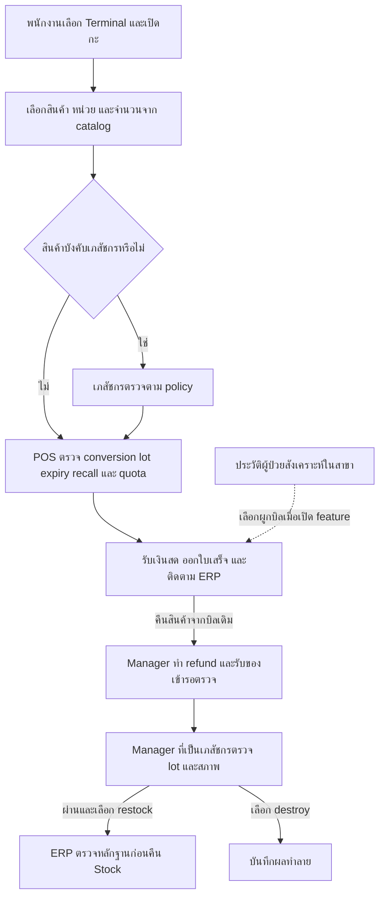

# README — ใช้ POS ร้านขายยา

คู่มือ local สำหรับขายยา ตรวจของคืน และประวัติผู้ป่วยสังเคราะห์ใน Phase 28.8.4 [หลักฐานตรวจรับ](acceptance/phase28_8_4/README.md)

> **ยังไม่ได้ทดสอบกับระบบและอุปกรณ์จริง** ใช้คู่มือนี้กับ local หรือข้อมูลสังเคราะห์

## เรียกใช้และสิทธิ์

เปิด **http://127.0.0.1:8128/** ตาม [คู่มือกลาง](README_POS.md), สาขา `business_type=pharmacy`, `APP_ENV=local`, `POS_LOCAL_PHARMACY_ENABLED=true`. ใช้หน้า `/` เดียวกับ POS ประเภทอื่น; สาขาและบัญชีเป็นตัวกำหนด workflow

| งาน | เงื่อนไขตามโค้ด |
| --- | --- |
| ขายสินค้าทั่วไปที่ไม่กำหนดเภสัชกร | cashier/manager/pharmacist ตาม policy สินค้า |
| ขายสินค้าที่ `requires_pharmacist=true` | ต้องใช้ role `pharmacist` |
| ตรวจของคืน เลือก restock/destroy | role `manager` + `pharmacist_qualified=true` และเปิด inspection feature |

**Qualified manager ไม่แทน role pharmacist ในการขายสินค้าที่บังคับเภสัชกร**. ระบบตรวจคืนกับระบบจ่ายยามีเงื่อนไขสิทธิ์แยกกัน; ผู้ดูแลต้อง provision authority ฝั่ง ERP ให้ตรงด้วย

Fixture `pharmacy-manager@pos.test` เป็นตัวอย่างผู้จัดการที่ตรวจคืนได้ เตรียมของรอตรวจไว้แล้ว แต่ไม่ใช่บัญชี pharmacist สำหรับขายสินค้าที่บังคับ role นั้น

## สร้างสาขาของตนเองครั้งแรก

จาก `pos/` หลังตั้ง environment/dependencies ตามคู่มือกลาง:

```powershell
$posBranchId = [guid]::NewGuid().ToString()
$posTerminalId = [guid]::NewGuid().ToString()
php artisan pos:branch $posBranchId PH01 "ร้านขายยาทดลอง" --type=pharmacy
php artisan pos:terminal $posTerminalId $posBranchId T01
php artisan pos:staff $posBranchId pharmacist@pos.test --role=pharmacist
php artisan pos:staff $posBranchId cashier.pharmacy@pos.test --role=cashier
php artisan pos:staff $posBranchId manager.pharmacy@pos.test --role=manager --pharmacist-qualified
```

`--pharmacist-qualified` เป็นค่าที่ผู้ดูแลระบุ ไม่ใช่ระบบตรวจรับรองคุณวุฒิจริง. ผูก UUID/role/qualification ของ POS กับ ERP staff authority ให้ถูกบุคคล ไม่ให้แคชเชียร์กำหนดสิทธิ์ตัวเอง

## Workflow



ก่อนเริ่มกะ ตรวจว่า lot และวันหมดอายุถูก provision และมีผู้ใช้ role `pharmacist` สำหรับสินค้าที่บังคับสิทธิ์ ส่วนการตรวจของคืนใช้บัญชี `manager` ที่ provision `pharmacist_qualified` การจัดส่งและ QR เมนูสำหรับลูกค้าปิดใน Pharmacy

เมื่อทดลองประวัติผู้ป่วย ให้เปิด `POS_LOCAL_PATIENT_HISTORY_ENABLED=true` ร่วมกับ Pharmacy flag แล้วเข้า **ประวัติผู้ป่วย** ที่ `/patients` เภสัชกรหรือ Manager ที่มีคุณสมบัติสร้างและแก้ทะเบียนได้ Cashier เลือกจากรหัสและชื่อที่ mask เพื่อผูกบิล ข้อมูลสังเคราะห์อยู่เฉพาะ POS Server ของสาขา แยกจาก ERP และ offline queue [คู่มือประวัติผู้ป่วย](PHASE_28_8_4_PATIENT_HISTORY.md)

## เตรียมสินค้าและ lot ก่อนขาย

ผู้ดูแล publish catalog และ pharmacy policy ได้แก่หน่วยฐาน หน่วยขาย factor/ราคา/conversion version, `base_step`, เงื่อนไขเภสัชกร พร้อม grant/lot/expiry ที่ใช้ขาย. รายการที่หน้า ERP ยังไม่มีฟอร์มตั้งค่าต้อง provision ให้ครบก่อน publish; ไม่ตั้ง conversion หรือยอมรับราคาเองจากตะกร้า

เปิด `POS_LOCAL_RETURN_INSPECTIONS_ENABLED=true` เมื่อต้องตรวจคืน และ `POS_LOCAL_REFUNDS_ENABLED=true` เมื่อต้องคืนเงิน; ฝั่ง ERP ต้องเปิด feature ที่สอดคล้องกัน. Recall ต้องเปิด/ส่งคำสั่งผ่านผู้ดูแล ERP ไม่ใช่การปรับยอด lot ใน browser

## ขายหน้าร้าน

1. Login ด้วย staff ของสาขา เลือก Terminal และเปิดกะ (รองรับโหมด `Light / Dark / System`)
2. ค้นหา/สแกนสินค้า เพิ่มเข้าตะกร้า แล้วเลือกหน่วยขายที่ publish ไว้ เช่น กล่อง/แผง/เม็ดหรือหน่วยปริมาตรของสินค้านั้น โดยหน้าตะกร้าจะแสดงป้ายเตือนรายการที่ต้องตรวจโดยเภสัชกร พร้อมรหัสล็อตและวันหมดอายุ (FEFO) จากโควตาสาขาที่พร้อมขาย
3. ตรวจจำนวนและราคาต่อหน่วย. ระบบแปลงเป็นหน่วยฐานและตรวจ precision/base_step; ถ้าจำนวนแทนค่าไม่ได้ให้แก้รายการ ไม่ปัดเศษเองให้ผ่าน
4. สินค้าที่บังคับเภสัชกรต้องใช้ pharmacist login. Manager ที่มี qualification สำหรับตรวจคืนยังขายสินค้ากลุ่มนี้ด้วย manager role ไม่ได้
5. ระบบเลือก lot จาก grant ตาม expiry policy และบล็อก lot หมดอายุ/recall/quota ไม่พอ. ตรวจเลขบิลและ lot ที่ส่งมอบตามหลักฐานของรายการ
6. รับเงินสด ยืนยันรายการ ตรวจเงินทอนและ receipt. ภาษี/การพิมพ์ทดสอบใช้ workflow กลางเมื่อ issuer profile พร้อม (หน้าพิมพ์สลิป/ใบกำกับภาษีใช้พื้นขาว `#FFFFFF` เสมอทั้งโหมดสว่างและมืด)

Phase28.8.4 เพิ่มประวัติผู้ป่วยแบบ local synthetic-only: ทะเบียน/แพ้ยาที่บันทึกเอง/บันทึกรับบริการ/ผูกบิล เข้ารหัสเฉพาะสาขา ไม่ sync ERP หรือ offline. เภสัชกรและ Manager ที่ pharmacist_qualified อ่าน/แก้ได้; cashier เห็นรหัส/ชื่อ mask. ดู [คู่มือและ diagram](PHASE_28_8_4_PATIENT_HISTORY.md). ยังไม่เปิดรับข้อมูลจริงและไม่มี automated allergy/diagnosis guard. ใบสั่งยาแนบมีเฉพาะ local synthetic fixture ตาม hash allowlist และ scanner policy; ไม่ใช้ช่องทดลองนี้รับไฟล์หรือข้อมูลผู้ป่วยจริง

## คืนเงินและตรวจของคืน

1. Manager ทำ refund จากบิลต้นฉบับ เลือกจำนวนคืนเงินและจำนวนสินค้าที่รับคืน ระบุเหตุผลและยืนยันรหัสผ่าน
2. ของที่รับคืนอยู่สถานะรอตรวจ ไม่เป็น Stock พร้อมขายทันที และไม่คืน quota อัตโนมัติ
3. ผู้จัดการที่เป็นเภสัชกรเข้า **ตรวจของคืน — ผู้จัดการที่เป็นเภสัชกร** แล้วกด **โหลดของรอตรวจ**
4. เลือก refund line/lot/grant กรอกจำนวนหน่วยฐานที่ตรวจ พร้อมหลักฐานสภาพบรรจุภัณฑ์ การเก็บรักษา และการยืนยัน lot
5. เลือก `restock` หรือ `destroy`, ระบุเหตุผลและยืนยันรหัสผ่านผู้จัดการ
6. Restock ต้องผ่าน lot/expiry/สภาพและ quantity guards; ERP ต้องตรวจ source/ต้นทุนเดิมก่อนคืน Stock/COGS. หน้าจอสำเร็จฝั่ง POS ไม่ใช่หลักฐานว่า ERP รับเข้าแล้ว
7. Destroy เก็บผลตรวจ ไม่ลด Stock/COGS ซ้ำจากรายการขายเดิม. สินค้าที่ lot/หลักฐานไม่ครบให้คงรอตรวจตาม workflow

การตรวจผ่านไม่เพิ่ม grant ขายของ POS เอง; หากต้องขายต่อให้ผู้ดูแลจัดสรร quota ตาม Stock ที่ ERP ตรวจรับแล้ว

## Recall และปิดกะ

ผู้มีสิทธิ์สร้าง lot recall ฝั่ง ERP แล้ว publish มายัง POS. ระบบบล็อกการนำ lot นั้นไปขาย/คืนพร้อมขายตาม policy; หากพบ recall ให้หยุดใช้ lot และให้ผู้ดูแลติดตาม source sales ไม่แก้ข้อมูลเดิมให้พ้นการบล็อก

ก่อนปิดงานตรวจรายการรอ ERP และของคืนที่ยังรอตรวจ จากนั้นนับเงิน/ปิดกะตามยอดจริง. ปิดกะไม่ล้าง pending sync หรือหลักฐานตรวจคืน

Pharmacy ไม่เปิด public QR menu ในรุ่นนี้ แม้ flag ส่วนกลางเปิดอยู่; ไม่ใช้ช่องเมนูของ Retail/Restaurant แทน workflow ขายยา

[คู่มือกลาง](README_POS.md) · [ร้านค้าทั่วไป](README_POS_RETAIL.md) · [ร้านอาหาร](README_POS_RESTAURANT.md)

## Source ที่ใช้ตรวจคู่มือ

[Pharmacy policy](../pos/app/Services/PharmacyPolicy.php) · [Return inspection](../pos/app/Services/ReturnInspectionService.php) · [หน้าตรวจคืน](../pos/resources/ReturnInspectionPanel.tsx)
