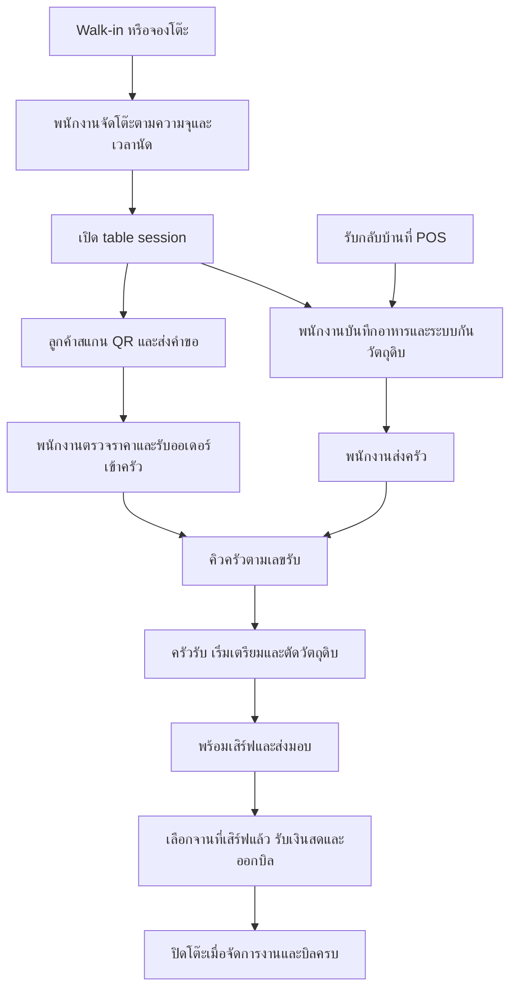

# README — ใช้ POS ร้านอาหาร

คู่มือ local ถึง Phase 28.8.5 สำหรับหน้าร้าน จอครัว คิวที่นั่ง จองโต๊ะ และ QR สั่งอาหาร [หลักฐานตรวจรับ](acceptance/phase28_8_5/README.md)

> **ยังไม่ได้ทดสอบกับระบบและอุปกรณ์จริง** ใช้คู่มือนี้กับ local หรือข้อมูลสังเคราะห์

## เรียกใช้และบัญชี

เปิด **http://127.0.0.1:8128/** ตาม [คู่มือกลาง](README_POS.md), สาขา `business_type=restaurant`, `APP_ENV=local`, `POS_LOCAL_RESTAURANT_ENABLED=true`. ส่วน **โต๊ะและครัว** จะแสดงในหน้าร้านเดียวกัน ไม่ได้มี URL แยกสำหรับครัว

| งาน | Role ที่ใช้ |
| --- | --- |
| สั่งอาหาร ส่งครัว เสิร์ฟ รับเงิน | `cashier` หรือ `manager` |
| รับออเดอร์ เริ่มเตรียม อาหารพร้อม | `kitchen` หรือ `manager` |
| รับจอง เรียกคิว และจัดที่นั่ง | `cashier` หรือ `manager` |
| สร้างโต๊ะ พักหรือข้ามคิว ยกเลิกและยืนยันของเสีย | `manager` |

`restaurant` เป็นประเภทธุรกิจของสาขา; สำหรับ workflow นี้ให้สร้างบัญชี cashier/kitchen/manager ตามตาราง ไม่ใช้ชื่อประเภทธุรกิจแทน role. ทดลอง fixture ใช้ `restaurant@pos.test` ซึ่งเป็น manager ทำขั้นตอนหน้าร้านและครัวได้

## สร้างสาขาของตนเองครั้งแรก

จาก `pos/` หลังตั้ง environment/dependencies ตามคู่มือกลาง:

```powershell
$posBranchId = [guid]::NewGuid().ToString()
$posTerminalId = [guid]::NewGuid().ToString()
php artisan pos:branch $posBranchId RS01 "ร้านอาหารทดลอง" --type=restaurant
php artisan pos:terminal $posTerminalId $posBranchId T01
php artisan pos:staff $posBranchId cashier.restaurant@pos.test --role=cashier
php artisan pos:staff $posBranchId kitchen.restaurant@pos.test --role=kitchen
php artisan pos:staff $posBranchId manager.restaurant@pos.test --role=manager
```

ERP ต้อง publish เมนู/ราคา/ภาษี พร้อม BOM/recipe snapshot และ quota วัตถุดิบที่สัมพันธ์กัน. ขนาดหรือ modifier เป็น SKU ที่มีราคา/สูตรของตนเอง; ไม่ใช่การพิมพ์ตัวเลือกอิสระแล้วให้แคชเชียร์เปลี่ยนราคา/สูตร

## Workflow



ใน **คิวที่นั่งและจองโต๊ะ** พนักงานบันทึกจำนวนคนและเวลานัด ระบบใช้คิว Walk-in เก่าสุดที่ความจุโต๊ะรองรับ และกันช่วงใช้งานโต๊ะจอง **90 นาที** หากผู้จองยังไม่มาเมื่อเลยเวลานัด **15 นาที** ให้พนักงานยืนยัน **ไม่มา** เพื่อปล่อยสิทธิ์ โต๊ะเปิดพร้อม session เมื่อ POS Server ยืนยันการจัดที่นั่งแล้ว

รายการสั่งเพิ่มได้เลขคิวใหม่ตามเวลาที่รับ Manager พัก คืนคิว หรือข้ามคิวด้วยเหตุผลที่บันทึกไว้ใน audit เมื่อการเชื่อมต่อสะดุด ให้ตรวจสถานะหรือส่งคำขอเดิมซ้ำหลังกลับมาออนไลน์ก่อนเปิดงานใหม่ [รายละเอียดคิวและ QR](PHASE_28_8_5_RESTAURANT.md)

## เปิดโต๊ะหรือรับกลับบ้าน

1. Cashier/manager เลือก Terminal และเปิดกะเงินสดก่อนรับเงิน
2. Manager เพิ่มชื่อและความจุใน **โต๊ะและครัว** จัดลูกค้าจาก **คิวที่นั่งและจองโต๊ะ** หรือกด **เลือกโต๊ะ …** เพื่อเปิดโต๊ะว่างที่ผ่านกติกาคิว ถ้ากลับบ้านให้เลือก **กลับบ้าน**
3. เลือกเมนู จำนวน และตัวเลือกขนาด/ส่วนเพิ่มที่ publish แล้ว จากนั้นเพิ่มรายการอาหาร
4. ระบบกันวัตถุดิบเมื่อสร้างออเดอร์; หาก quota ไม่พอไม่ควรสร้าง order ซ้ำเพื่อหลบ error

## ส่งครัวและเสิร์ฟ

ทำตามปุ่มของ role ที่กำหนด:

`รอส่งครัว` → **ส่งครัว** → **ครัวรับออเดอร์** → **เริ่มเตรียม** → **อาหารพร้อม** → **เสิร์ฟ / ส่งมอบ**

เริ่มเตรียมเป็นจังหวะ consume วัตถุดิบตาม recipe snapshot. หลังเตรียมแล้วห้ามใช้การลบออเดอร์แทนการบันทึกของเสีย. จออัปเดตทุกประมาณ5วินาที; passive polling ไม่ต่ออายุ idle session จึงอาจต้อง login ใหม่

ถ้าแยกเครื่อง/บัญชีหน้าร้านกับครัว ให้ใช้คนละ browser profile/session. การ login ในอีกแท็บของ profile เดียวกันเปลี่ยน session ร่วมกัน; ยังไม่ได้ทดสอบการติดตั้งหลายอุปกรณ์จริง

## รับเงินและแยกบิล

1. เลือก **เลือกชำระ …** เฉพาะรายการที่เสิร์ฟแล้วและยังไม่ถูกเรียกเก็บ
2. ตรวจยอดจาก server กรอกเงินสด แล้วกด **ยืนยันรับเงินค่าอาหาร**
3. แยกบิลโดยเลือกรายการบางส่วน ชำระบิลแรก แล้วเลือกส่วนที่เหลือชำระภายหลัง. เป็นการแยกตามรายการ/จาน ไม่ใช่ split/mixed tender
4. ระบบเชื่อม receipt กลับไปยัง kitchen lines เดิม ไม่ consume วัตถุดิบซ้ำตอนจ่ายเงิน
5. กลับบ้านต้องผ่านสถานะพร้อมส่งมอบและ **เสิร์ฟ / ส่งมอบ** เช่นกันก่อนชำระตาม workflow ปัจจุบัน
6. ปิดโต๊ะหลังจัดการอาหาร/บิลค้างครบ แล้วนับเงินและปิดกะ

ถ้า catalog หมดอายุ อย่าสร้างออเดอร์ใหม่ด้วยราคาเก่า; รายการที่เตรียม/เสิร์ฟแล้วใช้ frozen source สำหรับการชำระตามเงื่อนไข server

## ยกเลิกและของเสีย

Manager กด **ยกเลิก / ของเสีย**, เลือกเหตุผล ยืนยันสภาพวัตถุดิบและรหัสผ่าน. ก่อน consume ใช้การปล่อย reservation; หลัง consume ต้องเก็บ waste evidence ไม่ทำให้วัตถุดิบพร้อมขายกลับมาเอง. ถ้ารับเงินแล้วให้ใช้ refund อ้างบิลเดิม ไม่ย้อนสถานะครัวเพื่อขายซ้ำ

## รับคำขอจาก QR โต๊ะ

เปิด public-menu feature และ `online_visible` ของเมนู. Manager สร้าง QR โดยเลือก table session หรือกลับบ้าน. ลูกค้าเลือกเมนู ราคา ขนาด และส่วนเพิ่มที่เผยแพร่แล้ว จากนั้นส่งคำขอ พนักงานกด **รับออเดอร์เข้าครัว** เพื่อกันวัตถุดิบและส่งรายการเข้าคิวในครั้งเดียว ลูกค้ากดตรวจสถานะหรือสั่งเพิ่มได้ QR ของ table session ที่ปิดแล้วใช้ส่งคำขอใหม่ไม่ได้ และ QR เมนูไม่รับชำระเงิน

ลิงก์ loopback ใช้ทดลองเครื่องเดียวกัน คู่มือ Phase 28.8.5 ระบุวิธีเปิด private HTTPS LAN สำหรับทดลองข้ามเครื่อง การสแกนด้วยมือถือจริงและอุปกรณ์จริงยังไม่ได้ทดสอบ

[คู่มือกลาง](README_POS.md) · [ร้านค้าทั่วไป](README_POS_RETAIL.md) · [ร้านขายยา](README_POS_PHARMACY.md)

## Source ที่ใช้ตรวจคู่มือ

[หน้าร้าน/ครัว](../pos/resources/RestaurantPanel.tsx) · [Restaurant service](../pos/app/Services/RestaurantService.php)
