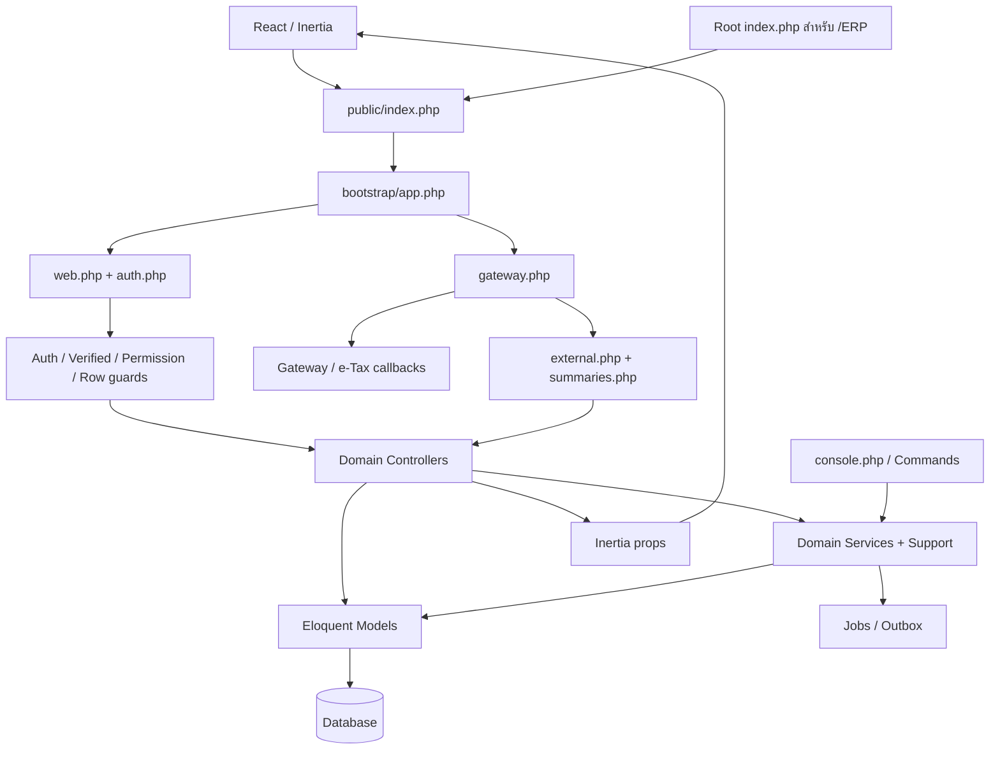
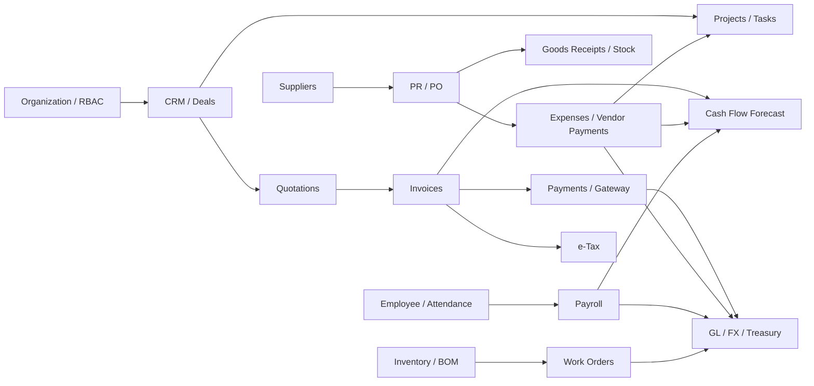

# 00 — ภาพรวมระบบจากโค้ด

สำรวจวันที่ 2026-10-24 (Asia/Bangkok), HEAD `b03c393c19762a09862b4a7aab688f1fe47dcdb3` พร้อม working tree ที่มีเอกสารแก้ไขค้างอยู่แล้ว

## ระบบนี้ทำอะไร

Company OS / ERP รวม CRM, งานขาย/จัดซื้อ, Finance/GL, Stock, Projects, HR/Payroll, Documents, Workflow, Manufacturing และ integrations ไว้ใน Laravel application เดียว

คำว่าโมดูลในเอกสารชุดนี้หมายถึงขอบเขตทางธุรกิจ ไม่ใช่ package/service ที่ deploy แยกกัน

## Stack ที่ประกาศใน repository

| ชั้น | หลักฐาน |
| --- | --- |
| PHP ^8.3 / Laravel ^13 / Inertia Laravel ^2 / Sanctum ^4 | [composer.json](../../backend/composer.json) |
| React ^18 / TypeScript ^5 / Inertia React ^2 / Vite ^7 | [package.json](../../backend/package.json) |
| Styling | Tailwind dependency ^3.2.1; มี @tailwindcss/vite ^4 ใน manifest ด้วย ต้องตรวจ config/lock ก่อนอัปเกรด |
| PDF / QR | laravel-dompdf / endroid/qr-code ตาม Composer manifest |
| Database | [database.php](../../backend/config/database.php) รองรับหลาย driver; setup wizard ใช้ MySQL, PHPUnit ใช้ SQLite in-memory |

เวอร์ชันข้างต้นเป็น dependency constraints ไม่ใช่ผลตรวจ runtime หรือเวอร์ชันที่ติดตั้งจริงทั้งหมด

## Request architecture

อ้างอิง [bootstrap/app.php](../../backend/bootstrap/app.php), [AppServiceProvider.php](../../backend/app/Providers/AppServiceProvider.php), [app.tsx](../../backend/resources/js/app.tsx)

## ชั้นความรับผิดชอบ

| ชั้น | ลักษณะจริง |
| --- | --- |
| Routes | route names, HTTP methods, middleware และ throttle |
| Controllers | validation, tenant/row guards, orchestration; บางแห่งมี business logic และ DB transaction อยู่ด้วย |
| Services | GL posting, payroll, OCR/e-Tax, workflow, numbering, integrations |
| Support/Policies | visibility, permissions, pagination/API envelopes, shared finance/file helpers |
| Models | relationships, casts, constants, model events/traits |
| Migrations | ประวัติ schema; ต้องอ่าน migration ถัดมาประกอบ ไม่ใช้ไฟล์แรกเป็น schema ล่าสุด |
| Pages/Hooks/Components | หน้าจอ Inertia และ editor lifecycle |
| Jobs/Console | asynchronous processing, recovery และ scheduled actions |

ไม่ใช่ strict service layer ทุก module: การแก้กฎธุรกิจต้องตรวจทั้ง Controller, Service, Support, Model และ observers

## ความสัมพันธ์หลักระหว่างโมดูล

ภาพนี้สรุปความสัมพันธ์ทางข้อมูล/การเรียกบางส่วน ไม่หมายความว่าทุกลูกศรทำงานอัตโนมัติในทุกสถานะ เงื่อนไขอ่านในเอกสารรายโมดูล

## กฎร่วมที่ต้องอ่านก่อนแก้โค้ด

1. `org_id` เป็น tenant key; มี explicit query scopes/guards หลายจุด ไม่ถือว่าทุก Eloquent query ถูก scope อัตโนมัติ
2. Permission route กับ row visibility เป็นคนละ gate โดย SalesAccess/ProjectAccess/TaskAccess มีขอบเขตต่างกัน
3. Financial reversal/audit เก็บประวัติแทนการแก้ posted record บางชนิด ต้องอ่านสถานะและ transaction ของแต่ละ flow
4. เงินใน model หลายตัว cast decimal แต่การคำนวณ PHP ยังมี float; การมี decimal schema ไม่พิสูจน์ rounding correctness ทั้งระบบ
5. Internal Inertia props, Portal และ External API มีสัญญาข้อมูล/สิทธิ์คนละชุด
6. Provider credentials และ feature toggles ไม่ได้ถูกตรวจค่าจริงในงานนี้; มี implementation ไม่เท่ากับพร้อมใช้ production

## วิธีตามโค้ดเมื่อจะแก้หนึ่งฟีเจอร์

Route → controller method → org/permission/parent guard → validation → transaction/service → model/migration → jobs/observers → response props → React page → tests

ใช้ [สารบัญโมดูล](README.md) เลือก domain ก่อน แล้วดู dependencies ข้ามโมดูลในแต่ละบท

## ขอบเขตการตรวจ

- อ่าน entry points, routes, controllers/services หลัก, models, UI ที่เกี่ยวข้อง, migrations และ representative tests ตามโมดูล
- ไม่ได้อ่านทุก function ในทุกไฟล์/ทุก branch และไม่ใช่ exhaustive security audit
- ไม่เปลี่ยน application code, environment, schema หรือข้อมูลธุรกิจ
- Node tests ในรอบสำรวจก่อนหน้า ผ่าน 22/22; รอบเอกสารนี้ตรวจลิงก์และความสอดคล้องของเอกสาร ไม่มีผล PHP/build/browser suite ใหม่
- รอบเอกสารแรก Skill Understand-Anything automatic scanner ติด `ERR_MODULE_NOT_FOUND`; ภายหลังติดตั้ง/build core และทำ full pipeline สำเร็จ ดู [ผล pipeline และ official knowledge graph](../UNDERSTAND_PIPELINE.md)

เอกสารเดิมสำหรับเทียบเจตนาการออกแบบ: [Architecture Decisions](../../docs/ARCHITECTURE_DECISIONS.md), [MVP_SCOPE.md](../../MVP_SCOPE.md), [GROUPS_WORKFLOW.md](../GROUPS_WORKFLOW.md) หากต่างจาก implementation ให้แยกว่ากำลังกล่าวถึงข้อกำหนดหรือพฤติกรรมจริง
