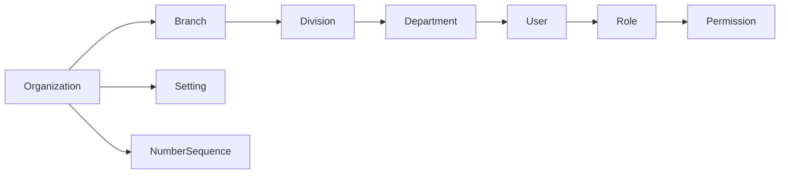

# 01 — Foundation, Organization และเลขเอกสาร

ตรวจจาก working tree วันที่ 2026-10-24; HEAD `b03c393c19762a09862b4a7aab688f1fe47dcdb3` การอ่านโค้ดนี้ไม่ใช่การยืนยันผลบน production

## หน้าที่และขอบเขต

สร้างองค์กร โครงสร้างสาขา/ฝ่าย/แผนก ผู้ดูแลเริ่มต้น การตั้งค่าบริษัท และลำดับเลขเอกสาร เป็นข้อมูลอ้างอิงของทุกโมดูล

## ไฟล์หลัก

| จุดรับผิดชอบ | หลักฐาน |
| --- | --- |
| สมัครองค์กรและ Owner | [OrganizationProvisioner.php](../../backend/app/Services/OrganizationProvisioner.php), `registerOwner()` |
| โครงสร้างองค์กร | [OrganizationStructureController.php](../../backend/app/Http/Controllers/Settings/OrganizationStructureController.php) |
| โปรไฟล์บริษัทและ policies | [OrganizationSettingsController.php](../../backend/app/Http/Controllers/Settings/OrganizationSettingsController.php) |
| ลำดับเลข | [NumberSequenceService.php](../../backend/app/Services/NumberSequenceService.php), `next()`, `preview()`, `configFor()` |
| UUID | [UsesOrderedUuid.php](../../backend/app/Models/Concerns/UsesOrderedUuid.php) |
| หน้าจอ | [Organization.tsx](../../backend/resources/js/Pages/Settings/Organization.tsx), [OrganizationStructure.tsx](../../backend/resources/js/Pages/Settings/OrganizationStructure.tsx) |

## ข้อมูลและความสัมพันธ์

- `Organization` เป็นเจ้าของ `org_id` ที่โมดูลอื่นใช้กรองข้อมูล
- Branch/Division/Department มี `org_id` ของตนเอง; Department เก็บทั้ง `branch_id` และ `division_id`
- User อ้างองค์กร สาขา ฝ่าย และแผนก ไม่ใช่สมาชิกหลายองค์กรผ่าน membership table ใน flow นี้
- Setting เก็บค่าตาม `org_id` + `key` เป็น `value_json`
- NumberSequence แยก `doc_type`, `branch_key`, `period_key`; UUID ว่างของระดับองค์กรใช้ sentinel ภายใน service
- [Organization.php](../../backend/app/Models/Organization.php), [Branch.php](../../backend/app/Models/Branch.php), [Division.php](../../backend/app/Models/Division.php), [Department.php](../../backend/app/Models/Department.php), [Setting.php](../../backend/app/Models/Setting.php), [NumberSequence.php](../../backend/app/Models/NumberSequence.php)

## เส้นทางและสิทธิ์

อ้างอิง [web.php](../../backend/routes/web.php); กลุ่ม Settings อยู่หลัง `auth` และ `verified`

| Route | สิทธิ์/เงื่อนไข |
| --- | --- |
| `GET /settings/organization` | `settings.organization.view` |
| `PATCH /settings/organization` | `settings.organization.update`, `password.confirm` |
| `PATCH /settings/organization/numbering` | สิทธิ์เดียวกับแก้บริษัท |
| `PATCH /settings/organization/two-factor` | สิทธิ์เดียวกับแก้บริษัท |
| `PATCH /settings/organization/attendance-privacy` | สิทธิ์เดียวกับแก้บริษัท |
| `GET /settings/organization-structure` | `settings.structure.view` |
| `POST /settings/branches`, `/settings/divisions`, `/settings/departments` | `settings.structure.update`, `password.confirm`, `throttle:10,1` |
| `PATCH /settings/{branches|divisions|departments}/{id}` และ `/disable` | สิทธิ์แก้โครงสร้างและยืนยันรหัสผ่าน |
| `DELETE /settings/{branches|divisions|departments}/{id}` | สิทธิ์แก้โครงสร้างและตรวจ dependency ก่อนลบ |
| `PATCH /settings/branches/{branch}/head-office` | สิทธิ์แก้โครงสร้างและยืนยันรหัสผ่าน |

รูป `{branches|divisions|departments}` ในตารางเป็นการย่อรายการ ไม่ใช่ Laravel route literal

## Workflow

1. Register ส่งข้อมูลบริษัท/ผู้ใช้ให้ `registerOwner()` ภายใน transaction
2. สร้าง Organization: `THB`, `Asia/Bangkok`, `active`
3. สร้าง Head Office, Default Division, Default Department แล้วผูก User
4. เติม PermissionCatalog, system roles และ permission defaults; ผูก role `owner`
5. เติม `organization.profile`, `security.two_factor`, number sequences และ audit `auth.register`
6. Controller ส่ง event Registered และ login ผู้ใช้ อ่านต่อ [Authentication](02_authentication_security.md)

การแก้โครงสร้างตรวจองค์กรเดียวกัน และตรวจ hierarchy/dependencies ใน controller แต่ละ action ห้ามปิดหรือลบสำนักงานใหญ่ก่อนย้ายสำนักงานใหญ่ไปที่อื่น

## เลขเอกสาร

- `next()` อ่าน format แล้ว lock แถว sequence ภายใน transaction ก่อน increment
- `preview()` อ่านค่าถัดไปโดยไม่ increment; ตัวเลข preview ไม่ใช่การจองเลข
- ค่า default `{SEQ:6}`; tokens ที่ service ยอมรับ: `{YYYY}`, `{YY}`, `{MM}`, `{DD}`, `{BRANCH}`, `{SEQ:n}`
- ต้องมี `{SEQ:n}` หนึ่ง token; padding 1–10; เลขหลัง render ยาวไม่เกิน 30 ตัว
- Reset: `none`, `yearly`, `monthly`, `daily`; scope: `organization`, `branch`
- Branch scope ต้องส่ง branch ที่อยู่ในองค์กรนั้น มิฉะนั้น throw `InvalidArgumentException`
- Finance/Procurement/HR ใช้ service นี้ร่วมกัน การเปลี่ยน format จึงกระทบเอกสารข้ามโมดูล

## ข้อจำกัดที่ควรรู้

- Tenant isolation ในตัวอย่าง controller เป็น explicit query/guard อย่าถือว่า Eloquent ทุก query ถูกกรององค์กรให้อัตโนมัติ
- `OrganizationSettingsController::update()` แก้ข้อมูลบริษัทและโลโก้; ไม่เปิดแก้ทุก field ที่หน้า `edit()` ส่งกลับ เช่น currency/timezone
- โลโก้เก็บ public disk ต่างจากเอกสารธุรกิจ private
- ไม่สรุปว่าเลขเอกสารไม่มี race ทุกกรณีจากการเห็น `lockForUpdate()` เพียงอย่างเดียว โดยเฉพาะแถวแรกของ sequence

## ชุดทดสอบอ้างอิง — อ่าน ไม่ได้รันในงานเอกสารนี้

- [Phase1FoundationTest.php](../../backend/tests/Feature/Phase1FoundationTest.php)
- [Phase1AdminTest.php](../../backend/tests/Feature/Phase1AdminTest.php)
- [Phase7NumberSequencesTest.php](../../backend/tests/Feature/Phase7NumberSequencesTest.php)
- [Phase11AdminMasterDataTest.php](../../backend/tests/Feature/Phase11AdminMasterDataTest.php)

กลับ [สารบัญ](README.md)
