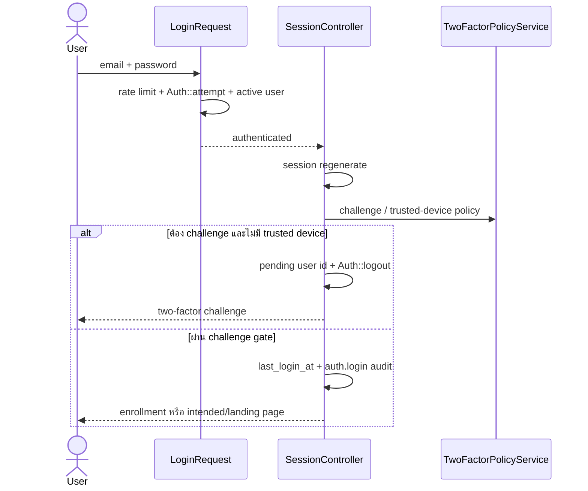

# 02 — Authentication, Session, RBAC และ 2FA

ตรวจจาก working tree วันที่ 2026-10-24; HEAD `b03c393c19762a09862b4a7aab688f1fe47dcdb3` เป็น static analysis ไม่ใช่ผล security audit

## ขอบเขต

Local login/register, reset password, email verification, invitation, password confirmation และ TOTP 2FA ส่วน Integration Key และ Portal มี authentication ของตนเอง อ่าน [External API](18_external_api_webhooks.md) และ [Portal/Gateway](17_portal_gateway.md)

## Source map

- [auth.php](../../backend/routes/auth.php) — route และ middleware ของ auth
- [LoginRequest.php](../../backend/app/Http/Requests/Auth/LoginRequest.php) — validate, authenticate, rate limit
- [AuthenticatedSessionController.php](../../backend/app/Http/Controllers/Auth/AuthenticatedSessionController.php) — session login/logout, challenge และ trusted device
- [RegisteredUserController.php](../../backend/app/Http/Controllers/Auth/RegisteredUserController.php) — สมัครผ่าน OrganizationProvisioner
- [AcceptInviteController.php](../../backend/app/Http/Controllers/Auth/AcceptInviteController.php) — ตรวจและใช้ invitation
- [TwoFactorController.php](../../backend/app/Http/Controllers/Auth/TwoFactorController.php), [TotpService.php](../../backend/app/Services/TotpService.php), [TwoFactorPolicyService.php](../../backend/app/Services/TwoFactorPolicyService.php)
- [EnsurePermission.php](../../backend/app/Http/Middleware/EnsurePermission.php), [EnsureTwoFactorEnrollment.php](../../backend/app/Http/Middleware/EnsureTwoFactorEnrollment.php)
- [User.php](../../backend/app/Models/User.php), [TwoFactorTrustedDevice.php](../../backend/app/Models/TwoFactorTrustedDevice.php)

## เส้นทางหลัก

| Route | Gate |
| --- | --- |
| `GET/POST /register`, `GET/POST /login` | `guest` |
| `GET/POST /forgot-password`, `GET /reset-password/{token}`, `POST /reset-password` | `guest` |
| `GET /two-factor-challenge` | `guest` |
| `POST /two-factor-challenge` | `guest`, `throttle:5,1` |
| `GET/POST /two-factor/setup` | `auth`, `password.confirm`; POST เพิ่ม `throttle:5,1` |
| `POST /users/{user}/two-factor/reset` | `auth`, `password.confirm`, throttle; controller ตรวจ Owner |
| `GET /verify-email/{id}/{hash}` | `auth`, `signed`, `throttle:6,1` |
| `POST /email/verification-notification` | `auth`, `throttle:6,1` |
| `GET/POST /confirm-password`, `GET /confirm-password/status` | `auth`; POST เพิ่ม throttle |
| `PUT /password`, `POST /logout` | `auth` |
| `GET/PATCH /invites/{user}/{token}` | `guest` |

## Login sequence

`LoginRequest` จำกัดความพยายาม 5 ครั้งตาม lowercase email + IP ตรวจ `user.status === active` หลังตรวจรหัสผ่าน จากโค้ดที่อ่าน **ยังไม่พบการตรวจ `organization.status` ใน method นี้** จึงไม่ควรอ้างว่าปิดองค์กรแล้ว login ถูกบล็อกโดยอัตโนมัติ

Logout ล้าง session และ regenerate CSRF token; login regenerate session เพื่อลด session fixation

## Policy 2FA

- Setting key `security.two_factor`; defaults `enabled=false`, `required_for_privileged_roles=true`, `allow_trusted_devices=true`, `trusted_device_days=30`
- บังคับ enrollment เมื่อ enabled และ policy required เปิดอยู่ สำหรับ role code `owner`, `admin`, `finance`
- ผู้ที่ตั้ง 2FA แล้วถูก challenge เมื่อ policy enabled แม้ไม่ใช่ role บังคับ enrollment
- Trusted cookie `erp_2fa_trusted`: lookup hash SHA-256, user, expiry และตรวจ user-agent hash ถ้ามี
- Enrollment middleware redirect ผู้ที่ยังไม่ลงทะเบียน ยกเว้น allowlist route เช่น setup, password, logout, verification
- อย่าเหมารวมว่ามี middleware ชื่อ `permission` แล้วทุก route บังคับ 2FA ซ้ำใน action; ต้องอ่าน route/controller เฉพาะงาน

## RBAC และข้อมูลส่งหน้าเว็บ

- `EnsurePermission` ตรวจ role→permissions ด้วย permission code จริง ไม่ได้ใช้ role name เป็น universal bypass
- [PermissionCatalog.php](../../backend/app/Support/PermissionCatalog.php) ระบุรายการ/default roles; role-permission ใน DB คือข้อมูลที่ middleware อ่าน
- [HandleInertiaRequests.php](../../backend/app/Http/Middleware/HandleInertiaRequests.php) รวม effective permissions ต่อ request และส่ง auth user เพียง id/name/email/email_verified_at
- User ซ่อน password, remember token, TOTP secret และ recovery codes ใน model serialization
- `DashboardLanding::routeFor()` เลือกปลายทางตาม permission ตามลำดับ อ่าน [Dashboard](22_dashboards_reporting.md)
- Row-level visibility เป็นอีกชั้นหนึ่งใน SalesAccess/ProjectAccess/TaskAccess และ controller ต่าง ๆ

## Invitation และการจัดการบัญชี

`UserController::invite()` สร้าง token 48 ตัว เก็บ SHA-256 หมดอายุ 72 ชั่วโมง; ตั้ง status `invited` และ role/hierarchy ก่อนส่ง notification ส่วนการ activate อ่าน `AcceptInviteController` ร่วมกับ [Admin](03_administration_audit.md)

ใน non-production invite action มี token ใน flash สำหรับพัฒนา; production ไม่แสดง token ใน success message

## Tests อ้างอิง — ไม่ได้รันในงานนี้

- [Phase1FoundationTest.php](../../backend/tests/Feature/Phase1FoundationTest.php) — login audit/session regeneration/rate limit/reset
- [Phase18TwoFactorTest.php](../../backend/tests/Feature/Phase18TwoFactorTest.php)
- [Auth](../../backend/tests/Feature/Auth) — tests พื้นฐาน auth
- [DashboardAccessTest.php](../../backend/tests/Feature/DashboardAccessTest.php) — permission ของ dashboard

กลับ [สารบัญ](README.md)
