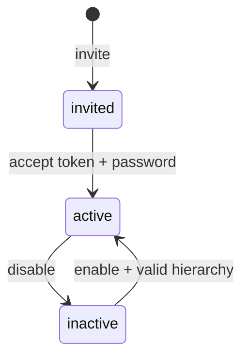

# 03 — Users, Roles, Permissions และ Audit

ตรวจจาก working tree วันที่ 2026-10-24; HEAD `b03c393c19762a09862b4a7aab688f1fe47dcdb3` อ่าน source/tests ไม่ได้รัน PHP tests

## ขอบเขตและข้อมูล

จัดการบัญชีใช้งาน สิทธิ์ โครงสร้างผู้ใช้ และประวัติการแก้ข้อมูล ส่วนทะเบียนพนักงานแยกใน [HR](12_hr_attendance_payroll.md)

- [UserController.php](../../backend/app/Http/Controllers/Admin/UserController.php) — index/invite/update/disable/enable/updateStructure
- [RoleController.php](../../backend/app/Http/Controllers/Admin/RoleController.php) — custom roles, permission sync และ assign
- [AuditLogController.php](../../backend/app/Http/Controllers/Admin/AuditLogController.php) — query audit ตามองค์กร
- [PermissionCatalog.php](../../backend/app/Support/PermissionCatalog.php) — permission definitions และ defaults
- [User.php](../../backend/app/Models/User.php), [Role.php](../../backend/app/Models/Role.php), [Permission.php](../../backend/app/Models/Permission.php), [AuditLog.php](../../backend/app/Models/AuditLog.php)
- [Admin pages](../../backend/resources/js/Pages/Admin) — Users/Roles/AuditLogs

User↔Role และ Role↔Permission เป็น many-to-many; แม้ schema รองรับหลาย role แต่ action assign/update ผู้ใช้ใช้ `sync()` ให้เหลือ role ที่เลือกหนึ่งรายการ

## Route และ permission

ดู [web.php](../../backend/routes/web.php) ทุก route ด้านล่างอยู่ใน `auth`, `verified`

| Route | Permission |
| --- | --- |
| `GET /users` | `users.view` |
| `POST /users/invite` | `users.create` |
| `PATCH /users/{user}` และ `/structure` | `users.update` |
| `PATCH /users/{user}/disable` และ `/enable` | `users.disable` |
| `GET /roles` | `roles.view` |
| `POST /roles`, `PATCH /roles/{role}`, `PATCH /roles/{role}/permissions` | `roles.manage` |
| `PATCH /users/{user}/role` | `roles.update` |
| `GET /audit-logs` | `audit.view` |

Write actions ในตารางใช้ `password.confirm` และ `throttle:10,1`; สร้าง role เพิ่ม `EnsureFormSubmission` เพื่อรองรับ retry เมื่อมี header

## User lifecycle และ guards

ภาพนี้แสดง lifecycle หลัก ไม่ใช่ transition matrix ครบทุก controller branch ให้ยึดเงื่อนไขใน method เป็นหลัก

1. Invite ตรวจ email unique, branch/division/department active และอยู่ org เดียวกัน
2. สร้าง User สถานะ invited พร้อม hash token/expiry/role ใน transaction แล้วส่งผ่าน NotificationService
3. Update ตรวจ hierarchy และ role ที่อยู่ในองค์กรเดียวกัน; person ID แก้/แสดงเต็มได้เมื่อมี `person_id.view_full`
4. Disable ห้ามปิดตนเอง และห้ามปิด active owner คนสุดท้าย
5. Disable ล้าง remember token และลบ DB sessions ถ้ามีตาราง sessions
6. เปลี่ยน role ผ่าน user update หรือ role assign ล้าง session/remember token ตาม branch ที่ตรวจว่ามีการเปลี่ยนจริง
7. Enable ตรวจ hierarchy ก่อนตั้ง active ไม่ใช่แค่สลับ boolean

เลขบัตรประชาชนใน index ถูก mask ด้วย [PersonIdMask.php](../../backend/app/Support/PersonIdMask.php) หากไม่มีสิทธิ์ดูเต็ม

## Role editor

- Custom code ต้องตรง `^[a-z][a-z0-9_]*$`, unique ภายใน org และไม่ใช้ชื่อ system roles ที่สงวน
- Role `owner` แก้ชื่อ/permissions ผ่าน editor ไม่ได้: `Owner role is immutable.` / `Owner role permissions are immutable.`
- Update ห้ามเปลี่ยน code; code ใช้เป็น stable identifier ใน policy อื่น เช่น 2FA
- Permission IDs ตรวจจากตาราง permissions; owner/default roles อ่านเพิ่มเติมใน OrganizationProvisioner
- เปลี่ยน permission set ล้าง sessions ของสมาชิก role; browser เก่าจึงอาจต้อง login ใหม่
- `assign()` ป้องกันถอด role ของ owner คนสุดท้าย
- ชื่อ role ไม่ใช่หลักฐานว่ามี permission ทุกตัว ต้องอ่าน pivot และ middleware

## Audit

Controller สำคัญเขียน AuditLog พร้อม actor/org/action/entity และ before/after JSON บางแห่งใส่ IP/user agent/request ID ด้วย จึงต้องดู payload ของแต่ละผู้สร้าง log

Audit index รองรับ `audit_id`, `action`, `from`, `to`, `window=24h`, `sensitive=1` และจำกัดล่าสุด 100 แถว

Sensitive filter ของหน้านี้เลือก `user.role_change`, `user.disable`, `user.hierarchy_change` เท่านั้น ไม่ได้หมายถึง sensitive events ทุกชนิดในระบบ

ไม่มีหลักฐานจาก index controller ว่า audit storage เป็น tamper-proof หรือมี external immutable archive; อย่าอ้างคุณสมบัตินั้นจากชื่อ AuditLog

## Tests อ้างอิง

- [Phase1AdminTest.php](../../backend/tests/Feature/Phase1AdminTest.php)
- [RoleEditorTest.php](../../backend/tests/Feature/RoleEditorTest.php) — create scoped/audited/retry-safe, permission update session revoke, owner/foreign org/code guards
- [Phase11AdminMasterDataTest.php](../../backend/tests/Feature/Phase11AdminMasterDataTest.php)

กลับ [สารบัญ](README.md)
