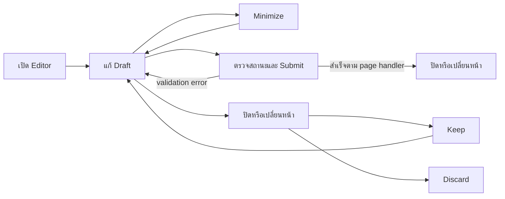

# 20 — Frontend, Layout และ Editor Lifecycle

ตรวจจาก working tree วันที่ 2026-10-24; HEAD `b03c393c19762a09862b4a7aab688f1fe47dcdb3`

## สถาปัตยกรรมหน้าเว็บ

React 18 + TypeScript รับ page props จาก Laravel ผ่าน Inertia ไม่ได้เป็น frontend repository แยกที่เรียก REST CRUD ทั้งหมด

1. [app.tsx](../../backend/resources/js/app.tsx) โหลด CSS/bootstrap และติดตั้ง `initializeHistoryGuard()` ก่อน Inertia
2. `createInertiaApp()` resolve ชื่อ `Finance/Invoices` ไป `Pages/Finance/Invoices.tsx` ผ่าน `import.meta.glob`
3. Laravel controller เรียก `Inertia::render()` พร้อม props ของหน้า
4. [HandleInertiaRequests.php](../../backend/app/Http/Middleware/HandleInertiaRequests.php) เติม auth/permissions/org/flash/notifications
5. [AuthenticatedLayout.tsx](../../backend/resources/js/Layouts/AuthenticatedLayout.tsx) สร้าง navigation ตาม permissions

ข้อมูลซ่อนเมนูใน browser เป็น UX; การอนุญาตจริงยังต้องตรวจ server route และ row access

## Source map

| ส่วน | ไฟล์ |
| --- | --- |
| Bundler | [vite.config.js](../../backend/vite.config.js), [package.json](../../backend/package.json) |
| UI primitives | [Components/UI](../../backend/resources/js/Components/UI) |
| Dialog กลาง | [CreateEditDialog.tsx](../../backend/resources/js/Components/UI/CreateEditDialog.tsx) |
| ยืนยันทิ้ง draft | [DiscardChangesDialog.tsx](../../backend/resources/js/Components/UI/DiscardChangesDialog.tsx), [useDiscardGuard.ts](../../backend/resources/js/Hooks/useDiscardGuard.ts) |
| Editor coordinator | [useEditorCoordinator.ts](../../backend/resources/js/Hooks/useEditorCoordinator.ts) |
| History interception | [historyGuard.ts](../../backend/resources/js/Support/historyGuard.ts) |
| Retry key | [useSubmissionKey.ts](../../backend/resources/js/Hooks/useSubmissionKey.ts), [EnsureFormSubmission.php](../../backend/app/Http/Middleware/EnsureFormSubmission.php) |
| Preview/viewport | [useEditorPreview.ts](../../backend/resources/js/Hooks/useEditorPreview.ts), [useEditorViewport.ts](../../backend/resources/js/Hooks/useEditorViewport.ts) |

## Dialog lifecycle

- `useEditorCoordinator` เก็บ active editor หนึ่งตัว พร้อม guard ref เพื่อสลับ editor อย่างมีขั้นตอน
- `CreateEditDialog` รองรับ normal/expanded/minimized/suspended; blocked close ระหว่าง processing/submitting
- เก็บขนาด dialog ใน localStorage เท่านั้น ไม่ใช่ draft persistence
- `useSubmissionKey` เก็บ UUID ใน React ref; reset เมื่อเริ่ม draft ใหม่ ไม่เก็บลง localStorage
- แต่ละ Page รับผิดชอบ form state, validation errors, dirty detection และ reset หลังสำเร็จ ต้องอ่าน usage ในหน้าที่จะแก้
- Dialog มี flow ตรวจ password confirmation โดย default ผ่าน prop `requiresPasswordConfirmation`; server middleware ยังเป็นผู้บังคับจริง

## Navigation และ dirty guard

`useDiscardGuard(dirty, processing)` ดัก `beforeunload`, Inertia GET navigation และ browser history ผ่าน shared history guard

- หาก processing จะไม่ดำเนิน pending action
- หาก dirty เก็บ action ไว้ แล้วให้ Keep/Discard
- Inertia navigation replay GET เดิมหนึ่งครั้ง รวม filters/callbacks
- Browser `popstate` ยกเลิกตรง ๆ ไม่ได้ จึง restore history entry ก่อนให้ผู้ใช้ตัดสินใจ
- ใช้ metadata `__erpHistoryIndex` เก็บตำแหน่งเท่านั้น ไม่ใส่ draft ลง history state
- ไม่คาดเดาทิศทางสำหรับ history entry เก่าที่ไม่มี metadata; document exit พึ่ง beforeunload

## Retry protection ฝั่ง server

`EnsureFormSubmission` เป็น opt-in เฉพาะ route ที่ประกาศ middleware และส่ง `X-Form-Submission`

1. ไม่มี header → ทำ request ตามปกติ
2. มี header → ต้องเป็น UUID; hash fingerprint จาก org/path/payload ยกเว้น `_token`
3. Lock แถว actor ภายใน transaction; lookup `form_submissions` ตาม user/key
4. Key เดิมแต่ payload เปลี่ยน → ValidationException
5. Replay สำเร็จเดิมต้องผ่าน scope check สำหรับ sales parent ที่ middleware รองรับ
6. บันทึก receipt เฉพาะ redirect ที่มี success flash ของ request นั้น

นี่ไม่ใช่ idempotency ครอบคลุมทุก API/ทุก write; Payment ใช้ mechanism ของ domain เอง

## Profile ที่แยกจาก Admin

[ProfileController.php](../../backend/app/Http/Controllers/ProfileController.php) และ [Profile/Edit.tsx](../../backend/resources/js/Pages/Profile/Edit.tsx) ใช้ `GET/PATCH/DELETE /profile` หลัง auth/verified

- เปลี่ยน email แล้ว reset `email_verified_at`
- ลบบัญชีต้องยืนยัน `current_password`, logout และ invalidate session
- `destroy()` ที่อ่านเรียก `$user->delete()` โดยตรง ไม่พบ last-owner guard แบบ Admin/UserController ใน method นี้ จึงต้องตรวจผลต่อองค์กรก่อนเปลี่ยน flow นี้
- อ้างอิง [ProfileTest.php](../../backend/tests/Feature/ProfileTest.php)

## การตรวจสอบ

Node history tests **ผ่าน 9 tests ในรอบสำรวจวันที่เดียวกันก่อนงานเอกสารนี้**: [historyGuard.test.mjs](../../backend/tests/Frontend/historyGuard.test.mjs)

ชุด Feature ที่เกี่ยวข้อง อ่านแต่ไม่ได้รันในงานนี้:

- [Phase231SalesDialogsTest.php](../../backend/tests/Feature/Phase231SalesDialogsTest.php)
- [Phase2314MasterDialogsTest.php](../../backend/tests/Feature/Phase2314MasterDialogsTest.php)
- [Phase2315CompatibilityTest.php](../../backend/tests/Feature/Phase2315CompatibilityTest.php)
- [Browser fixtures/scripts](../../backend/tests/Browser) ไม่ถือเป็นหลักฐานว่ารัน browser verification แล้ว

กลับ [สารบัญ](README.md)
