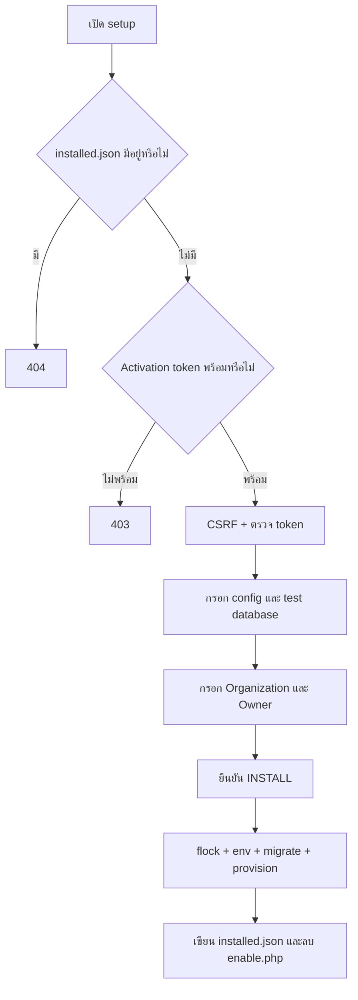

# 21 — Setup Wizard, Deployment และการตรวจระบบ

ตรวจจาก working tree วันที่ 2026-10-24; HEAD `b03c393c19762a09862b4a7aab688f1fe47dcdb3` ไม่ได้ติดตั้งใหม่หรือแก้ environment ระหว่างทำเอกสาร

## Entry points

| เส้นทาง source | หน้าที่ |
| --- | --- |
| [backend/public/index.php](../../backend/public/index.php) | Laravel HTTP entry ปกติ |
| [index.php](../../index.php) | Compatibility entry ที่ตั้ง `SCRIPT_NAME`/`PHP_SELF` เป็น `/ERP/index.php` |
| [.htaccess](../../.htaccess) | `RewriteBase /ERP/`, route assets และปิดเข้าถึง `backend/setup` |
| [setup/index.php](../../setup/index.php) | Forward ไป public setup entry |
| [backend/public/setup/index.php](../../backend/public/setup/index.php) | Native PHP wizard ไม่ผ่าน Laravel routes ปกติ |
| [Installer.php](../../backend/setup/Installer.php) | Preflight/token/env/migration/owner/lock |
| [system-requirements.php](../../setup/system-requirements.php) | Root wrapper ของหน้าตรวจ requirements |

ถ้าย้ายตำแหน่งเว็บออกจาก `/ERP` ต้องตรวจ root wrapper และ rewrite ด้วย ไม่ใช่เปลี่ยน APP_URL อย่างเดียว

## Wizard lifecycle



Wizard ใช้ session `erp_setup`, HttpOnly, SameSite Strict และ secure cookie เมื่อตรวจว่าเป็น HTTPS มี CSRF ของ wizard เอง

`Installer::activationToken()` รองรับ server environment `SETUP_TOKEN` หรือ `backend/setup/enable.php`; token ต้องยาวตาม validation ใน installer ดูวิธีเตรียมใน [setup/README.md](../../backend/setup/README.md)

## เงื่อนไขติดตั้ง

- Preflight ตรวจ PHP 8.3+, vendor autoload, PDO MySQL, OpenSSL, Mbstring, Fileinfo, DOM, SimpleXML, cURL, Zip
- ตรวจ storage/cache เขียนได้, `.env.example` อ่านได้, app root เขียนได้, ไม่มี `.env` และมี `public/build/`
- Database test ใช้ PDO `SELECT 1`
- `assertDatabaseEmpty()` ตรวจว่ามีตาราง `migrations` หรือไม่ **ไม่ได้พิสูจน์ว่าฐานไม่มีตารางอื่นเลย**
- `install()` ตรวจ lock ที่ `storage/app/installer/installed.json` และใช้ `install.lock` กับ `flock(LOCK_EX | LOCK_NB)`
- ลำดับจริง: writeEnvironment → runMigrations → provisionOwner → writeInstallLock → unlink enable file
- Failure เขียน setup log แล้วแสดง error ทั่วไป ไม่มีหลักฐานว่า rollback filesystem/DDL ทั้งกระบวนการได้
- Wizard ใช้กับ fresh release ไม่ใช่ general migration UI สำหรับอัปเกรดฐานเดิม

## งาน background

ใช้ [routes/console.php](../../backend/routes/console.php), [Console commands](../../backend/app/Console/Commands) และ [Jobs](../../backend/app/Jobs) เป็นแหล่งอ้างอิง authoritative ของ schedule

ตัวอย่างงาน: invoice overdue/due-soon, document expiry, notification dispatch/digest, e-Tax inquiry, cash-flow snapshot รวมถึง jobs เฉพาะ module

จาก `backend/`:

```sh
php artisan queue:work
php artisan schedule:run
```

Queue worker เป็น process ต่อเนื่อง ส่วน scheduler ต้องมีตัวเรียกตามรอบ รายละเอียด automation อ่าน [Notifications](16_notifications_automation.md)

## คำสั่งพัฒนาและตรวจสอบ

ดู [composer.json](../../backend/composer.json), [package.json](../../backend/package.json), [phpunit.xml](../../backend/phpunit.xml)

```sh
composer install
pnpm install
php artisan serve
pnpm run dev
```

คำสั่งตรวจที่ประกาศไว้:

```sh
php artisan test
php vendor/bin/pint --test
pnpm run lint
pnpm run check-format
pnpm run build
pnpm run test:history
```

- Build คือ `tsc && vite build`
- PHPUnit ใช้ SQLite `:memory:`, array cache/mail/session และ sync queue ตาม XML; ไม่แทน validation บน MySQL concurrency/production queue
- Composer scripts ใช้ npm ในบาง flow ขณะที่ README ใช้ pnpm; ตรวจ lockfile/workflow ที่ทีมเลือกก่อนติดตั้ง
- ไม่รัน migrate/seed/setup/composer setup เพื่อสำรวจ เพราะมีผลต่อ environment/ฐานข้อมูล

## Tests และข้อจำกัด

- [InstallerTest.php](../../backend/tests/Unit/Setup/InstallerTest.php) ตรวจ token/preflight/lock/CSRF และ setup behavior; อ่าน ไม่ได้รัน
- [setup-script-runner.php](../../backend/tests/Support/setup-script-runner.php) ใช้เรียก native script ใน test
- ผลผ่าน unit/SQLite ไม่ยืนยันความพร้อมของ web-server permissions, rewrite, HTTPS, database grants หรือ credentials ภายนอก
- รอบเอกสารแรก Understand-Anything scan ติด `ERR_MODULE_NOT_FOUND` สำหรับ plugin `packages/core/dist/index.js`; ภายหลังติดตั้ง/build runtime และทำ full pipeline สำเร็จ ดู [รายงาน](../UNDERSTAND_PIPELINE.md)

กลับ [สารบัญ](README.md)
