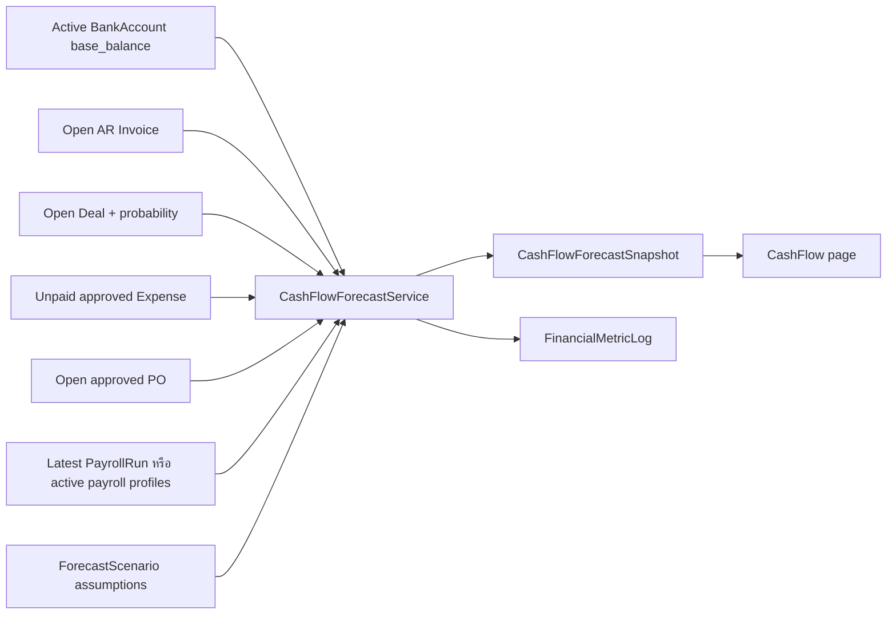

# 23 — Cash Flow Forecasting และ Financial Health

ตรวจจาก working tree วันที่ 2026-10-24; HEAD `b03c393c19762a09862b4a7aab688f1fe47dcdb3` เป็นคำอธิบายสูตรในโค้ด ไม่ใช่การรับรองความถูกต้องของแบบจำลองทางการเงิน

## จุดเข้าและ Source map

- [CashFlowController.php](../../backend/app/Http/Controllers/Finance/CashFlowController.php) — index/snapshot/updateScenario
- [CashFlowForecastService.php](../../backend/app/Services/Finance/CashFlowForecastService.php) — generateForecast/calculateFinancialHealth/getMultiScenarioComparison
- [ForecastScenario.php](../../backend/app/Models/ForecastScenario.php) — assumptions และ default scenarios
- [CashFlowForecastSnapshot.php](../../backend/app/Models/CashFlowForecastSnapshot.php), [FinancialMetricLog.php](../../backend/app/Models/FinancialMetricLog.php)
- [CashFlow.tsx](../../backend/resources/js/Pages/Finance/CashFlow.tsx)
- [web.php](../../backend/routes/web.php), [console.php](../../backend/routes/console.php)

| Route/command | เงื่อนไข |
| --- | --- |
| `GET /finance/cash-flow` | auth/verified + `cash_flow.view` |
| `POST /finance/cash-flow/snapshot` | `cash_flow.manage`, `throttle:10,1` |
| `PATCH /finance/cash-flow/scenarios/{scenario}` | `cash_flow.manage`, throttle; controller ตรวจ scenario.org_id |
| `cashflow:snapshot --org= --horizon=90` | CLI/scheduler ไม่ใช่ web permission flow |

## Data flow

## Forecast workflow

1. Resolve Organization; ถ้าไม่มี scenario สร้าง `base`, `best`, `worst` จาก constants
2. Controller clamp horizon 14–180 วัน ค่า default 90 และรับ `as_of_date`
3. Starting cash = ผลรวม BankAccount `base_balance` ของบัญชี active
4. สร้าง inflow/outflow items ตามวันที่และ scenario
5. รวมรายวัน ตั้งแต่ day 0 ถึง horizon รวมปลายทั้งสองด้าน
6. คำนวณ running balance, ending/lowest cash และเก็บ breakdown/daily series ลง snapshot
7. Financial health บันทึกเป็น FinancialMetricLog แยกจาก snapshot

`GET index()` เรียก `getMultiScenarioComparison()` ซึ่งเรียก `generateForecast()` และ create snapshots; จากนั้นเรียก `calculateFinancialHealth()` ซึ่ง create log ด้วย **การเปิดหน้าจอนี้จึงมี DB writes** ไม่ใช่ pure read

## สูตร inflow/outflow

| รายการ | เงื่อนไขและสูตรที่อ่านพบ |
| --- | --- |
| AR | Invoice sent/partially_paid/overdue และ base_balance_due > 0; ยอดคงเหลือ × ar_collection_rate |
| AR date | due_date หรือ today+14 แล้วบวก delay; อ่าน handling overdue ใน `calculateInflowItems()` |
| Pipeline | Deal OPEN_STAGES มูลค่าบวก; value_amount × probability/100 × deal_multiplier |
| Deal date | expected_close_date หรือ today+30; วันที่ผ่านแล้วเลื่อนไป today+7 |
| Expense AP | approved/partially_paid ยอด base_balance_due > 0 × ap_payment_rate × expense buffer |
| Expense date | expense_date; ผ่านแล้วเลื่อนไป today+3 |
| PO | approved/partially_received ใช้ base_total หรือ fallback total เต็มรายการ |
| PO date | expected_date หรือ today+14; ผ่านแล้วเลื่อนไป today+7 |
| Payroll | latest run gross_amount + employer social security หรือผลรวม monthly_salary ของ active profiles |
| Payroll date | ประมาณ recurring ในวันที่ 25 ของแต่ละเดือนภายใน horizon พร้อม payroll buffer |

Defaults ใน model ใช้ multiplier/rate เป็นสัดส่วน เช่น `1.00`, `1.20`, `0.80`; fields ชื่อ `*_percent` ใช้หาร 100 ใน service จึงไม่ควรกรอก rate/multiplier สับสนกับเปอร์เซ็นต์

## Financial health ที่โค้ดใช้

- Current cash: active BankAccount base_balance
- Current AR: open Invoice base_balance_due
- Current AP: Expense approved/partially_paid balance + approved/partially_received PO base_total
- Estimated inventory value: `SUM(Product.cost * Product.reorder_point)` ของ active tracked products **ไม่ใช่ยอด StockMovement คงเหลือจริง**
- Current liabilities ใช้ `max(currentAp, 1.00)` ป้องกันหารศูนย์ ซึ่งมีผลต่อ ratio เมื่อไม่มีหนี้
- Current/quick ratio, working capital, DSO, DPO, burn rate และ runway คำนวณจากตัวแปรและ window ใน `calculateFinancialHealth()`

## จุดที่ต้องระวังก่อนใช้ตัวเลขตัดสินใจ

1. PO กับ Expense ถูกนำเข้าพยากรณ์แยกกัน จาก method ที่อ่านไม่พบการหัก overlap ของ expense ที่อ้าง PO เดียวกัน ต้องตรวจข้อมูลจริงเพื่อประเมิน double counting
2. Deal ใช้ `value_amount` ขณะที่รายการการเงินหลายตัวใช้ base currency; ไม่พบ FX conversion ใน branch pipeline ที่อ่าน
3. `as_of_date` คุมวันพยากรณ์ แต่หลาย query อ่านสถานะ/ยอดปัจจุบัน ไม่ใช่ historical ledger reconstruction
4. Payroll ใช้ latest run และประมาณวันที่ 25 ไม่ใช่ตารางจ่ายเงินจริงทั้งหมด
5. ค่า default best case มี `ar_delay_days=-5` แต่ `updateScenario()` validate delay ขั้นต่ำ 0; การตั้งค่าผ่าน UI จึงไม่เทียบเท่าค่า seed ทุกกรณี
6. `getMultiScenarioComparison()` วน key base/best/worst ตายตัว; custom scenarios/default fallback ต้องอ่าน service ก่อนขยาย UX
7. Service รับ User เพื่อ recorded actor แต่ query หลาย source กรอง org โดยตรง ไม่ได้ตรวจ permission ของแต่ละ source แบบ DashboardAccess; route cash_flow.view เป็นสิทธิ์หลักของ flow นี้

ข้อสังเกตเหล่านี้มาจาก static reading ยังไม่ได้ทำ fixture reconciliation หรือยืนยันผลผิดพลาดผ่าน tests

## Tests อ้างอิง — อ่าน ไม่ได้รัน

[Phase25CashFlowTest.php](../../backend/tests/Feature/Phase25CashFlowTest.php) มีกรณี default scenarios, AR/pipeline, expense/PO/payroll, stress comparison, ratios/runway, org authorization, scenario update และ command snapshot

เอกสารเดิม: [Cash Flow Forecasting Engine](../19_cash_flow_forecasting_engine.md) ใช้ประกอบภาพรวม แต่สูตรล่าสุดให้ยึด implementation ข้างต้น

กลับ [สารบัญ](README.md)
